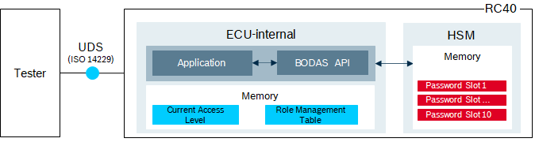

# Access levels {#access-levels .p_Heading1 style="page-break-after: avoid;"}

+:--------------------------------------------------------------------------------------------------------------------------------+----------------------------------------------------------------------------------------------------------------------+
| **Navigation:**  [System features](system-concepts.html) \> [Security](security.html) \> [Authorization](authorization.html) \> |    |
|                                                                                                                                 |                                                                                                                      |
| # Access levels {#access-levels-1 .p_Heading1 style="page-break-after: avoid;"}                                                 |                                                                                                                      |
+---------------------------------------------------------------------------------------------------------------------------------+----------------------------------------------------------------------------------------------------------------------+

## Definition {#definition .p_Heading2 style="page-break-after: avoid;"}

An access level is a set of access rights. The access level is a part of the application state and determines which access rights are granted to a user.

## Function {#function .p_Heading2 style="page-break-after: avoid;"}

In the RC context, the current access level of an active UDS session is determined by an internal protected state variable that holds the information about the currently active level in combination with a predefined role management table that determines the set of granted access rights for each state.

One access level is always linked to a distinct password that is stored in the Hardware Security Module (HSM). The RC is capable to hold up to 20 different access levels whereas the first 10 levels can be freely configured and the latter 10 levels are reserved for Rexroth-internal purposes like the initial flashing process in the production line.

 

<figure style="margin:0;padding:0">

<figcaption aria-hidden="true">
Table18: Access level artifacts
</figcaption>
</figure>

Access levels and their mapping to access-rights are stored within the BSW and can be configured in easyConfig. In case that there is no BSW present on the device, a default authorization table (see [Configuration](configuration.html){.topiclink}) is applied instead. The HSM-stored passwords can be changed with the  bds_sec_saveSecret function.

Further information

The currently active access level is automatically determined by the Security Manager component when the user performs an authentication via UDS. For more information about how to manage the access level manually please refer to these pages:

- [Security Access Levels](security-access-levels.html){.topiclink} - Describes the UDS message format and API calls for handling the seed and key authentication process.

- SEC Module - Lists all supported bds_sec\_\* API functions that can be used to manage the access level.

- [Diagnostic Authentication](diagnostic-authentication.html){.topiclink} - Describes how the active access level can be changed by the user.
