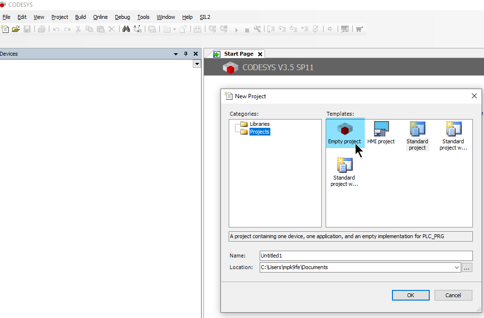
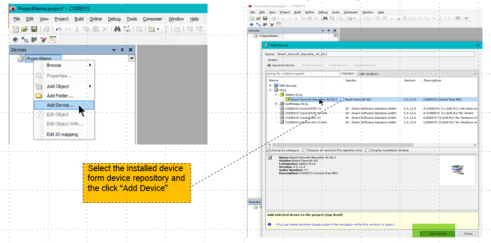
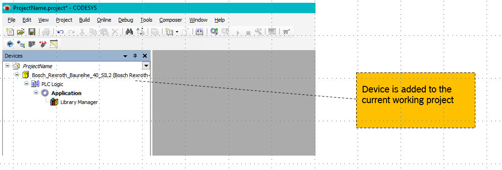
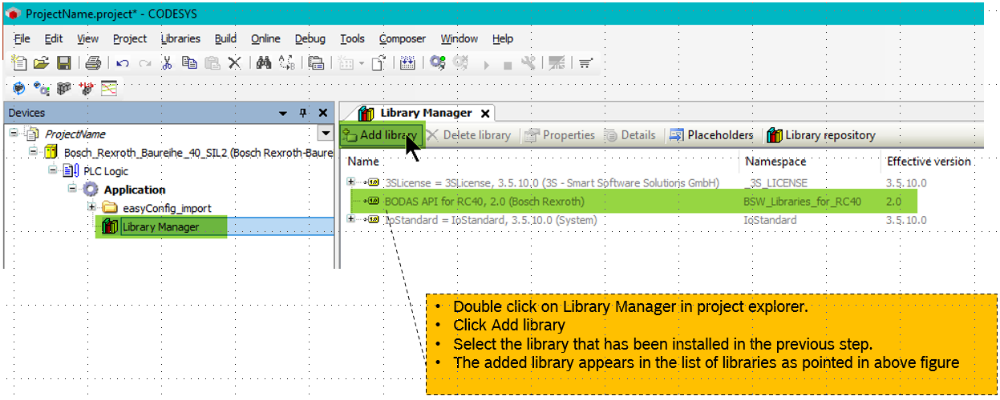

# Add a device and a library to an empty CODESYS project {#add-a-device-and-a-library-to-an-empty-codesys-project .p_Heading1 style="page-break-after: avoid;"}

+:----------------------------------------------------------------------------------------------------------------------------------------------------------------------------------------------------------------------------------+-----------------------------------------------------------------------------------------------------------------------------------------------------------------------+
| **Navigation:**  [Introduction](introduction.html) \> [First steps with RC](preparation.html) \> [Configurations](required-tools.html) \> [Step 5: ASW development & components involved](step-5-asw-development--compon.html) \> |    |
|                                                                                                                                                                                                                                   |                                                                                                                                                                       |
| # Add a device and a library to an empty CODESYS project {#add-a-device-and-a-library-to-an-empty-codesys-project-1 .p_Heading1 style="page-break-after: avoid;"}                                                                 |                                                                                                                                                                       |
+-----------------------------------------------------------------------------------------------------------------------------------------------------------------------------------------------------------------------------------+-----------------------------------------------------------------------------------------------------------------------------------------------------------------------+

## Create Empty project {#create-empty-project .p_Heading2 style="page-break-after: avoid;"}

To open a new empty CODESYS project - open CODESYS  \> File \> New Project \> Chose Empty Project

 

<figure style="margin:0;padding:0">

<figcaption aria-hidden="true">
Create an empty CODESYS project
</figcaption>
</figure>

 

 

## Add device to the project {#add-device-to-the-project .p_Heading2 style="page-break-after: avoid;"}

After creating an empty CODESYS project add a previously installed device from the device repository to the current project.

 

<figure style="margin:0;padding:0">

<figcaption aria-hidden="true">
Add device to the project
</figcaption>
</figure>

 

Once the device is added to the current project, it appears in the device explorer

 

<figure style="margin:0;padding:0">

<figcaption aria-hidden="true">
View an added device in the project
</figcaption>
</figure>

## Add a library to the project {#add-a-library-to-the-project .p_Heading2 style="page-break-after: avoid;"}

Now you can add any CODESYS library to the current project from CODESYS library repository. Right click on the Library Manager under added device \> Add library

 

<figure style="margin:0;padding:0">

<figcaption aria-hidden="true">
Add a library from the library repository to the project
</figcaption>
</figure>

 

 

  -------------------------------------------------------------------------------- ----------------------------------------------------------------------------------------
  {style="margin:0;width:2.1667in;height:0.6979in;border:none"}   The above mentioned steps in this sub-chapter are needed for every new CODESYS project
  -------------------------------------------------------------------------------- ----------------------------------------------------------------------------------------

 
