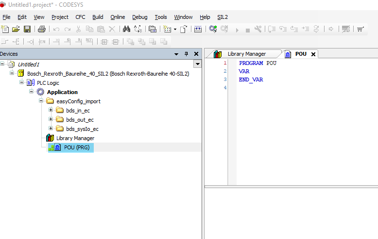
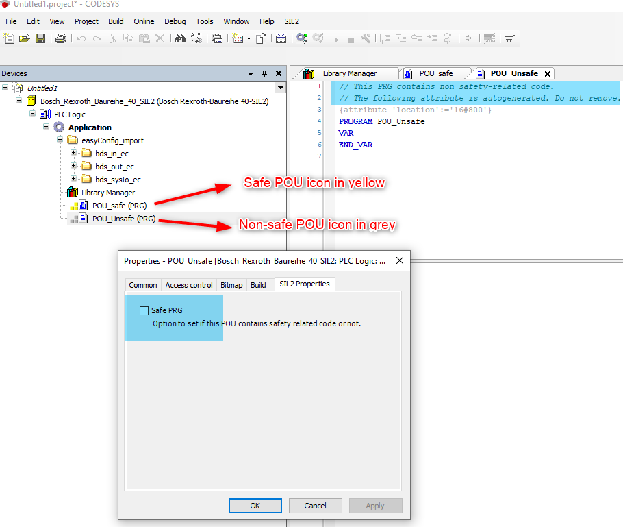
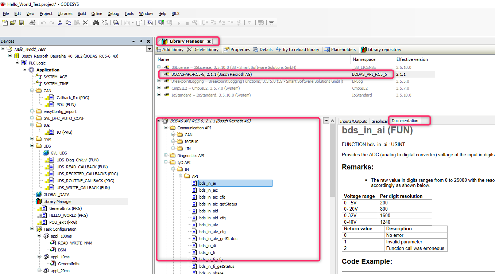
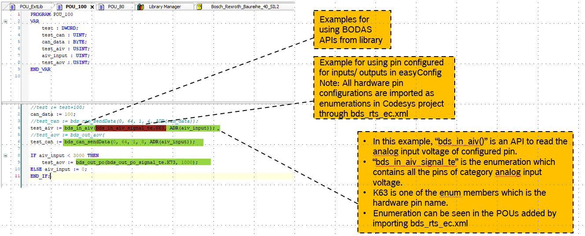

# Add safe/non-safe POUs & write ASW using BODAS-API {#add-safenon-safe-pous-write-asw-using-bodas-api .p_Heading1 style="page-break-after: avoid;"}

+:----------------------------------------------------------------------------------------------------------------------------------------------------------------------------------------------------------------------------------+----------------------------------------------------------------------------------------------------------------------------------------------------------------+
| **Navigation:**  [Introduction](introduction.html) \> [First steps with RC](preparation.html) \> [Configurations](required-tools.html) \> [Step 5: ASW development & components involved](step-5-asw-development--compon.html) \> |    |
|                                                                                                                                                                                                                                   |                                                                                                                                                                |
| # Add safe/non-safe POUs & write ASW using BODAS-API {#add-safenon-safe-pous-write-asw-using-bodas-api-1 .p_Heading1 style="page-break-after: avoid;"}                                                                            |                                                                                                                                                                |
+-----------------------------------------------------------------------------------------------------------------------------------------------------------------------------------------------------------------------------------+----------------------------------------------------------------------------------------------------------------------------------------------------------------+

A Programming Organization Unit (POU) is a programming unit is used to choose the type and implementation language. For safety applications only ST (Structured Text) must be used.

You are free to choose the type of POU:

- a Program if there is no return value

- a Function if there is a return value to be used.

- a Function Block depending on the ASW needs.

+---------------------------------------------------------------------------------------------------------------------------------------------------------------------------------------------------------------------------------------------------------------------------------------------------------------------------------------+
| {style="margin:0;width:8.3333in;height:0.4479in;border:none"}                                                                                                                                                                                                                                                    |
+=======================================================================================================================================================================================================================================================================================================================================+
| The ASW developer is responsible to choose the type and the implementation language based on safety integrity level of application software. For safety critical applications (SIL2) only ST must be used. Additionally the ASW developers shall follow the safety instructions from CODESYS as stated in CODESYS safety user manual. |
|                                                                                                                                                                                                                                                                                                                                       |
| This CODESYS safety user manual can be found in the \"Manuals\" folder  in myBODAS build download with name \[H2\] CODESYS Safety SIL2 - IEC Programming Guidelines.pdf                                                                                                                                                               |
+---------------------------------------------------------------------------------------------------------------------------------------------------------------------------------------------------------------------------------------------------------------------------------------------------------------------------------------+

 

## Add POU to the project {#add-pou-to-the-project .p_Heading2 style="page-break-after: avoid;"}

To add a POU to the CODESYS project - right click the Application icon - Add Object - POU\...

As described earlier chose Structured Text (ST) from the drop down list of Implementation Language. You can enter the name of POU as per ones naming conventions during ASW development.

A POU can then be seen under Application of the current CODESYS project.

<figure style="margin:0;padding:0">

<figcaption aria-hidden="true">
Add a POU to CODESYS project
</figcaption>
</figure>

   

 

 

RC4x devices with CODESYS support using mixed-critical POUs - You can use both safe and non-safe POUs in the same project based on the ASW requirements.

The default POU that is created when a SIL2 plug-in (part of [Step 4: install additional plug-ins](step-4-install-additional-plug.html){.topiclink}) is added to the CODESYS package manager is of SIL2 (safe) qualification.

To change the safety property of a POU - right click on added POU \> select Properties \> in the opened mini-window click on SIL2Properties tab \> uncheck the Safe PRG box.

The safe and non-safe POUs can be differentiated by the color of POU\'s. Yellow for safe and grey for non-safe POU.

 

<figure style="margin:0;padding:0">

<figcaption aria-hidden="true">
Safe and Non-safe POUs in a CODESYS project
</figcaption>
</figure>

 

 

  {style="margin:0;width:8.3333in;height:0.4583in;border:none"}
  -----------------------------------------------------------------------------------------------------------------------------------------------------------------------------------------------------------------------------
  If the RCs are used without following the instructions on this page and the user manual \"\[H2\] CODESYS Safety SIL2 - IEC Programming Guidelines.pdf\" -  the functional safety of the control units cannot be guaranteed.

 

+--------------------------------------------------------------------------------+-----------------------------------------------------------------------------------------------------------------------------------------------------------------------------------------------------------------------------------------------------------------------------------------------+
| {style="margin:0;width:2.1667in;height:0.6979in;border:none"} | Freedom From Interference (FFI):                                                                                                                                                                                                                                                              |
|                                                                                |                                                                                                                                                                                                                                                                                               |
|                                                                                | When using application components of mixed safety criticality ( some parts of ASW are safe and some other parts are non-safe ) - it is mandatory that the failures during execution of non-safe ASW are not interrupting the execution of safe ASW. This is called freedom from interference. |
+--------------------------------------------------------------------------------+-----------------------------------------------------------------------------------------------------------------------------------------------------------------------------------------------------------------------------------------------------------------------------------------------+

 

## Use BODAS-API {#use-bodas-api .p_Heading2 style="page-break-after: avoid;"}

To develop ASW, you can use BODAS-API that are available in the library of BODAS-RTS package.

Select the added library of the project to view the APIs.

The documentation of each API is available in the respective Documentation tab.

 

  -------------------------------------------------------------------------------- ------------------------------------------------------------------------------------------------------------------------
  {style="margin:0;width:2.1667in;height:0.6979in;border:none"}   For seeing in/ building the documentation, CODESYS Add-on/package \"CODESYS Library Documentation Support\" is needed.
  -------------------------------------------------------------------------------- ------------------------------------------------------------------------------------------------------------------------

 

<figure style="margin:0;padding:0">

<figcaption aria-hidden="true">
BODAS-API and relevant documentation
</figcaption>
</figure>

 

 

<figure style="margin:0;padding:0">

<figcaption aria-hidden="true">
Sample code of POU in CODESYS using BODAS-API
</figcaption>
</figure>

 

 
