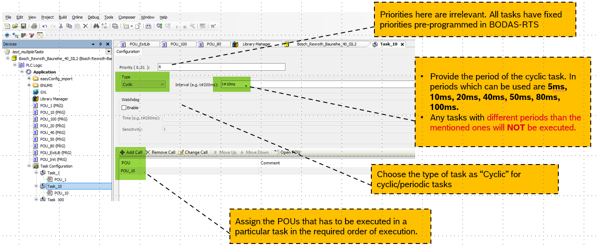
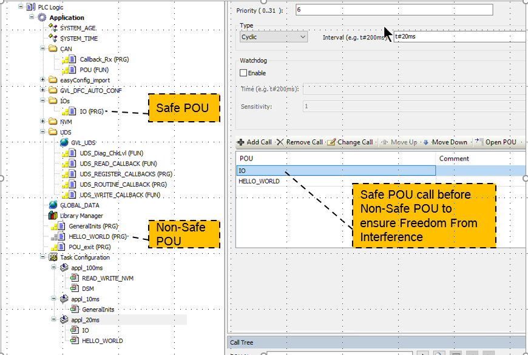

# Add task configuration {#add-task-configuration .p_Heading1 style="page-break-after: avoid;"}

+:----------------------------------------------------------------------------------------------------------------------------------------------------------------------------------------------------------------------------------+-------------------------------------------------------------------------------------------------------------------------------------------------------------------+
| **Navigation:**  [Introduction](introduction.html) \> [First steps with RC](preparation.html) \> [Configurations](required-tools.html) \> [Step 5: ASW development & components involved](step-5-asw-development--compon.html) \> |    |
|                                                                                                                                                                                                                                   |                                                                                                                                                                   |
| # Add task configuration {#add-task-configuration-1 .p_Heading1 style="page-break-after: avoid;"}                                                                                                                                 |                                                                                                                                                                   |
+-----------------------------------------------------------------------------------------------------------------------------------------------------------------------------------------------------------------------------------+-------------------------------------------------------------------------------------------------------------------------------------------------------------------+

Scheduling of ASW tasks is handled in BODAS-RTS. The ASW tasks for CODESYS ASW carry the following properties:

- The available cyclic tasks for ASW are 1ms, 5ms, 10ms, 20ms, 40ms, 50ms, 80ms, 100ms. ( ms = milli seconds)

- The cyclic tasks with more frequent cycle time have higher priority than cyclic tasks with less frequent cycle time. Here is the order of priorities 1ms \> 5ms \> 10ms \> 20 ms\> 40ms \> 50ms \> 80ms \> 100ms

- A high priority task can preempt a low priority task, i.e. 10ms task can preempt 50ms task.

- The tasks have fixed priorities in BODAS-RTS and cannot be changed by user in CODESYS

- The tasks in a CODESYS project can be created under an Application \> Add Object \> Task Configuration.

- Under the created Task Configuration a maximum number of 3 (three) cyclic tasks with previously mentioned cycle timings can be created.

- Configuration of task priorities in CODESYS IDE are redundant and has no impact on scheduling.

- Several safe and non-safe POUs can be attached to a single cyclic task in CODESYS.

 

 

<figure style="margin:0;padding:0">

<figcaption aria-hidden="true">
Task mapping of ASW POUs in a CODESYS project
</figcaption>
</figure>

 

       

<figure style="margin:0;padding:0">

<figcaption aria-hidden="true">
Order of POUS in a CODESYS task
</figcaption>
</figure>

 

 

  {style="margin:0;width:8.3333in;height:0.4479in;border:none"}
  -------------------------------------------------------------------------------------------------------------------------------------------------------------------
  When assigning more than one POU of different safety level to as cyclic task - the ASW developer must ensure that a safe POU is before the non-safe POU in order.

+-----------------------------------------------------------------------------------------------------------------------------------------------------------------------------------------------+
| {style="margin:0;width:8.3333in;height:0.4583in;border:none"}                                                                                                          |
+===============================================================================================================================================================================================+
| When assigning more than one POU of different safety level to as cyclic task - If the assigning order of safe POU is not before non-safe POU the Freedon From Interference is not guaranteed. |
|                                                                                                                                                                                               |
| This might hamper the execution of safe ASW as expected.                                                                                                                                      |
+-----------------------------------------------------------------------------------------------------------------------------------------------------------------------------------------------+

 
