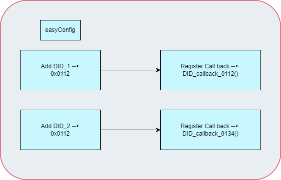
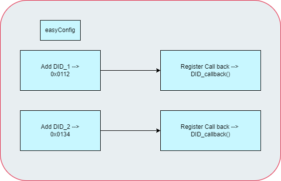

# Adding UDS DIDs in easyConfig {#adding-uds-dids-in-easyconfig .p_Heading1 style="page-break-after: avoid;"}

+:--------------------------------------------------------------------------------------------------------------------------------------------------------------------------------------------------------------------------------------+-------------------------------------------------------------------------------------------------------------------------------------------+
| **Navigation:**  [System features](system-concepts.html) \> [BSW](bsw.html) \> [Diagnostic services (UDS)](diagnostic-services.html) \> [UDS overview](uds---overview.html) \> [Data Identifier (DID)](data-identifier-(did).html) \> |  .html "Parent Chapter")  |
|                                                                                                                                                                                                                                       |                                                                                                                                           |
| # Adding UDS DIDs in easyConfig {#adding-uds-dids-in-easyconfig-1 .p_Heading1 style="page-break-after: avoid;"}                                                                                                                       |                                                                                                                                           |
+---------------------------------------------------------------------------------------------------------------------------------------------------------------------------------------------------------------------------------------+-------------------------------------------------------------------------------------------------------------------------------------------+

## Remarks: {#remarks .p_Heading2 style="page-break-after: avoid;"}

- Data identifiers can be added from easyConfig with the specified ranges.

- Access levels of security and session can be mapped from easyConfig.

- Available DID ranges from easyConfig according to ISO 14229.

  0x0100 -- 0xA5FF

  0xA800 -- 0xACFF

  0xB000 -- 0xB1FF

  0xC000 -- 0xC2FF

  0xCF00 -- 0xEFFF

  0xF010 -- 0xF0FF

  0xF100 -- 0xF17F

  0xF180 -- Boot Software Identification Data Identifier

  0xF181 -- Application Software Identification Data Identifier1

  0xF182 -- Application Data Identification Data Identifier

  0xF183 -- Boot Software Fingerprint Data Identifier

  0xF184 -- Application Software Fingerprint Data Identifier

  0xF185 -- Application Data Fingerprint Data Identifier

  0xF187 -- Vehicle Manufacturer Spare Part Number Data Identifier

  0xF188 -- Vehicle Manufacturer ECU Software Number Data Identifier

  0xF18C -- ECU Serial Number Data Identifier1

  0xF18E -- Vehicle Manufacturer Kit Assembly Part Number Data Identifier

  0xF191 -- Vehicle Manufacturer ECU Hardware Number Data Identifier

  0xF193 -- System Supplier ECU Hardware Version Number Data Identifier1

  0xF1A0 -- 0xF1EF

  0xF1F4 -- 0xF1FF

  0xFD00 -- 0xFDFF

 

1 - The DIDs 0xF181, 0xF18C, and 0xF193 are available by default in BODAS-BSW and are classified as standard DIDs. However, if these DIDs are configured using easyConfig, user-defined properties will override the default BODAS-BSW implementation. As a result, the data read from these DIDs in BODAS-service may not reflect the intended values. Therefore, separate implementations for the corresponding DID callbacks are required. For details on alternative BSW APIs to be used within these callbacks, [Standard DIDs](standard-dids.html){.topiclink}.

## 1. Adding data identifiers with independent callback : {#adding-data-identifiers-with-independent-callback .p_Heading2 style="page-break-after: avoid;"}

In easyConfig the DID configuration can be made with independent callback functions.\
Hence when the same DID is requested from a tester tool, the callback function will be called automatically.\
This is applicable for all DIDs, Data or InputOutput Control DID related.

## Example: {#example .p_Heading2 style="page-break-after: avoid;"}

Add DID in easyConfig:

 

{style="margin:0;width:5.8438in;height:3.7604in;border:none"}

 

## 2. Adding multiple data identifiers with single callback {#adding-multiple-data-identifiers-with-single-callback .p_Heading2 style="page-break-after: avoid;"}

In easyConfig the multiple DID configuration can be made with common call back function.\
Hence when the any DID is requested from a tester tool, the same callback function will be called automatically.\
To get the active Data Identifier the bds_uds_GetActiveDid can be used.

 

Example:

Add DID from easyConfig:

{style="margin:0;width:5.8438in;height:3.7604in;border:none"}

 
