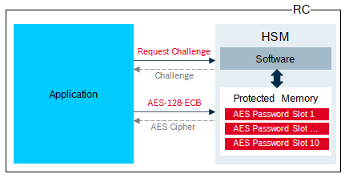
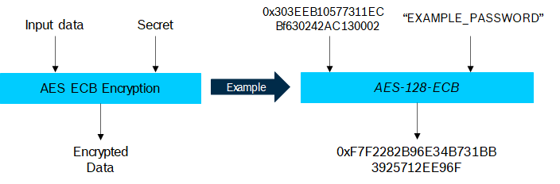

# Advanced Encryption Standard (AES) algorithm {#advanced-encryption-standard-aes-algorithm .p_Heading1 style="page-break-after: avoid;"}

+:--------------------------------------------------------------------------------------------------------------------------------------------+--------------------------------------------------------------------------------------------------------------------------------+
| **Navigation:**  [System features](system-concepts.html) \> [Security](security.html) \> [Authentication](authentication.html) \>           |    |
|                                                                                                                                             |                                                                                                                                |
| # Advanced Encryption Standard (AES) algorithm {#advanced-encryption-standard-aes-algorithm-1 .p_Heading1 style="page-break-after: avoid;"} |                                                                                                                                |
+---------------------------------------------------------------------------------------------------------------------------------------------+--------------------------------------------------------------------------------------------------------------------------------+

The Advanced Encryption Standard (AES) is used during the [authentication process](diagnostic-authentication.html){.topiclink} to determine if a user possesses the permission to use a certain [access level](access-levels.html){.topiclink}. The default algorithm variant used in an RC is called AES-128-ECB.

The standard defines algorithms for encryption and decryption of a fixed-length array of bits in a very efficient way and with little computational overhead. AES is used in a wide area of applications and is as of now sufficiently secure even for a smaller key size. For a detailed description of the algorithm, please refer to [FIPS 197](https://nvlpubs.nist.gov/nistpubs/FIPS/NIST.FIPS.197-upd1.pdf){.weblink target="_blank"} or [ISO/IEC 18033-3](https://www.iso.org/standard/54531.html){.weblink target="_blank"}.

## Introduction {#introduction .p_Heading2 style="page-break-after: avoid;"}

The AES algorithm is part of the HSM software and executed on the HSM. This is done to prevent unauthorized access to the confidential passwords that are required for the computation of the output (see below).

<figure style="margin:0;padding:0">

<figcaption aria-hidden="true">
Figure26: The AES algorithm is executed on the HSM. The results of the calculation is returned to the application.
</figcaption>
</figure>

The algorithm requires two input variables to produce an encrypted message:

- Input data - The data to be encrypted.

- Secret key - The encryption password.

 

The output of the algorithm is a ciphertext that has the following properties:

1.There is no known way to efficiently retrieve the input data or password from the output.

2.Given the same input, the output of an AES encryption is identical.

3.The output can be decrypted if the used password is known.

 

The figure below depicts a black-box view of the algorithm. The right side shows an example of an input data and secret along with the corresponding output of the algorithm.

<figure style="margin:0;padding:0">

<figcaption aria-hidden="true">
Figure27: AES Encryption of input data using a secret password.
</figcaption>
</figure>

 
