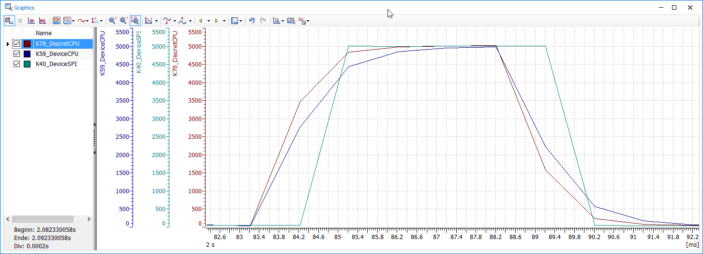

# Analog voltage acquisition {#analog-voltage-acquisition .p_Heading1 style="page-break-after: avoid;"}

+:----------------------------------------------------------------------------------------------------------+-------------------------------------------------------------------------------------------------------------------+
| **Navigation:**  [System features](system-concepts.html) \> [BSW](bsw.html) \> [Inputs](inputs.html) \>   |    |
|                                                                                                           |                                                                                                                   |
| # Analog voltage acquisition {#analog-voltage-acquisition-1 .p_Heading1 style="page-break-after: avoid;"} |                                                                                                                   |
+-----------------------------------------------------------------------------------------------------------+-------------------------------------------------------------------------------------------------------------------+

Analog voltage measurement

 

The ADC conversion of discrete analog inputs (0..32V) is started every 1ms, nevertheless there is a difference between the discrete inputs and the device inputs.

The ADC conversion of discrete analog inputs (5V) is started every 125µs. The BSW will provide the mean value of 8 successive measurement values.

Device inputs:

- Measurement delay can be upto 3ms and update rate is about 1ms.\
The ADC value is delayed by about 2ms after end of conversion caused by the device internal double buffering and the necessity to read the conversion results via SPI. Thus, it is recommended not to use this signals where a fast reaction to signal changes is required.

- Please note that with a higher configured input range the resolution gets worse.

- With eC, one input of a input device can be routed via the device output directly to the micro controller ADC for a faster reaction to signal changes.

But keep in mind that

- The output range is for the worst case 0.1V to 4.9V and

- A low pass filter of 230Hz is implemented after the device output.

 

In the CANalyzer trace the different behavior is shown:\
 

<figure style="margin:0;padding:0">

<figcaption>
Figure63: Resistance measurement
</figcaption>
</figure>

 

 

The ADC conversion for the resistance inputs is handled by the device itself.

Due to the measurement approach the conversion time is much slower compared to voltage measurement and is between 200µs\...3000µs depending on the measurement range.
