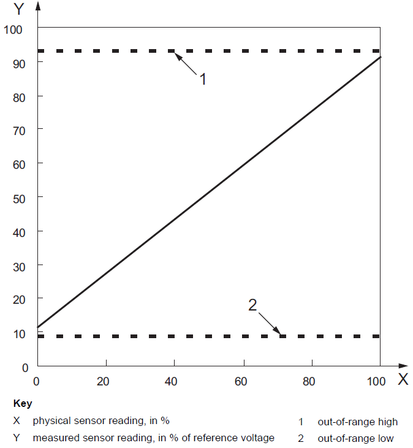

# Analogue inputs {#analogue-inputs .p_Heading1 style="page-break-after: avoid;"}

+:------------------------------------------------------------------------------------------------------------------------------------------------------------------------+---------------------------------------------------------------------------------------------------------------------------------------+
| **Navigation:**  [Safety manual](safety-manual.html) \> [Safety-related inputs](safety-relatedinputs.html) \> [Multi-functional inputs](multi-functionalinputs.html) \> |    |
|                                                                                                                                                                         |                                                                                                                                       |
| # Analogue inputs {#analogue-inputs-1 .p_Heading1 style="page-break-after: avoid;"}                                                                                     |                                                                                                                                       |
+-------------------------------------------------------------------------------------------------------------------------------------------------------------------------+---------------------------------------------------------------------------------------------------------------------------------------+

Besides the comparison of two independent signals described in [Multi-functional inputs in general](multi-functionalinputsingeneral.html){.topiclink}, failures of the analogue inputs could be detected by implementing a signal range check.

<figure style="margin:0;padding:0">

<figcaption aria-hidden="true">
Figure 118: Sensor signal range check for failure detection (source: ISO 26262-5)
</figcaption>
</figure>

 

Depending on the sensor characteristics, the valid signal reading could be limited to a certain part of the sensor's electrical range (see above figure for example). The following failures could be detected by out-of-range signals:

- Short circuit to ground

- Short circuit to power supply

- Open circuit

The signal range check can be realized either by the ASW or by configuring the BSW (for details see  bds_in_aiv_cfg,  bds_in_aic_cfg, and  bds_in_ri_cfg ).  Once implemented correctly, diagnostic coverage (DC) of 60% could be achieved by this signal range check method, given the test frequency is 100 times of the demanding rate of the machine safety function.
