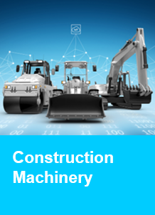
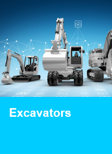
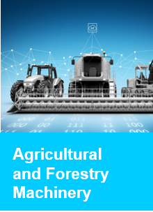
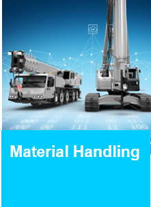
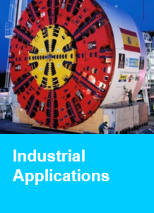

# Applications {#applications .p_Heading1 style="page-break-after: avoid;"}

+:------------------------------------------------------------------------------+---------------------------------------------------------------------------------------------------------------+
| **Navigation:**  [Introduction](introduction.html) \>                         |    |
|                                                                               |                                                                                                               |
| # Applications {#applications-1 .p_Heading1 style="page-break-after: avoid;"} |                                                                                                               |
+-------------------------------------------------------------------------------+---------------------------------------------------------------------------------------------------------------+

## Application areas {#application-areas .p_Heading2 style="page-break-after: avoid;"}

  -------------------------------------------------------------------------------------------------------------------------------------------- --------------------------------------------------------------------------------------------------------- ---------------------------------------------------------------------------------------------------------------------------------------- ----------------------------------------------------------------------------------------------------------------------------- -----------------------------------------------------------------------------------------------------------------------------------------------
  {style="margin:0;width:1.8125in;height:2.5208in;border:none"}   {style="margin:0;width:1.8333in;height:2.5208in;border:none"}   {style="margin:0;width:1.8333in;height:2.5313in;border:none"}   {style="margin:0;width:1.8438in;height:2.5208in;border:none"}   {style="margin:0;width:1.8125in;height:2.5208in;border:none"}
  -------------------------------------------------------------------------------------------------------------------------------------------- --------------------------------------------------------------------------------------------------------- ---------------------------------------------------------------------------------------------------------------------------------------- ----------------------------------------------------------------------------------------------------------------------------- -----------------------------------------------------------------------------------------------------------------------------------------------

## Usage and benefits {#usage-and-benefits .p_Heading2 style="page-break-after: avoid;"}

RCs (of series 40) can be used for various applications in mobile machines and equipment. RCs complement the Rexroth Mobile Hydraulics product portfolio, they are part of the Bosch Rexroth Design and Application System BODAS. For stationary and factory equipment that is typically AC powered from a supply network please look at the other Rexroth product groups such as Industrial Hydraulics or Electric Drives and Controls.

RCs are programmable hardware platforms. The 32 bit multicore micro-controller feature PFlash for the program code and RAM for volatile data. Nonvolatile memory (NVRAM) is provided for storing data such as parameters, process information, error codes and elapsed operating time.

RCs can be programmed:

- In C

- Via the CODESYS development environment in a PLC programming language defined in the IEC 61131-3 standard

- Via model based development using a C or CODESYS code generator

Our programming interface (API) provides access to the RC\'s functionality such as I/O and system resources without knowledge of the hardware realization. Rexroth also offers pre-programmed controllers for a variety of applications such as travel drives, fan drives, dual path control, valve and hitch control. The respective software packages are also available for customization.

The power outputs of RCs are optimized but not limited to the actuation of solenoids on hydraulic valves, pumps and motors. The RC's multifunctional inputs can be used to acquire signals from many different sensors and control devices. RCs are equipped with multiple CAN / CAN FD interfaces for which various communication protocols such as J1939 (ISOBUS), CANopen / CANopen Safety, UDS and XCP are supported.

Electrically RCs provide all functionality for a standalone operation:

- All internally required voltages are derived from the DC (with nominal 12V or 24V) supply voltage.

- Additionally the RC generates supply voltages for connected sensors.

Safety functions can be realized with RCs according to ISO 13849 up to PL d and ISO 25119 up to AgPL d. Since these safety standards are harmonized with the European machine directive, RCs can be used for safety functions on machines for which this directive applies.

Make sure to read the [Safety Manual](safety-manual.html){.topiclink} if the RC is a part of a safety function.

Unauthorized access to the RC is prohibited by security measures that utilize the hardware security module of the microprocessor.

BODAS-service 4.x is a PC software that is provided by Rexroth. BODAS-service 4.x is a tool for flashing, parameter setting, commissioning, process monitoring, etc., on RCs. The RCs can also be adapted to other service tools due to the support of open standards like UDS and the possibility to develop a custom boot loader.

RCs work seamlessly with other BODAS components such as sensors, display and the BODAS Connect solutions for IoT.
