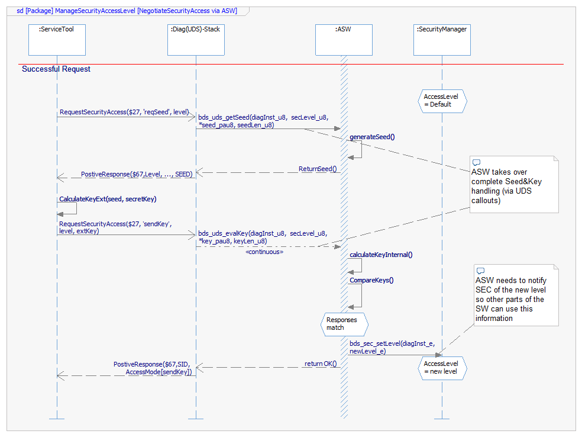

# ASW security access {#asw-security-access .p_Heading1 style="page-break-after: avoid;"}

+:-------------------------------------------------------------------------------------------------------------------------------------------------------------------------------------------------+--------------------------------------------------------------------------------------------------------------------------------------------------------+
| **Navigation:**  [System features](system-concepts.html) \> [Security](security.html) \> [Authentication](authentication.html) \> [Diagnostic authentication](diagnostic-authentication.html) \> |    |
|                                                                                                                                                                                                  |                                                                                                                                                        |
| # ASW security access {#asw-security-access-1 .p_Heading1 style="page-break-after: avoid;"}                                                                                                      |                                                                                                                                                        |
+--------------------------------------------------------------------------------------------------------------------------------------------------------------------------------------------------+--------------------------------------------------------------------------------------------------------------------------------------------------------+

Optionally, the security access can be altered by the ASW. This should only be used if the provided \'standard\' BSW mechanisms are not sufficient. The following sequence diagram depicts how a default security access can be performed within the ASW. The manual key negotiation has to be enabled in easyConfig before the implementation in the ASW is performed (for details, see [Security Manager](security-manager.html){.topiclink}).

<figure style="margin:0;padding:0">

<figcaption aria-hidden="true">
Figure25:  Detailed security access when using customized procedures for the authentication process.
</figcaption>
</figure>
