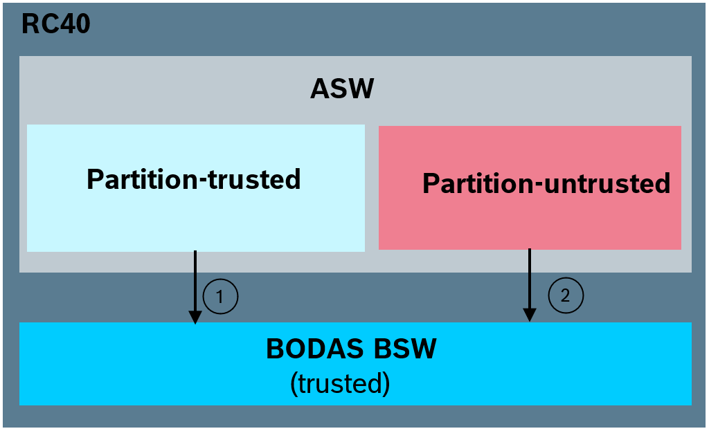
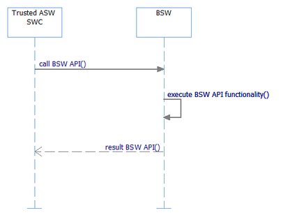
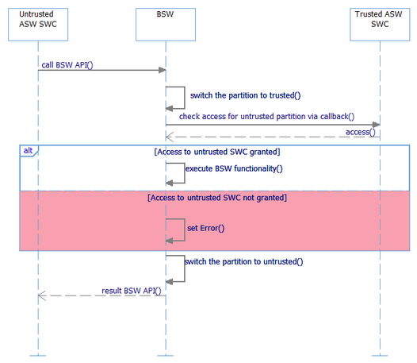

# BSW API support to partition concept {#bsw-api-support-to-partition-concept .p_Heading1 style="page-break-after: avoid;"}

+:----------------------------------------------------------------------------------------------------------------------------------------------------------------------------------------------------------------------------------+--------------------------------------------------------------------------------------------------------------------------------------------------------------+
| **Navigation:**  [Safety manual](safety-manual.html) \> [Safety-related software and software toolchain](safety-relatedsoftwareandsoftwaretoolchain.html) \> [Freedom from Interference (FFI)](freedom-from-interference.html) \> |    |
|                                                                                                                                                                                                                                   |                                                                                                                                                              |
| # BSW API support to partition concept {#bsw-api-support-to-partition-concept-1 .p_Heading1 style="page-break-after: avoid;"}                                                                                                     |                                                                                                                                                              |
+-----------------------------------------------------------------------------------------------------------------------------------------------------------------------------------------------------------------------------------+--------------------------------------------------------------------------------------------------------------------------------------------------------------+

This section describes the guidelines for usage of BSW APIs as per the partition concept.

 

<figure style="margin:0;padding:0">

<figcaption aria-hidden="true">
Figure 121: Interaction paths in RC40 partition concept.
</figcaption>
</figure>

In the CODESYS environment, two interaction paths (Path 1 and Path 2) described in the above figure is implemented through a function call.

 

 \
Path 1: The application software component in the trusted partition is calling the BSW APIs.

Path 2: The application software component in the untrusted partition is calling the BSW APIs.

## Trusted partition calling base software APIs {#trusted-partition-calling-base-software-apis .p_Heading2 style="page-break-after: avoid;"}

- The application software components in the trusted partition are allowed to call all BSW APIs without any restrictions. This is based on the principle that an application software assigned in trusted partition is safe, reliable and has access to all operations and resources. Also, the BSW is designed to be executed in a trusted mode.

- The below sequence diagram shows the execution sequence when an application software from a trusted partition is accessing a BSW API. Since BSW API is called by a software component running in trusted run time, therefore base software API also executes in the trusted mode.

<figure style="margin:0;padding:0">

<figcaption aria-hidden="true">
Figure 122: Sequenzdiagram for API call from trusted partition.
</figcaption>
</figure>

## Untrusted partition calling base software APIs {#untrusted-partition-calling-base-software-apis .p_Heading2 style="page-break-after: avoid;"}

- The application software component in the untrusted partition is not allowed to call all BSW APIs. The BSW introduces new FFI variant APIs designed for usage in untrusted application software components. The FFI variant APIs are the extended variant of the existing APIs to support the partition concept and will perform the same operation as the existing APIs. These APIs have the same name as the existing APIs plus the suffix \"\_ffi\".  Refer to the section [List of BSW API for FFI. support](list-of-bsw-api-for-ffi-suppor.html){.topiclink} for information on the APIs available with the FFI variant.

- The definitions for these new APIs are available in the new BSW header files identified by the suffix \"\_ffi\". From the list, it can be seen that not all the BSW APIs support an FFI variant. This is based on the principle that an application software assigned in untrusted software is less safe or non-safe, therefore it should have restricted access to some of the base software operations.

- It could also be necessary to have restrictions on the resources (like I/O pin, communication channel, etc.) accessed by the software components in an untrusted partition and this could be an application-specific restriction. To support this the FFI variant APIs implement a callback mechanism to extend the handling of the application-specific restrictions.

## The below sequence diagram show the execution sequence when an application software from a untrusted partition is accessing a BSW API with FFI variant. (Applicable for all APIs listed in section [List of BSW API for FFI. support)](list-of-bsw-api-for-ffi-suppor.html){.topiclink} {#the-below-sequence-diagram-show-the-execution-sequence-when-an-application-software-from-a-untrusted-partition-is-accessing-a-bsw-api-with-ffi-variant.-applicable-for-all-apis-listed-in-section-list-of-bsw-api-for-ffi.-support .p_Heading2 style="page-break-after: avoid;"}

<figure style="margin:0;padding:0">

<figcaption aria-hidden="true">
Figure 123: Sequenzdiagram for API call from untrusted partition.
</figcaption>
</figure>

The execution sequence in the above diagram shows the below important steps handled internally by the BSW APIs with freedom from interference (FFI) variant.

1\. When the application software components from untrusted partition calls an FFI variant of the BSW APIs, the BSW API would switch the execution context to trusted mode. This is necessary because the BSW APIs are designed to be executed in the trusted mode so that it has access to the trusted memory.

2\. The BSW API triggers a callback which needs to be implemented by an application software which is safe and reliable. The callback to be implemented by application software shall have same name as BSW API without the suffix \"\_ffi\", it will have the suffix \"ParamChk_cb\". The function signature for callback to be implemented is given below.

  callback function signature
  -----------------------------------------------------------------------------------
  boolean bds_xxxxParamChk_cb(bds_rsmFfi_callerInfo_ts callerInfo_s, arg1\...argN);

 

where callerInfo_s consist of information related to caller of BSW API like partition from which call is triggered, caller program address.

 

        arg1\...argN are the same argument list of the called BSW API.

The callback function returns a boolean value TRUE or FALSE, which is calculated by the application software.

3\. If the callback returns value TRUE indicating that the application software allows the execution of the base software API from untrusted partition, so the base software executes the desired functionality (e.g., setting output or getting input value or send communication message). Refer API specific page for more information.

4\. If the callback returns value FALSE indicating that the application software is denying the execution of the base software API from untrusted partition, so the BSW API will not execute the desired functionality and returns an FFI related error code. Refer API specific page for more information.

5\. Last step would be switching back to untrusted mode and returning result of the base software API execution.

All the steps mentioned above are internally handled by the base software API when it is called by the application software. The only intervention needed by the application software is in step 2 where it shall implement the necessary conditional checks in the callback and return TRUE or FALSE.

In addition, BSW allows the calling of some APIs by the software components from the untrusted partition that does not support the FFI variant. Refer to section [List of BSW API with no restrictions](list-of-bsw-api-with-no-restrictions.html){.topiclink} for information on such APIs. The execution sequence of such APIs when called from untrusted partition would be similar to execution sequence when an trusted partition is calling the base software APIs.

Hints on suffixes of the API names and callback that is discussed in the above sections : if a regular API name is bds_inI_ctrlShunt() then FFI variant API name is bds_inI_ctrlShunt_ffi() and callback name to be implemented by application software is bds_inI_ctrlShuntParamChk_cb().

  {style="margin:0;width:2.1667in;height:0.6979in;border:none"}   As mentioned in the above section, the BSW APIs with FFI variant implements additional checks to handle the partition concept, resulting in the increased runtime compared to exisiting APIs
  -------------------------------------------------------------------------------- ----------------------------------------------------------------------------------------------------------------------------------------------------------------------------------------------

## Summary {#summary .p_Heading2 style="page-break-after: avoid;"}

- A software component in the trusted partition is allowed to call all BSW APIs without any restrictions.

- A software component in the untrusted partition is allowed to call only BSW APIs with the FFI variant listed in the section [List of BSW API for FFI. support](list-of-bsw-api-for-ffi-suppor.html){.topiclink} and the BSW APIs listed in the section [List of BSW API with no restrictions](list-of-bsw-api-with-no-restrictions.html){.topiclink}. Calling APIs which are not in the lists can result in undesired behavior of application software and will deviate the freedom from interference concept guidelines.

- If software component in the untrusted partition is accessing FFI variant, a callback needs to be implemented by a safe software to extend the application specific checks.

- Section How to implement BSW API call from different partition describes examples of how to use different BSW APIs in partition concept.
