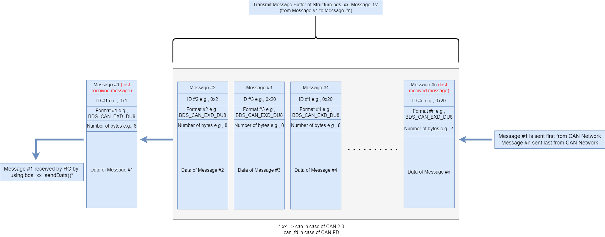
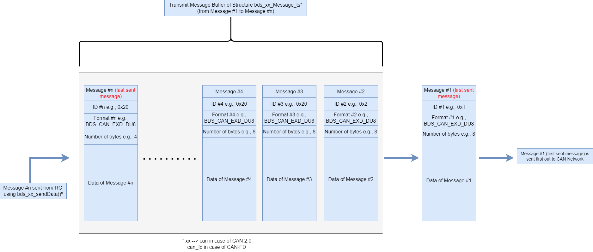

# Buffers {#buffers .p_Heading1 style="page-break-after: avoid;"}

+:-------------------------------------------------------------------------------------------------------------------------------------------------------------------------------------------------------------------------------------------+-------------------------------------------------------------------------------------------------------------------------------------+
| **Navigation:**  [System features](system-concepts.html) \> [BSW](bsw.html) \> [Network communication & protocols](network-comm-protocols.html) \> [CAN-FD](can-fd.html) \> [CAN-FD legacy communication](chapter-page-template_2.html) \> |    |
|                                                                                                                                                                                                                                            |                                                                                                                                     |
| # Buffers {#buffers-1 .p_Heading1 style="page-break-after: avoid;"}                                                                                                                                                                        |                                                                                                                                     |
+--------------------------------------------------------------------------------------------------------------------------------------------------------------------------------------------------------------------------------------------+-------------------------------------------------------------------------------------------------------------------------------------+

- \"Buffer\" or CAN-FD buffer in this context means a queue of messages (which follow fields of bds_can_Message_ts - ID, Format, Number of bytes, Data) in a First In First Out (FIFO) format.

- This software buffers of CAN-FD are used to handle transmission / reception of a CAN-FD message (raw CAN-FD frame).

- Configuration of buffer is done in easyConfig and additionally with the help of API  bds_can_fd_registerTxBuf() /  bds_can_fd_registerRxBuf().

<figure style="margin:0;padding:0">

<figcaption>
Receive Message buffer for CAN/CAN-FD
</figcaption>
</figure>

<figure style="margin:0;padding:0">

<figcaption>
Transmit Message buffer for CAN/CAN-FD
</figcaption>
</figure>

- On how to use the  BSW APIs for CAN-FD legacy communication, refer the How-To page [How to implement CAN-FD legacy using Transmit, Receive Buffers](howtoimplementcan-fdlegacyusingtransmitreceivebuffers.html){.topiclink}.

- On how to use the  BSW APIs for CAN legacy communication, refer the How-To page [How to implement CAN legacy using Transmit, Receive Buffers](howtoimplementcanlegacyusingtransmitreceivebuffers.html){.topiclink}.
