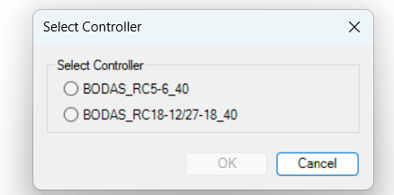
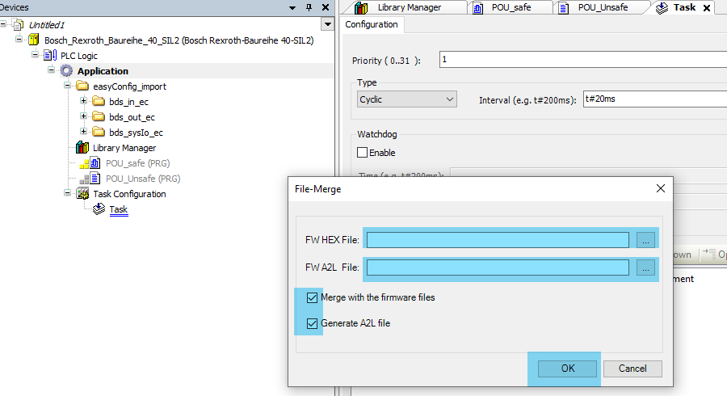

# Build ASW and generate hex and/or a2l {#build-asw-and-generate-hex-andor-a2l .p_Heading1 style="page-break-after: avoid;"}

+:----------------------------------------------------------------------------------------------------------------------------------------------------------------------------------------------------------------------------------+--------------------------------------------------------------------------------------------------------------------------------------------------------+
| **Navigation:**  [Introduction](introduction.html) \> [First steps with RC](preparation.html) \> [Configurations](required-tools.html) \> [Step 5: ASW development & components involved](step-5-asw-development--compon.html) \> |    |
|                                                                                                                                                                                                                                   |                                                                                                                                                        |
| # Build ASW and generate hex and/or a2l {#build-asw-and-generate-hex-andor-a2l-1 .p_Heading1 style="page-break-after: avoid;"}                                                                                                    |                                                                                                                                                        |
+-----------------------------------------------------------------------------------------------------------------------------------------------------------------------------------------------------------------------------------+--------------------------------------------------------------------------------------------------------------------------------------------------------+

The ASW written in CODESYS can be built to check for any compilation errors and warnings directly on the console window in CODESYS. You can generate hex and a2l files for any error free ASW.

You can create a merged hex file and a merged a2l file that includes the contents of ASW from CODESYS + BODAS-RTS. In order to generate the required files from CODESYS, follow the steps below.

- Save the current project after a successful build

- Click Online tab

- Select Create Hex File ( Note: this option will be available only if the plug-in BODAS files generation.package is installed to package repository)

- Select the HW variant

{style="margin:0;width:4.5625in;height:2.2604in;border:none"}

- Browse the BODAS-RTS hex and a2l files from downloaded BODAS-RTS package (BODAS-RTS/hex & BODAS-RTS/a2l)

- Make sure the 2 check boxes Merge with firmware files and Generate A2L file are checked. (Generate A2L file is optional if a2l file is not needed)

- Click OK and see the generated files in the CODESYS project directory. A file with name \<projectName\>\_merge.hex is the final hex file with contains ASW + BODAS-RTS.

 

 

  -------------------------------------------------------------------------------- ---------------------------------------------------------------------------------------------------------------------------------------------------------------------------------------------------------------------------------------------------------------
  {style="margin:0;width:2.1667in;height:0.6979in;border:none"}   An a2l file is a structured ASCII text file which contains measurement and calibration definitions used with XCP. In RC4x context the a2l file can be used to measure or test the ASW variables via XCP using tools like CANoe from Vector or INCA from ETAS.
  -------------------------------------------------------------------------------- ---------------------------------------------------------------------------------------------------------------------------------------------------------------------------------------------------------------------------------------------------------------

 

   

<figure style="margin:0;padding:0">

<figcaption aria-hidden="true">
Generate hex and a2l files from CODESYS IDE
</figcaption>
</figure>

 
