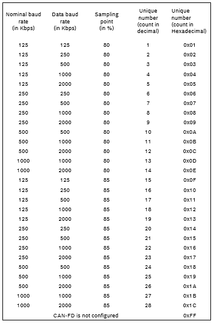

# CAN FD in CB-ME {#can-fd-in-cb-me .p_Heading1 style="page-break-after: avoid;"}

+:---------------------------------------------------------------------------------------------+----------------------------------------------------------------------------------------------------------------------------------------------------------+
| **Navigation:**  [System features](system-concepts.html) \> [Bootloader](bootloader.html) \> |   inbootloader.html "Next Topic") |
|                                                                                              |                                                                                                                                                          |
| # CAN FD in CB-ME {#can-fd-in-cb-me-1 .p_Heading1 style="page-break-after: avoid;"}          |                                                                                                                                                          |
+----------------------------------------------------------------------------------------------+----------------------------------------------------------------------------------------------------------------------------------------------------------+

- Basic information about the CAN FD concept is documented in the chapter [CAN-FD](can-fd.html){.topiclink}.

- CB-ME utilizes the shared CAN / UDS configuration set by the ASW. CAN FD configuration via unique number is configured as below:

 

<figure style="margin:0;padding:0">

<figcaption aria-hidden="true">
Figure 31: CAN FD Configuration
</figcaption>
</figure>

 

+--------------------------------------------------------------------------------+--------------------------------------------------------+
| {style="margin:0;width:2.1667in;height:0.6979in;border:none"} | •CAN channels CAN 1, CAN 2 and CAN 4 support CAN-FD.   |
|                                                                                |                                                        |
|                                                                                | •CAN 3 does not support CAN-FD.                        |
|                                                                                |                                                        |
|                                                                                | •Same CAN-ID is supported for both CAN2.0B and CAN FD. |
+================================================================================+========================================================+

 
