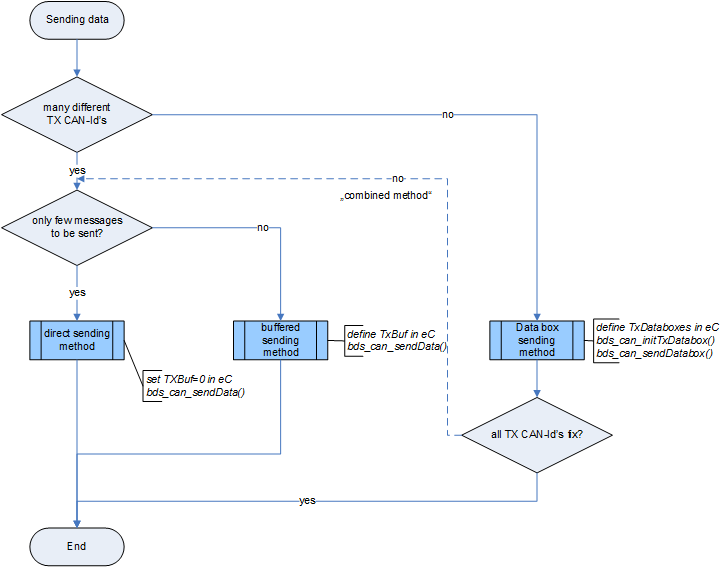
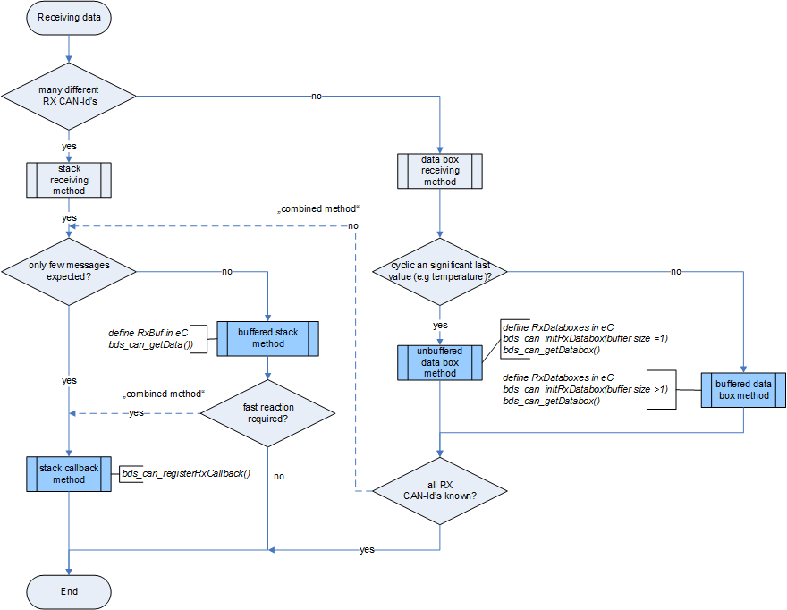

# CAN configuration steps {#can-configuration-steps .p_Heading1 style="page-break-after: avoid;"}

+:---------------------------------------------------------------------------------------------------------------------------------------------------------------------------------------------------------------------+-------------------------------------------------------------------------------------------------------------------------------------+
| **Navigation:**  [System features](system-concepts.html) \> [BSW](bsw.html) \> [Network communication & protocols](network-comm-protocols.html) \> [CAN](can.html) \> [CAN communication](can-communication.html) \> |    |
|                                                                                                                                                                                                                      |                                                                                                                                     |
| # CAN configuration steps {#can-configuration-steps-1 .p_Heading1 style="page-break-after: avoid;"}                                                                                                                  |                                                                                                                                     |
+----------------------------------------------------------------------------------------------------------------------------------------------------------------------------------------------------------------------+-------------------------------------------------------------------------------------------------------------------------------------+

This description should help to find the right configuration for the CAN legacy function and to configure it. On the following figures you can identify your required CAN sending or receiving methods. The API functions belonging to the methods are listed as comment.

1.TX method

 

<figure style="margin:0;padding:0">

<figcaption aria-hidden="true">
Figure74: TX method
</figcaption>
</figure>

 

 

2.RX method

 

<figure style="margin:0;padding:0">

<figcaption aria-hidden="true">
Figure75: RX method
</figcaption>
</figure>
