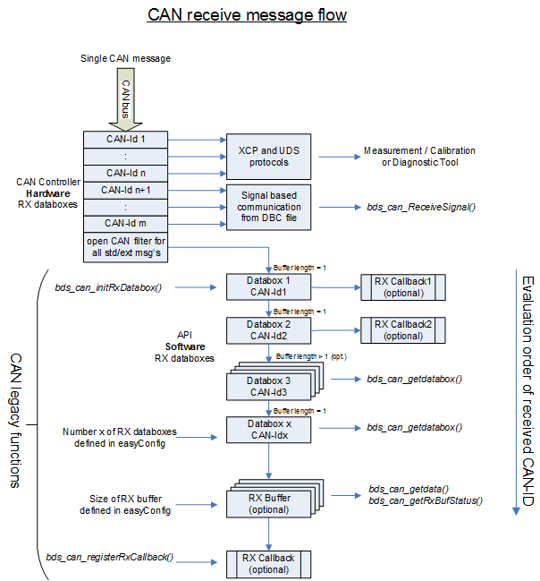
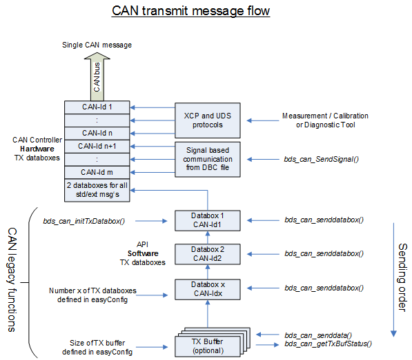

# CAN message overview {#can-message-overview .p_Heading1 style="page-break-after: avoid;"}

+:----------------------------------------------------------------------------------------------+------------------------------------+
| **Navigation:**  »No topics above this level«                                                 |  |
|                                                                                               |                                    |
| # CAN message overview {#can-message-overview-1 .p_Heading1 style="page-break-after: avoid;"} |                                    |
+-----------------------------------------------------------------------------------------------+------------------------------------+

 

The following figure shows an overview about the hardware CAN receive data boxes of the CAN controller, the software data boxes, message buffer and the API functions for receiving messages.

 

{style="margin:0;width:6.2917in;height:6.7604in;border:none"}

 

 

The following figure shows an overview about the hardware CAN transmit data boxes of the CAN controller, the software data boxes, message buffer and the API functions for sending messages.

 

{style="margin:0;width:6.2188in;height:5.4479in;border:none"}

 
