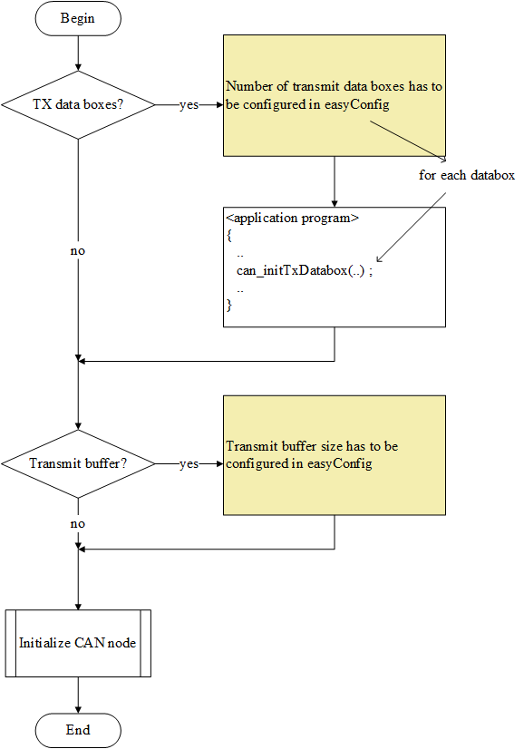
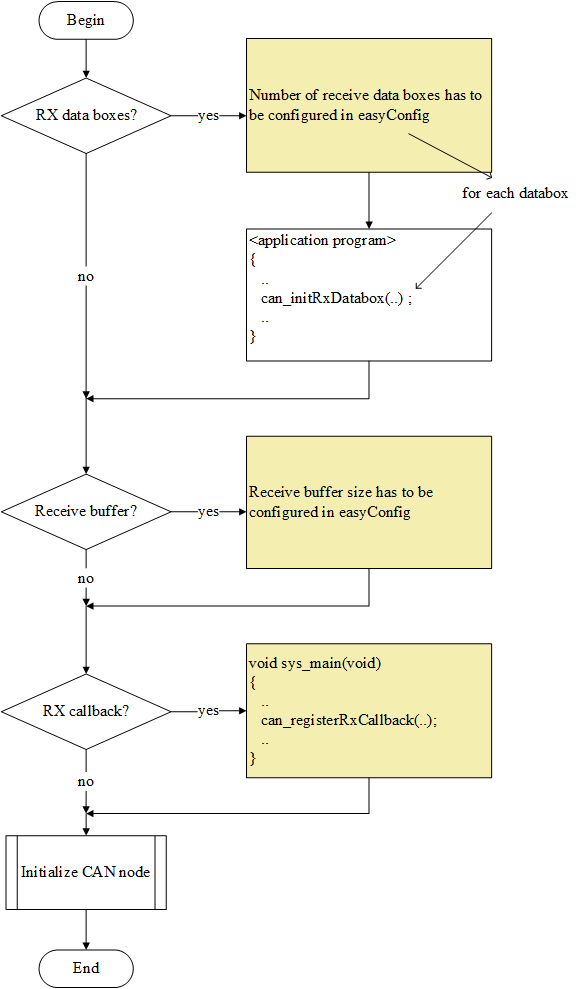

# CAN Preparation steps {#can-preparation-steps .p_Heading1 style="page-break-after: avoid;"}

+:---------------------------------------------------------------------------------------------------------------------------------------------------------------------------------------------------------------------+----------------------------------------------------------------------------------------------------------------------------------------------------+
| **Navigation:**  [System features](system-concepts.html) \> [BSW](bsw.html) \> [Network communication & protocols](network-comm-protocols.html) \> [CAN](can.html) \> [CAN communication](can-communication.html) \> |    |
|                                                                                                                                                                                                                      |                                                                                                                                                    |
| # CAN Preparation steps {#can-preparation-steps-1 .p_Heading1 style="page-break-after: avoid;"}                                                                                                                      |                                                                                                                                                    |
+----------------------------------------------------------------------------------------------------------------------------------------------------------------------------------------------------------------------+----------------------------------------------------------------------------------------------------------------------------------------------------+

The following figures give an overview of the CAN legacy communication preparation.

 

1.Preparing CAN transmit function

 

<figure style="margin:0;padding:0">

<figcaption aria-hidden="true">
Figure76: Preparing CAN legacy transmit function
</figcaption>
</figure>

 

 

2.Preparing CAN receive function

 

 

<figure style="margin:0;padding:0">

<figcaption aria-hidden="true">
Figure77: Preparing CAN legacy receive function
</figcaption>
</figure>

 

 

 
