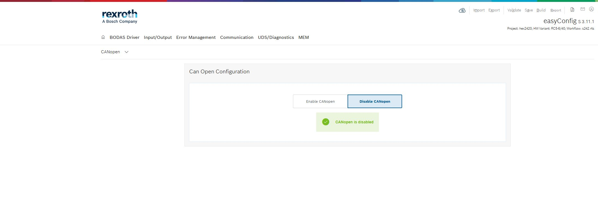

# CANopen Enabling on myBODAS {#canopen-enabling-on-mybodas .p_Heading1 style="page-break-after: avoid;"}

+:---------------------------------------------------------------------------------------------------------------+-----------------------------------------------------------------------------------------------------------------------------------------------------------+
| **Navigation:**  [BSW API](sw-api-reference-manual.html) \> [CANOpen for CODESYS](canopen-for-codesys.html) \> |    |
|                                                                                                                |                                                                                                                                                           |
| # CANopen Enabling on myBODAS {#canopen-enabling-on-mybodas-1 .p_Heading1 style="page-break-after: avoid;"}    |                                                                                                                                                           |
+----------------------------------------------------------------------------------------------------------------+-----------------------------------------------------------------------------------------------------------------------------------------------------------+

 

- To enable CANopen in your project, navigate to the \"Communication\" menu, select \"CANopen\"  in the upper left drop down menu and then click \"Enable CANopen.\"

 

{style="margin:0;width:19.1146in;height:6.7396in;border:none"}
