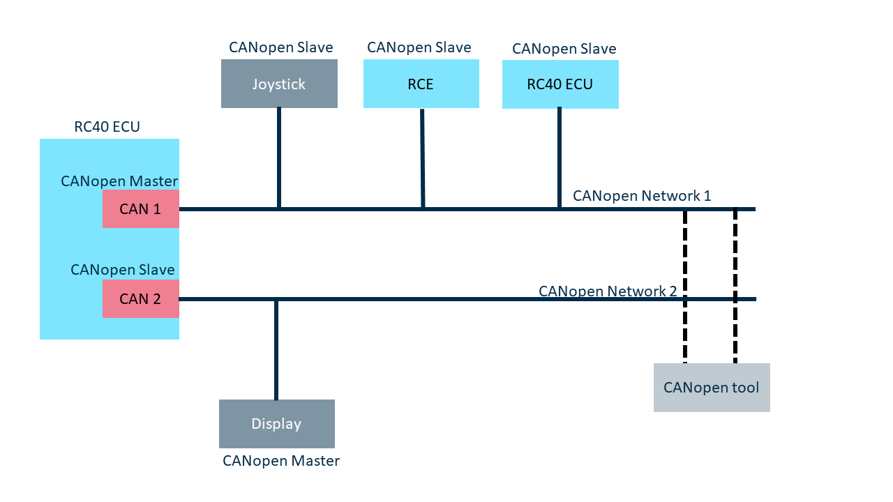
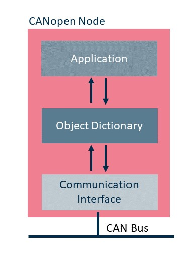
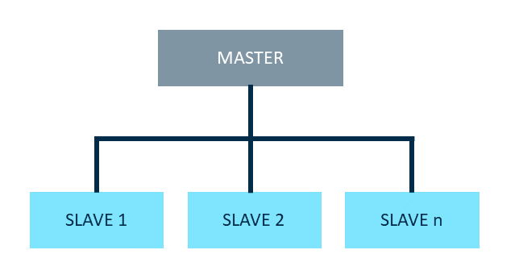
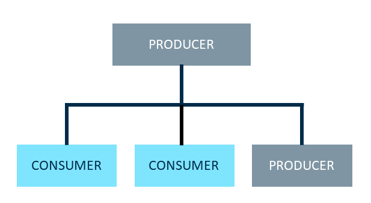
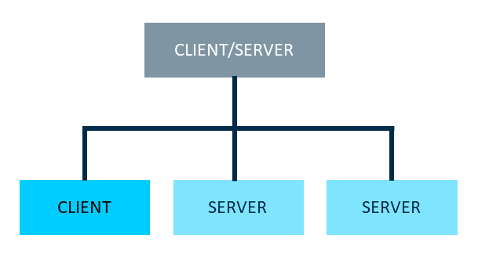

# CANopen introduction {#canopen-introduction .p_Heading1 style="page-break-after: avoid;"}

+:----------------------------------------------------------------------------------------------------------------------------------------------------------------------------------------------------------------------------------------------------+-----------------------------------------------------------------------------------------------------------------------------------------------------------------+
| **Navigation:**  [System features](system-concepts.html) \> [BSW](bsw.html) \> [Network communication & protocols](network-comm-protocols.html) \> [CANopen](canopen2.html) \> [CANopen protocol description](canopen-protocol-description.html) \> |   .html "Next Topic") |
|                                                                                                                                                                                                                                                     |                                                                                                                                                                 |
| # CANopen introduction {#canopen-introduction-1 .p_Heading1 style="page-break-after: avoid;"}                                                                                                                                                       |                                                                                                                                                                 |
+-----------------------------------------------------------------------------------------------------------------------------------------------------------------------------------------------------------------------------------------------------+-----------------------------------------------------------------------------------------------------------------------------------------------------------------+

CANopen is a communication protocol based on the CAN bus. This protocol is used mainly in automation applications, though it is finding acceptance in many other areas as well. In terms of the OSI model, the CANopen covers mainly the transport layer and application layer. The CANopen standard consists of an addressing scheme, several small communication protocols, and an application layer defined by a device profile. The communication protocols have support for network management, device monitoring, and communication between nodes, including a simple transport layer for message segmentation or de-segmentation. The lower level protocol implementing the data link and physical layers are usually \"Controller Area Network\" (CAN), although devices using some other means of communication like various industrial Ethernet variants can also implement the CANopen device profile.

## CANopen standard {#canopen-standard .p_Heading2 style="page-break-after: avoid;"}

 The \"CAN in Automation\" (CiA) organization is the international association of users and manufacturers of CAN-based communication protocols. This organization develops and defines the CANopen standard. The CANopen is based on the \"CAN Application layer\" (CAL). The CANopen profile CiA-301 is standardized as EN 50325-4 and CANopen safety profile CiA-304 is standardized as EN 50325-5.  

## Communication in CANopen network {#communication-in-canopen-network .p_Heading2 style="page-break-after: avoid;"}

 In a CANopen network, various devices are connected via the CAN bus. The baud rate describes the transmission speed at which the messages are transmitted over the CAN bus. This must be set to the same value for all connected devices. For the devices to communicate with one another in a CANopen network, it must be possible to address each device with a unique ID. Because the devices in the network can be thought of as nodes, we speak here of node-IDs.

The following figure illustrates an example of such a CANopen network.

<figure style="margin:0;padding:0">

<figcaption aria-hidden="true">
Figure66: Communication in CANopen network
</figcaption>
</figure>

Device model:

<figure style="margin:0;padding:0">

<figcaption aria-hidden="true">
Figure67: Device model
</figcaption>
</figure>

The communication block provides the communication objects and the appropriate functionality to transport data items via the underlying network structure.

The object dictionary is a collection of all the data items which influence the behavior of the application objects, the communication objects, and the state machines used on the CANopen device. The object dictionary defines a set of objects where data can be stored on a CANopen node. Each object in the object dictionary can be read and written from the CAN bus using the SDO protocol by addressing using 16-bit index and 8-bit sub-index.

The overall layout of the standard object dictionary is shown below.

 

  Index (hex)   Object
  ------------- --------------------------------------------
  0000          Not used
  0001-001F     Static Data Types
  0020-003F     Complex Data Types
  0040-005F     Manufacturer Specific Complex Data Types
  0060-007F     Device Profile Specific Static Data Types
  0080-009F     Device Profile Specific Complex Data Types
  00A0-0FFF     Reserved for further use
  1000-1FFF     Communication Profile Area
  2000-5FFF     Manufacturer Specific Profile Area
  6000-9FFF     Standardized Device Profile Area
  A000-BFFF     Standardized Interface Profile Area
  C000-FFFF     Reserved for further use

 

 

The application comprises the functionality of the device for interaction with the process environment. Thus the object dictionary serves as an interface between the communication and the application. The complete description of a device's application for the data items in the object dictionary is named as a device profile.

## Communication relationships {#communication-relationships .p_Heading2 style="page-break-after: avoid;"}

The devices in the CANopen network communicate with one another through the transmission of objects. The CANopen protocol uses 3 different communication relationships when messaging between the CANopen nodes.

 

- Master/Slave relationship

 

<figure style="margin:0;padding:0">

<figcaption>
Figure68: Master/Slave relationship
</figcaption>
</figure>

In a CANopen network, one node acts as an application master or controller which controls the slaves. The NMT protocol in a CANopen uses the master/slave communication model. The active NMT master controls the NMT state machine that defines the behavior of a CANopen device using NMT protocol. The LSS protocol in a CANopen is another example that is based on the master/slave relationship. In a master/slave communication model, at any time there is only one device in the network serving as a master for specific functionality, all the other devices in the network act as slaves.

 

- Producer/consumer relationship

 

<figure style="margin:0;padding:0">

<figcaption aria-hidden="true">
Figure69: Producer/consumer relationship
</figcaption>
</figure>

In a CANopen network, there can be a producer that generates information and consumers who will read this information. The PDO protocol and SRDO protocol in a CANopen uses the producer-consumer communication model.

 

- Client/server relationship

 

<figure style="margin:0;padding:0">

<figcaption aria-hidden="true">
Figure70: Client/server relationship
</figcaption>
</figure>

The client sends a data request to a server, which replies with the requested data. The SDO protocol in a CANopen uses the client-server communication model.

 

## CANopen COB-ID {#canopen-cob-id .p_Heading2 style="page-break-after: avoid;"}

+-------+------+------+------+------+------+------+------+------+------+------+
| Bit10 | Bit9 | Bit8 | Bit7 | Bit6 | Bit5 | Bit4 | Bit3 | Bit2 | Bit1 | Bit0 |
+=======+======+======+======+======+======+======+======+======+======+======+
| Function code              | Node-ID                                        |
+----------------------------+------------------------------------------------+

 

The 11-bit CAN ID is referred to as the Communication Object Identifier (COB-ID) and is split into two parts, the first 4 bits equal a function code and the next 7 bits contain the node-ID.

The below table lists predefined COB-ID (CAN-ID) used by RC40 CANopen lib based on feature supported.

 

  ------------------------------ --------------- -------------------------------
  Object                         Specification   CAN-ID
  NMT                            CiA-301         000h
  Global fail safe command       CiA-304         001h
  Sync                           CiA-301         080h
  Emergency                      CiA-301         081h to 0FFh (080h + node-ID)
  Safety relevant data objects   CiA-304         101h to 180h
  TPDO1                          CiA-301         181h to 1FFh (180h + node-ID)
  RPDO1                          CiA-301         201h to 27Fh (200h + node-ID)
  TPDO2                          CiA-301         281h to 2FFh(280h + node-ID)
  RPDO2                          CiA-301         301h to 37Fh (300h + node-ID)
  TPDO3                          CiA-301         381h to 3FFh(380h + node-ID)
  RPDO3                          CiA-301         401h to 47Fh (400h + node-ID)
  TPDO4                          CiA-301         481h to 4FFh (480h + node-ID)
  RPDO4                          CiA-301         501h to 57Fh (500h + node-ID)
  SDO1 server-to-client          CiA-301         581h to 5FFh (580h + node-ID)
  SDO1 client-to-server          CiA-301         601h to 67Fh (600h + node-ID)
  NMT error control              CiA-301         701h to 77Fh (700h + node-ID)
  Layer setting services         CiA-305         7E4h to 7E5h
  ------------------------------ --------------- -------------------------------

 

 

 

 

 

 

 

 
