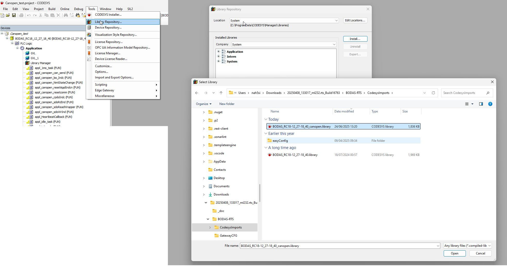

# CANopen Library Installation {#canopen-library-installation .p_Heading1 style="page-break-after: avoid;"}

+:---------------------------------------------------------------------------------------------------------------+----------------------------------------------------------------------------------------------------------------------------------------------------------+
| **Navigation:**  [BSW API](sw-api-reference-manual.html) \> [CANOpen for CODESYS](canopen-for-codesys.html) \> |    |
|                                                                                                                |                                                                                                                                                          |
| # CANopen Library Installation {#canopen-library-installation-1 .p_Heading1 style="page-break-after: avoid;"}  |                                                                                                                                                          |
+----------------------------------------------------------------------------------------------------------------+----------------------------------------------------------------------------------------------------------------------------------------------------------+

 

- All the CANopen BODAS API\'s that are needed for the ASW development are packed in a CODESYS library that can be added to CODESYS library repository. BODAS_RC18-12_27-18_40_canopen.library is a part of BODAS-RTS package and can be found in easyConfig build download folder in directory - BODAS-RTS/CodesysImports/.

Follow the steps below to add BODAS_RC18-12_27-18_40_canopen.library to CODESYS library repository

- Open CODESYS IDE \> Tools \> Library Repository

- A window will pop-up. In this window click on Install button and browse the library from the downloaded BODAS-RTS package (BODAS-RTS/CodesysImports)

Note:

Please note that the BODAS_RC18-12_27-18_40_canopen.library provides specific CANopen functionalities. It is an additional library that works in conjunction with your existing BODAS ASW development environment. You must still install and maintain the main BODAS library BODAS_RC18-12_27-18_40.library as per standard procedures. The BODAS_RC18-12_27-18_40_canopen.library simply extends the capabilities of your project to include CANopen features.

 

 

 

 

 

{style="margin:0;width:20.5104in;height:10.7708in;border:none"}

 

 
