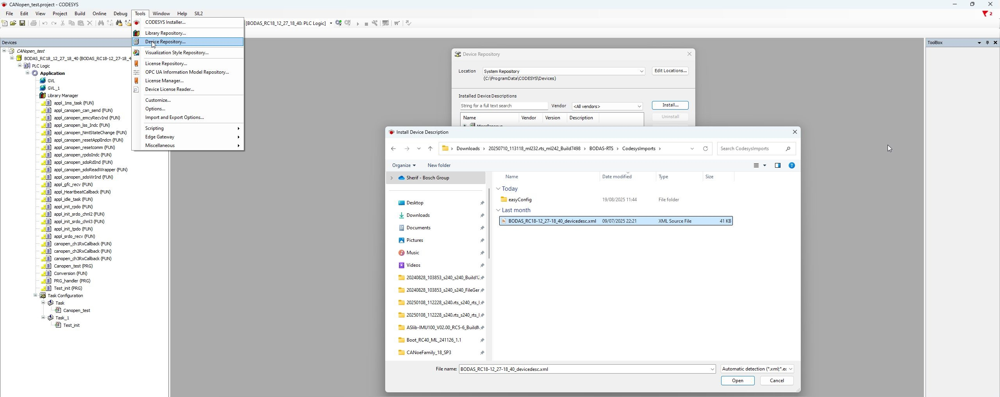
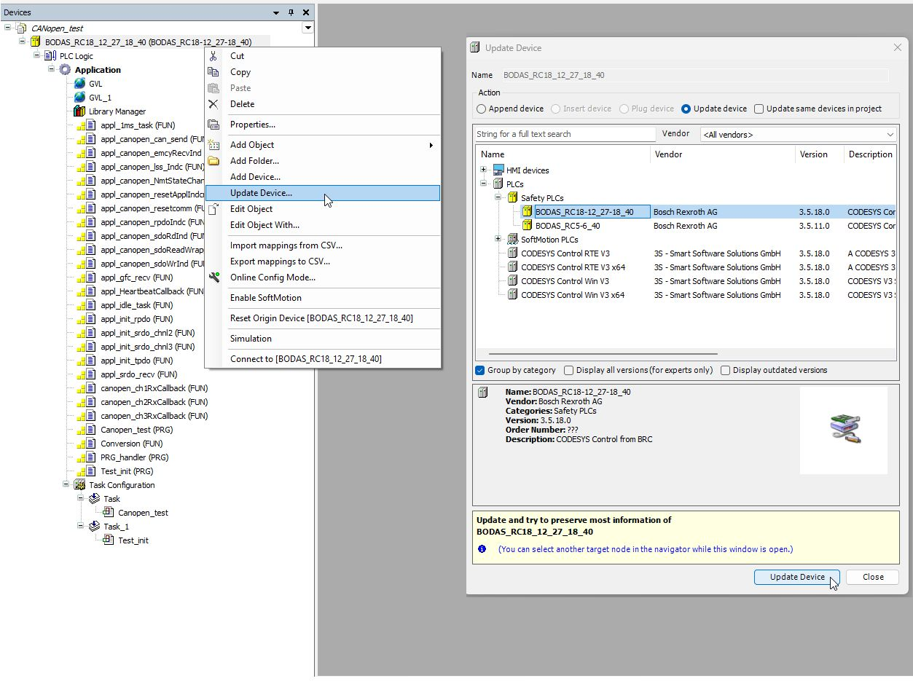

# CANopen Device Description Update {#canopen-device-description-update .p_Heading1 style="page-break-after: avoid;"}

+:------------------------------------------------------------------------------------------------------------------------+-----------------------------------------------------------------------------------------------------------------------------------+
| **Navigation:**  [BSW API](sw-api-reference-manual.html) \> [CANOpen for CODESYS](canopen-for-codesys.html) \>          |    |
|                                                                                                                         |                                                                                                                                   |
| # CANopen Device Description Update {#canopen-device-description-update-1 .p_Heading1 style="page-break-after: avoid;"} |                                                                                                                                   |
+-------------------------------------------------------------------------------------------------------------------------+-----------------------------------------------------------------------------------------------------------------------------------+

 

- To utilize the CANopen functionalities for ASW development, you need to update the device description for the RC40 within CODESYS. The necessary file, BODAS_RC18-12_27-18_40.devdesc.xml, is located in the BODAS-RTS/CodesysImports/ directory within your easyConfig build download. To install it, open CODESYS IDE, go to Tools \> Device Repository, click \"Install,\" and then browse to select the BODAS_RC18-12_27-18_40.devdesc.xml file from the specified location.

 

 

{style="margin:0;width:26.6667in;height:10.6042in;border:none"}

 

Important Notes:

- After installing the updated device description, ensure you \"Update Device\" for any existing devices in your project explorer

 

{style="margin:0;width:13.0521in;height:9.7396in;border:none"}

 

 

- Then, perform a \"Clean Build\" of your project to clear cached compilation files and rebuild using the new device description.

 
