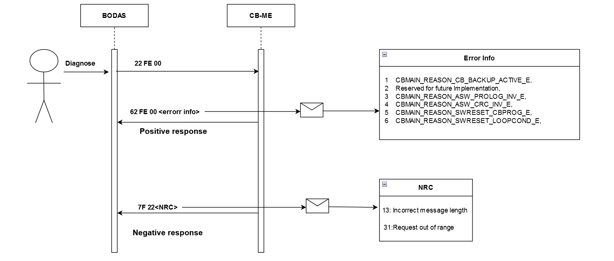

# CB-ME diagnosis {#cb-me-diagnosis .p_Heading1 style="page-break-after: avoid;"}

+:---------------------------------------------------------------------------------------------------------------------------------------------------------------------------------------------------------------------------------+-----------------------------------------------------------------------------------------------------------------------------------+
| **Navigation:**  [System features](system-concepts.html) \> [Bootloader](bootloader.html) \> [Diagnostics services (UDS) in Bootloader](diagnosticsservices(uds)inbootloader.html) \> [Accessible DIDs](accessible-dids.html) \> |    |
|                                                                                                                                                                                                                                  |                                                                                                                                   |
| # CB-ME diagnosis {#cb-me-diagnosis-1 .p_Heading1 style="page-break-after: avoid;"}                                                                                                                                              |                                                                                                                                   |
+----------------------------------------------------------------------------------------------------------------------------------------------------------------------------------------------------------------------------------+-----------------------------------------------------------------------------------------------------------------------------------+

CB-ME diagnosis can be used for troubleshooting in case the ASW is not started and the control stays in CB-ME. It can be used to read the error information from CB-ME to know why the application could not be started. The System Supplier Specific DID (0xFE00) is used as per the ISO 14229-1.\
 \
This feature is available in CB-ME from version rbr_CB_ME_ML_V03.06.00 onwards.

 

 

<figure style="margin:0;padding:0">

<figcaption aria-hidden="true">
Figure32: Request-response diagram for CB-ME diagnosis
</figcaption>
</figure>

## Reading the diagnosis information {#reading-the-diagnosis-information .p_Heading2 style="page-break-after: avoid;"}

- When the DID request is received, the CB-ME diagnoses and responds with the reason why the application was not started. The following are the possible reasons why the control can stay in CB-ME without jumping to application:\
 

  Value   CB-ME Reason                       Description
  ------- ---------------------------------- ---------------------------------------
  1       CBMAIN_REASON_CB_BACKUP_ACTIVE_E   CB-ME was started in backup location.
  2       \-                                 Reserved for future implementation.
  3       CBMAIN_REASON_ASW_PROLOG_INV_E     The application prolog is invalid.
  4       CBMAIN_REASON_ASW_CRC_INV_E        The application CRC is invalid.
  5       CBMAIN_REASON_SWRESET_CBPROG_E     CB programming is active.
  6       CBMAIN_REASON_SWRESET_LOOPCOND_E   Reset loop condition is detected.

 

- DID request:

+----------------+------------------+--------+--------+--------+--------+--------+--------+
| Byte 0         | Byte 1           | Byte 2 | Byte 3 | Byte 4 | Byte 5 | Byte 6 | Byte 7 |
+----------------+------------------+--------+--------+--------+--------+--------+--------+
| Request length | RDBI Request SID | DID             | Padding Bytes                     |
+================+==================+========+========+========+========+========+========+
| 03             | 22               | FE     | 00     | 00     | 00     | 00     | 00     |
+----------------+------------------+--------+--------+--------+--------+--------+--------+

 

- DID positive response:

+-----------------+-------------------+--------+--------+--------------+------------------+------------------+--------------+
| Byte 0          | Byte 1            | Byte 2 | Byte 3 | Byte 4       | Byte 5           | Byte 6           | Byte 7       |
+-----------------+-------------------+--------+--------+--------------+------------------+------------------+--------------+
| Response length | RDBI Response SID | DID             | Error Information                                  | Padding Byte |
+=================+===================+========+========+==============+==================+==================+==============+
| 06              | 62                | FE     | 00     | CB-ME Reason | Reset type (MSB) | Reset type (LSB) | 00           |
+-----------------+-------------------+--------+--------+--------------+------------------+------------------+--------------+

 

- DID negative response:

+-----------------+-----------------------+------------------+--------------------------------+-----------+-----------+-----------+-----------+
| Byte 0          | Byte 1                | Byte 2           | Byte 3                         | Byte 4    | Byte 5    | Byte 6    | Byte 7    |
+-----------------+-----------------------+------------------+--------------------------------+-----------+-----------+-----------+-----------+
| Response length | Negative Response SID | RDBI Request SID | NRC                            | Padding Bytes                                 |
+=================+=======================+==================+================================+===========+===========+===========+===========+
| 03              | 7F                    | 22               | 0x13: Incorrect message length | 00        | 00        | 00        | 00        |
|                 |                       |                  |                                |           |           |           |           |
|                 |                       |                  | 0x31: Request out of range     |           |           |           |           |
+-----------------+-----------------------+------------------+--------------------------------+-----------+-----------+-----------+-----------+

 

- Two additional bytes (Byte 5 and Byte 6) of data are reserved to read the last Reset type if there is a reset loop condition. For cases other than the reset loop condition, these bytes are always set to 0xFF by default and only Byte 4 must be referred for reading the error information.

- For interpreting the reset information using the Reset type, please refer [How to interpret the reset information from a given reset type?](how-to-read-the-reset-informat.html){.topiclink}.
