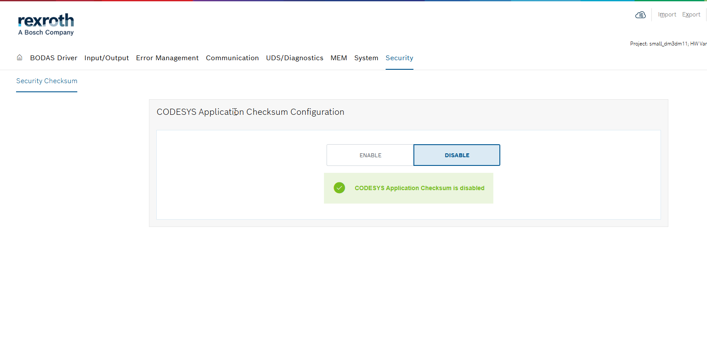
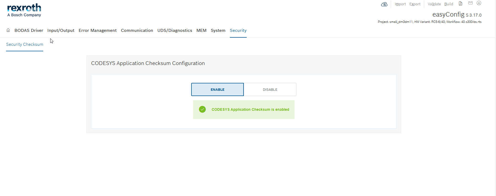

# CODESYS Application Checksum Configuration {#codesys-application-checksum-configuration .p_Heading1 style="page-break-after: avoid;"}

+:------------------------------------------------------------------------------------------------------------------------------------------+------------------------------------------------------------------------------------------------------------------------------------------------------------------------+
| **Navigation:**  [How-Tos](how-to.html) \> [How to calculate checksum for CODESYS merged HEX](how-to-calculate-checksum-for-.html) \>     |    |
|                                                                                                                                           |                                                                                                                                                                        |
| # CODESYS Application Checksum Configuration {#codesys-application-checksum-configuration-1 .p_Heading1 style="page-break-after: avoid;"} |                                                                                                                                                                        |
+-------------------------------------------------------------------------------------------------------------------------------------------+------------------------------------------------------------------------------------------------------------------------------------------------------------------------+

- To enable CODESYS Application Checksum Configuration in your project, navigate to the \"Security\" menu, select \"Security Checksum\"  in the upper left drop down menu and then click \"Enable CODESYS Application Checksum Configuration.\"

 

 

 

+------------------------------------------------------------------------------------------+--------------------------------------------------------------------------------------+
| {style="margin:0;width:2.1667in;height:0.7083in;border:none"} | To maintain compatibilty with older WFs other than sml290.rts.                       |
|                                                                                          |                                                                                      |
|                                                                                          | CODESYS Application Checksum Configuration will be by default  \"DISABLED\".\        |
|                                                                                          |  \                                                                                   |
|                                                                                          | For WF 290-bs.rts CODESYS Application Checksum Configuration is always \"ENABLED\".\ |
|                                                                                          |                                                                                      |
+------------------------------------------------------------------------------------------+--------------------------------------------------------------------------------------+

 

 

 

 

Step 1: Disable the CODESYS Application Checksum Configuration when CRA-compliant features, such as Secure Flashing, are not required.

 

 

{style="margin:0;width:13.7396in;height:6.6250in;border:none"}

 

 

Step 2: Enable CODESYS Application Checksum Configuration to ensure compatibility with CRA-compliant security features, including Secure Flashing.

 

 

 

{style="margin:0;width:14.0833in;height:5.5625in;border:none"}f

 

 

 
