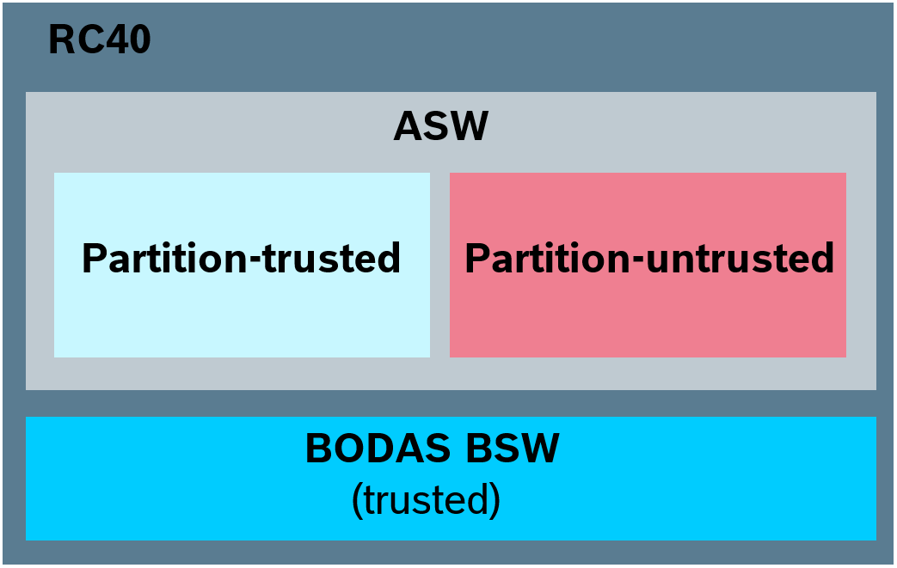
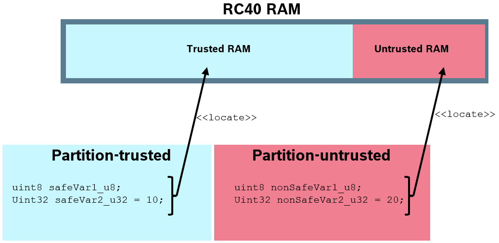
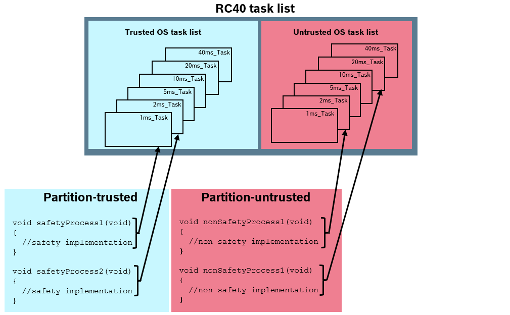
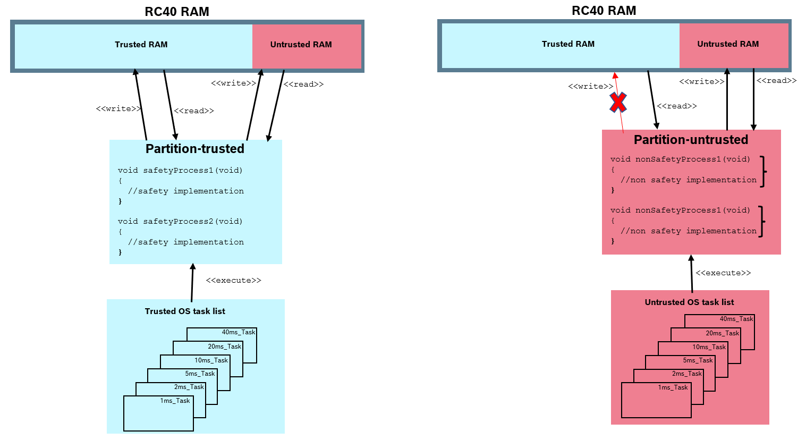
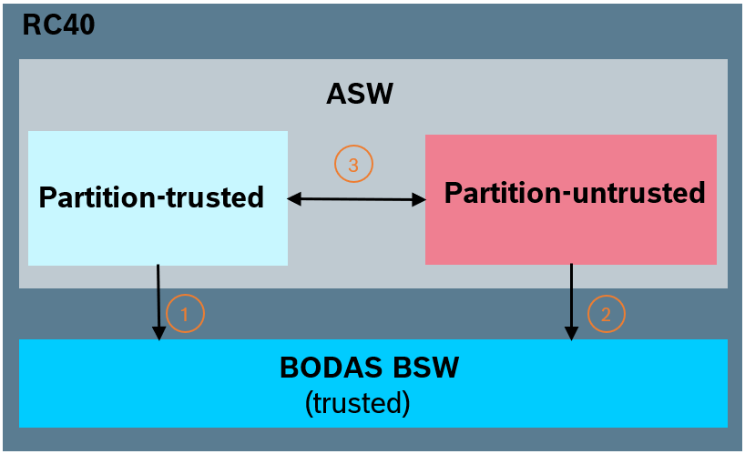

# Freedom from Interference in RC4x {#freedom-from-interference-in-rc4x .p_Heading1 style="page-break-after: avoid;"}

+:----------------------------------------------------------------------------------------------------------------------------------------------------------------------------------------------------------------------------------+------------------------------------------------------------------------------------------------------------------------------------------------------------------------+
| **Navigation:**  [Safety manual](safety-manual.html) \> [Safety-related software and software toolchain](safety-relatedsoftwareandsoftwaretoolchain.html) \> [Freedom from Interference (FFI)](freedom-from-interference.html) \> |    |
|                                                                                                                                                                                                                                   |                                                                                                                                                                        |
| # Freedom from Interference in RC4x {#freedom-from-interference-in-rc4x-1 .p_Heading1 style="page-break-after: avoid;"}                                                                                                           |                                                                                                                                                                        |
+-----------------------------------------------------------------------------------------------------------------------------------------------------------------------------------------------------------------------------------+------------------------------------------------------------------------------------------------------------------------------------------------------------------------+

The BSW introduces the possibility of partitioning the application software components to support the concept of freedom from interference. The BSW implements mechanism based on ISO 25119-3 Annex B, independence by software partitioning. By using the partition concept to achieve the independence between partitions.

 

+------------------------------------------------------------------------------------------+-----------------------------------------------------------------------------------------------------------------------------------------------------------------------------+
| {style="margin:0;width:2.1667in;height:0.7083in;border:none"} | •The BSW implements only mechanism to support realization of freedom from interference concept.                                                                             |
|                                                                                          |                                                                                                                                                                             |
|                                                                                          | •The BSW will only address some faults mentioned in [Freedom from interference introduction](what-is-freedom-of-interferenc.html){.topiclink} if used as per the guidelines |
|                                                                                          |                                                                                                                                                                             |
|                                                                                          | •The ASW shall have its own safety concept, verification and validation to address independence of different software components.                                           |
+------------------------------------------------------------------------------------------+-----------------------------------------------------------------------------------------------------------------------------------------------------------------------------+

 

## What is a partition? {#what-is-a-partition .p_Heading2 style="page-break-after: avoid;"}

- A partition is a collection of one or more application software components.

- The application software component is a ASW-specific definition and not under the scope of BSW. E.g., an application software component can be a single C-function or group of C-functions, or a C-source file or group of C-source files.

- A partition is spatially separated from other partitions, e.g., memory partition

- A partition is temporally separated from other partitions, e.g., run-time partition

- A partition can be trusted or untrusted.

## Spatial partition {#spatial-partition .p_Heading2 style="page-break-after: avoid;"}

Spatial partitioning addresses unauthorized data access and illegitimate command of peripherals assigned to other partitions. Spatial partitioning within a single processor addresses two dimensions: preventing jobs from overwriting memory elements of other jobs (e.g., protection of data and code) and preventing jobs from interfering with the access of the device.

## Temporal partition {#temporal-partition .p_Heading2 style="page-break-after: avoid;"}

Temporal partition addresses the disturbance by the timing of events from other partitions (scheduling, order of execution etc.). In software that implements multiple tasks, a primary source for temporal fault propagation is a task delaying another task occupying a shared resource (e.g. the processor). The purpose of temporal partitioning is to preserve the temporal properties of resources (e.g., duration of availability of CPU or the instant at which the CPU becomes available) even in the case of faulty jobs.

## Partition concept in RC4x {#partition-concept-in-rc4x .p_Heading2 style="page-break-after: avoid;"}

<figure style="margin:0;padding:0">

<figcaption aria-hidden="true">
Figure 124: RC40 partition concept
</figcaption>
</figure>

 

1.The BSW supports two partitions, namely trusted and untrusted. Both partitions are assigned to a single core.

2.A software component in a trusted partition has unrestricted access to all memory locations and can perform any operation on those.

3.A software component in an untrusted partition has unrestricted access to its own memory locations. However, it has restricted read/write and execute access to other memory locations.

4.In the case of application software components with two different safety levels, the software components with a higher safety level shall be assigned to a trusted partition and the software component with a lesser safety level shall be assigned to an untrusted partition

5.In the case of application software components with no safety or quality managed (QM) and software components with a safety level, the software component with a safety level shall be assigned to a trusted partition and the software component with no safety/QM shall be assigned to the untrusted partition.

6.The BSW is in a trusted partition.

7.The BSW supports only two partitions and application software with software components of more than two safety levels can exist. In that case, the software component with the highest safety level shall be assigned to the trusted partition and all other software components with a lesser safety level shall be assigned to the untrusted partition. (E.g., When an application software consists of software components with 3 different safety levels - SRL 2, SRL 1 and SRL B, the SRL2 software component shall be assigned to a trusted partition, the SRL 1 and SRL B software components shall be assigned to the untrusted partition)

The BSW introduces new memory mapping and process/task mapping to support temporal and spatial partitioning. When its resources, run-time, and memory are assigned to a partition, a software component is considered to be in a partition.

## Spatial separation of partitions {#spatial-separation-of-partitions .p_Heading2 style="page-break-after: avoid;"}

## The BSW spatial partitioning is applicable only to RAM memory only. Application software components can assign their C variables to either trusted memory or untrusted memory. {#the-bsw-spatial-partitioning-is-applicable-only-to-ram-memory-only.-application-software-components-can-assign-their-c-variables-to-either-trusted-memory-or-untrusted-memory. .p_Heading2 style="page-break-after: avoid;"}

<figure style="margin:0;padding:0">

<figcaption aria-hidden="true">
Figure 125: Spatial separation of partitions of RC40 RAM
</figcaption>
</figure>

## The project linker configuration is designed in a way that by default any variable declared in the application software is placed to trusted memory. To assign an application software variable into untrusted memory, the BSW introduces a concept called memmap through a new header file \"bds_rsmFfi_appSwMemMap.h\". The memmap concept is an industry standard practice that allows application developers to write generic C code (compiler-independent) while enabling developers to have control over the location of C program objects. Generally, the compiler assigns all variables to the appropriate sections (bss cleared, bss no init or data init) at compile time. This applies to a variable allocated in trusted memory since it is assigned by default without the use of memmap concept. But in the case of untrusted variables the section within untrusted memory needs to be manually specified by the application using #defines available in the header file \"bds_rsmFfi_appSwMemMap.h\". {#the-project-linker-configuration-is-designed-in-a-way-that-by-default-any-variable-declared-in-the-application-software-is-placed-to-trusted-memory.-to-assign-an-application-software-variable-into-untrusted-memory-the-bsw-introduces-a-concept-called-memmap-through-a-new-header-file-bds_rsmffi_appswmemmap.h.-the-memmap-concept-is-an-industry-standard-practice-that-allows-application-developers-to-write-generic-c-code-compiler-independent-while-enabling-developers-to-have-control-over-the-location-of-c-program-objects.-generally-the-compiler-assigns-all-variables-to-the-appropriate-sections-bss-cleared-bss-no-init-or-data-init-at-compile-time.-this-applies-to-a-variable-allocated-in-trusted-memory-since-it-is-assigned-by-default-without-the-use-of-memmap-concept.-but-in-the-case-of-untrusted-variables-the-section-within-untrusted-memory-needs-to-be-manually-specified-by-the-application-using-defines-available-in-the-header-file-bds_rsmffi_appswmemmap.h. .p_Heading2 style="page-break-after: avoid;"}

+-----------------------------------------------------------------------------------------------------------------+
| Example for using \"bds_rsmFfi_appSwMemMap.h\"                                                                  |
+=================================================================================================================+
|                                                                                                                 |
|                                                                                                                 |
| #define appSw_start_untrusted_xxx_D       //Start of memory map                                                 |
|                                                                                                                 |
| #include \"bds_rsmFfi_appSwMemMap.h\"                                                                           |
|                                                                                                                 |
|                                                                                                                 |
|                                                                                                                 |
| //any variable declared between this start and stop sections will be assigned into untrusted memory             |
|                                                                                                                 |
|                                                                                                                 |
|                                                                                                                 |
| #define appSw_stop_untrusted_xxx_D                                                                              |
|                                                                                                                 |
| #include \"bds_rsmFfi_appSwMemMap.h\"       //end of memory map                                                 |
|                                                                                                                 |
|                                                                                                                 |
+-----------------------------------------------------------------------------------------------------------------+

## An application software variable can be placed into any of the below sections in untrusted memory based on the type of variable. {#an-application-software-variable-can-be-placed-into-any-of-the-below-sections-in-untrusted-memory-based-on-the-type-of-variable. .p_Heading2 style="page-break-after: avoid;"}

1\. bss cleared RAM section for variables that needs to be initialized with 0\'s.

2\. bss no init section for variables that should be protected from initialization after reset (also known as protected RAM).

3\. data init section for variables that should be initialized with constants.

+-----------------------------------+------------------------------------------------------------------+
| Untrusted memory sections         | #define to be used from header file \"bds_rsmFfi_appSwMemMap.h\" |
+===================================+==================================================================+
| bss cleared RAM                   | appSw_start_untrusted_ramCleared_D                               |
|                                   |                                                                  |
|                                   | appSw_stop_untrusted_ramCleared_D                                |
+-----------------------------------+------------------------------------------------------------------+
| bss no init RAM                   | appSw_start_untrusted_noInitRamSect_D                            |
|                                   |                                                                  |
|                                   | appSw_stop_untrusted_noInitRamSect_D                             |
+-----------------------------------+------------------------------------------------------------------+
| data init RAM                     | appSw_start_untrusted_initRamSect_D                              |
|                                   |                                                                  |
|                                   | appSw_stop_untrusted_noInitRamSect_D                             |
+-----------------------------------+------------------------------------------------------------------+

Refer to How to assign variables to a partition

  {style="margin:0;width:2.1667in;height:0.6979in;border:none"}   The BSW spatial partition is only applicable for data block and not applicable for code block.
  -------------------------------------------------------------------------------- ------------------------------------------------------------------------------------------------

## Temporal separation of partitions {#temporal-separation-of-partitions .p_Heading2 style="page-break-after: avoid;"}

The BSW temporal partitioning is applicable to OS tasks. The process in the application software components can be assigned to trusted OS tasks or untrusted OS tasks.

<figure style="margin:0;padding:0">

<figcaption aria-hidden="true">
Figure 126: Temporal separation of partitions for task lists
</figcaption>
</figure>

The BSW introduces a new set of OS tasks for the untrusted partition. In the process mapping configuration of easyConfig the tasks with suffix \"\_Untrusted\" shall be used for software components in the untrusted partition and all other tasks shall be used for software components in trusted partition. The software components expected in trusted partition should add its process in trusted task only and the software components expected in untrusted partition should add its process in untrusted task only.

Below table lists new untrusted tasks.

  Untrusted tasks                 Description
  ------------------------------- --------------------------------------------------
  OS_IniDrv_Task_Untrusted        initialization task for the untrusted partition
  OS_1ms_Task_Untrusted           1ms cycle task for the untrusted partition
  OS_2ms_Task_Untrusted           2ms cycle task for the untrusted partition
  OS_5ms_Task_Untrusted           5ms cycle task for the untrusted partition
  OS_10ms_Task_Untrusted          10ms cycle task for the untrusted partition
  OS_20ms_Task_Untrusted          20ms cycle task for the untrusted partition
  OS_40ms_Task_Untrusted          40ms cycle task for the untrusted partition
  OS_50ms_Task_Untrusted          50ms cycle task for the untrusted partition
  OS_80ms_Task_Untrusted          80ms cycle task for the untrusted partition
  OS_100ms_Task_Untrusted         100ms cycle task for the untrusted partition
  OS_Aswbg_Task_Untrusted         background/idle task for the untrusted partition
  OS_AswShutdown_Task_Untrusted   ASW shutdown task for the untrusted partition

Refer to How to assign a process to a run-time partition. for instructions on how to place C variables into either trusted or untrusted memory sections.

## Memory protection and run-time protection to achieve software independence {#memory-protection-and-run-time-protection-to-achieve-software-independence .p_Heading2 style="page-break-after: avoid;"}

The BSW implements memory monitoring using internal memory protection hardware unit. This memory protection is achieved by assigning different access rights to partitions. These access rights work based on the memory partition and run-time partition described in above section. Below figure shows memory access schema implemented by BSW.

<figure style="margin:0;padding:0">

<figcaption aria-hidden="true">
Figure 127: Scheme of BSW memory access
</figcaption>
</figure>

The software component in a trusted partition, e,g., the application processes assigned to trusted tasks and all the functions running inside those application processes will have unrestricted access, such as read and write access to the complete RAM of RC4x. In other words, all the functions executed in trusted tasks are executed in trusted mode and functions executing in trusted mode will have unrestricted access to the complete RAM.

The software component in a untrusted partition, e.g., the application processes assigned to untrusted tasks and all the functions running inside those application processes will have unrestricted access, such as read and write access to only untrusted RAM and only read access to trusted RAM. In other words, all the functions executed in untrusted tasks are executed in untrusted mode and functions executing in untrusted mode will have unrestricted access to only untrusted RAM and only read access to trusted RAM.

Any write access to trusted memory by the software running untrusted mode is considered illegal memory access and the base software will trigger software reset and log a new diagnostic trouble code (DTC) entry.

+----------------------------------------------------------------------+---------------------------------------------------------+
| Information for memory access related resets                         | Remarks                                                 |
+========================+=============================================+=========================================================+
| Reset Group            | RBA_MPU_RESET_GROUP                         | can be read at startup using bds_sys_getResetInfo       |
+------------------------+---------------------------------------------+---------------------------------------------------------+
| Reset ID               | RBA_MPU_COREMPU_REGION_ILLEGAL_ACCESS_RESET | can be read at startup using bds_sys_getResetInfo       |
+------------------------+---------------------------------------------+---------------------------------------------------------+
| DTC                    | 0x833,DFC_rbr_mo_memoryProtection_err       | will be available as previosly active error since reset |
+------------------------+---------------------------------------------+---------------------------------------------------------+

 

  {style="margin:0;width:2.1667in;height:0.7083in;border:none"}   For run-time partitioning, the trusted task and the untrusted task in BSW OS is implemented such that the trusted task will not be interrupted by the untrusted task because trusted tasks have a high priority and untrusted tasks are with the lowest priority. But both trusted and untrusted tasks are assigned and running in a single core, therefore, pure temporal independence cannot be achieved. E.g., a software halt triggered due to faults in the untrusted task can stop the complete core and reset of software.
  ------------------------------------------------------------------------------------------ -----------------------------------------------------------------------------------------------------------------------------------------------------------------------------------------------------------------------------------------------------------------------------------------------------------------------------------------------------------------------------------------------------------------------------------------------------------------------------------------------------------------------------------

## Interactions between software components in different partitions {#interactions-between-software-components-in-different-partitions .p_Heading2 style="page-break-after: avoid;"}

With the introduction of partition concept, different interaction scenarios between software components are foreseen.

<figure style="margin:0;padding:0">

<figcaption aria-hidden="true">
Figure 128: Interaction between software components in the partition concept
</figcaption>
</figure>

In the above figure, different interaction scenario are shown.

Scenario 1: The application software component in trusted partition is accessing BSW APIs\
The BSW is implemented as a trusted partition software component. Application software components in an trusted partition can therefore access all BSW APIs without any restriction.\
More details about scenario 1 in section [RC BSW API support to partition concept](bsw-api-support-to-partition-c.html){.topiclink}.

Scenario 2: The application software component in untrusted partition is accessing BSW APIs\
As stated above the BSW is implemented as a trusted partition software component. Application software components in an untrusted partition have a restricted access to BSW APIs.\
More details about scenario 2 and restrictions related to API access are explained in section [RC BSW API support to partition concept](bsw-api-support-to-partition-c.html){.topiclink}.  

Scenario 3: Inter/cross partition interaction\
Within application software, the software components in one partition can interact with the software components in another partition. The BSW implements a mechanism to support this interaction scenario. This mechanism is offered as a new base software API to application software.\
More details about scenario 3 in section [inter-partition interactions](cross-partition-communication.html){.topiclink}.

Scenario 4: The application software components within the same partition interact\
The application software components within the same partition can interact with each other. This is generally a C function in one of the partitions calling another C function belonging to safe safety levels as the caller functions. In such case, conventional C function call can be used and no additional handling is needed.

 
