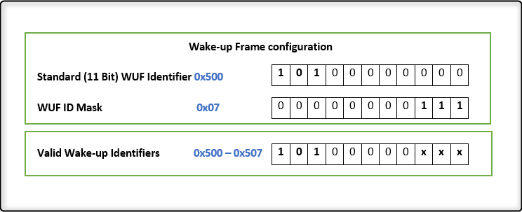
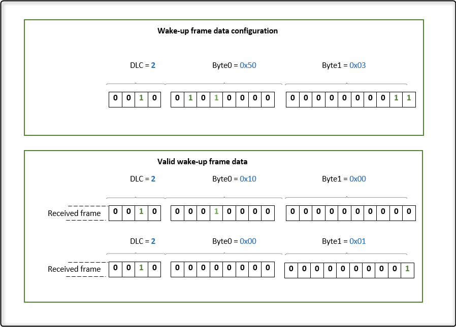

# Configuration parameters required for Wakeup by CAN in eC {#configuration-parameters-required-for-wakeup-by-can-in-ec .p_Heading1 style="page-break-after: avoid;"}

+:--------------------------------------------------------------------------------------------------------------------------------------------------------------------------------------------------------------------------------+-----------------------------------------------------------------------------------------------------------------------------+
| **Navigation:**  [System features](system-concepts.html) \> [BSW](bsw.html) \> [Runtime system & system states](runtime-system-system-states.html) \> [Wake up](wake-up-feature.html) \> [Wakeup by CAN](wakeup-by-can.html) \> |   .html "Next Topic") |
|                                                                                                                                                                                                                                 |                                                                                                                             |
| # Configuration parameters required for Wakeup by CAN in eC {#configuration-parameters-required-for-wakeup-by-can-in-ec-1 .p_Heading1 style="page-break-after: avoid;"}                                                         |                                                                                                                             |
+---------------------------------------------------------------------------------------------------------------------------------------------------------------------------------------------------------------------------------+-----------------------------------------------------------------------------------------------------------------------------+

Parameters that should be configured for wakeup by CAN are as follows:

## Details required on how to enable wakeup by CAN in eC (WUP & WUF): {#details-required-on-how-to-enable-wakeup-by-can-in-ec-wup-wuf .p_Heading2 style="page-break-after: avoid;"}

## 1.Enable/Disable CAN wakeup {#enabledisable-can-wakeup .p_Heading2 style="page-break-after: avoid;"}

+--------------------+---------------+------------+---------------------------------------------+-------------------+--------------------------------------------------------------------------------------------+
| Parameter name     | Default value | Range      | Description                                 | Mandatory(Yes/No) | Other remarks                                                                              |
+====================+===============+============+=============================================+===================+============================================================================================+
| Enable CAN wake-up | False         | True/False | Enable/disable CAN wakeup by Pattern (WUP). | Yes               | If enabled, WUP will be enabled.                                                           |
|                    |               |            |                                             |                   |                                                                                            |
|                    |               |            |                                             |                   |                                                                                            |
|                    |               |            |                                             |                   |                                                                                            |
|                    |               |            |                                             |                   | WUP can be enabled separately for CAN_1 and CAN_4 for RC18-12/40, RC27-18/40 and RC5-6/40. |
+--------------------+---------------+------------+---------------------------------------------+-------------------+--------------------------------------------------------------------------------------------+

 

## Configuration parameters specific to RC18-12/40 and RC27-18/40: {#configuration-parameters-specific-to-rc18-1240-and-rc27-1840 .p_Heading2 style="page-break-after: avoid;"}

2\. Enable WUF

+----------------+---------------+------------+------------------------------------------+-------------------+-------------------------------------------------------------------------------------------------------------+
| Parameter name | Default value | Range      | Description                              | Mandatory(Yes/No) | Other remarks                                                                                               |
+================+===============+============+==========================================+===================+=============================================================================================================+
| Enable WUF     | False         | True/False | Enable/disable CAN Wakeup by Frame (WUF) | Yes               | If enabled, WUF will be enabled in CAN_4 channel.                                                           |
|                |               |            |                                          |                   |                                                                                                             |
|                |               |            |                                          |                   | Prerequisite for this parameter to be set: \"Enable CAN wake-up\" should be set to True.                    |
|                |               |            |                                          |                   |                                                                                                             |
|                |               |            |                                          |                   |                                                                                                             |
|                |               |            |                                          |                   |                                                                                                             |
|                |               |            |                                          |                   | If Enable WUF = FALSE and parameter Enable/Disable CAN wakeup is set to TRUE, then WUP is enabled in CAN_4. |
+----------------+---------------+------------+------------------------------------------+-------------------+-------------------------------------------------------------------------------------------------------------+

 

 

## Details specific to Wakeup by Frame (WUF): {#details-specific-to-wakeup-by-frame-wuf .p_Heading2 style="page-break-after: avoid;"}

## 3. Frame type {#frame-type .p_Heading2 style="page-break-after: avoid;"}

  Parameter name   Default value   Range               Description                                                                              Mandatory(Yes/No)             Other remarks
  ---------------- --------------- ------------------- ---------------------------------------------------------------------------------------- ----------------------------- ---------------
  Frame type       Standard        Standard/Extended   CAN Identifier type to be sent to wakeup ECU via WUF (Standard CAN ID/Extended CAN ID)   Yes if WUF is enabled in eC    

 

## 4. Identifier {#identifier .p_Heading2 style="page-break-after: avoid;"}

+----------------+---------------+---------------------------------------------+-------------------------------------------------------+-----------------------------+---------------+
| Parameter name | Default value | Range                                       | Description                                           | Mandatory(Yes/No)           | Other remarks |
+================+===============+=============================================+=======================================================+=============================+===============+
| Identifier     | 0             | 0x0 - 0x7FF if Frame type is Standard;      | CAN Identifier required to wakeup the system via WUF. | Yes if WUF is enabled in eC |               |
|                |               |                                             |                                                       |                             |               |
|                |               | 0x0 - 0x1FFFFFFF if Frame type is Extended. |                                                       |                             |               |
+----------------+---------------+---------------------------------------------+-------------------------------------------------------+-----------------------------+---------------+

 

## 5. Identifier mask {#identifier-mask .p_Heading2 style="page-break-after: avoid;"}

+-----------------+---------------+---------------------------------------------+------------------------------------------------------------------------------------+-----------------------------+-------------------------------------------------------------------------------------------------------------------------------------------+
| Parameter name  | Default value | Range                                       | Description                                                                        | Mandatory(Yes/No)           | Other remarks                                                                                                                             |
+=================+===============+=============================================+====================================================================================+=============================+===========================================================================================================================================+
| Identifier mask | 0             | 0x0 - 0x7FF if frame type is standard;      | This configures the bitmask required of the CAN frame intended to wake up the ECU. | Yes if WUF is enabled in eC | It acts as a filter for CAN identifiers (i.e., a range of values of CAN identifiers can be selected through configuring this parameter).1 |
|                 |               |                                             |                                                                                    |                             |                                                                                                                                           |
|                 |               | 0x0 - 0x1FFFFFFF if frame type is extended. |                                                                                    |                             |                                                                                                                                           |
+-----------------+---------------+---------------------------------------------+------------------------------------------------------------------------------------+-----------------------------+-------------------------------------------------------------------------------------------------------------------------------------------+

 

## 6. Data Length Code (DLC) {#data-length-code-dlc .p_Heading2 style="page-break-after: avoid;"}

+----------------+---------------+-----------+-----------------------------+-----------------------------+---------------+
| Parameter name | Default value | Range     | Description                 | Mandatory(Yes/No)           | Other remarks |
+================+===============+===========+=============================+=============================+===============+
| DLC            | 8             | 1-8       | DLC of configured WUF frame | Yes if WUF is enabled in eC |               |
|                |               |           |                             |                             |               |
|                |               |           |                             |                             |               |
+----------------+---------------+-----------+-----------------------------+-----------------------------+---------------+

## 7. Data mask {#data-mask .p_Heading2 style="page-break-after: avoid;"}

+----------------+---------------------------------+-------------+-----------------------------------+-----------------------------+------------------------------------------------------------------------------------------------------------------------------------------------+
| Parameter name | Default value                   | Range       | Description                       | Mandatory(Yes/No)           | Other remarks                                                                                                                                  |
+================+=================================+=============+===================================+=============================+================================================================================================================================================+
| Data mask      | 0xFF for each byte of CAN frame | 0x00 - 0xFF | Data mask of configured WUF frame | Yes if WUF is enabled in eC | It acts as a filter for CAN messages for WUF to happen (i.e., WUF can be done upon sending certain data values alone in addition to ID mask).2 |
|                |                                 |             |                                   |                             |                                                                                                                                                |
|                |                                 |             |                                   |                             |                                                                                                                                                |
+----------------+---------------------------------+-------------+-----------------------------------+-----------------------------+------------------------------------------------------------------------------------------------------------------------------------------------+

 

 

## Instructions on Baud Rate: {#instructions-on-baud-rate .p_Heading2 style="page-break-after: avoid;"}

Baud rate for CAN wakeup will be configured in Communication configuration under easyConfig, where the baud rate is configured for CAN_4.

 

## Instructions on configuring ID masks and data masks: {#instructions-on-configuring-id-masks-and-data-masks .p_Heading2 style="page-break-after: avoid;"}

## CAN identifier mask: {#can-identifier-mask .p_Heading2 style="page-break-after: avoid;"}

 

An ID mask should be defined to allow a group of identifiers to be recognized as valid by an individual node, where value 1 means 'don't care'.

 

<figure style="margin:0;padding:0">

<figcaption aria-hidden="true">
Figure98: Wake-up frame configuration
</figcaption>
</figure>

 

Consider the above example.

The last three bits of the wakeup frame identifier are in don\'t care state as the last three bits of WUF ID mask is set to \'1\'.

So according to the above example, we can infer that the SW configuration via eC can accept WUF Ids from 0x500 to 0x507, for the ECU wakeup.

 

  {style="margin:0;width:1.4792in;height:0.2813in;border:none"}   •Assigning value for WUF ID mask should be handled carefully, since it considers only the bit mask and not the hexadecimal value. For example, in above example configuration if WUF ID mask is 0x08, then the valid CAN IDs for WUF would be 0x500 and 0x508 only.
  ----------------------------------------------------------------------------------------------------------------- ---------------------------------------------------------------------------------------------------------------------------------------------------------------------------------------------------------------------------------------------------------------------

 

## Data Length Code (DLC) and wakeup frame data configuration: {#data-length-code-dlc-and-wakeup-frame-data-configuration .p_Heading2 style="page-break-after: avoid;"}

 

Given a matching DLC, any matching bit of the data field of the received frame will trigger a wakeup.

 

  {style="margin:0 auto 0 auto;width:1.7188in;height:0.3333in;border:none"}   If a WUF contains a valid ID but the DLCs don't match, the data field is ignored and no nodes are waken up (WUF doesn\'t happen in such a case).
  ----------------------------------------------------------------------------------------------------------------------------- --------------------------------------------------------------------------------------------------------------------------------------------------

 

An example for the same is given below:

 

<figure style="margin:0;padding:0">

<figcaption aria-hidden="true">
Figure99: Wake-up frame data configuration
</figcaption>
</figure>

 
