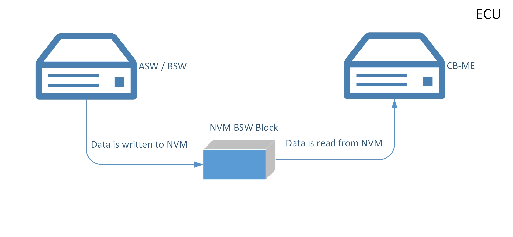

# UDS configuration sharing through NVM for CAN {#uds-configuration-sharing-through-nvm-for-can .p_Heading1 style="page-break-after: avoid;"}

+:-------------------------------------------------------------------------------------------------------------------------------------------------------------------------------+-------------------------------------------------------------------------------------------------------------------------------+
| **Navigation:**  [System features](system-concepts.html) \> [BSW](bsw.html) \> [Diagnostic services (UDS)](diagnostic-services.html) \> [UDS overview](uds---overview.html) \> |    |
|                                                                                                                                                                                |                                                                                                                               |
| # UDS configuration sharing through NVM for CAN {#uds-configuration-sharing-through-nvm-for-can-1 .p_Heading1 style="page-break-after: avoid;"}                                |                                                                                                                               |
+--------------------------------------------------------------------------------------------------------------------------------------------------------------------------------+-------------------------------------------------------------------------------------------------------------------------------+

## Abstract: {#abstract .p_Heading2 style="page-break-after: avoid;"}

This page talks about UDS configuration sharing which is between ASW / BSW and CB-ME. This feature enables user to work at higher baud rate speeds up the flash-Process. If the CAN baud rate is changed in that UDS enabled channel through CAN configuration API in run-time, then that also will be updated in NVM. This feature also enables seamless communication between ECU and tester.

The configuration which are shared are listed below,

1.UDS based CAN channel number,

2.Baud rate,

3.Sampling point,

4.Node ID,

5.Tester ID,

6.RX / TX Identifiers.

This feature have the following advantages,

- CB-ME will be aware of run time CAN / UDS configuration change,

- Flash process can be carried out with user defined configurations &

- CB-ME will use same CAN Node ID the customer has defined in ASW.

 

+------------------------------------------------------------------------------------------+---------------------------------------------------------------------------------------------+
| {style="margin:0;width:2.1667in;height:0.7083in;border:none"} | UDS configuration sharing through NVM for CAN is applicable only to the UDS BODAS instance. |
|                                                                                          |                                                                                             |
|                                                                                          | Therefore, this works well with BODAS-service.                                              |
+------------------------------------------------------------------------------------------+---------------------------------------------------------------------------------------------+

 

## Description: {#description .p_Heading2 style="page-break-after: avoid;"}

<figure style="margin:0;padding:0">

<figcaption aria-hidden="true">
Figure 45: Writing to the NVM
</figcaption>
</figure>

This configuration will be written to the NVM in the following scenario\'s:

- On initialization, the configuration from the easyConfig will be written to NVM block on the start-up.

- when the CAN configuration is changed for UDS based CAN channel through bds_can_init() or bds_can_initxt() API, then on successful CAN configuration the NVM is updated with the latest configuration.

- during the execution of ECU\'s reprogramming request, Diagnostic Session Control service (SID 0x10 and Subfunction 0x02)

- during the execution of ECU Reset service (SID 0x11)

Writing configuration data to NVM happens in the BSW so no changes are required from ASW side.

## Conclusion: {#conclusion .p_Heading2 style="page-break-after: avoid;"}

With this feature the flashing using CB-ME can be performed with user defined / higher baud rate speeds configurations. This feature will enable synchronization between BSW / ASW and CB-ME.

 

 
