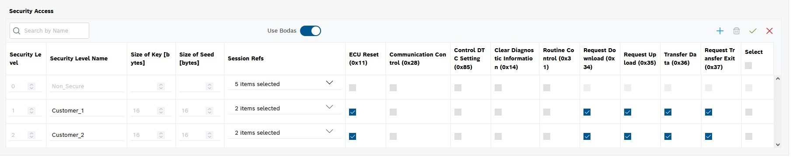

# Configuration {#configuration .p_Heading1 style="page-break-after: avoid;"}

+:--------------------------------------------------------------------------------------------------------------------------------+-----------------------------------------------------------------------------------------------------------------------+
| **Navigation:**  [System features](system-concepts.html) \> [Security](security.html) \> [Authorization](authorization.html) \> |    |
|                                                                                                                                 |                                                                                                                       |
| # Configuration {#configuration-1 .p_Heading1 style="page-break-after: avoid;"}                                                 |                                                                                                                       |
+---------------------------------------------------------------------------------------------------------------------------------+-----------------------------------------------------------------------------------------------------------------------+

You can configure the [Access Levels](access-levels.html){.topiclink}  and their [Access Rights](access-rights.html){.topiclink} by using easyConfig. The configuration is included in your BSW once you build and download it from easyConfig.

 

<figure style="margin:0;padding:0">

<figcaption aria-hidden="true">
Table19: Role Management configuration in easyConfig.
</figcaption>
</figure>

Refer to the easyConfig manual for more information about how the SecurityAccess service can be configured.

## Flashing without an ASW {#flashing-without-an-asw .p_Heading2 style="page-break-after: avoid;"}

If you have not yet flashed an application onto the RC or have previously erased the application, the RC provides a default authorization table that can be used for the authentication process.

  Access Rights\*       ECU Reset   Communication Control   Control DTC Settings   Clear DTC   Save changed DID\'s   Flash Control Block   Flash BSW + ASW   Change User Password
  --------------------- ----------- ----------------------- ---------------------- ----------- --------------------- --------------------- ----------------- ----------------------
  Default (0)           O           W                       W                      O           W                     W                     W                 W
  Development (1)       P           P                       P                      P           P                     P                     P                 O
  Password Change (2)   P           O                       O                      O           O                     O                     O                 P
  Service (3)           P           O                       O                      P           P                     P                     P                 O

[]{#fig_b8d522 .hmanchor}Table 2: Default authorization table

 

The default passwords for the RC are described in the table below.

  Access level   Default Password
  -------------- ------------------
  0              DEF_PASSWORD_021
  1              DEF_PASSWORD_022
  2              DEF_PASSWORD_023
  3              DEF_PASSWORD_024
  4              DEF_PASSWORD_025
  5              DEF_PASSWORD_026
  6              DEF_PASSWORD_027
  7              DEF_PASSWORD_028
  8              DEF_PASSWORD_029
  9              DEF_PASSWORD_030

[]{#fig_b24f3a .hmanchor}Table 3: Default access level passwords

 

  ------------------------------------------------------------------------------------------ ----------------------------------------------------------------------------------------------------------------------------------------------------------------------------------------------------------
  {style="margin:0;width:2.1667in;height:0.7083in;border:none"}   Make sure to change the passwords of your RCs when you use them productively! The default passwords are not kept secret and do not follow the [Password guideline](password-guideline.html){.topiclink}.
  ------------------------------------------------------------------------------------------ ----------------------------------------------------------------------------------------------------------------------------------------------------------------------------------------------------------
