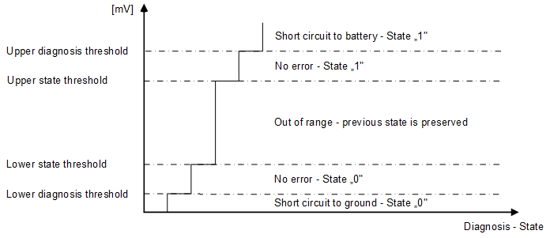

# Configure a digital input {#configure-a-digital-input .p_Heading1 style="page-break-after: avoid;"}

+:--------------------------------------------------------------------------------------------------------+----------------------------------------------------------------------------------------------------------------------------------------+
| **Navigation:**  [System features](system-concepts.html) \> [BSW](bsw.html) \> [Inputs](inputs.html) \> |    |
|                                                                                                         |                                                                                                                                        |
| # Configure a digital input {#configure-a-digital-input-1 .p_Heading1 style="page-break-after: avoid;"} |                                                                                                                                        |
+---------------------------------------------------------------------------------------------------------+----------------------------------------------------------------------------------------------------------------------------------------+

The BSW supports two input types:

- Digital input (DI).

- Analog input (AI), which can also be used as digital input (AID).

 

DI input

The thresholds of a digital input is configured with eC (easyConfig).\
 

AID input

 

The figure below describes the thresholds for different scenarios  and the corresponding states and associated errors.

 

 

{style="margin:0;width:7.2500in;height:3.1354in;border:none"}

 

The upper threshold depend on the the voltage range from an input. See  bds_in_aiv_cfg API for details related to the diagnosis threshold and  bds_in_aid_cfg for the  details related to state threshold. The faults are indicated after the debounce time has elapsed . Further, it also depends on the hardware configuration of the corresponding input (with pull up resistor or pull down resistor or pull up and pull down resistors) in case of an open load. The faults are just indicated, there is no reaction from the BSW.

 

Below are the examples for an input with a nominal input voltage from 5V. The input has a pull up resistor, the resulting open load voltage is approximately 3500mV.

 

Example1 : AID input without diagnosis

 

Configured state thresholds from the application:

- Upper state threshold is 1800mV.

- Lower state threshold is 1200mV

 

- State \"1\" if input voltage \>= 1800mV

- State \"0\" if input voltage \<= 1200mV

- Fault OR (Out of range) detected if the input voltage is higher than 1200mV or lower than 1800mV

 

Example2 : AID input with diagnosis

 

Configured state and diagnosis thresholds from the application:

- Upper diagnosis threshold is 3000mV.

- Upper state threshold is 1800mV.

- Lower state threshold is 1200mV

- Lower diagnosis threshold is 150mV.

 

With this configuration an open load is also detected:

- State \"1\" if input voltage \>= 1800mV

- State \"0\" if input voltage \<= 1200mV

- Fault SCB (Short circuit to battery) is detected if the input voltage is higher than 3000mV

- Fault SCG (Short circuit to ground) is detected if the  input voltage is lower than 150mV

- Fault OR (Out of range) is detected if the input voltage is higher than 1200mV and lower than 1800mV

 

 
