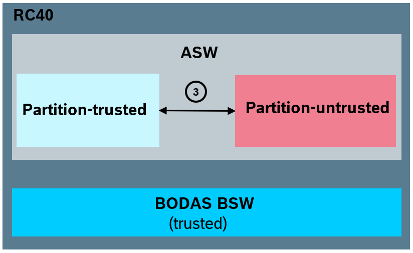
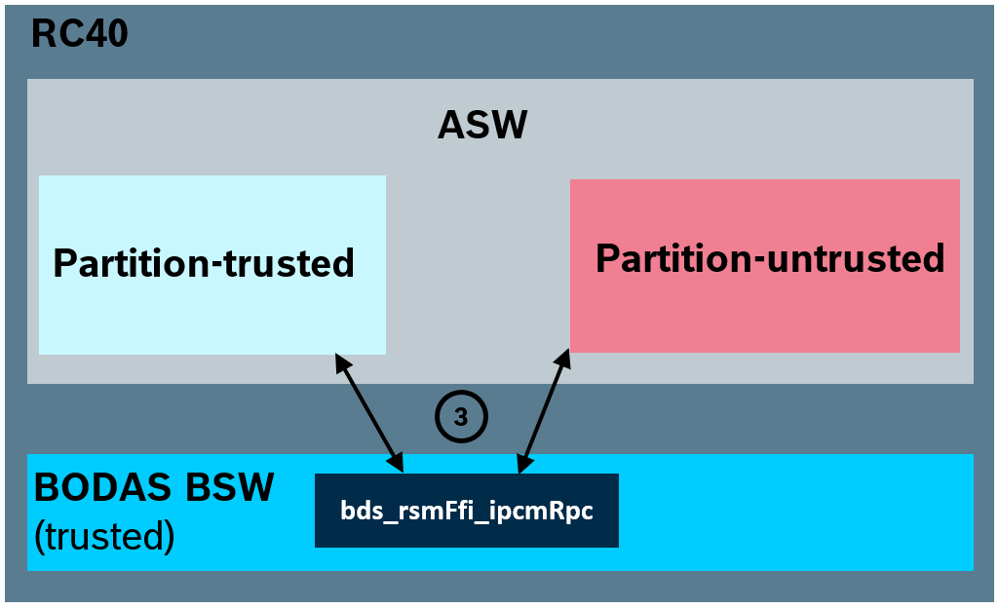
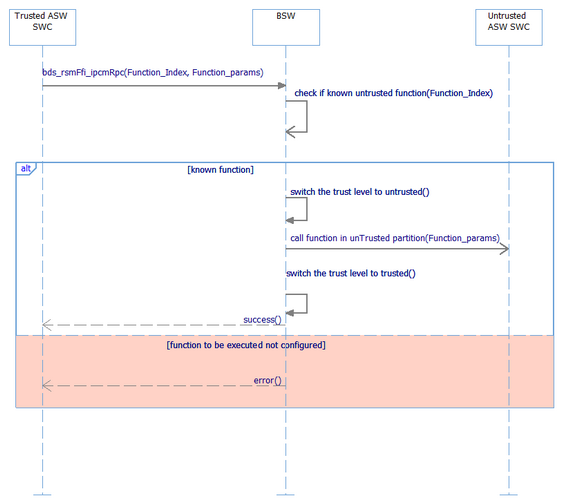
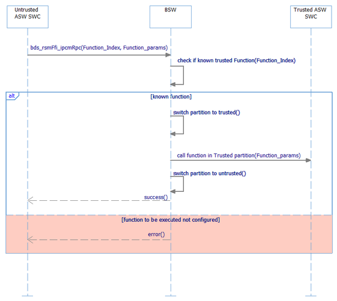
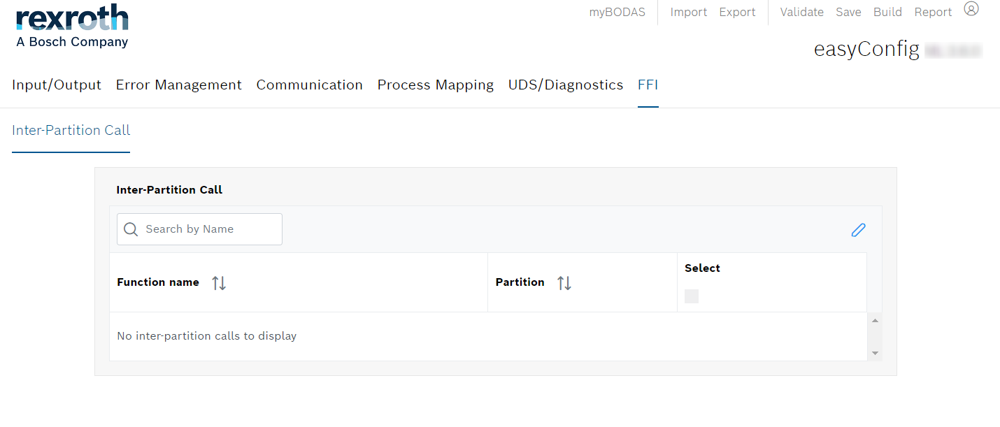

# Inter-partition interactions {#inter-partition-interactions .p_Heading1 style="page-break-after: avoid;"}

+:----------------------------------------------------------------------------------------------------------------------------------------------------------------------------------------------------------------------------------+-------------------------------------------------------------------------------------------------------------------------------------------------------------------+
| **Navigation:**  [Safety manual](safety-manual.html) \> [Safety-related software and software toolchain](safety-relatedsoftwareandsoftwaretoolchain.html) \> [Freedom from Interference (FFI)](freedom-from-interference.html) \> |    |
|                                                                                                                                                                                                                                   |                                                                                                                                                                   |
| # Inter-partition interactions {#inter-partition-interactions-1 .p_Heading1 style="page-break-after: avoid;"}                                                                                                                     |                                                                                                                                                                   |
+-----------------------------------------------------------------------------------------------------------------------------------------------------------------------------------------------------------------------------------+-------------------------------------------------------------------------------------------------------------------------------------------------------------------+

This section describes the implementation guidelines for inter- (cross-) partition interaction scenarios (path 3 in figure below) of application software components in partition concept.

<figure style="margin:0;padding:0">

<figcaption aria-hidden="true">
Figure 129: Inter-partition interaction
</figcaption>
</figure>

The inter-partition interactions are necessary to get data from or set data in the other partitions. In the CODESYS environment, this can be achieved through global variables method or C-function calls. It can be challenging to ensure software independence if these methods are used. The RC40 [freedom from interference (FFI) concept](freedom-from-interference.html){.topiclink} implements a new mechanism called inter-partition communication manager (IPCM).

 

The application software components shall use API  bds_rsmFfi_ipcmRpc bds_rsmFfi_ipcmRpc bds_rsmFfi_ipcmRpc implemented by BSW to interact between the partitions. The diagram below visualizes this.

 

<figure style="margin:0;padding:0">

<figcaption aria-hidden="true">
Figure 130: Interaction of partitions with BODAS BSW
</figcaption>
</figure>

 

## Typical use-case of inter-partition interactions {#typical-use-case-of-inter-partition-interactions .p_Heading2 style="page-break-after: avoid;"}

 

The example below explains a sample use-case of inter-partition interactions and why IPCM is needed to ensure the software independence between partitions in such scenario.

 

In below example, we have a safe code implemented in a trusted partition.

+-----------------------------------------------------------------------+
| Safe code in trusted partition                                        |
+=======================================================================+
| uint16 IgnitionStatus_u16;             //Trusted variable             |
|                                                                       |
|                                                                       |
|                                                                       |
| //Cycle task for 80ms                                                 |
|                                                                       |
| void OS_80ms_Task(void)                //Trusted task                 |
|                                                                       |
| {                                                                     |
|                                                                       |
|  appl_start_ignition();               //Trusted process               |
|                                                                       |
| }                                                                     |
|                                                                       |
|                                                                       |
|                                                                       |
| //Function to start an ignition                                       |
|                                                                       |
| void appl_start_ignition(void)                                        |
|                                                                       |
| {                                                                     |
|                                                                       |
|  IgnitionStatus_u16 = 0x1000;         //Writing a trusted variable    |
|                                                                       |
| }                                                                     |
+-----------------------------------------------------------------------+

 

In the example below, we have a non-safe code implemented.

+-----------------------------------------------------------------------+
| non-safe code                                                         |
+=======================================================================+
| uint16 ledStatus_u16;                  //Untrusted variable           |
|                                                                       |
|                                                                       |
|                                                                       |
| //Function to set a led output                                        |
|                                                                       |
| void appl_set_led(void)                                               |
|                                                                       |
| {                                                                     |
|                                                                       |
|  ledStatus_u16 = 0x10;                //Writing a untrusted variable  |
|                                                                       |
| }                                                                     |
+-----------------------------------------------------------------------+

 

A typical use-case could be a safe code trying to set an output in the non safe code. In the example above, the function appl_start_ignition() set a led using function appl_set_led().

+----------------------------------------------------------------------------------------------+
| Safe code in trusted partition                                                               |
+==============================================================================================+
| uint16 IgnitionStatus_u16;             //Trusted variable                                    |
|                                                                                              |
|                                                                                              |
|                                                                                              |
| //Cycle task for 80ms                                                                        |
|                                                                                              |
| void OS_80ms_Task(void)                //Trusted task                                        |
|                                                                                              |
| {                                                                                            |
|                                                                                              |
|  appl_start_ignition();               //Trusted process                                      |
|                                                                                              |
| }                                                                                            |
|                                                                                              |
|                                                                                              |
|                                                                                              |
| //Function to start an ignition                                                              |
|                                                                                              |
| void appl_start_ignition(void)                                                               |
|                                                                                              |
| {                                                                                            |
|                                                                                              |
|  IgnitionStatus_u16 = 0x1000;         //Writing a trusted variable                           |
|                                                                                              |
|                                                                                              |
|                                                                                              |
| appl_set_led();                      //This implementation is not allowed as per FFI concept |
|                                                                                              |
| }                                                                                            |
+----------------------------------------------------------------------------------------------+

 

In the code snippet above, the code line in RED is an undesired implementation and deviates from the concept of freedom from interference because appl_set_led()is executing in the function appl_start_ignition()that is running in a trusted task therefore it is running in a trusted mode. Therefore appl_set_led()also executes in the trusted mode giving it an access to complete RAM memory. This could be serious issue in safety context because appl_set_led() being a non safe code can write into safety variable IgnitionStatus_u16. The expected behavior to handle above use case is to run the appl_set_led() in untrusted mode even though it is triggered from safety function. This expected behavior can be achieved using the  bds_rsmFfi_ipcmRpc bds_rsmFfi_ipcmRpc bds_rsmFfi_ipcmRpc.

 

+-----------------------------------------------------------------------+
| Safe code in trusted partition with ipcm API                          |
+=======================================================================+
| uint16 IgnitionStatus_u16;             //Trusted variable             |
|                                                                       |
|                                                                       |
|                                                                       |
| //Cycle task for 80ms                                                 |
|                                                                       |
| void OS_80ms_Task(void)                //Trusted task                 |
|                                                                       |
| {                                                                     |
|                                                                       |
|  appl_start_ignition();               //Trusted process               |
|                                                                       |
| }                                                                     |
|                                                                       |
|                                                                       |
|                                                                       |
| //Function to start an ignition                                       |
|                                                                       |
| void appl_start_ignition(void)                                        |
|                                                                       |
| {                                                                     |
|                                                                       |
|  bds_rsmFfi_ipcmRes_ts ret_s;                                         |
|                                                                       |
|                                                                       |
|                                                                       |
|  IgnitionStatus_u16 = 0x1000;         //Writing a trusted variable    |
|                                                                       |
|                                                                       |
|                                                                       |
|   //execute appl_set_led() via ipcm API                               |
|                                                                       |
|  ret_s = bds_rsmFfi_ipcmRpc (bds_rsmFfi_appl_set_led_E, NULL);        |
|                                                                       |
|                                                                       |
|                                                                       |
|  if(ret_s.status_e == bds_rsmFfi_ok_E)                                |
|                                                                       |
|      {                                                                |
|                                                                       |
|         //successfull                                                 |
|                                                                       |
|      }                                                                |
|                                                                       |
| }                                                                     |
+-----------------------------------------------------------------------+

 

In the code snippet above, the non safe function appl_set_led()is triggered from safety function appl_start_ignition()through  bds_rsmFfi_ipcmRpc bds_rsmFfi_ipcmRpc bds_rsmFfi_ipcmRpc API instead of conventional C function call. The  bds_rsmFfi_ipcmRpc bds_rsmFfi_ipcmRpc bds_rsmFfi_ipcmRpc will execute the function appl_set_led()in untrusted mode in the example above.

 

The example above demonstrates a typical use case of the trusted partition interacting with the untrusted partition. Similar scenario can exist where the untrusted partition wants to interact with a trusted partition. The  bds_rsmFfi_ipcmRpc bds_rsmFfi_ipcmRpc bds_rsmFfi_ipcmRpc supports interactions in both direction.

 

## Working principle of bds_rsmFfi_ipcmRpc API {#working-principle-of-bds_rsmffi_ipcmrpc-api .p_Heading2 style="page-break-after: avoid;"}

The  bds_rsmFfi_ipcmRpc bds_rsmFfi_ipcmRpc bds_rsmFfi_ipcmRpc API implements a mechanism for executing a function belonging to one partition from another partition. During execution, based on the caller partition and partition of the called function, necessary mode change is handled by  bds_rsmFfi_ipcmRpc bds_rsmFfi_ipcmRpc bds_rsmFfi_ipcmRpc. The below sequence diagrams explain the working principle of  bds_rsmFfi_ipcmRpc bds_rsmFfi_ipcmRpc bds_rsmFfi_ipcmRpc.

<figure style="margin:0;padding:0">

<figcaption>
Figure 131: Sequence diagram: Caller is from trusted partition and called function is from untrusted partition
</figcaption>
</figure>

 

<figure style="margin:0;padding:0">

<figcaption>
Figure 132: Sequence diagram: Caller is from untrusted partition and called function is from trusted partition
</figcaption>
</figure>

 

It is also possible to pass parameters from the caller function to the called function through the API  bds_rsmFfi_ipcmRpc bds_rsmFfi_ipcmRpc bds_rsmFfi_ipcmRpc.

 

In both sequence diagrams, the first step in the execution of bds_rsmFfi_ipcmRpc bds_rsmFfi_ipcmRpc bds_rsmFfi_ipcmRpc API is to check if the function to be called and its partition is known. If the called function is unknown then  bds_rsmFfi_ipcmRpc bds_rsmFfi_ipcmRpc bds_rsmFfi_ipcmRpc API will exit with an error code.

## Inter-partition call configurations {#inter-partition-call-configurations .p_Heading2 style="page-break-after: avoid;"}

 

As discussed in the above section, it is necessary for bds_rsmFfi_ipcmRpc bds_rsmFfi_ipcmRpc bds_rsmFfi_ipcmRpc API to know the details of the function to be called. This input shall be provided by application developer via easyConfig. The configuration is available in FFI tab-\> Inter-Partition Call

 

<figure style="margin:0;padding:0">

<figcaption aria-hidden="true">
Figure 133: easyConfig configuration window for inter-partition calls
</figcaption>
</figure>

 

In above configuration window, the application developer should input the following information:

1\. Name of the function, allowed to be called by other partition, typically C name of the function.

2\. Partition type for the function, allowed to be called by other partition. Partition: Trusted or Untrusted.

3\. Partition type should be decided based on the mapping of safety level as explained in the section [Freedom from interference in RC4x](frequency-acquisition.html){.topiclink}

 

Refer to How to implement inter-partition call using the ipcm API

 
