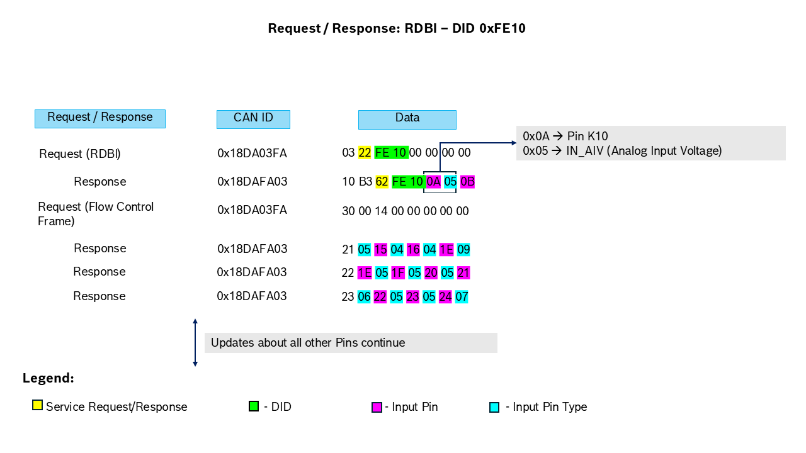
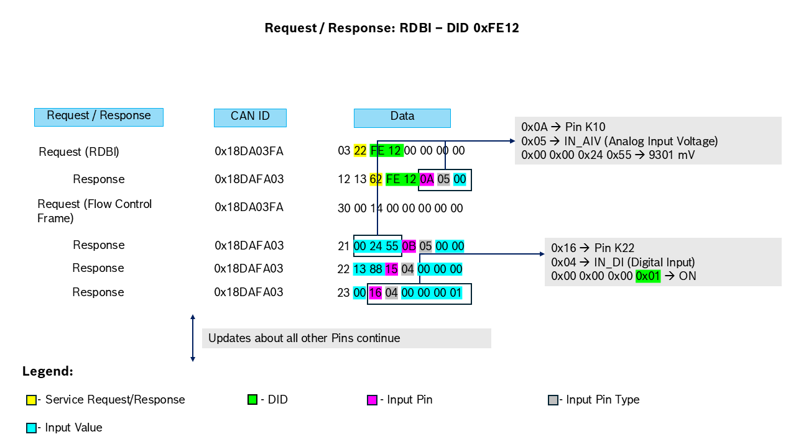

# DIDs for reading Input Pins {#dids-for-reading-input-pins .p_Heading1 style="page-break-after: avoid;"}

+:-----------------------------------------------------------------------------------------------------------------------------------------------------------------------------------------------------------------------------------------------------------------------------------------------------------------------+---------------------------------------------------------------------------------------------------------------------------------------------------------------------+
| **Navigation:**  [System features](system-concepts.html) \> [BSW](bsw.html) \> [Diagnostic services (UDS)](diagnostic-services.html) \> [UDS overview](uds---overview.html) \> [Data Identifier (DID)](data-identifier-(did).html) \> [DIDs for reading Input and Output Pins](data-identifiers-(did)-for-rea.html) \> | -for-rea.html "Previous Topic") -for-rea.html "Parent Chapter")  |
|                                                                                                                                                                                                                                                                                                                        |                                                                                                                                                                     |
| # DIDs for reading Input Pins {#dids-for-reading-input-pins-1 .p_Heading1 style="page-break-after: avoid;"}                                                                                                                                                                                                            |                                                                                                                                                                     |
+------------------------------------------------------------------------------------------------------------------------------------------------------------------------------------------------------------------------------------------------------------------------------------------------------------------------+---------------------------------------------------------------------------------------------------------------------------------------------------------------------+

DIDs which are used for reading input pins are:

+-----------+---------------------------------------------------------------------------------------+--------------------+--------------+---------------------------------------+------------------------------------------------------+
| DID       | Description (Long Name)                                                               | Short Name (label) | Display Type | Comment                               | Alternative BSW API                                  |
+-----------+---------------------------------------------------------------------------------------+--------------------+--------------+---------------------------------------+------------------------------------------------------+
| 0xFE10    | Input Pin Overview, from the ASW configuration in easyConfig of configured inputs     | Input Pin Overview | Hexadecimal  | Reading Input Pin and related type    | No BSW API for this.                                 |
+-----------+---------------------------------------------------------------------------------------+--------------------+--------------+---------------------------------------+------------------------------------------------------+
| 0xFE12    | Input Pin Port Values, actual input state values from ASW configuration in easyConfig | Get Input Values   | Hexadecimal  | Reading Input Pin and related voltage | Refer \"Type of Inputs\" at the end of this chapter. |
|           |                                                                                       |                    |              |                                       |                                                      |
|           |                                                                                       |                    |              |                                       |                                                      |
|           |                                                                                       |                    |              |                                       |                                                      |
|           |                                                                                       |                    |              |                                       |                                                      |
+-----------+---------------------------------------------------------------------------------------+--------------------+--------------+---------------------------------------+------------------------------------------------------+

### Note: {#note .p_Heading3 style="page-break-after: avoid;"}

- The DIDs are accessible within the Default diagnostic session without requiring any specific security access.

- These DIDs are read-only and cannot be modified or written to.

 

### 0xFE10 - Input Pin Overview, from the ASW configuration in easyConfig of configured inputs {#xfe10---input-pin-overview-from-the-asw-configuration-in-easyconfig-of-configured-inputs .p_Heading3 style="page-break-after: avoid;"}

oThe response data for reading this DID consists of the following:

+--------------------+--------+--------+---------------------+----------------------------------------------------------------------------------------------------------------------------------+----------------------------+---------+----------------------------------------+
| Name               | Size   | Length | Format of data sent | Format to be displayed                                                                                                           | Conversion                 | Minimum | Maximum                                |
+--------------------+--------+--------+---------------------+----------------------------------------------------------------------------------------------------------------------------------+----------------------------+---------+----------------------------------------+
| PIN number         | 1      | 1      | uint8               | Numeric. Valid range is 1-154(they are pin numbers).                                                                             | In hexadecimal data = 0xab | 0       | 0x99                                   |
|                    |        |        |                     |                                                                                                                                  |                            |         |                                        |
|                    |        |        |                     |                                                                                                                                  |                            |         | 0xFF - wrong (not required to display) |
+--------------------+--------+--------+---------------------+----------------------------------------------------------------------------------------------------------------------------------+----------------------------+---------+----------------------------------------+
| Pin / Channel type | 1      | 1      | uint8               | Numeric. See the \"Type of Inputs\" table at the end of this chapter for a detailed description of each value of channel type.\* | In hexadecimal data = 0xab | 4       | 7                                      |
|                    |        |        |                     |                                                                                                                                  |                            |         |                                        |
|                    |        |        |                     |                                                                                                                                  | ab: identical              |         | 0xFF - wrong (not required to display) |
+--------------------+--------+--------+---------------------+----------------------------------------------------------------------------------------------------------------------------------+----------------------------+---------+----------------------------------------+

Sample Request and Response:

<figure style="margin:0;padding:0">

<figcaption>
Figure 41: UDS Request / Response for RDBI - DID 0xFE10
</figcaption>
</figure>

 

### 0xFE12 - Input Pin Port Values, actual input state values from ASW configuration in easyConfig {#xfe12---input-pin-port-values-actual-input-state-values-from-asw-configuration-in-easyconfig .p_Heading3 style="page-break-after: avoid;"}

oThe response data for reading this DID consists the following:

+--------------------------+--------+--------+---------------------+------------------------------------------------------------------------------------------------------------------------------------------+------------+---------+----------------------------------------+
| Name                     | Size   | Length | Format of data sent | Format to be displayed                                                                                                                   | Conversion | Minimum | Maximum                                |
+--------------------------+--------+--------+---------------------+------------------------------------------------------------------------------------------------------------------------------------------+------------+---------+----------------------------------------+
| Input Pin Number         | 1      | 1      | uint8               | Numeric. Valid range is 1-154(they are pin numbers).                                                                                     | Identical  | 1       | 0x99                                   |
|                          |        |        |                     |                                                                                                                                          |            |         |                                        |
|                          |        |        |                     |                                                                                                                                          |            |         | 0xFF - wrong (not required to display) |
+--------------------------+--------+--------+---------------------+------------------------------------------------------------------------------------------------------------------------------------------+------------+---------+----------------------------------------+
| Input Pin / Channel Type | 1      | 1      | uint8               | Numeric. See the \"Type of Inputs\" table below (at the end of this chapter) for a detailed description of each value of channel type.\* | Identical  | 4       | 7                                      |
|                          |        |        |                     |                                                                                                                                          |            |         |                                        |
|                          |        |        |                     |                                                                                                                                          |            |         | 0xFF - wrong (not required to display) |
+--------------------------+--------+--------+---------------------+------------------------------------------------------------------------------------------------------------------------------------------+------------+---------+----------------------------------------+
| Input Pin Value          | 4      | 4      | uint8               | Actual input values                                                                                                                      | Identical  | 0       | 0xFFFFFFFF                             |
+--------------------------+--------+--------+---------------------+------------------------------------------------------------------------------------------------------------------------------------------+------------+---------+----------------------------------------+

 

Sample Request and Response:

<figure style="margin:0;padding:0">

<figcaption>
Figure 42: UDS Request / Response for RDBI - DID 0xFE12
</figcaption>
</figure>

### \*Type of Inputs: {#type-of-inputs .p_Heading3 style="page-break-after: avoid;"}

+----------------------------------+----------------------------------------------------------+------------------------------------+-------------+---------------------+
| Type of Input - Abbreviated Form | Meaning / Explanation                                    | Value as read in UDS Response byte | Units       | Alternative BSW API |
+----------------------------------+----------------------------------------------------------+------------------------------------+-------------+---------------------+
| IN_DI                            | Digital Input                                            | 4                                  | ON or OFF   | bds_inDig_get       |
+----------------------------------+----------------------------------------------------------+------------------------------------+-------------+---------------------+
| IN_AIV                           | Analog Input Voltage                                     | 5                                  | mV          | bds_inU_get         |
+----------------------------------+----------------------------------------------------------+------------------------------------+-------------+---------------------+
| IN_RI                            | Resistance Input                                         | 6                                  | Ohm         | bds_inR_get         |
+----------------------------------+----------------------------------------------------------+------------------------------------+-------------+---------------------+
| IN_FI                            | Frequency Input                                          | 7                                  | Hz          | bds_inPwm_getFrq    |
+----------------------------------+----------------------------------------------------------+------------------------------------+-------------+---------------------+
| SENT Input                       | SENT Input                                               | 8                                  | \-          | APIs as in SENT     |
+----------------------------------+----------------------------------------------------------+------------------------------------+-------------+---------------------+
| Phase Input                      | Phase Input gives both the frequency and direction value | 9                                  | \-          | bds_inPha_get       |
|                                  |                                                          |                                    |             |                     |
|                                  |                                                          |                                    |             | bds_inPha_getTiBufd |
+----------------------------------+----------------------------------------------------------+------------------------------------+-------------+---------------------+
| AIC Input                        | Analog Input Current Input                               | 10                                 | uA          | bds_inI_get         |
+----------------------------------+----------------------------------------------------------+------------------------------------+-------------+---------------------+
| \-                               | Unused Input Pin number/ unused channel type             | 0xFF                               | \-          | \-                  |
+----------------------------------+----------------------------------------------------------+------------------------------------+-------------+---------------------+

The Pin Type 08 (SENT) and Pin Type 09 (Phase) are not supported in the BODAS-service.\
Hence, if you request the value of a Pin of this category then you will receive response for that pin as 0xFFFFFFFF.
