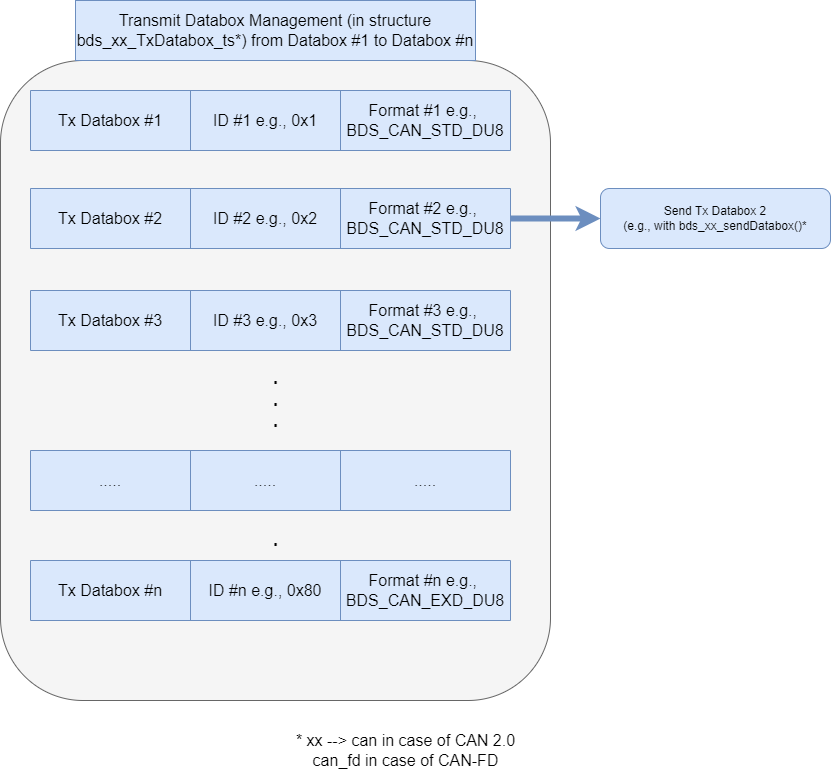
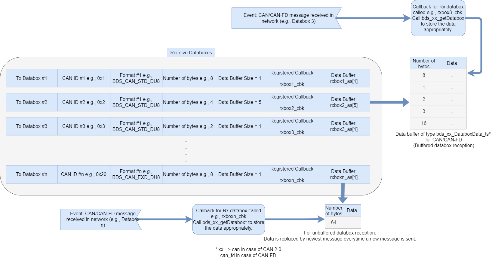

# Databoxes {#databoxes .p_Heading1 style="page-break-after: avoid;"}

+:-------------------------------------------------------------------------------------------------------------------------------------------------------------------------------------------------------------------------------------------+---------------------------------------------------------------------------------------------------------------+
| **Navigation:**  [System features](system-concepts.html) \> [BSW](bsw.html) \> [Network communication & protocols](network-comm-protocols.html) \> [CAN-FD](can-fd.html) \> [CAN-FD legacy communication](chapter-page-template_2.html) \> |    |
|                                                                                                                                                                                                                                            |                                                                                                               |
| # Databoxes {#databoxes-1 .p_Heading1 style="page-break-after: avoid;"}                                                                                                                                                                    |                                                                                                               |
+--------------------------------------------------------------------------------------------------------------------------------------------------------------------------------------------------------------------------------------------+---------------------------------------------------------------------------------------------------------------+

- Databoxes are messages which have separate memory allocated for them, which have

oA dedicated databox number

oCAN ID

oCAN ID format

oNumber of bytes (for Receive databox)

oData (including a data buffer) (for Receive databox)

oReceive callback (for Receive databox)

- Transmit databoxes shall be used for priority sending of CAN-FD messages compared to CAN-FD buffers (i.e., CAN-FD databoxes are sent / received first)

<figure style="margin:0;padding:0">

<figcaption>
Image: Tx Databox and related Transmission CAN/CAN-FD
</figcaption>
</figure>

- Receive databoxes shall be used for effective organization of incoming messages.

 

 

<figure style="margin:0;padding:0">

<figcaption>
Image: Rx Databox and Related Reception for a given CAN channel, for CAN/CAN-FD messages.
</figcaption>
</figure>

- There are three phases of databox usage:

oRegister databoxes - register memory for usage of Transmit / Receive Databoxes

oInitialize databoxes - initializes parameters of databox

§Transmit Databox - Databox number, CAN ID, CAN ID format

§Receive Databox - Databox number, CAN ID, CAN ID format, Number of bytes of data, CAN-FD Receive Databox data buffer, Databox buffer length, Callback function name

oSend / Receive databox

- On how to use the  BSW APIs for CAN-FD legacy communication, refer the How-To page [How to implement CAN-FD legacy using Transmit, Receive Databoxes](howtoimplementcanlegacyusingtransmitreceivebuffers.html){.topiclink}

- On how to use the  BSW APIs for CAN legacy communication, refer the How-To page [How to implement CAN legacy using Transmit, Receive Databoxes](howtoimplementcanlegacyusingtransmitreceivedataboxes.html){.topiclink}.
