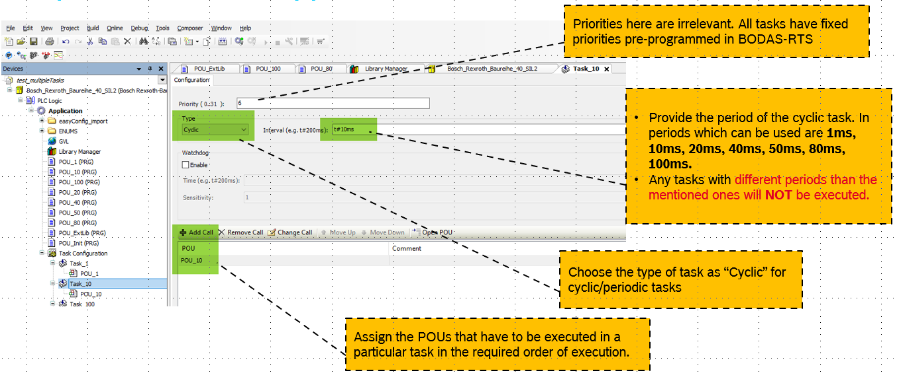
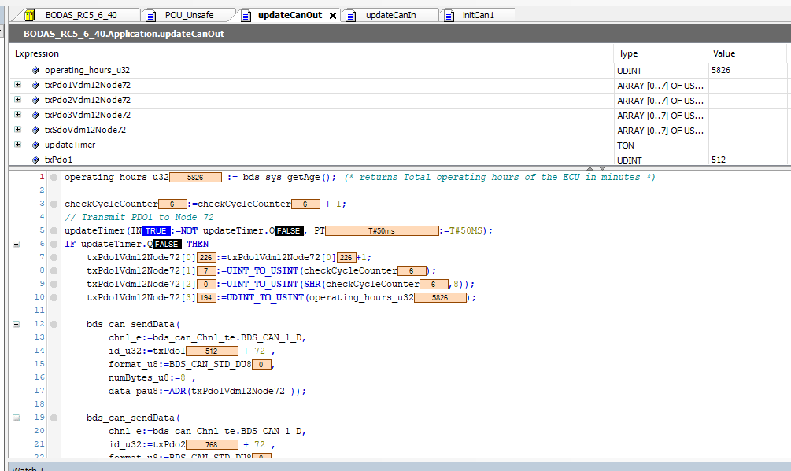

# Device scan and log-in {#device-scan-and-log-in .p_Heading1 style="page-break-after: avoid;"}

+:----------------------------------------------------------------------------------------------------------------------------------------------------------------------------------------------------------------------------------+-----------------------------------------------------------------------------------------------------------------------------------------------------------+
| **Navigation:**  [Introduction](introduction.html) \> [First steps with RC](preparation.html) \> [Configurations](required-tools.html) \> [Step 5: ASW development & components involved](step-5-asw-development--compon.html) \> |    |
|                                                                                                                                                                                                                                   |                                                                                                                                                           |
| # Device scan and log-in {#device-scan-and-log-in-1 .p_Heading1 style="page-break-after: avoid;"}                                                                                                                                 |                                                                                                                                                           |
+-----------------------------------------------------------------------------------------------------------------------------------------------------------------------------------------------------------------------------------+-----------------------------------------------------------------------------------------------------------------------------------------------------------+

The user can log-in to RC4x device to monitor the ASW variables of CODESYS. Before starting to monitor the user shall make sure the following criteria are met:

- The machine is in safe state.

- The RC4x device is up and running (a merged hex file  is flashed)

- PEAK-CAN hardware device is connected to CAN1. CAN1 is pre-configured to 1000Kbps, however user can reinitialize the required baudrate in ASW.

- The CODESYS Gateway is started (can be viewed and controlled via Gateway Tray on Windows toolbar)

- You can see CAN messages with IDs 08Ah, 60Ah & 58Ah on CAN trace (these are CAN messages exchanged between between CODESYS Gateway and RC4x device)

When the above mentioned criteria are satisfied, you can connect to RC4x device from CODESYS by clicking on Scan Network. Device with name RC40small is appeared on the scan and connected with a double click on device name.

 

<figure style="margin:0;padding:0">

<figcaption aria-hidden="true">
CODESYS Scan Network lists devices connected to CODESY Gateway
</figcaption>
</figure>

 

After the CODESYS IDE is connected to RC4x device, you can log-in to the device to monitor the ASW variables of each POU. Click on Online tab of CODESYS - click Login.

With the Login, monitoring of ASW begins. Open each POU or add selected variables of each POU to the watch list to monitor them.

 

<figure style="margin:0;padding:0">

<figcaption aria-hidden="true">
Device Login from CODESYS for monitoring
</figcaption>
</figure>
