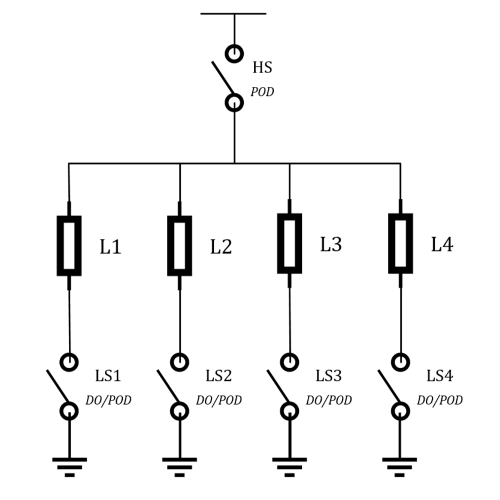
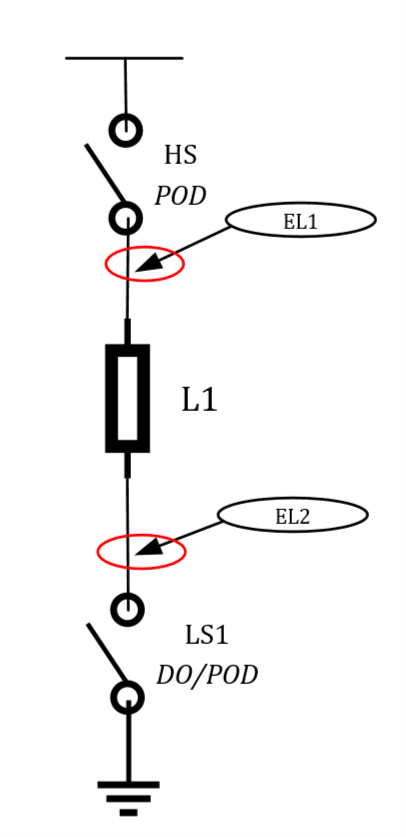
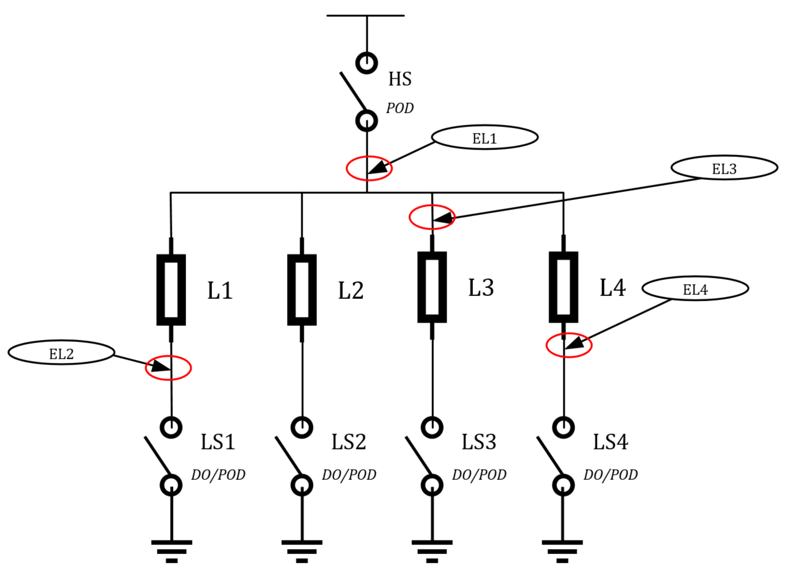

# DHDLM {#dhdlm .p_Heading1 style="page-break-after: avoid;"}

+:----------------------------------------------------------------------------------------------------------------------------------------------------+---------------------------------------------------------------------------------------------------------------+
| **Navigation:**  [System features](system-concepts.html) \> [BSW](bsw.html) \> [Outputs](outputs.html) \> [SAFOUT function](safety-outputs.html) \> |    |
|                                                                                                                                                     |                                                                                                               |
| # DHDLM {#dhdlm-1 .p_Heading1 style="page-break-after: avoid;"}                                                                                     |                                                                                                               |
+-----------------------------------------------------------------------------------------------------------------------------------------------------+---------------------------------------------------------------------------------------------------------------+

Digital High - Digital Low Multiple (DHDLM) operating mode.

DHDLM is the combination of 1 common POD (digital high-side power output (HS) with close-loop current control (CLCC)) and up to 4 parallel DOs (digital low-side power output (LS)) or proportional outputs used as a digital outputs (POD).

 

   

<figure style="margin:0;padding:0">

<figcaption aria-hidden="true">
Figure 82:SAFOUT channel by comprised of a HS with CLCC combined with up to four digital LS outputs
</figcaption>
</figure>

 

## Safety functions {#safety-functions .p_Heading2 style="page-break-after: avoid;"}

Safety function related to this configuration are

- Prevention from unintended actuation, and

- Safe deactivation of the actuators

For these safety functions, each of the low-side power outputs is considered to be a functional channel.

## Failure detection possibilities of the DHDLM mode {#failure-detection-possibilities-of-the-dhdlm-mode .p_Heading2 style="page-break-after: avoid;"}

+-------------------------------+----------------------------------------------------+-------------+
| Failure mode                  | Failure detected?                                  | Comments    |
|                               |                                                    |             |
|                               |                                                    |             |
|                               +----------------+----------------+------------------+             |
|                               | Active load    | Inactive load  | Inactive channel |             |
|                               |                |                |                  |             |
|                               | (HS = PWM,     | (HS = PWM,     | (HS = LS = OFF)  |             |
|                               |                |                |                  |             |
|                               | LS = ON)       | LS = OFF)      |                  |             |
+===============================+================+================+==================+=============+
| HS                            | Yes            | Yes            | Yes              | \-          |
|                               |                |                |                  |             |
| short circuit to ground       |                |                |                  |             |
+-------------------------------+----------------+----------------+------------------+-------------+
| HS                            | No             | No             | Yes              | \-          |
|                               |                |                |                  |             |
| short circuit to battery      |                |                |                  |             |
+-------------------------------+----------------+----------------+------------------+-------------+
| HS                            | Yes            | Yes            | Yes              | \-          |
|                               |                |                |                  |             |
| open circuit                  |                |                |                  |             |
+-------------------------------+----------------+----------------+------------------+-------------+
| LS                            | Yes            | Yes            | Yes              | \-          |
|                               |                |                |                  |             |
| short circuit to ground       |                |                |                  |             |
+-------------------------------+----------------+----------------+------------------+-------------+
| LS                            | Yes            | Yes            | Yes              | \-          |
|                               |                |                |                  |             |
| short circuit to battery      |                |                |                  |             |
+-------------------------------+----------------+----------------+------------------+-------------+
| LS                            | Yes            | Yes            | Yes              | \-          |
|                               |                |                |                  |             |
| open circuit                  |                |                |                  |             |
+-------------------------------+----------------+----------------+------------------+-------------+
| Over current                  | Yes            | N.A.           | N.A.             | \-          |
+-------------------------------+----------------+----------------+------------------+-------------+
| Mismatch of HS and LS current | N.A.           | N.A.           | N.A.             | \-          |
+-------------------------------+----------------+----------------+------------------+-------------+

 

## Configuration {#configuration .p_Heading2 style="page-break-after: avoid;"}

Example:

#define DHDLM_CHNL2  ( DHDLM \| CHNL2)

bds_safout_cfg(DHDLM_CHNL2, K08, K16, K15, K13, 0);

## Use {#use .p_Heading2 style="page-break-after: avoid;"}

Switch ON LS1:(LS1 is ON )

bds_safout(DHDLM_CHNL2, K16, 1);

 

Switch ON LS2:(LS1 is ON and LS2 is ON)

bds_safout(DHDLM_CHNL2, K16, 1);

bds_safout(DHDLM_CHNL2, K15, 1);

 

Shut-OFF:

bds_safout(DHDLM_CHNL2, K16, 0);

bds_safout(DHDLM_CHNL2, K15, 0);

 

## Diagnostics {#diagnostics .p_Heading2 style="page-break-after: avoid;"}

The diagnostic information (diag_u32) of safout channel is read using  bds_safout_getStatus.

In figure below, ELx represents the error location.

1 HS : 1 LS configuration  

 

 

<figure style="margin:0;padding:0">

<figcaption aria-hidden="true">
Figure 83: Error locations (EL) in 1:1 HS-LS combination of SAFOUT
</figcaption>
</figure>

 

The table below indicates the different [diagnostic fault checks (DFC)](diagnostic-fault-check.html){.topiclink} status words that will be displayed in case of different errors (short circuit to battery (SCB) / ground (SCG), open load (OL)) depending on the SAFOUT channel status.

+------------+-----------------------+---------------------+--------------------------+
| Error type | Safout channel status | diag_u32            | Remarks                  |
|            |                       +-----------+---------+                          |
|            |                       | EL1       | EL2     |                          |
+============+=======================+===========+=========+==========================+
| SCB        | OFF                   | 0x00001   | 0x00001 | only detected by HS      |
|            +-----------------------+-----------+---------+--------------------------+
|            | ON                    | 0x00000\* | 0x00010 | \*Not detected           |
+------------+-----------------------+-----------+---------+--------------------------+
| SCG        | OFF                   | 0x00022   | 0x00020 |                          |
|            +-----------------------+-----------+---------+--------------------------+
|            | ON                    | 0x00002   | 0x00020 |                          |
+------------+-----------------------+-----------+---------+--------------------------+
| OL         | OFF                   | 0x00040   | 0x00040 | OL is not detected by HS |
|            +-----------------------+-----------+---------+--------------------------+
|            | ON                    | 0x00040   | 0x00040 | OL is not detected by HS |
+------------+-----------------------+-----------+---------+--------------------------+

For shorted load, HS will detect an SCG error and LS will detect an SCB error. (diag : 0x12)  

 

1 HS : 4 LS configuration  

 

<figure style="margin:0;padding:0">

<figcaption aria-hidden="true">
Figure 83: Error location in 1:4 HS-LS combination of SAFOUT
</figcaption>
</figure>

 

The table below indicates the different [diagnostic fault checks (DFC)](diagnostic-fault-check.html){.topiclink} status words that will be displayed in case of different errors (short circuit to battery (SCB) / ground (SCG), open load (OL)) depending on the SAFOUT channel status.

+------------+-----------------------+-------------------------------------------+------------------------------+
| Error type | Safout channel Status | diag_u32                                  | Remarks                      |
|            |                       +-----------+---------+-----------+---------+                              |
|            |                       | EL1       | EL2     | EL3       | EL4     |                              |
+============+=======================+===========+=========+===========+=========+==============================+
| SCB        | OFF                   | 0x00001   | 0x00001 | 0x00001   | 0x00001 | only detected by HS          |
|            +-----------------------+-----------+---------+-----------+---------+------------------------------+
|            | ON1                   | 0x00000\* | 0x00010 | 0x00000\* | 0x10000 | \* Not detected              |
+------------+-----------------------+-----------+---------+-----------+---------+------------------------------+
| SCG        | OFF                   | 0x22222   | 0x22220 | 0x22220   | 0x22220 |                              |
|            +-----------------------+-----------+---------+-----------+---------+------------------------------+
|            | ON1                   | 0x00002   | 0x00020 | 0x00002   | 0x20000 |                              |
+------------+-----------------------+-----------+---------+-----------+---------+------------------------------+
| OL         | OFF                   | 0x44440   | 0x00040 | 0x04000   | 0x40000 | OL is not detected by HS     |
|            +-----------------------+-----------+---------+-----------+---------+------------------------------+
|            | ON1                   | 0x22240\* | 0x00040 | 0x04000   | 0x40000 | \*LS1 is ON, other LS\'s OFF |
+------------+-----------------------+-----------+---------+-----------+---------+------------------------------+

For shorted load, HS will detect an SCG error and LS will detect an SCB error.

Example: shorted load L3 (diag_u32: 0x1002)  

 

 
