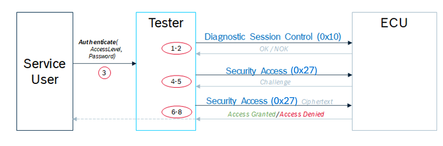
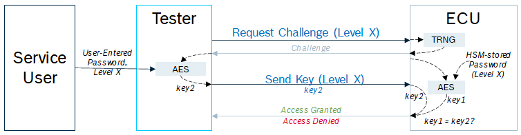

# Diagnostic authentication {#diagnostic-authentication .p_Heading1 style="page-break-after: avoid;"}

+:----------------------------------------------------------------------------------------------------------------------------------+-------------------------------------------------------------------------------------------------------------------------+
| **Navigation:**  [System features](system-concepts.html) \> [Security](security.html) \> [Authentication](authentication.html) \> |    |
|                                                                                                                                   |                                                                                                                         |
| # Diagnostic authentication {#diagnostic-authentication-1 .p_Heading1 style="page-break-after: avoid;"}                           |                                                                                                                         |
+-----------------------------------------------------------------------------------------------------------------------------------+-------------------------------------------------------------------------------------------------------------------------+

The authentication procedure ensures that only authorized users have access to a designated set of [access rights](access-rights.html){.topiclink}.

## Diagnostic session establishment         {#diagnostic-session-establishment .p_Heading2 style="page-break-after: avoid;"}

The user wants to access privileged diagnostic features on a connected RC via UDS. The authentication process is performed as follows:

<figure style="margin:0;padding:0">

<figcaption aria-hidden="true">
Figure20: Secure session establishment for UDS communication.
</figcaption>
</figure>

 

1.The tester establishes a diagnostic session to start the communication with the device.

2.The session is established and a default access level is granted to the user (basic rights granted).

3.The service user selects an access level and enters the respective password to increase the access level of the session.

4.The tester requests a challenge from the RC using the UDS \'SecurityAccess\' service.

5.The RC responds with a randomly generated challenge.

6.The tester combines challenge and password to a ciphertext.

7.The tester requests access to the desired access level by transferring the ciphertext to the RC by using the UDS \'SecurityAccess\' service.

8.The RC decides if the access is granted by evaluating the validity of the given ciphertext.

## Authentication procedure {#authentication-procedure .p_Heading2 style="page-break-after: avoid;"}

The challenge-response authentication described above is realized by the following steps:

1.Challenge generation - The RC generates a random number by using a True Random Number Generator (TRNG) which ensures that the response from the tester is different for every authentication request. The random number is generated within the HSM and returned to the tester upon request.

2.Authentication - Both Tester and RC encrypt the challenge using the AES encryption described [here](advanced-encryption-standard-(.html){.topiclink} and the given access level password. The RC computes the AES result within the HSM. This leads to the same result if the input data is identical.

3.Validation - Once the RC receives the ciphertext (key2) and the respective access level from the tester, the RC checks if key1 and key2 are identical. If this is the case, the user-entered password is identical to the HSM-stored password and the RC will grant the desired access level to the diagnostic session.

<figure style="margin:0;padding:0">

<figcaption aria-hidden="true">
Figure21: Symmetric AES Authentication Procedure.
</figcaption>
</figure>

## Security aspects {#security-aspects .p_Heading2 style="page-break-after: avoid;"}

The following security aspects are crucial in the context of diagnostic authentication:

- Password guessing (Brute-Force) prevention, see [Password protection](password-change.html){.topiclink}. Entering multiple invalid passwords increases the authentication timeout between each authentication attempt.

- The user-entered secret password cannot be recalculated easily by analyzing the transferred messages between a tester and a device. The AES encryption ensures that the recalculation of the original password using the transferred ciphertext is infeasible.

- The randomly generated challenge by the RC ensures, that the data transferred between tester and device cannot simply be recorded and resent at a later time by an unauthorized user to gain privileged access rights. The TRNG is especially important in this context to ensure that the produced random numbers cannot be predicted and are distributed throughout the whole number range.

## Custom authentication {#custom-authentication .p_Heading2 style="page-break-after: avoid;"}

The diagnostic authentication can be modified by disabling the usage of the [Security Manager](security-manager.html){.topiclink} component for UDS.

- [UDS Security Access](uds-security-access.html){.topiclink} describes the default sequence for UDS authentication.

- [ASW Security Access](asw-security-access.html){.topiclink} shows an alternative sequence for implementing a different authentication.
