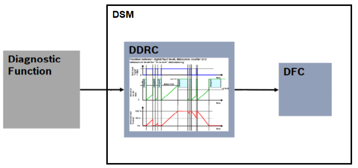
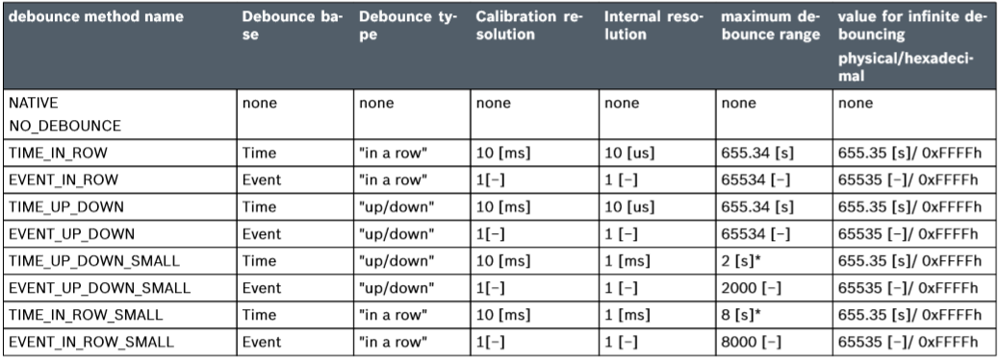
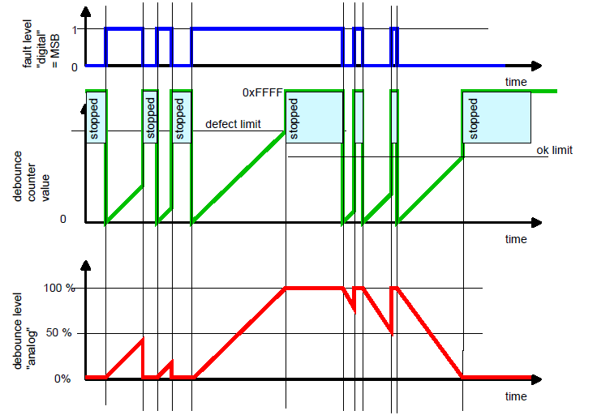
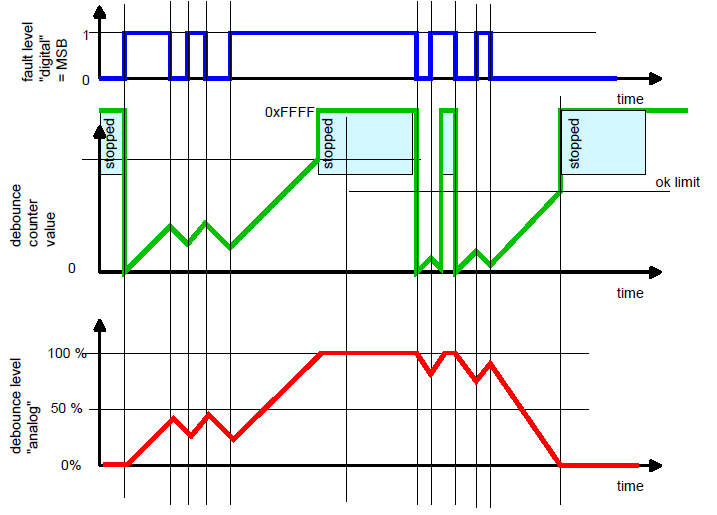

# Diagnostic Debounce and Report Check (DDRC) {#diagnostic-debounce-and-report-check-ddrc .p_Heading1 style="page-break-after: avoid;"}

+:-------------------------------------------------------------------------------------------------------------------------------------------------------------------------------------------------------------------------+--------------------------------------------------------------------------------------------------------------------------------------------------------+
| **Navigation:**  [System features](system-concepts.html) \> [BSW](bsw.html) \> [Error handling infrastructure](error-handling-infrastructure.html) \> [Diagnostic System Management](diagnosticsystemmanagement.html) \> |    |
|                                                                                                                                                                                                                          |                                                                                                                                                        |
| # Diagnostic Debounce and Report Check (DDRC) {#diagnostic-debounce-and-report-check-ddrc-1 .p_Heading1 style="page-break-after: avoid;"}                                                                                |                                                                                                                                                        |
+--------------------------------------------------------------------------------------------------------------------------------------------------------------------------------------------------------------------------+--------------------------------------------------------------------------------------------------------------------------------------------------------+

## 1. Function definition {#function-definition .p_Heading2 style="page-break-after: avoid;"}

As an alternative to the direct application of the low-level DFC interface, a high-level interface with integrated pre-debouncing is available. The diagnostic debounce and report check (DDRC) module provides some time- or event-based pre-debouncing methods for typical diagnostics.

With the function  bds_dsm_updateDebError the DFC handling is provided for the application. The DFC handling itself is described in the chapter [Diagnostic Fault Check](diagnostic-fault-check.html){.topiclink}.

 

<figure style="margin:0;padding:0">

<figcaption aria-hidden="true">
Figure57: Interaction of DDRC with monitoring function and DFC
</figcaption>
</figure>

 

2\. The reasons of fault debouncing

- Reduces the impact of temporary interferences.

- The test result shows a certain consistency.

## 3. The available debounce methods {#the-available-debounce-methods .p_Heading2 style="page-break-after: avoid;"}

Only one debounce method can be used. Following alternatives are available:

- NATIVE No debouncing. That means, any necessary debouncing for DFC\'s  must be executed by the application itself and not in the DDRC.

- NO_DEBOUNCE No debouncing takes place, the reported current status is immediately transferred.

## 3.1 Debounce methods IN ROW {#debounce-methods-in-row .p_Heading2 style="page-break-after: avoid;"}

- TIME_IN_ROW Time debouncing \"in a row\", that means the fault must be present without interruption /disturbance, so that the debouncing can occur.

- TIME_IN_ROW_SMALL Similar to \"TIME_IN_ROW\" with reduced debounce limits.

- EVENT_IN_ROW Event debouncing \"in a row\". Functionality like time debouncing \"in a row\" but it counts of events (= API calls).

- EVENT_IN_ROW_SMALL Similar to \"EVENT \_IN_ROW\" with reduced debounce limits.

## 3.2 Debounce methods UP-DOWN {#debounce-methods-up-down .p_Heading2 style="page-break-after: avoid;"}

- TIME_UP_DOWN Integrating/statistical time debouncing with a timer, counting upwards and downwards.

- EVENT_UP_DOWN Integrating/statistical event debouncing with a counter, counting upwards and downwards.

- TIME_UP_DOWN_SMALL Integrating/statistical time debouncing with a timer, counting upwards and downwards.

 

The debounce methods NATIVE and NO_DEBOUNCE execute no debouncing inside the DSM.

For the debounce methods NATIVE and NO_DEBOUNCE, the \"Cal Param Name\" does not have to be adjusted in eC.

The following table shows all available debouncing and their basic characteristics. In the table for each DFC, the used debounce method can be found.

 

{#fig9329a932 style="margin:0;width:9.9479in;height:3.5729in;border:none"}

[]{#fig_cc6ef9 .hmanchor}Table 5: Available debouncing and their basic characteristics

The maximum debounce time for the small variants is limited to 8s for TIME_IN_ROW_SMALL and to 2s for TIME_UP_DOWN_SMALL. If the value exceeds this boundary the debounce time will be limited by the DSM to the maximum value. Debounce Methods without \_SMALL in the name support the whole range which is configurated by the Customer in eC. The debounce methods with_SMALL in the name use only reduced static RAM resources (2 Byte RAM per debouncing instead of 4 Byte). They have a reduced resolution and a reduced maximum range and the reason to used is to save RAM within ECU.

## 4. Debounce variants {#debounce-variants .p_Heading2 style="page-break-after: avoid;"}

There are currently two basic debounce variants available:

TIME DEBOUNCING:\
Debouncing is based on temporal behavior. The time grid of the diagnostic function is irrelevant. The monitoring function provides the time difference between the calls of the diagnostic function cumulated within the pre-debounce. The internal resolution this addition is determined by the type of the debouncing method and can be taken from the table

EVENT DEBOUNCING:\
Debouncing is based on the number of reported events. Each message of the monitoring function is considered to be an event.

 

## 5. Debounce types {#debounce-types .p_Heading2 style="page-break-after: avoid;"}

Choosing the appropriate debounce type is important for the resulting behaviour. In case of disturbed (noisy) input, up−down counter should be used instead of in−a−row debouncing.

## IN ROW Debouncing: {#in-row-debouncing .p_Heading2 style="page-break-after: avoid;"}

In order to detect faults, during this debouncing the monitoring must report a faulty result for the entire debounce time. As soon as the error disappears, the debouncing is reset (counter == stopped).

For healing, there must be \"no error\" throughout the whole healing period. An error during the debouncing occurs immediately to reset the healing counter (counter == stopped).

A \"in a row\" debouncing is therefore not suitable to detect permanently disturbed or noisy faults.

 

 

<figure style="margin:0;padding:0">

<figcaption>
Figure58: Relation between digital fault level, debounce counter and debounce level for „in a row“ debouncing
</figcaption>
</figure>

## UP-DOWN Debouncing: {#up-down-debouncing .p_Heading2 style="page-break-after: avoid;"}

During fault debouncing, the counter counts upwards as long as the undefined error is present. If there is no error, the Counter down. When the counter reaches zero, it is set to \"STOP\". If the counter reaches the defect limit, it is also set to \"STOP\" and the debounce level remains at 100%.

In the case of a healing debounce, the counter counts upwards as long as there is no error (simultaneously debounce level drops). He counts down as soon as there is an error. If the counter reaches 0, it is set to \"STOP\" and the debounce level is set to 100%. When reaching the healing limit the timer will stop and the debounce level will remain at 0%. This debouncing is also referred to as \"statistical debounce\". It is well suited for processing disturbed signals (even changing Fault conditions can lead to 100% debounced results).

 

 

<figure style="margin:0;padding:0">

<figcaption aria-hidden="true">
Figure59: Relation between digital fault level, debounce counter and debounce level for "up/down" debouncing
</figcaption>
</figure>

 

 

 
