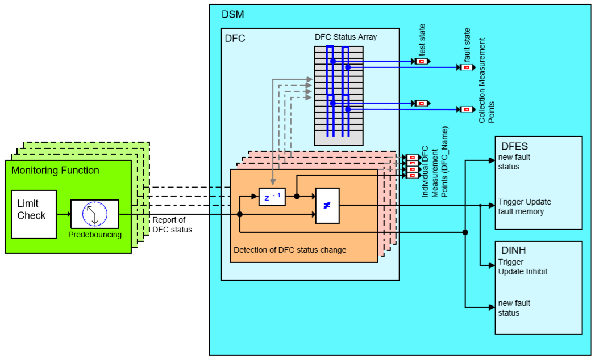
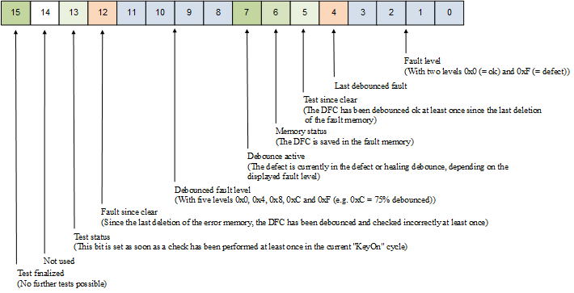
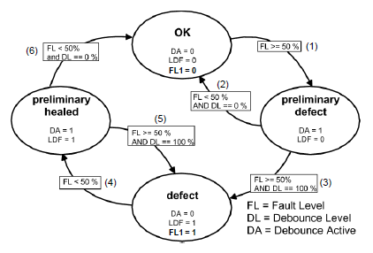
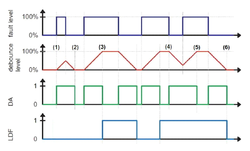

# Diagnostic Fault Check (DFC) {#diagnostic-fault-check-dfc .p_Heading1 style="page-break-after: avoid;"}

 

+:-------------------------------------------------------------------------------------------------------------------------------------------------------------------------------------------------------------------------+--------------------------------------------------------------------------------------------------------------------------------------------------------------------------+
| **Navigation:**  [System features](system-concepts.html) \> [BSW](bsw.html) \> [Error handling infrastructure](error-handling-infrastructure.html) \> [Diagnostic System Management](diagnosticsystemmanagement.html) \> |    |
|                                                                                                                                                                                                                          |                                                                                                                                                                          |
| # Diagnostic Fault Check (DFC) {#diagnostic-fault-check-dfc-1 .p_Heading1 style="page-break-after: avoid;"}                                                                                                              |                                                                                                                                                                          |
|                                                                                                                                                                                                                          |                                                                                                                                                                          |
|                                                                                                                                                                                                                          |                                                                                                                                                                          |
+--------------------------------------------------------------------------------------------------------------------------------------------------------------------------------------------------------------------------+--------------------------------------------------------------------------------------------------------------------------------------------------------------------------+

## Function definition: {#function-definition .p_Heading2 style="page-break-after: avoid;"}

The basic-interface between monitoring functions and the DSM is the report of a single check result (fault symptom). The interface contains information about the level of degradation, the level of confirmation of a defect and information whether a test has been finished. The information reported to this interface is expected to be pre debounced (free of disturbances). This means short disturbances are suppressed within the monitoring function respective by time or event based debouncing in the [Diagnostic Debounce and Report Check](diagnostic-debounce-and-report-check.html){.topiclink} module.

 

 

<figure style="margin:0;padding:0">

<figcaption>
Figure 60: DFC function overview
</figcaption>
</figure>

For each existing fault check, a DFC status word is available. If the reported information is different to the last status (change of fault status), the [Diagnostic Inhibit Handler](diagnostic-inhibit-handler.html){.topiclink} (DINH) and the [Diagnostic Fault Event Storage](diagnostic-fault-event-storage.html){.topiclink} (DFES) is updated.\
Each time a monitoring function determines a new result, the DFC handler is called with the evaluated status. The DFC handler compares this new result with the last reported result. If nothing has changed, no further action is taken. If something has changed, the new result is used to update the array which contains all DFC status. Furthermore, the DINH is called to check whether the change is relevant for any function Identifier (FId) and to update the FId status if necessary.\
On a status change, also the DFES handler is called to check if a DFES entry must be created or updated.

DFC status word

For the indication of the I/O faults (e.g., with  bds_out_po_getStatus) the status word is copied out of the DFC status array and is displayed like this:

 

{style="margin:0;width:7.3958in;height:3.7813in;border:none"}

 

  Example:

  0x0000 - value after initialization and after a reset of the DFC, if the DFC is configured as native the value is just changed after a fault

  0x2020 - w/o fault

  0x3F7F - w/  debounced fault

  0x3060 - w/o fault, has been debounced ok (e.g. shows also that the DFC has checked incorrectly at least once, see Bit12)

 

 

## DFC status array {#dfc-status-array .p_Heading2 style="page-break-after: avoid;"}

With the corresponding functions the DFC status array is accessed and the content is formatted accordingly.

The status of a DFC can be checked with bds_dsm_testError and with the help of  bds_dsm_getErrors or  bds_dsm_getNumErrors the DFC status array can be examined regarding the fault types.

The resetting of the faults is described in the chapter [Diagnostic Fault Event Storage](diagnostic-fault-event-storage.html){.topiclink}.

## DFC handling {#dfc-handling .p_Heading2 style="page-break-after: avoid;"}

The DFC handling is described below.

State machine for DFC handling

Explanation of the relationship between fault level (FL), debounce fault level (DL), last debounced fault (LDF) and the debounce active status (DA) on the basis of a state diagram.\
 

{style="margin:0;width:4.3958in;height:2.9792in;border:none"}            

 \
 

## Example of the different states {#example-of-the-different-states .p_Heading2 style="page-break-after: avoid;"}

The diagram shows the behavior using the following example of an up/down debounce. The transitions (1) to (6) described above are displayed in the diagram.

{style="margin:0;width:5.2083in;height:3.1354in;border:none"}

 

 

 
