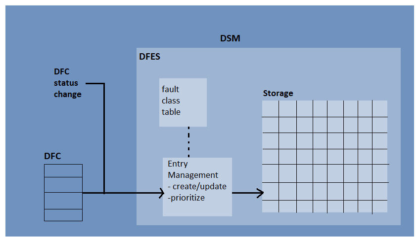

# Diagnostic Fault Event Storage (DFES) {#diagnostic-fault-event-storage-dfes .p_Heading1 style="page-break-after: avoid;"}

 

+:-------------------------------------------------------------------------------------------------------------------------------------------------------------------------------------------------------------------------+--------------------------------------------------------------------------------------------------------------------------------------------------------+
| **Navigation:**  [System features](system-concepts.html) \> [BSW](bsw.html) \> [Error handling infrastructure](error-handling-infrastructure.html) \> [Diagnostic System Management](diagnosticsystemmanagement.html) \> |    |
|                                                                                                                                                                                                                          |                                                                                                                                                        |
| # Diagnostic Fault Event Storage (DFES) {#diagnostic-fault-event-storage-dfes-1 .p_Heading1 style="page-break-after: avoid;"}                                                                                            |                                                                                                                                                        |
|                                                                                                                                                                                                                          |                                                                                                                                                        |
|                                                                                                                                                                                                                          |                                                                                                                                                        |
+--------------------------------------------------------------------------------------------------------------------------------------------------------------------------------------------------------------------------+--------------------------------------------------------------------------------------------------------------------------------------------------------+

## Function definition {#function-definition .p_Heading2 style="page-break-after: avoid;"}

Upon detection of a fault (reporting of a faulty check = fault event), an entry within the Diagnostic Fault Event Storage (DFES) is created for this fault event, in which additional detailed information is stored ([environment conditions](environmental-data.html){.topiclink}, cycle counter). The information of the entry serves as data for customer specific and legally specified diagnostic tester interface.

 

<figure style="margin:0;padding:0">

<figcaption aria-hidden="true">
Figure61: DFES Overview
</figcaption>
</figure>

                                       

## DFES classes {#dfes-classes .p_Heading2 style="page-break-after: avoid;"}

## The behavior of a fault event storage entry is calibrated via fault classes. A fault class table is one complete set of calibration parameters which determine this behavior. The different fault classes for the different behaviors are organized within a \"fault class table\". For each existing [Diagnostic Fault Check](diagnostic-fault-check.html){.topiclink} (DFC) a calibration label is provided which selects the fault class DFES_Cls.DFC_xxx_C. If a fault entry for this fault check is created, the class parameters assigned by this label are used for management of the DFES entry. Beside the fault classes some calibration values must be available for each fault check. In this project the following fault classes are supported, see also [Diagnostic Trouble Code](diagnostic-trouble-code.html){.topiclink}: {#the-behavior-of-a-fault-event-storage-entry-is-calibrated-via-fault-classes.-a-fault-class-table-is-one-complete-set-of-calibration-parameters-which-determine-this-behavior.-the-different-fault-classes-for-the-different-behaviors-are-organized-within-a-fault-class-table.-for-each-existing-diagnostic-fault-check-dfc-a-calibration-label-is-provided-which-selects-the-fault-class-dfes_cls.dfc_xxx_c.-if-a-fault-entry-for-this-fault-check-is-created-the-class-parameters-assigned-by-this-label-are-used-for-management-of-the-dfes-entry.-beside-the-fault-classes-some-calibration-values-must-be-available-for-each-fault-check.-in-this-project-the-following-fault-classes-are-supported-see-also-diagnostic-trouble-code .p_Heading2 style="page-break-after: avoid;"}

- DFES_NoEntry (0 class)  suppresses the DFES handling of a check completely. Also checks which are not assigned to the current ECU type in Multi ECU system are ignored by the DFES (inhibit relations active but no DFES entry)

- DFES_MaxHighPrio (1.class) for monitoring errors

- DFES_HighPrio (2.class)

- DFES_LowPrio (3.class)

 

Note: Faults configured as DFES_NoEntry (0 class) in easyConfig will not be reported by UDS service 0x19.

If the error memory is full a new error can replace existing entries as long as the priority of the new fault is higher than the entry with the lowest priority.

## Displacement in case of full fault event storage {#displacement-in-case-of-full-fault-event-storage .p_Heading2 style="page-break-after: avoid;"}

If a new DFES entry should be created and all available DFES entries are already occupied it is checked whether an existing entry can be replaced. The least prior fault entry gets displaced if the new entry has a higher priority. The sequence number decides between existing entries of equal priority. Older entries (means smaller values of DFES_idxSequence ) have higher priority. In the case of same priority newer entries will get replaced. The priority of an existing DFES entry is determined by the fault class (of the DFC) and an influence derived from the current entry state.

## Entry state management {#entry-state-management .p_Heading2 style="page-break-after: avoid;"}

The following table contains the description for each state. All states can be used for all fault checks. The entry state and the calibrated tester visibility control the output to the diagnostic interface.

  State               Description
  ------------------- --------------------------------------------------------------------------------------------------------------------------------------------------------------------------------------------------
  Empty               As long as the slot has never been used, this is the default status
  Erased              Entry has been deleted. The Entry has not been assigned to another check up to now. The data of the previous entry is still available until it is overwritten
  confirmed           A fault has been detected and partially pre-debounced by the monitoring function. A delay of the final decision of the check result is still in progress. The freeze frame conditions are stored.
  confirmed Healing   Healing is in Progress.
  confirmed Aging     Waiting for self deleting
  Service             Visible for service only.
  Shadow              A fault has been detected and partially predebounced by the monitoring function. A delay of the final decision of the check result is still in progress. The freeze frame conditions are stored.

[]{#fig_55b6bb .hmanchor}Table 6: State characteristics

 

## Visualization of the DFES {#visualization-of-the-dfes .p_Heading2 style="page-break-after: avoid;"}

The DFES can have a maximum of 32 different possible entries.\
The advantage of this solution against the measurement points of former ECU generations is the possibility to provide verbal conversions for the display. Furthermore it is possible to display all elements of a certain type with simply selecting the whole array.\
The sequence of the entries is not always reflected by the array order. The order can be obtained by the sequence array DFES_idxSequence.\
DFES_ctFrq: Frequency counter. This counter counts how often the check status changes from \"Passed\" to \"Failed\". In other words: How often has the fault appeared newly. This information is used to categorize a fault as sporadic.\
DFES_EnvBlock: BSW variable which checks the environment variables of the particular DFC. The values here varies based on the operating hours and the environment data configured here.\
DFES_numDFC: This stores the DFC ID which caused the entry at index \[n-1\], entry is made once a DFC status is \"Failed\".

 

  Number of DFES entry     DFES_numDFC   DFES_EnvBlock   DFES_ctFrq   DFES_idxSequence
  ------------------------ ------------- --------------- ------------ ------------------
  0                        DFC_xyz       ENV_I, ENVII    \-           \-
                                                                       

[]{#fig_4b2e7d .hmanchor}Table 7: DFES storage measurement visualization

 

 

 

 
