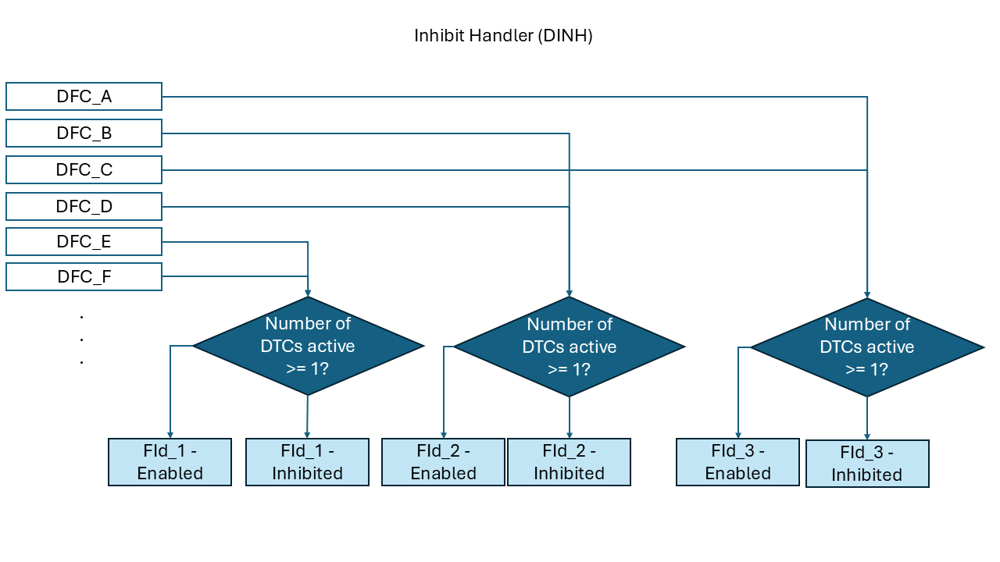

# Diagnostic Inhibit Handler (DINH) {#diagnostic-inhibit-handler-dinh .p_Heading1 style="page-break-after: avoid;"}

+:-------------------------------------------------------------------------------------------------------------------------------------------------------------------------------------------------------------------------+-------------------------------------------------------------------------------------------------------------------------------------------------------------+
| **Navigation:**  [System features](system-concepts.html) \> [BSW](bsw.html) \> [Error handling infrastructure](error-handling-infrastructure.html) \> [Diagnostic System Management](diagnosticsystemmanagement.html) \> |    |
|                                                                                                                                                                                                                          |                                                                                                                                                             |
| # Diagnostic Inhibit Handler (DINH) {#diagnostic-inhibit-handler-dinh-1 .p_Heading1 style="page-break-after: avoid;"}                                                                                                    |                                                                                                                                                             |
+--------------------------------------------------------------------------------------------------------------------------------------------------------------------------------------------------------------------------+-------------------------------------------------------------------------------------------------------------------------------------------------------------+

## Function definition {#function-definition .p_Heading2 style="page-break-after: avoid;"}

The Diagnostic Inhibit Handler (DINH) controls the release or block (locking of normal function and release of backup function) of functions or function parts depending on fault check. Each functionality which has such dependency will provide a Function Identifier (FId). The DINH provides a status word for each FId. By polling the status of its FId, the function detects the block or release request.

The release information is computed based on a FId matrix.\
 

 

<figure style="margin:0;padding:0">

<figcaption>
Figure62:  Principle function of the inhibit handler
</figcaption>
</figure>

## Definition of FId and inhibit function {#definition-of-fid-and-inhibit-function .p_Heading2 style="page-break-after: avoid;"}

## A \"Function Identifier\" (FId) represents a function or a part of a function executed conditionally depending on results of fault checks. {#a-function-identifier-fid-represents-a-function-or-a-part-of-a-function-executed-conditionally-depending-on-results-of-fault-checks. .p_Heading2 style="page-break-after: avoid;"}

- The inhibit handler processes the defined dependency between FId and DFC and computes the part of the enable/permission information, which is based on fault information.

- If all DFCs assigned to a FId are not active at a given point of time, the FId has the status PERMISSION - no DFC inhibits the FId. This means the normal operation function can be processed.

- If one or more assigned DFC is in Active state (i.e., test \"Failed\"), the FId is inhibited (NO_PERMISSION). In this case only limp home or default reactions may be processed.

## How functions may use the FId {#how-functions-may-use-the-fid .p_Heading2 style="page-break-after: avoid;"}

The function  bds_dsm_getFIdPermission returns TRUE, if the function has running permission.\
If a function runs only in case of defect (substitute reaction), it is only executed when it has no permission.

 

 

 

 

 

 
