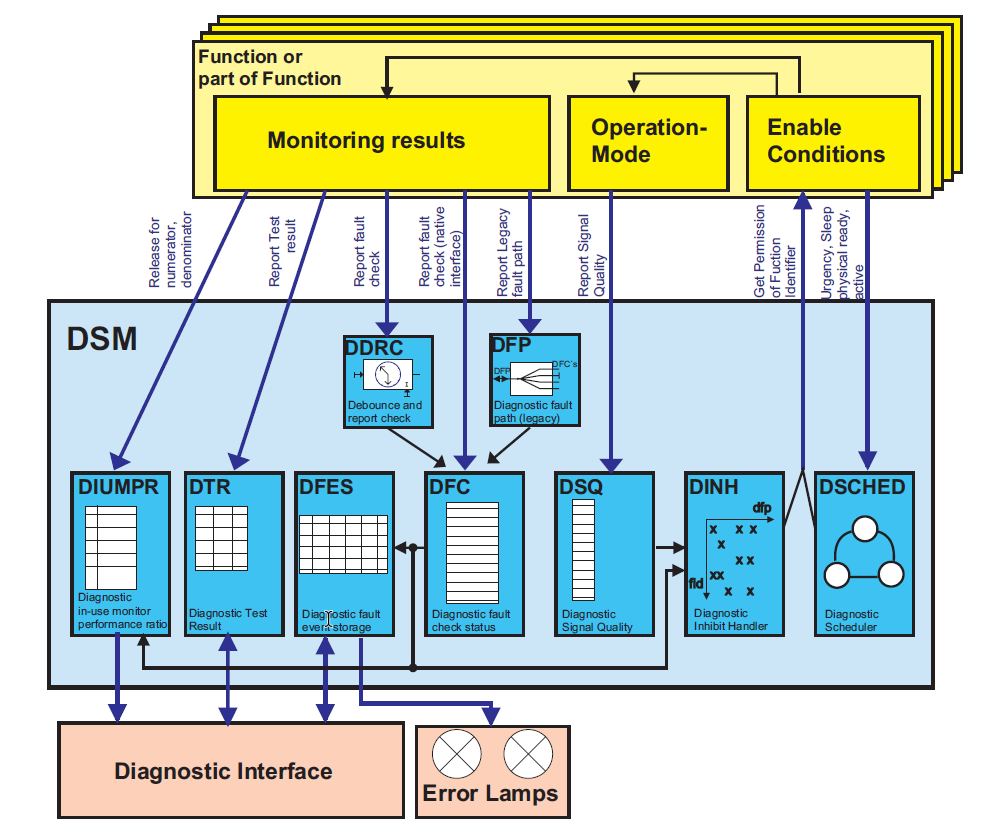

# Diagnostic system management {#diagnostic-system-management .p_Heading1 style="page-break-after: avoid;"}

+:--------------------------------------------------------------------------------------------------------------+------------------------------------+
| **Navigation:**  »No topics above this level«                                                                 |  |
|                                                                                                               |                                    |
| # Diagnostic system management {#diagnostic-system-management-1 .p_Heading1 style="page-break-after: avoid;"} |                                    |
+---------------------------------------------------------------------------------------------------------------+------------------------------------+

The Diagnostic system management(DSM) collects the test result reported from the monitoring functions. The current fault states and the derived error memory entries are available in standard form for the application software and the tester communication.The DSM coordinates the display of results on fault indicators and the Diagnose interface on the basis of debounce cycles that can be calibrated in a wide range.

{style="margin:0;width:8.6250in;height:7.3229in;border:none"}

 

# Basic Functional Block {#basic-functional-block .p_Heading1 style="page-break-after: avoid;"}

 

DFC (Diagnostic Fault Check handling):

 

The basis-interface between monitoring functions and the DSM is the report of a single check result (fault symptom). The interface contains information about the level of degradation, the level of confirmation of a defect and information whether a test has been finished. The information reported to this interface is expected to be pre debounced (free of disturbances). This means short disturbances are suppressed by time or event based debouncing within the monitoring function (or the DSM Module DDRC).

For each existing fault check (DFC), a Status word is available. The status word contains information about:

- the last reported fault level

- the last reported level of confirmation (debounce level)

- the tested status

- additional derived information (tested since fcm clear)

If the reported information is different to the last status (change of fault status) the inhibit handler and the fault code memory is updated.

 

DDRC (Diagnostic Debouncing and Report of Checks)

 

Alternatively to the basis interface (DFC) a higher level interface with integrated pre debouncing is available. This module provides for normal fault handling demands some pre debouncing methods (Time or Event; In a Row or Up/Down).

The automatic generated DFC Overview tables contain for each DFC the information whether this pre debouncing is used and which debounce method is configured.

 

DFES (Diagnostic Fault Event Storage)

 

Upon detection of a fault (reporting of a faulty check = fault event), an entry within the fault event storage (FES) is created for this fault event, in which additional detailed information is stored (environment conditions, cycle counter). The information of the entry serve as data for customer−specific, and legally specified diagnostic tester interface.

Within such a FES entry additional debouncing is done (e.g. MIL debouncing). This debouncing is normally done by cycle types as driving cycles, warm up cycles (explanation see detailed description). The main purpose of this additional debouncing is to fulfill legal demands as well as customer demands. The debouncing result controls visibility for testers and illumination of malfunction indicator lamps.

 

DINH (Diagnostic Inhibit handler)

 

The Inhibit Handler controls the release or block (locking of normal function and release of backup function) of functions or function parts depending on fault check states, fault check test states and signal quality states. Every functionality which has such dependencies, provides a function identifier (FId). The DINH provides for each FId a status word. By polling the status of it\'s FId, the function detects the block or release request. The release information is computed based on a calibration matrix, the fault check results and the signal qualities. Reactions can take place even on partially debounced or partially defective checks /Status.

The initial data set for the inhibit matrix calibration is generated during SW−Make based on informations about dependencies given within the module interface description of each SW Module. This initial calibration can be modified later by calibration.

 

DSCHED (Diagnostic Scheduler)

 

The Diagnostic Scheduler is a configurable coordination level, which enables an de coupling of connected functions.If several mutual disturbing functions are ready to run it must be avoided to run them at the same time. On the other hand each of the functions must be activated from time to time (under real driving conditions).

The Scheduler releases a set of compatible functions, on the Basis of dynamically calculated Priorities. Through the Diagnostic Scheduler,it is ensured that functions which would distort themselves, are not simultaneously released. Based on the Priority, a selection of released functions is specified, wherein always the maximal number of functions are activated (currently not active functions do not want to /cannot run or suppressed by a higher priority mutual exclusive function).

The scheduled functions must provide dynamic information like \"ready to run\" (physical release conditions met) or a contribution to their priority (\"urgency\"). The relationships between the functions (FId) an their common resource are described by data descriptions in the calibration.

 

DSQ (Diagnostic Signal Quality)

 

In addition to the fault check results, validity information of signals is handled. As in faults, invalid signals lead to reduced functionality (functions are \"inhibited\"). This can be due to temporary operating states for which no fault check results must be generated.

e.g.: A cold Lambda sensor leads to an invalid Lambda−Signal, through which some Diagnostics cannot run (are inhibited\"), even when there is no fault in the system.

Furthermore the Signal Quality is used to hide the internal structure of the component driver monitoring from the system. The system needs not to know which type of sensor is used or whether the sensor information is provided by the can. By providing a signal quality for each complex signal it is sufficient for the signal consumers to know its signal quality.This means a Signal Quality reflects both: temporary operation modes and fault check results.

 

 

 

 

 

 

 
