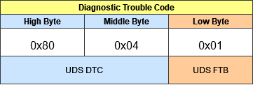

# Diagnostic Trouble Code (DTC) {#diagnostic-trouble-code-dtc .p_Heading1 style="page-break-after: avoid;"}

+:-------------------------------------------------------------------------------------------------------------------------------------------------------------------------------------------------------------------------+----------------------------------------------------------------------------------------------------------------------------------------------------+
| **Navigation:**  [System features](system-concepts.html) \> [BSW](bsw.html) \> [Error handling infrastructure](error-handling-infrastructure.html) \> [Diagnostic System Management](diagnosticsystemmanagement.html) \> |    |
|                                                                                                                                                                                                                          |                                                                                                                                                    |
| # Diagnostic Trouble Code (DTC) {#diagnostic-trouble-code-dtc-1 .p_Heading1 style="page-break-after: avoid;"}                                                                                                            |                                                                                                                                                    |
+--------------------------------------------------------------------------------------------------------------------------------------------------------------------------------------------------------------------------+----------------------------------------------------------------------------------------------------------------------------------------------------+

Definition for a Diagnostic Trouble Code (DTC) as in Standard ISO 14229-1:\
\"Numerical common identifier for a fault condition identified by the on-board diagnostic system\".

The BSW provides a DTC of 3 bytes for every Diagnostic Fault Check (DFC) (as per Standard ISO 15031-6).

A 3 byte DTC is provided to facilitate a better Suspect Parameter Number (SPN) and Failure Mode Identifier (FMI) mapping for a DTC, and to support more failure types of a base DTC.

[{#toggle0186a1 .image-toggle style="width:2.8229in;height:0.9583in;border:none"}{.image-toggle-magnifier}](dtc.png){.imagetogglelink style="margin:0;width:2.8229in;height:0.9583in"}\
[]{#fig_77c264 .hmanchor}Table 8: 3 byte diagnostic trouble code

+------------------------------------------------------------------------------------------+------------------------------------------------------------------------------------------------------------------------------------------------------------------------------+
| {style="margin:0;width:2.1667in;height:0.7083in;border:none"} | BODAS-BSW supports DTC of 2 bytes till v01.20 (or easyConfig (eC) workflow s/ml 200).                                                                                        |
|                                                                                          |                                                                                                                                                                              |
|                                                                                          | Now it supports 3 bytes DTC.                                                                                                                                                 |
|                                                                                          |                                                                                                                                                                              |
|                                                                                          | •The High Byte and Middle Byte of a DTC corresponds to the field \"UDS DTC\" in easyConfig GUI (considered as the base DTC of a 3 byte DTC, synonymous to 2 byte DTC value). |
|                                                                                          |                                                                                                                                                                              |
|                                                                                          | •The Low Byte of a DTC corresponds to the field \"UDS FTB\" in easyConfig GUI (configuration of Failure Type Byte (FTB)).                                                    |
+------------------------------------------------------------------------------------------+------------------------------------------------------------------------------------------------------------------------------------------------------------------------------+

 

## Steps to configure a DTC in easyConfig: {#steps-to-configure-a-dtc-in-easyconfig .p_Heading2 style="page-break-after: avoid;"}

### Steps to configure an ASW DTC in easyConfig: {#steps-to-configure-an-asw-dtc-in-easyconfig .p_Heading3 style="page-break-after: avoid;"}

1.For the DTC High Byte and Middle Byte, configure the field in the easyConfig GUI, Error Management -\> ASW DFC Errors -\> UDS DTC (accepted ranges: 0x8000 - 0xFFFF).

2.For the DTC Low Byte, configure the field in the easyConfig GUI, Error Management -\> ASW DFC Errors -\> UDS FTB (accepted ranges: 0x00 - 0xFF).

### Steps to configure an BSW DTC in easyConfig: {#steps-to-configure-an-bsw-dtc-in-easyconfig .p_Heading3 style="page-break-after: avoid;"}

+------------------------------------------------------------------------------------------+------------------------------------------------------------------------------------------------------+
| {style="margin:0;width:2.1667in;height:0.7083in;border:none"} | The following fields in BSW DTC were not configurable till v01.26 (or easyConfig workflow s/ml 260): |
|                                                                                          |                                                                                                      |
|                                                                                          | •UDS DTC                                                                                             |
|                                                                                          |                                                                                                      |
|                                                                                          | •UDS FTB                                                                                             |
|                                                                                          |                                                                                                      |
|                                                                                          | •DFES_Priority                                                                                       |
+------------------------------------------------------------------------------------------+------------------------------------------------------------------------------------------------------+

1.For the DTC High Byte and Middle Byte, configure the field in the easyConfig GUI, Error Management -\> ASW DFC Errors -\> UDS DTC (accepted ranges: 0x8000 - 0xFFFF).

2.For the DTC Low Byte, configure the field in the easyConfig GUI, Error Management -\> ASW DFC Errors -\> UDS FTB (accepted ranges: 0x00 - 0xFF).

 

The DFCs for the Base Software (BSW) and the corresponding DTCs are listed in the table below.\
The BSW supports the following fault classes are supported, see also [Diagnostic Fault Event Storage](diagnostic-fault-event-storage.html){.topiclink} (DFES):

- DFES_NoEntry (0 class)  suppresses the DFES handling of a check completely. Also checks which are not assigned to the current ECU type in Multi ECU system are ignored by the DFES (inhibit relations active but no DFES entry).

- DFES_MaxHighPrio (1.class) for monitoring errors.

- DFES_HighPrio (2.class)

- DFES_LowPrio (3.class)

 

Note: Faults configured as DFES_NoEntry (0 class) in easyConfig will not be reported by UDS service 0x19.

 

The DFC\'s DFES_Prio (DFES Priority) shall be configurable for all the BSW DFCs (configurable values: DFES_NoEntry, DFES_HighPrio, DFES_LowPrio) except for monitoring errors (DFCs having DFC Define DFC_rbr_mo\*).

For DFCs with \*\_in, \*\_out and \*\_safout as part of \"DFC Define\", the parameters \[ok Limit\] and \[defect Limit\] can be changed in easyConfig.

The following table shows the limit ranges of the DFCs:

  DFC Define         Module   Ok Limit\[ms\]   Defect Limit \[ms\]
  ------------------ -------- ---------------- ---------------------
  DFC_rbr_in\*       Input    10               1000
  DFC_rbr_out\*      Output   10               250
  DFC_rbr_safout\*   Safout   10               250

 

 

 

The following table shows the DFC name, default DTC value (values are configurable in easyConfig), default DFES_Prio, API function and Description for all BSW DFCs.

 

 

## DTC Table for controllers RC18-12/40, RC27-18/40: {#dtc-table-for-controllers-rc18-1240-rc27-1840 .p_Heading2 style="page-break-after: avoid;"}

+-------------------------------------------+---------------------------------------+-------------------+-------------------------------------------------------------+----------------------------------------------------------------------------------------------------------------------------------------------------------------------------------------------------------------------------------------------------------+
| DFC define                                | Default DTC (Diagnostic Trouble Code) | Default DFES_Prio | API function                                                | Description                                                                                                                                                                                                                                              |
+-------------------------------------------+---------------------------------------+-------------------+-------------------------------------------------------------+----------------------------------------------------------------------------------------------------------------------------------------------------------------------------------------------------------------------------------------------------------+
| DFC_rbr_sysAiv                            | 0x010100                              | DFES_LowPrio      | bds_sys_aiv                                                 | The BSW API bds_sys_aiv() was called with an invalid parameter; the possible reason is that the system input voltage signal was out of the valid bds_sys_aiv_signal_te range or the pointer used to read the signal value was invalid.                   |
+-------------------------------------------+---------------------------------------+-------------------+-------------------------------------------------------------+----------------------------------------------------------------------------------------------------------------------------------------------------------------------------------------------------------------------------------------------------------+
| DFC_rbr_sysDo                             | 0x010200                              | DFES_LowPrio      | bds_sys_do                                                  | The BSW API bds_sys_do() was called with an invalid parameter, possible reason is the shunt activation (low resistance path) for the digital output is not enabled or shunt Recovery Time is not elapsed (i.e., shunt not yet reactivated).              |
+-------------------------------------------+---------------------------------------+-------------------+-------------------------------------------------------------+----------------------------------------------------------------------------------------------------------------------------------------------------------------------------------------------------------------------------------------------------------+
| DFC_rbr_sysDi                             | 0x010300                              | DFES_LowPrio      | bds_sys_di                                                  | The BSW API bds_sys_di() was called with an invalid parameter, possible reason is the wrong input signal passed or Null pointer passed as parameter.                                                                                                     |
+-------------------------------------------+---------------------------------------+-------------------+-------------------------------------------------------------+----------------------------------------------------------------------------------------------------------------------------------------------------------------------------------------------------------------------------------------------------------+
| DFC_rbr_sysAit                            | 0x010400                              | DFES_LowPrio      | bds_sys_ait                                                 | The BSW API bds_sys_ait() was called with an invalid parameter, possible reason is the wrong input signal passed or Null pointer passed was parameter.                                                                                                   |
+-------------------------------------------+---------------------------------------+-------------------+-------------------------------------------------------------+----------------------------------------------------------------------------------------------------------------------------------------------------------------------------------------------------------------------------------------------------------+
| DFC_rbr_sysSetVss                         | 0x010500                              | DFES_LowPrio      | bds_sys_SetVss                                              | The BSW API bds_sys_setVSS() was called with an invalid parameter, possible reason is the wrong input signal (other than VSS) or wrong setting of state (other than STD_ON and STD_OFF).                                                                 |
+-------------------------------------------+---------------------------------------+-------------------+-------------------------------------------------------------+----------------------------------------------------------------------------------------------------------------------------------------------------------------------------------------------------------------------------------------------------------+
| DFC_rbr_sysGetVss                         | 0x010600                              | DFES_LowPrio      | bds_sys_GetVss                                              | The BSW API bds_sys_getVSS() was called with an invalid parameter, possible reason is the wrong input signal (other than VSS) or Null pointer passed as parameter.                                                                                       |
+-------------------------------------------+---------------------------------------+-------------------+-------------------------------------------------------------+----------------------------------------------------------------------------------------------------------------------------------------------------------------------------------------------------------------------------------------------------------+
| DFC_rbr_sysInit                           | 0x010700                              | DFES_LowPrio      | bds_sysInit                                                 | The BSW API bds_sys_init() was called with an invalid parameter, possible reason is the inappropriate hardware ID (RC40-0x72).                                                                                                                           |
+-------------------------------------------+---------------------------------------+-------------------+-------------------------------------------------------------+----------------------------------------------------------------------------------------------------------------------------------------------------------------------------------------------------------------------------------------------------------+
| DFC_rbr_sys_taskload                      | 0x010800                              | DFES_LowPrio      | bds_sys_getTaskRuntime                                      | The BSW API bds_sys_getTaskRuntime() was called with an invalid parameter, possible reason is the inappropriate Task ID (Task_100ms_D,Task_80ms_D ,Task_50ms_D ,Task_40ms_D ,Task_20ms_D ,Task_10ms_D ,Task_5ms_D,Task_2ms_D,Task_1ms_D).                |
+-------------------------------------------+---------------------------------------+-------------------+-------------------------------------------------------------+----------------------------------------------------------------------------------------------------------------------------------------------------------------------------------------------------------------------------------------------------------+
| DFC_rbr_sys_coreload                      | 0x010900                              | DFES_LowPrio      | bds_sys_getCoreLoad                                         | The BSW API bds_sys_getCoreLoad() was called with an invalid parameter, possible reason is the inappropriate Core ID (RC5-6/40: 0,1,2 cores, RC18-27/40 - RC12-18/40: 0,1,2,3 cores).                                                                    |
+-------------------------------------------+---------------------------------------+-------------------+-------------------------------------------------------------+----------------------------------------------------------------------------------------------------------------------------------------------------------------------------------------------------------------------------------------------------------+
| DFC_rbr_sysOperHrIntegrityErr             | 0x010A00                              | DFES_LowPrio      | \-                                                          | Operating hours parameter is not reliable, variable is manipulated.                                                                                                                                                                                      |
+-------------------------------------------+---------------------------------------+-------------------+-------------------------------------------------------------+----------------------------------------------------------------------------------------------------------------------------------------------------------------------------------------------------------------------------------------------------------+
| DFC_rbr_sysOperHrsSaturated               | 0x010B00                              | DFES_LowPrio      | \-                                                          | Operating hours parameter has reached the maximum limit. (32 bit)                                                                                                                                                                                        |
+-------------------------------------------+---------------------------------------+-------------------+-------------------------------------------------------------+----------------------------------------------------------------------------------------------------------------------------------------------------------------------------------------------------------------------------------------------------------+
| DFC_rbr_rsmFfiApiCallErr                  | 0x010C00                              | DFES_LowPrio      | \-                                                          | The DFC is set if BSW API with \_ffi was called in untrusted partition and corresponding BSW API callback function returns FALSE.                                                                                                                        |
+-------------------------------------------+---------------------------------------+-------------------+-------------------------------------------------------------+----------------------------------------------------------------------------------------------------------------------------------------------------------------------------------------------------------------------------------------------------------+
| DFC_rbr_canGetDataboxNoInit               | 0x020100                              | DFES_LowPrio      | bds_can_getDatabox                                          | The DFC is set if for a given CAN Rx Databox, BSW API bds_can_getDatabox() was called before proper initialization by bds_can_initRxDatabox().                                                                                                           |
|                                           |                                       |                   |                                                             |                                                                                                                                                                                                                                                          |
|                                           |                                       |                   |                                                             |                                                                                                                                                                                                                                                          |
|                                           |                                       |                   |                                                             |                                                                                                                                                                                                                                                          |
|                                           |                                       |                   |                                                             | command bds_can_initRxDatabox() before it can be used.                                                                                                                                                                                                   |
+-------------------------------------------+---------------------------------------+-------------------+-------------------------------------------------------------+----------------------------------------------------------------------------------------------------------------------------------------------------------------------------------------------------------------------------------------------------------+
| DFC_rbr_canGetDataboxParam                | 0x020200                              | DFES_LowPrio      | bds_can_getDatabox                                          | The BSW API bds_can_getDatabox() was called with an invalid parameter. For more details please check the return value.                                                                                                                                   |
+-------------------------------------------+---------------------------------------+-------------------+-------------------------------------------------------------+----------------------------------------------------------------------------------------------------------------------------------------------------------------------------------------------------------------------------------------------------------+
| DFC_rbr_canGetDataNoBuf                   | 0x020300                              | DFES_LowPrio      | bds_can_getData                                             | The BSW API bds_can_getData() requires a receive buffer to store incoming messages, but none is configured. Please either set up a receive buffer for this CAN channel (via easyConfig) or ensure bds_can_getData is not called.                         |
|                                           |                                       |                   |                                                             |                                                                                                                                                                                                                                                          |
|                                           |                                       |                   |                                                             | or a receive buffer is registered for this CAN channel by means of eC configuration.                                                                                                                                                                     |
+-------------------------------------------+---------------------------------------+-------------------+-------------------------------------------------------------+----------------------------------------------------------------------------------------------------------------------------------------------------------------------------------------------------------------------------------------------------------+
| DFC_rbr_canGetDataParam                   | 0x020400                              | DFES_LowPrio      | bds_can_getData                                             | The BSW API bds_can_getData() was called with an invalid parameter. For more details please check the return value.                                                                                                                                      |
+-------------------------------------------+---------------------------------------+-------------------+-------------------------------------------------------------+----------------------------------------------------------------------------------------------------------------------------------------------------------------------------------------------------------------------------------------------------------+
| DFC_rbr_canGetRxBufStatusParam            | 0x020500                              | DFES_LowPrio      | bds_can_getRxBufStatus                                      | The BSW API bds_can_getRxBufStatus() was called with an invalid parameter. For more details please check the return value.                                                                                                                               |
+-------------------------------------------+---------------------------------------+-------------------+-------------------------------------------------------------+----------------------------------------------------------------------------------------------------------------------------------------------------------------------------------------------------------------------------------------------------------+
| DFC_rbr_canGetStatusParam                 | 0x020600                              | DFES_LowPrio      | bds_can_getStatus                                           | The BSW API bds_can_getStatus() was called with an invalid parameter. For more details please check the return value.                                                                                                                                    |
+-------------------------------------------+---------------------------------------+-------------------+-------------------------------------------------------------+----------------------------------------------------------------------------------------------------------------------------------------------------------------------------------------------------------------------------------------------------------+
| DFC_rbr_canGetTxBufStatusParam            | 0x020700                              | DFES_LowPrio      | bds_can_getTxBufStatus                                      | The BSW API bds_can_getTxBufStatus() was called with an invalid parameter. For more details please check the return value.                                                                                                                               |
+-------------------------------------------+---------------------------------------+-------------------+-------------------------------------------------------------+----------------------------------------------------------------------------------------------------------------------------------------------------------------------------------------------------------------------------------------------------------+
| DFC_rbr_canInitParam                      | 0x020800                              | DFES_LowPrio      | bds_can_init/ bds_can_initxt                                | The BSW API bds_can_init() / bds_can_initxt() was called with an invalid parameter. For more details please check the return value.                                                                                                                      |
+-------------------------------------------+---------------------------------------+-------------------+-------------------------------------------------------------+----------------------------------------------------------------------------------------------------------------------------------------------------------------------------------------------------------------------------------------------------------+
| DFC_rbr_canInitRxDataboxOverlap           | 0x020900                              | DFES_LowPrio      | bds_can_initRxDatabox                                       | bds_can_initRxDatabox(): new buffer overlaps with a buffer registered already.                                                                                                                                                                           |
+-------------------------------------------+---------------------------------------+-------------------+-------------------------------------------------------------+----------------------------------------------------------------------------------------------------------------------------------------------------------------------------------------------------------------------------------------------------------+
| DFC_rbr_canInitRxDataboxParam             | 0x020A00                              | DFES_LowPrio      | bds_can_initRxDatabox                                       | The BSW API bds_can_initRxDatabox() was called with an invalid parameter. For more details please check the return value.                                                                                                                                |
+-------------------------------------------+---------------------------------------+-------------------+-------------------------------------------------------------+----------------------------------------------------------------------------------------------------------------------------------------------------------------------------------------------------------------------------------------------------------+
| DFC_rbr_canInitTxDataboxParam             | 0x020B00                              | DFES_LowPrio      | bds_can_initTxDatabox                                       | The BSW API bds_can_initTxDatabox() was called with an invalid parameter. For more details please check the return value.                                                                                                                                |
+-------------------------------------------+---------------------------------------+-------------------+-------------------------------------------------------------+----------------------------------------------------------------------------------------------------------------------------------------------------------------------------------------------------------------------------------------------------------+
| DFC_rbr_canIsDataboxFreeNoInit            | 0x020C00                              | DFES_LowPrio      | bds_can_isTxDataboxFree                                     | TX data box has to be initialized by the BSW API bds_can_initTxDatabox(), before bds_can_isTxDataboxFree() can be used.                                                                                                                                  |
+-------------------------------------------+---------------------------------------+-------------------+-------------------------------------------------------------+----------------------------------------------------------------------------------------------------------------------------------------------------------------------------------------------------------------------------------------------------------+
| DFC_rbr_canIsDataboxFreeParam             | 0x020D00                              | DFES_LowPrio      | bds_can_isTxDataboxFree                                     | The BSW API bds_can_isTxDataboxFree() was called with an invalid parameter. For more details please check the return value.                                                                                                                              |
+-------------------------------------------+---------------------------------------+-------------------+-------------------------------------------------------------+----------------------------------------------------------------------------------------------------------------------------------------------------------------------------------------------------------------------------------------------------------+
| DFC_rbr_canIsTxEmptyParam                 | 0x020E00                              | DFES_LowPrio      | bds_can_isTxChannelFree                                     | The BSW API bds_can_isTxChannelFree() was called with an invalid parameter. For more details please check the return value.                                                                                                                              |
+-------------------------------------------+---------------------------------------+-------------------+-------------------------------------------------------------+----------------------------------------------------------------------------------------------------------------------------------------------------------------------------------------------------------------------------------------------------------+
| DFC_rbr_canRegBusOffCallbInvState         | 0x020F00                              | DFES_LowPrio      | bds_can_registerBusOffCallback                              | The DFC is set if the BSW API bds_can_registerBusOffCallback() was called in a system state (RUN, POST_RUN, SHUTDOWN) other than INIT.                                                                                                                   |
+-------------------------------------------+---------------------------------------+-------------------+-------------------------------------------------------------+----------------------------------------------------------------------------------------------------------------------------------------------------------------------------------------------------------------------------------------------------------+
| DFC_rbr_canRegBusOffCallbParam            | 0x021000                              | DFES_LowPrio      | bds_can_registerBusOffCallback                              | The BSW API bds_can_registerBusOffCallback() function was called with an invalid parameter. For more details please check the return value.                                                                                                              |
+-------------------------------------------+---------------------------------------+-------------------+-------------------------------------------------------------+----------------------------------------------------------------------------------------------------------------------------------------------------------------------------------------------------------------------------------------------------------+
| DFC_rbr_canRegRxBufInvState               | 0x021100                              | DFES_LowPrio      | \-                                                          | The DFC is set if the BSW internal function for registering CAN Receive Buffers, rbr_can_registerRxBuf() was called after ASW Init task, or before BSW Init task.                                                                                        |
+-------------------------------------------+---------------------------------------+-------------------+-------------------------------------------------------------+----------------------------------------------------------------------------------------------------------------------------------------------------------------------------------------------------------------------------------------------------------+
| DFC_rbr_canRegRxBufOverlap                | 0x021200                              | DFES_LowPrio      | \-                                                          | The DFC is set if the BSW internal function for registering CAN Receive Buffers, rbr_can_registerRxBuf() was called and the current passed buffer overlaps the existing CAN buffer.                                                                      |
+-------------------------------------------+---------------------------------------+-------------------+-------------------------------------------------------------+----------------------------------------------------------------------------------------------------------------------------------------------------------------------------------------------------------------------------------------------------------+
| DFC_rbr_canRegRxBufParam                  | 0x021300                              | DFES_LowPrio      | \-                                                          | The DFC is set if the BSW internal function, rbr_can_registerRxBuf() was called with invalid parameters, such as a buffer configured with zero messages, an invalid buffer address, or an invalid CAN channel.                                           |
+-------------------------------------------+---------------------------------------+-------------------+-------------------------------------------------------------+----------------------------------------------------------------------------------------------------------------------------------------------------------------------------------------------------------------------------------------------------------+
| DFC_rbr_canRegRxCallbInvState             | 0x021400                              | DFES_LowPrio      | bds_can_registerRxCallback                                  | The DFC is set if the BSW API bds_can_registerRxCallback() was called in a system state (RUN, POST_RUN, SHUTDOWN) other than INIT.                                                                                                                       |
+-------------------------------------------+---------------------------------------+-------------------+-------------------------------------------------------------+----------------------------------------------------------------------------------------------------------------------------------------------------------------------------------------------------------------------------------------------------------+
| DFC_rbr_canRegRxCallbParam                | 0x021500                              | DFES_LowPrio      | bds_can_registerRxCallback                                  | The DFC is set if the BSW API bds_can_registerRxCallback() was called with an invalid CAN channel or with an invalid parameter. CAN callbacks for a given CAN channel have to be registered by the BSW API bds_can_registerRxCallback().                 |
+-------------------------------------------+---------------------------------------+-------------------+-------------------------------------------------------------+----------------------------------------------------------------------------------------------------------------------------------------------------------------------------------------------------------------------------------------------------------+
| DFC_rbr_canRegRxDataboxInvNumb            | 0x021600                              | DFES_LowPrio      | \-                                                          | The DFC is set if the number of the databoxes for the BSW internal function, rbr_can_registerRxDataboxes() are fewer than the number of databoxes configured (in easyConfig).                                                                            |
+-------------------------------------------+---------------------------------------+-------------------+-------------------------------------------------------------+----------------------------------------------------------------------------------------------------------------------------------------------------------------------------------------------------------------------------------------------------------+
| DFC_rbr_canRegRxDataboxInvState           | 0x021700                              | DFES_LowPrio      | \-                                                          | The DFC is set if BSW internal function for registering CAN receive databoxes, rbr_can_registerRxDataboxes() was called in a system state (RUN, POST_RUN, SHUTDOWN) other than INIT.                                                                     |
+-------------------------------------------+---------------------------------------+-------------------+-------------------------------------------------------------+----------------------------------------------------------------------------------------------------------------------------------------------------------------------------------------------------------------------------------------------------------+
| DFC_rbr_canRegRxDataboxOverlap            | 0x021800                              | DFES_LowPrio      | \-                                                          | The DFC is set if BSW internal function for registering CAN receive databoxes, rbr_can_registerRxDataboxes(), was called with a buffer (as parameter) overlapping an already registered buffer or reuse of the same variable buffer.                     |
+-------------------------------------------+---------------------------------------+-------------------+-------------------------------------------------------------+----------------------------------------------------------------------------------------------------------------------------------------------------------------------------------------------------------------------------------------------------------+
| DFC_rbr_canRegRxDataboxParam              | 0x021900                              | DFES_LowPrio      | \-                                                          | The DFC is set if BSW internal function, rbr_can_registerRxDataboxes() was called with an invalid parameter, such as an invalid buffer address, number of CAN Receive Databoxes = 0 or invalid CAN channel.                                              |
+-------------------------------------------+---------------------------------------+-------------------+-------------------------------------------------------------+----------------------------------------------------------------------------------------------------------------------------------------------------------------------------------------------------------------------------------------------------------+
| DFC_rbr_canRegTxBufInvState               | 0x021A00                              | DFES_LowPrio      | \-                                                          | The DFC is set if BSW internal function for registering CAN Tx Buffers, rbr_can_registerTxBuf() was called after ASW Init task, or before BSW Init task.                                                                                                 |
+-------------------------------------------+---------------------------------------+-------------------+-------------------------------------------------------------+----------------------------------------------------------------------------------------------------------------------------------------------------------------------------------------------------------------------------------------------------------+
| DFC_rbr_canRegTxBufOverlap                | 0x021B00                              | DFES_LowPrio      | \-                                                          | The DFC is set if BSW internal function for registering CAN Tx buffers, rbr_can_registerTxBuf() was called and the current passed buffer overlaps the existing CAN buffer.                                                                               |
+-------------------------------------------+---------------------------------------+-------------------+-------------------------------------------------------------+----------------------------------------------------------------------------------------------------------------------------------------------------------------------------------------------------------------------------------------------------------+
| DFC_rbr_canRegTxBufParam                  | 0x021C00                              | DFES_LowPrio      | \-                                                          | The DFC is set if the BSW internal function for registering CAN Tx Buffers, rbr_can_registerTxBuf() was called with invalid parameter (buffer registered with number of messages = 0), or buffer address is invalid or CAN channel is invalid).          |
+-------------------------------------------+---------------------------------------+-------------------+-------------------------------------------------------------+----------------------------------------------------------------------------------------------------------------------------------------------------------------------------------------------------------------------------------------------------------+
| DFC_rbr_canRegTxDataboxInvNumb            | 0x021D00                              | DFES_LowPrio      | \-                                                          | The DFC is set if CAN Tx databoxes registered via BSW internal function rbr_can_registerTxDataboxes() during ASW Init are fewer than configured (in easyConfig) for the same CAN channel.                                                                |
+-------------------------------------------+---------------------------------------+-------------------+-------------------------------------------------------------+----------------------------------------------------------------------------------------------------------------------------------------------------------------------------------------------------------------------------------------------------------+
| DFC_rbr_canRegTxDataboxInvState           | 0x021E00                              | DFES_LowPrio      | \-                                                          | The DFC is set if the BSW internal function for registering CAN transmit databoxes, rbr_can_registerTxDataboxes(), was called in a system state (RUN, POST_RUN, SHUTDOWN) other than INIT.                                                               |
+-------------------------------------------+---------------------------------------+-------------------+-------------------------------------------------------------+----------------------------------------------------------------------------------------------------------------------------------------------------------------------------------------------------------------------------------------------------------+
| DFC_rbr_canRegTxDataboxOverlap            | 0x021F00                              | DFES_LowPrio      | \-                                                          | The DFC is set if CAN legacy Tx databox buffers registered by BSW internal function rbr_can_registerTxDataboxes() in ASW Init task overlap an existing buffer, either due to a different variable or reuse of the same buffer.                           |
+-------------------------------------------+---------------------------------------+-------------------+-------------------------------------------------------------+----------------------------------------------------------------------------------------------------------------------------------------------------------------------------------------------------------------------------------------------------------+
| DFC_rbr_canRegTxDataboxParam              | 0x022000                              | DFES_LowPrio      | \-                                                          | The DFC is set if CAN legacy transmit databoxes are registered by the BSW internal function rbr_can_registerTxDataboxes() in ASW Init task using invalid parameters such as a NULL address, zero databox count, or an invalid CAN channel.               |
+-------------------------------------------+---------------------------------------+-------------------+-------------------------------------------------------------+----------------------------------------------------------------------------------------------------------------------------------------------------------------------------------------------------------------------------------------------------------+
| DFC_rbr_canResetTxBufParam                | 0x022100                              | DFES_LowPrio      | bds_can_resetTxBuf                                          | The BSW API bds_can_resetTxBuf() was called with an invalid parameter. For more details please check the return value.                                                                                                                                   |
+-------------------------------------------+---------------------------------------+-------------------+-------------------------------------------------------------+----------------------------------------------------------------------------------------------------------------------------------------------------------------------------------------------------------------------------------------------------------+
| DFC_rbr_canSendDataboxNoInit              | 0x022200                              | DFES_LowPrio      | bds_can_sendDatabox                                         | The BSW API bds_can_sendDatabox() was called without initialized databox. Databox has to be initialized with bds_can_initTxDatabox().                                                                                                                    |
+-------------------------------------------+---------------------------------------+-------------------+-------------------------------------------------------------+----------------------------------------------------------------------------------------------------------------------------------------------------------------------------------------------------------------------------------------------------------+
| DFC_rbr_canSendDataboxParam               | 0x022300                              | DFES_LowPrio      | bds_can_sendDatabox                                         | The BSW API bds_can_sendDatabox() was called with an invalid parameter. For more details please check the return value.                                                                                                                                  |
+-------------------------------------------+---------------------------------------+-------------------+-------------------------------------------------------------+----------------------------------------------------------------------------------------------------------------------------------------------------------------------------------------------------------------------------------------------------------+
| DFC_rbr_canSendDataBufOvfl                | 0x022400                              | DFES_LowPrio      | bds_can_sendData                                            | bds_can_sendData(): here is a buffer overflow and data can not be sent.                                                                                                                                                                                  |
+-------------------------------------------+---------------------------------------+-------------------+-------------------------------------------------------------+----------------------------------------------------------------------------------------------------------------------------------------------------------------------------------------------------------------------------------------------------------+
| DFC_rbr_canSendDataParam                  | 0x022500                              | DFES_LowPrio      | bds_can_sendData                                            | The BSW API bds_can_sendData() was called with an invalid parameter. For more details please check the return value.                                                                                                                                     |
+-------------------------------------------+---------------------------------------+-------------------+-------------------------------------------------------------+----------------------------------------------------------------------------------------------------------------------------------------------------------------------------------------------------------------------------------------------------------+
| DFC_rbr_canSetTxCycleParam                | 0x022600                              | DFES_LowPrio      | bds_can_setTxCycle                                          | The BSW API bds_can_setTxCycle() was called with an invalid parameter. For more details please check the return value.                                                                                                                                   |
+-------------------------------------------+---------------------------------------+-------------------+-------------------------------------------------------------+----------------------------------------------------------------------------------------------------------------------------------------------------------------------------------------------------------------------------------------------------------+
| DFC_rbr_canStartParam                     | 0x022700                              | DFES_LowPrio      | bds_can_start                                               | The BSW API bds_can_start() was called with an invalid parameter. For more details please check the return value.                                                                                                                                        |
+-------------------------------------------+---------------------------------------+-------------------+-------------------------------------------------------------+----------------------------------------------------------------------------------------------------------------------------------------------------------------------------------------------------------------------------------------------------------+
| DFC_rbr_canStopParam                      | 0x022800                              | DFES_LowPrio      | bds_can_stop                                                | The BSW API bds_can_stop() was called with an invalid parameter. For more details please check the return value.                                                                                                                                         |
+-------------------------------------------+---------------------------------------+-------------------+-------------------------------------------------------------+----------------------------------------------------------------------------------------------------------------------------------------------------------------------------------------------------------------------------------------------------------+
| DFC_rbr_can_SendSignal                    | 0x022900                              | DFES_LowPrio      | bds_can_SendSignal / bds_can_SendSignalGroup                | The BSW API bds_can_sendSignal() / bds_can_sendSignalGroup() was called with an invalid parameter or the signal transmission failed.                                                                                                                     |
+-------------------------------------------+---------------------------------------+-------------------+-------------------------------------------------------------+----------------------------------------------------------------------------------------------------------------------------------------------------------------------------------------------------------------------------------------------------------+
| DFC_rbr_can_ReceiveSignal                 | 0x022A00                              | DFES_LowPrio      | bds_can_ReceiveSignal / bds_can_ReceiveSignalGroup          | The BSW API bds_can_receiveSignal() / bds_can_receiveSignalGroup() was called with an invalid parameter or the signal transmission failed.                                                                                                               |
+-------------------------------------------+---------------------------------------+-------------------+-------------------------------------------------------------+----------------------------------------------------------------------------------------------------------------------------------------------------------------------------------------------------------------------------------------------------------+
| DFC_rbr_can_SetIpduGroup                  | 0x022B00                              | DFES_LowPrio      | bds_can_SetMsgGroup                                         | The BSW API bds_can_setMsgGroup() was called with an invalid parameter or the signal transmission failed.                                                                                                                                                |
+-------------------------------------------+---------------------------------------+-------------------+-------------------------------------------------------------+----------------------------------------------------------------------------------------------------------------------------------------------------------------------------------------------------------------------------------------------------------+
| DFC_rbr_can_ClearIpduGroup                | 0x022C00                              | DFES_LowPrio      | bds_can_resetAllMsgGroups                                   | The BSW API bds_can_resetAllMsgGroups() was called with an invalid parameter or the signal transmission failed.                                                                                                                                          |
+-------------------------------------------+---------------------------------------+-------------------+-------------------------------------------------------------+----------------------------------------------------------------------------------------------------------------------------------------------------------------------------------------------------------------------------------------------------------+
| DFC_rbr_canIpduGroupControl               | 0x022D00                              | DFES_LowPrio      | bds_can_startAllMsgGroups                                   | The BSW API bds_can_startAllMsgGroups() was called with an invalid parameter or the signal transmission failed.                                                                                                                                          |
+-------------------------------------------+---------------------------------------+-------------------+-------------------------------------------------------------+----------------------------------------------------------------------------------------------------------------------------------------------------------------------------------------------------------------------------------------------------------+
| DFC_rbr_inK10OR                           | 0x030100                              | DFES_LowPrio      | \-                                                          | Detection of OR at the connector pin K10.                                                                                                                                                                                                                |
+-------------------------------------------+---------------------------------------+-------------------+-------------------------------------------------------------+----------------------------------------------------------------------------------------------------------------------------------------------------------------------------------------------------------------------------------------------------------+
| DFC_rbr_inK10SCB                          | 0x030200                              | DFES_LowPrio      | \-                                                          | Detection of SCB at the connector pin K10.                                                                                                                                                                                                               |
+-------------------------------------------+---------------------------------------+-------------------+-------------------------------------------------------------+----------------------------------------------------------------------------------------------------------------------------------------------------------------------------------------------------------------------------------------------------------+
| DFC_rbr_inK10SCG                          | 0x030300                              | DFES_LowPrio      | \-                                                          | Detection of SCG at the connector pin K10.                                                                                                                                                                                                               |
+-------------------------------------------+---------------------------------------+-------------------+-------------------------------------------------------------+----------------------------------------------------------------------------------------------------------------------------------------------------------------------------------------------------------------------------------------------------------+
| DFC_rbr_inK36OR                           | 0x030400                              | DFES_LowPrio      | \-                                                          | Detection of OR at the connector pin K36.                                                                                                                                                                                                                |
+-------------------------------------------+---------------------------------------+-------------------+-------------------------------------------------------------+----------------------------------------------------------------------------------------------------------------------------------------------------------------------------------------------------------------------------------------------------------+
| DFC_rbr_inK36SCB                          | 0x030500                              | DFES_LowPrio      | \-                                                          | Detection of SCB at the connector pin K36.                                                                                                                                                                                                               |
+-------------------------------------------+---------------------------------------+-------------------+-------------------------------------------------------------+----------------------------------------------------------------------------------------------------------------------------------------------------------------------------------------------------------------------------------------------------------+
| DFC_rbr_inK36SCG                          | 0x030600                              | DFES_LowPrio      | \-                                                          | Detection of SCG at the connector pin K36.                                                                                                                                                                                                               |
+-------------------------------------------+---------------------------------------+-------------------+-------------------------------------------------------------+----------------------------------------------------------------------------------------------------------------------------------------------------------------------------------------------------------------------------------------------------------+
| DFC_rbr_inK37AicSCB                       | 0x030700                              | DFES_LowPrio      | \-                                                          | Detection of SCB at the connector pin K37.                                                                                                                                                                                                               |
+-------------------------------------------+---------------------------------------+-------------------+-------------------------------------------------------------+----------------------------------------------------------------------------------------------------------------------------------------------------------------------------------------------------------------------------------------------------------+
| DFC_rbr_inK37AicSCG                       | 0x030800                              | DFES_LowPrio      | \-                                                          | Detection of SCG at the connector pin K37.                                                                                                                                                                                                               |
+-------------------------------------------+---------------------------------------+-------------------+-------------------------------------------------------------+----------------------------------------------------------------------------------------------------------------------------------------------------------------------------------------------------------------------------------------------------------+
| DFC_rbr_inK37OR                           | 0x030900                              | DFES_LowPrio      | \-                                                          | Detection of OR at the connector pin K37.                                                                                                                                                                                                                |
+-------------------------------------------+---------------------------------------+-------------------+-------------------------------------------------------------+----------------------------------------------------------------------------------------------------------------------------------------------------------------------------------------------------------------------------------------------------------+
| DFC_rbr_inK37SCB                          | 0x030A00                              | DFES_LowPrio      | \-                                                          | Detection of SCB at the connector pin K37.                                                                                                                                                                                                               |
+-------------------------------------------+---------------------------------------+-------------------+-------------------------------------------------------------+----------------------------------------------------------------------------------------------------------------------------------------------------------------------------------------------------------------------------------------------------------+
| DFC_rbr_inK37SCG                          | 0x030B00                              | DFES_LowPrio      | \-                                                          | Detection of SCG at the connector pin K37.                                                                                                                                                                                                               |
+-------------------------------------------+---------------------------------------+-------------------+-------------------------------------------------------------+----------------------------------------------------------------------------------------------------------------------------------------------------------------------------------------------------------------------------------------------------------+
| DFC_rbr_inK37ShuntSCB                     | 0x030C00                              | DFES_LowPrio      | \-                                                          | Detection of SCB at the connector pin K37.                                                                                                                                                                                                               |
+-------------------------------------------+---------------------------------------+-------------------+-------------------------------------------------------------+----------------------------------------------------------------------------------------------------------------------------------------------------------------------------------------------------------------------------------------------------------+
| DFC_rbr_inK38OR                           | 0x030D00                              | DFES_LowPrio      | \-                                                          | Detection of OR at the connector pin K38.                                                                                                                                                                                                                |
+-------------------------------------------+---------------------------------------+-------------------+-------------------------------------------------------------+----------------------------------------------------------------------------------------------------------------------------------------------------------------------------------------------------------------------------------------------------------+
| DFC_rbr_inK38SCB                          | 0x030E00                              | DFES_LowPrio      | \-                                                          | Detection of SCB at the connector pin K38.                                                                                                                                                                                                               |
+-------------------------------------------+---------------------------------------+-------------------+-------------------------------------------------------------+----------------------------------------------------------------------------------------------------------------------------------------------------------------------------------------------------------------------------------------------------------+
| DFC_rbr_inK38SCG                          | 0x030F00                              | DFES_LowPrio      | \-                                                          | Detection of SCG at the connector pin K38.                                                                                                                                                                                                               |
+-------------------------------------------+---------------------------------------+-------------------+-------------------------------------------------------------+----------------------------------------------------------------------------------------------------------------------------------------------------------------------------------------------------------------------------------------------------------+
| DFC_rbr_inK39OR                           | 0x031000                              | DFES_LowPrio      | \-                                                          | Detection of OR at the connector pin K39.                                                                                                                                                                                                                |
+-------------------------------------------+---------------------------------------+-------------------+-------------------------------------------------------------+----------------------------------------------------------------------------------------------------------------------------------------------------------------------------------------------------------------------------------------------------------+
| DFC_rbr_inK39SCB                          | 0x031100                              | DFES_LowPrio      | \-                                                          | Detection of SCB at the connector pin K39.                                                                                                                                                                                                               |
+-------------------------------------------+---------------------------------------+-------------------+-------------------------------------------------------------+----------------------------------------------------------------------------------------------------------------------------------------------------------------------------------------------------------------------------------------------------------+
| DFC_rbr_inK39SCG                          | 0x031200                              | DFES_LowPrio      | \-                                                          | Detection of SCG at the connector pin K39.                                                                                                                                                                                                               |
+-------------------------------------------+---------------------------------------+-------------------+-------------------------------------------------------------+----------------------------------------------------------------------------------------------------------------------------------------------------------------------------------------------------------------------------------------------------------+
| DFC_rbr_inK40OR                           | 0x031300                              | DFES_LowPrio      | \-                                                          | Detection of OR at the connector pin K40.                                                                                                                                                                                                                |
+-------------------------------------------+---------------------------------------+-------------------+-------------------------------------------------------------+----------------------------------------------------------------------------------------------------------------------------------------------------------------------------------------------------------------------------------------------------------+
| DFC_rbr_inK40SCB                          | 0x031400                              | DFES_LowPrio      | \-                                                          | Detection of SCB at the connector pin K40.                                                                                                                                                                                                               |
+-------------------------------------------+---------------------------------------+-------------------+-------------------------------------------------------------+----------------------------------------------------------------------------------------------------------------------------------------------------------------------------------------------------------------------------------------------------------+
| DFC_rbr_inK40SCG                          | 0x031500                              | DFES_LowPrio      | \-                                                          | Detection of SCG at the connector pin K40.                                                                                                                                                                                                               |
+-------------------------------------------+---------------------------------------+-------------------+-------------------------------------------------------------+----------------------------------------------------------------------------------------------------------------------------------------------------------------------------------------------------------------------------------------------------------+
| DFC_rbr_inK41OR                           | 0x031600                              | DFES_LowPrio      | \-                                                          | Detection of OR at the connector pin K41.                                                                                                                                                                                                                |
+-------------------------------------------+---------------------------------------+-------------------+-------------------------------------------------------------+----------------------------------------------------------------------------------------------------------------------------------------------------------------------------------------------------------------------------------------------------------+
| DFC_rbr_inK41SCB                          | 0x031700                              | DFES_LowPrio      | \-                                                          | Detection of SCB at the connector pin K41.                                                                                                                                                                                                               |
+-------------------------------------------+---------------------------------------+-------------------+-------------------------------------------------------------+----------------------------------------------------------------------------------------------------------------------------------------------------------------------------------------------------------------------------------------------------------+
| DFC_rbr_inK41SCG                          | 0x031800                              | DFES_LowPrio      | \-                                                          | Detection of SCG at the connector pin K41.                                                                                                                                                                                                               |
+-------------------------------------------+---------------------------------------+-------------------+-------------------------------------------------------------+----------------------------------------------------------------------------------------------------------------------------------------------------------------------------------------------------------------------------------------------------------+
| DFC_rbr_inK42OR                           | 0x031900                              | DFES_LowPrio      | \-                                                          | Detection of OR at the connector pin K42.                                                                                                                                                                                                                |
+-------------------------------------------+---------------------------------------+-------------------+-------------------------------------------------------------+----------------------------------------------------------------------------------------------------------------------------------------------------------------------------------------------------------------------------------------------------------+
| DFC_rbr_inK42SCB                          | 0x031A00                              | DFES_LowPrio      | \-                                                          | Detection of SCB at the connector pin K42.                                                                                                                                                                                                               |
+-------------------------------------------+---------------------------------------+-------------------+-------------------------------------------------------------+----------------------------------------------------------------------------------------------------------------------------------------------------------------------------------------------------------------------------------------------------------+
| DFC_rbr_inK42SCG                          | 0x031B00                              | DFES_LowPrio      | \-                                                          | Detection of SCG at the connector pin K42.                                                                                                                                                                                                               |
+-------------------------------------------+---------------------------------------+-------------------+-------------------------------------------------------------+----------------------------------------------------------------------------------------------------------------------------------------------------------------------------------------------------------------------------------------------------------+
| DFC_rbr_inK43OR                           | 0x031C00                              | DFES_LowPrio      | \-                                                          | Detection of OR at the connector pin K43.                                                                                                                                                                                                                |
+-------------------------------------------+---------------------------------------+-------------------+-------------------------------------------------------------+----------------------------------------------------------------------------------------------------------------------------------------------------------------------------------------------------------------------------------------------------------+
| DFC_rbr_inK43SCB                          | 0x031D00                              | DFES_LowPrio      | \-                                                          | Detection of SCB at the connector pin K43.                                                                                                                                                                                                               |
+-------------------------------------------+---------------------------------------+-------------------+-------------------------------------------------------------+----------------------------------------------------------------------------------------------------------------------------------------------------------------------------------------------------------------------------------------------------------+
| DFC_rbr_inK43SCG                          | 0x031E00                              | DFES_LowPrio      | \-                                                          | Detection of SCG at the connector pin K43.                                                                                                                                                                                                               |
+-------------------------------------------+---------------------------------------+-------------------+-------------------------------------------------------------+----------------------------------------------------------------------------------------------------------------------------------------------------------------------------------------------------------------------------------------------------------+
| DFC_rbr_inK44OR                           | 0x031F00                              | DFES_LowPrio      | \-                                                          | Detection of OR at the connector pin K44.                                                                                                                                                                                                                |
+-------------------------------------------+---------------------------------------+-------------------+-------------------------------------------------------------+----------------------------------------------------------------------------------------------------------------------------------------------------------------------------------------------------------------------------------------------------------+
| DFC_rbr_inK44SCB                          | 0x032000                              | DFES_LowPrio      | \-                                                          | Detection of SCB at the connector pin K44.                                                                                                                                                                                                               |
+-------------------------------------------+---------------------------------------+-------------------+-------------------------------------------------------------+----------------------------------------------------------------------------------------------------------------------------------------------------------------------------------------------------------------------------------------------------------+
| DFC_rbr_inK44SCG                          | 0x032100                              | DFES_LowPrio      | \-                                                          | Detection of SCG at the connector pin K44.                                                                                                                                                                                                               |
+-------------------------------------------+---------------------------------------+-------------------+-------------------------------------------------------------+----------------------------------------------------------------------------------------------------------------------------------------------------------------------------------------------------------------------------------------------------------+
| DFC_rbr_inK45OR                           | 0x032200                              | DFES_LowPrio      | \-                                                          | Detection of OR at the connector pin K45.                                                                                                                                                                                                                |
+-------------------------------------------+---------------------------------------+-------------------+-------------------------------------------------------------+----------------------------------------------------------------------------------------------------------------------------------------------------------------------------------------------------------------------------------------------------------+
| DFC_rbr_inK45SCB                          | 0x032300                              | DFES_LowPrio      | \-                                                          | Detection of SCB at the connector pin K45.                                                                                                                                                                                                               |
+-------------------------------------------+---------------------------------------+-------------------+-------------------------------------------------------------+----------------------------------------------------------------------------------------------------------------------------------------------------------------------------------------------------------------------------------------------------------+
| DFC_rbr_inK45SCG                          | 0x032400                              | DFES_LowPrio      | \-                                                          | Detection of SCG at the connector pin K45.                                                                                                                                                                                                               |
+-------------------------------------------+---------------------------------------+-------------------+-------------------------------------------------------------+----------------------------------------------------------------------------------------------------------------------------------------------------------------------------------------------------------------------------------------------------------+
| DFC_rbr_inK52OR                           | 0x032500                              | DFES_LowPrio      | \-                                                          | Detection of OR at the connector pin K52.                                                                                                                                                                                                                |
+-------------------------------------------+---------------------------------------+-------------------+-------------------------------------------------------------+----------------------------------------------------------------------------------------------------------------------------------------------------------------------------------------------------------------------------------------------------------+
| DFC_rbr_inK52SCB                          | 0x032600                              | DFES_LowPrio      | \-                                                          | Detection of SCB at the connector pin K52.                                                                                                                                                                                                               |
+-------------------------------------------+---------------------------------------+-------------------+-------------------------------------------------------------+----------------------------------------------------------------------------------------------------------------------------------------------------------------------------------------------------------------------------------------------------------+
| DFC_rbr_inK52SCG                          | 0x032700                              | DFES_LowPrio      | \-                                                          | Detection of SCG at the connector pin K52.                                                                                                                                                                                                               |
+-------------------------------------------+---------------------------------------+-------------------+-------------------------------------------------------------+----------------------------------------------------------------------------------------------------------------------------------------------------------------------------------------------------------------------------------------------------------+
| DFC_rbr_inK53OR                           | 0x032800                              | DFES_LowPrio      | \-                                                          | Detection of OR at the connector pin K53.                                                                                                                                                                                                                |
+-------------------------------------------+---------------------------------------+-------------------+-------------------------------------------------------------+----------------------------------------------------------------------------------------------------------------------------------------------------------------------------------------------------------------------------------------------------------+
| DFC_rbr_inK53SCB                          | 0x032900                              | DFES_LowPrio      | \-                                                          | Detection of SCB at the connector pin K53.                                                                                                                                                                                                               |
+-------------------------------------------+---------------------------------------+-------------------+-------------------------------------------------------------+----------------------------------------------------------------------------------------------------------------------------------------------------------------------------------------------------------------------------------------------------------+
| DFC_rbr_inK53SCG                          | 0x032A00                              | DFES_LowPrio      | \-                                                          | Detection of SCG at the connector pin K53.                                                                                                                                                                                                               |
+-------------------------------------------+---------------------------------------+-------------------+-------------------------------------------------------------+----------------------------------------------------------------------------------------------------------------------------------------------------------------------------------------------------------------------------------------------------------+
| DFC_rbr_inK54AicSCB                       | 0x032B00                              | DFES_LowPrio      | \-                                                          | Detection of SCB at the connector pin K54.                                                                                                                                                                                                               |
+-------------------------------------------+---------------------------------------+-------------------+-------------------------------------------------------------+----------------------------------------------------------------------------------------------------------------------------------------------------------------------------------------------------------------------------------------------------------+
| DFC_rbr_inK54AicSCG                       | 0x032C00                              | DFES_LowPrio      | \-                                                          | Detection of SCG at the connector pin K54.                                                                                                                                                                                                               |
+-------------------------------------------+---------------------------------------+-------------------+-------------------------------------------------------------+----------------------------------------------------------------------------------------------------------------------------------------------------------------------------------------------------------------------------------------------------------+
| DFC_rbr_inK54OR                           | 0x032D00                              | DFES_LowPrio      | \-                                                          | Detection of OR at the connector pin K54.                                                                                                                                                                                                                |
+-------------------------------------------+---------------------------------------+-------------------+-------------------------------------------------------------+----------------------------------------------------------------------------------------------------------------------------------------------------------------------------------------------------------------------------------------------------------+
| DFC_rbr_inK54SCB                          | 0x032E00                              | DFES_LowPrio      | \-                                                          | Detection of SCB at the connector pin K54.                                                                                                                                                                                                               |
+-------------------------------------------+---------------------------------------+-------------------+-------------------------------------------------------------+----------------------------------------------------------------------------------------------------------------------------------------------------------------------------------------------------------------------------------------------------------+
| DFC_rbr_inK54SCG                          | 0x032F00                              | DFES_LowPrio      | \-                                                          | Detection of SCG at the connector pin K54.                                                                                                                                                                                                               |
+-------------------------------------------+---------------------------------------+-------------------+-------------------------------------------------------------+----------------------------------------------------------------------------------------------------------------------------------------------------------------------------------------------------------------------------------------------------------+
| DFC_rbr_inK54ShuntSCB                     | 0x033000                              | DFES_LowPrio      | \-                                                          | Detection of SCB at the connector pin K54.                                                                                                                                                                                                               |
+-------------------------------------------+---------------------------------------+-------------------+-------------------------------------------------------------+----------------------------------------------------------------------------------------------------------------------------------------------------------------------------------------------------------------------------------------------------------+
| DFC_rbr_inK55AicSCB                       | 0x033100                              | DFES_LowPrio      | \-                                                          | Detection of SCB at the connector pin K55.                                                                                                                                                                                                               |
+-------------------------------------------+---------------------------------------+-------------------+-------------------------------------------------------------+----------------------------------------------------------------------------------------------------------------------------------------------------------------------------------------------------------------------------------------------------------+
| DFC_rbr_inK55AicSCG                       | 0x033200                              | DFES_LowPrio      | \-                                                          | Detection of SCG at the connector pin K55.                                                                                                                                                                                                               |
+-------------------------------------------+---------------------------------------+-------------------+-------------------------------------------------------------+----------------------------------------------------------------------------------------------------------------------------------------------------------------------------------------------------------------------------------------------------------+
| DFC_rbr_inK55OR                           | 0x033300                              | DFES_LowPrio      | \-                                                          | Detection of OR at the connector pin K55.                                                                                                                                                                                                                |
+-------------------------------------------+---------------------------------------+-------------------+-------------------------------------------------------------+----------------------------------------------------------------------------------------------------------------------------------------------------------------------------------------------------------------------------------------------------------+
| DFC_rbr_inK55SCB                          | 0x033400                              | DFES_LowPrio      | \-                                                          | Detection of SCB at the connector pin K55.                                                                                                                                                                                                               |
+-------------------------------------------+---------------------------------------+-------------------+-------------------------------------------------------------+----------------------------------------------------------------------------------------------------------------------------------------------------------------------------------------------------------------------------------------------------------+
| DFC_rbr_inK55SCG                          | 0x033500                              | DFES_LowPrio      | \-                                                          | Detection of SCG at the connector pin K55.                                                                                                                                                                                                               |
+-------------------------------------------+---------------------------------------+-------------------+-------------------------------------------------------------+----------------------------------------------------------------------------------------------------------------------------------------------------------------------------------------------------------------------------------------------------------+
| DFC_rbr_inK55ShuntSCB                     | 0x033600                              | DFES_LowPrio      | \-                                                          | Detection of SCB at the connector pin K55.                                                                                                                                                                                                               |
+-------------------------------------------+---------------------------------------+-------------------+-------------------------------------------------------------+----------------------------------------------------------------------------------------------------------------------------------------------------------------------------------------------------------------------------------------------------------+
| DFC_rbr_inK56OR                           | 0x033700                              | DFES_LowPrio      | \-                                                          | Detection of OR at the connector pin K56.                                                                                                                                                                                                                |
+-------------------------------------------+---------------------------------------+-------------------+-------------------------------------------------------------+----------------------------------------------------------------------------------------------------------------------------------------------------------------------------------------------------------------------------------------------------------+
| DFC_rbr_inK56SCB                          | 0x033800                              | DFES_LowPrio      | \-                                                          | Detection of SCB at the connector pin K56.                                                                                                                                                                                                               |
+-------------------------------------------+---------------------------------------+-------------------+-------------------------------------------------------------+----------------------------------------------------------------------------------------------------------------------------------------------------------------------------------------------------------------------------------------------------------+
| DFC_rbr_inK56SCG                          | 0x033900                              | DFES_LowPrio      | \-                                                          | Detection of SCG at the connector pin K56.                                                                                                                                                                                                               |
+-------------------------------------------+---------------------------------------+-------------------+-------------------------------------------------------------+----------------------------------------------------------------------------------------------------------------------------------------------------------------------------------------------------------------------------------------------------------+
| DFC_rbr_inK57OR                           | 0x033A00                              | DFES_LowPrio      | \-                                                          | Detection of OR at the connector pin K57.                                                                                                                                                                                                                |
+-------------------------------------------+---------------------------------------+-------------------+-------------------------------------------------------------+----------------------------------------------------------------------------------------------------------------------------------------------------------------------------------------------------------------------------------------------------------+
| DFC_rbr_inK57SCB                          | 0x033B00                              | DFES_LowPrio      | \-                                                          | Detection of SCB at the connector pin K57.                                                                                                                                                                                                               |
+-------------------------------------------+---------------------------------------+-------------------+-------------------------------------------------------------+----------------------------------------------------------------------------------------------------------------------------------------------------------------------------------------------------------------------------------------------------------+
| DFC_rbr_inK57SCG                          | 0x033C00                              | DFES_LowPrio      | \-                                                          | Detection of SCG at the connector pin K57.                                                                                                                                                                                                               |
+-------------------------------------------+---------------------------------------+-------------------+-------------------------------------------------------------+----------------------------------------------------------------------------------------------------------------------------------------------------------------------------------------------------------------------------------------------------------+
| DFC_rbr_inK58OR                           | 0x033D00                              | DFES_LowPrio      | \-                                                          | Detection of OR at the connector pin K58.                                                                                                                                                                                                                |
+-------------------------------------------+---------------------------------------+-------------------+-------------------------------------------------------------+----------------------------------------------------------------------------------------------------------------------------------------------------------------------------------------------------------------------------------------------------------+
| DFC_rbr_inK58SCB                          | 0x033E00                              | DFES_LowPrio      | \-                                                          | Detection of SCB at the connector pin K58.                                                                                                                                                                                                               |
+-------------------------------------------+---------------------------------------+-------------------+-------------------------------------------------------------+----------------------------------------------------------------------------------------------------------------------------------------------------------------------------------------------------------------------------------------------------------+
| DFC_rbr_inK58SCG                          | 0x033F00                              | DFES_LowPrio      | \-                                                          | Detection of SCG at the connector pin K58.                                                                                                                                                                                                               |
+-------------------------------------------+---------------------------------------+-------------------+-------------------------------------------------------------+----------------------------------------------------------------------------------------------------------------------------------------------------------------------------------------------------------------------------------------------------------+
| DFC_rbr_inK59OR                           | 0x034000                              | DFES_LowPrio      | \-                                                          | Detection of OR at the connector pin K59.                                                                                                                                                                                                                |
+-------------------------------------------+---------------------------------------+-------------------+-------------------------------------------------------------+----------------------------------------------------------------------------------------------------------------------------------------------------------------------------------------------------------------------------------------------------------+
| DFC_rbr_inK59SCB                          | 0x034100                              | DFES_LowPrio      | \-                                                          | Detection of SCB at the connector pin K59.                                                                                                                                                                                                               |
+-------------------------------------------+---------------------------------------+-------------------+-------------------------------------------------------------+----------------------------------------------------------------------------------------------------------------------------------------------------------------------------------------------------------------------------------------------------------+
| DFC_rbr_inK59SCG                          | 0x034200                              | DFES_LowPrio      | \-                                                          | Detection of SCG at the connector pin K59.                                                                                                                                                                                                               |
+-------------------------------------------+---------------------------------------+-------------------+-------------------------------------------------------------+----------------------------------------------------------------------------------------------------------------------------------------------------------------------------------------------------------------------------------------------------------+
| DFC_rbr_inK60OR                           | 0x034300                              | DFES_LowPrio      | \-                                                          | Detection of OR at the connector pin K60.                                                                                                                                                                                                                |
+-------------------------------------------+---------------------------------------+-------------------+-------------------------------------------------------------+----------------------------------------------------------------------------------------------------------------------------------------------------------------------------------------------------------------------------------------------------------+
| DFC_rbr_inK60SCB                          | 0x034400                              | DFES_LowPrio      | \-                                                          | Detection of SCB at the connector pin K60.                                                                                                                                                                                                               |
+-------------------------------------------+---------------------------------------+-------------------+-------------------------------------------------------------+----------------------------------------------------------------------------------------------------------------------------------------------------------------------------------------------------------------------------------------------------------+
| DFC_rbr_inK60SCG                          | 0x034500                              | DFES_LowPrio      | \-                                                          | Detection of SCG at the connector pin K60.                                                                                                                                                                                                               |
+-------------------------------------------+---------------------------------------+-------------------+-------------------------------------------------------------+----------------------------------------------------------------------------------------------------------------------------------------------------------------------------------------------------------------------------------------------------------+
| DFC_rbr_inK61AicSCB                       | 0x034600                              | DFES_LowPrio      | \-                                                          | Detection of SCB at the connector pin K61.                                                                                                                                                                                                               |
+-------------------------------------------+---------------------------------------+-------------------+-------------------------------------------------------------+----------------------------------------------------------------------------------------------------------------------------------------------------------------------------------------------------------------------------------------------------------+
| DFC_rbr_inK61AicSCG                       | 0x034700                              | DFES_LowPrio      | \-                                                          | Detection of SCG at the connector pin K61.                                                                                                                                                                                                               |
+-------------------------------------------+---------------------------------------+-------------------+-------------------------------------------------------------+----------------------------------------------------------------------------------------------------------------------------------------------------------------------------------------------------------------------------------------------------------+
| DFC_rbr_inK61OR                           | 0x034800                              | DFES_LowPrio      | \-                                                          | Detection of OR at the connector pin K61.                                                                                                                                                                                                                |
+-------------------------------------------+---------------------------------------+-------------------+-------------------------------------------------------------+----------------------------------------------------------------------------------------------------------------------------------------------------------------------------------------------------------------------------------------------------------+
| DFC_rbr_inK61SCB                          | 0x034900                              | DFES_LowPrio      | \-                                                          | Detection of SCB at the connector pin K61.                                                                                                                                                                                                               |
+-------------------------------------------+---------------------------------------+-------------------+-------------------------------------------------------------+----------------------------------------------------------------------------------------------------------------------------------------------------------------------------------------------------------------------------------------------------------+
| DFC_rbr_inK61SCG                          | 0x034A00                              | DFES_LowPrio      | \-                                                          | Detection of SCG at the connector pin K61.                                                                                                                                                                                                               |
+-------------------------------------------+---------------------------------------+-------------------+-------------------------------------------------------------+----------------------------------------------------------------------------------------------------------------------------------------------------------------------------------------------------------------------------------------------------------+
| DFC_rbr_inK61ShuntSCB                     | 0x034B00                              | DFES_LowPrio      | \-                                                          | Detection of SCB at the connector pin K61.                                                                                                                                                                                                               |
+-------------------------------------------+---------------------------------------+-------------------+-------------------------------------------------------------+----------------------------------------------------------------------------------------------------------------------------------------------------------------------------------------------------------------------------------------------------------+
| DFC_rbr_inK62OR                           | 0x034C00                              | DFES_LowPrio      | \-                                                          | Detection of OR at the connector pin K62.                                                                                                                                                                                                                |
+-------------------------------------------+---------------------------------------+-------------------+-------------------------------------------------------------+----------------------------------------------------------------------------------------------------------------------------------------------------------------------------------------------------------------------------------------------------------+
| DFC_rbr_inK62SCB                          | 0x034D00                              | DFES_LowPrio      | \-                                                          | Detection of SCB at the connector pin K62.                                                                                                                                                                                                               |
+-------------------------------------------+---------------------------------------+-------------------+-------------------------------------------------------------+----------------------------------------------------------------------------------------------------------------------------------------------------------------------------------------------------------------------------------------------------------+
| DFC_rbr_inK62SCG                          | 0x034E00                              | DFES_LowPrio      | \-                                                          | Detection of SCG at the connector pin K62.                                                                                                                                                                                                               |
+-------------------------------------------+---------------------------------------+-------------------+-------------------------------------------------------------+----------------------------------------------------------------------------------------------------------------------------------------------------------------------------------------------------------------------------------------------------------+
| DFC_rbr_inK63OR                           | 0x034F00                              | DFES_LowPrio      | \-                                                          | Detection of OR at the connector pin K63.                                                                                                                                                                                                                |
+-------------------------------------------+---------------------------------------+-------------------+-------------------------------------------------------------+----------------------------------------------------------------------------------------------------------------------------------------------------------------------------------------------------------------------------------------------------------+
| DFC_rbr_inK63SCB                          | 0x035000                              | DFES_LowPrio      | \-                                                          | Detection of SCB at the connector pin K63.                                                                                                                                                                                                               |
+-------------------------------------------+---------------------------------------+-------------------+-------------------------------------------------------------+----------------------------------------------------------------------------------------------------------------------------------------------------------------------------------------------------------------------------------------------------------+
| DFC_rbr_inK63SCG                          | 0x035100                              | DFES_LowPrio      | \-                                                          | Detection of SCG at the connector pin K63.                                                                                                                                                                                                               |
+-------------------------------------------+---------------------------------------+-------------------+-------------------------------------------------------------+----------------------------------------------------------------------------------------------------------------------------------------------------------------------------------------------------------------------------------------------------------+
| DFC_rbr_inK64OR                           | 0x035200                              | DFES_LowPrio      | \-                                                          | Detection of OR at the connector pin K64.                                                                                                                                                                                                                |
+-------------------------------------------+---------------------------------------+-------------------+-------------------------------------------------------------+----------------------------------------------------------------------------------------------------------------------------------------------------------------------------------------------------------------------------------------------------------+
| DFC_rbr_inK64SCB                          | 0x035300                              | DFES_LowPrio      | \-                                                          | Detection of SCB at the connector pin K64.                                                                                                                                                                                                               |
+-------------------------------------------+---------------------------------------+-------------------+-------------------------------------------------------------+----------------------------------------------------------------------------------------------------------------------------------------------------------------------------------------------------------------------------------------------------------+
| DFC_rbr_inK64SCG                          | 0x035400                              | DFES_LowPrio      | \-                                                          | Detection of SCG at the connector pin K64.                                                                                                                                                                                                               |
+-------------------------------------------+---------------------------------------+-------------------+-------------------------------------------------------------+----------------------------------------------------------------------------------------------------------------------------------------------------------------------------------------------------------------------------------------------------------+
| DFC_rbr_inK65OR                           | 0x035500                              | DFES_LowPrio      | \-                                                          | Detection of OR at the connector pin K65.                                                                                                                                                                                                                |
+-------------------------------------------+---------------------------------------+-------------------+-------------------------------------------------------------+----------------------------------------------------------------------------------------------------------------------------------------------------------------------------------------------------------------------------------------------------------+
| DFC_rbr_inK65SCB                          | 0x035600                              | DFES_LowPrio      | \-                                                          | Detection of SCB at the connector pin K65.                                                                                                                                                                                                               |
+-------------------------------------------+---------------------------------------+-------------------+-------------------------------------------------------------+----------------------------------------------------------------------------------------------------------------------------------------------------------------------------------------------------------------------------------------------------------+
| DFC_rbr_inK65SCG                          | 0x035700                              | DFES_LowPrio      | \-                                                          | Detection of SCG at the connector pin K65.                                                                                                                                                                                                               |
+-------------------------------------------+---------------------------------------+-------------------+-------------------------------------------------------------+----------------------------------------------------------------------------------------------------------------------------------------------------------------------------------------------------------------------------------------------------------+
| DFC_rbr_inK74OR                           | 0x035800                              | DFES_LowPrio      | \-                                                          | Detection of OR at the connector pin K74.                                                                                                                                                                                                                |
+-------------------------------------------+---------------------------------------+-------------------+-------------------------------------------------------------+----------------------------------------------------------------------------------------------------------------------------------------------------------------------------------------------------------------------------------------------------------+
| DFC_rbr_inK74SCB                          | 0x035900                              | DFES_LowPrio      | \-                                                          | Detection of SCB at the connector pin K74.                                                                                                                                                                                                               |
+-------------------------------------------+---------------------------------------+-------------------+-------------------------------------------------------------+----------------------------------------------------------------------------------------------------------------------------------------------------------------------------------------------------------------------------------------------------------+
| DFC_rbr_inK74SCG                          | 0x035A00                              | DFES_LowPrio      | \-                                                          | Detection of SCG at the connector pin K74.                                                                                                                                                                                                               |
+-------------------------------------------+---------------------------------------+-------------------+-------------------------------------------------------------+----------------------------------------------------------------------------------------------------------------------------------------------------------------------------------------------------------------------------------------------------------+
| DFC_rbr_inK75OR                           | 0x035B00                              | DFES_LowPrio      | \-                                                          | Detection of OR at the connector pin K75.                                                                                                                                                                                                                |
+-------------------------------------------+---------------------------------------+-------------------+-------------------------------------------------------------+----------------------------------------------------------------------------------------------------------------------------------------------------------------------------------------------------------------------------------------------------------+
| DFC_rbr_inK75SCB                          | 0x035C00                              | DFES_LowPrio      | \-                                                          | Detection of SCB at the connector pin K75.                                                                                                                                                                                                               |
+-------------------------------------------+---------------------------------------+-------------------+-------------------------------------------------------------+----------------------------------------------------------------------------------------------------------------------------------------------------------------------------------------------------------------------------------------------------------+
| DFC_rbr_inK75SCG                          | 0x035D00                              | DFES_LowPrio      | \-                                                          | Detection of SCG at the connector pin K75.                                                                                                                                                                                                               |
+-------------------------------------------+---------------------------------------+-------------------+-------------------------------------------------------------+----------------------------------------------------------------------------------------------------------------------------------------------------------------------------------------------------------------------------------------------------------+
| DFC_rbr_inK76OR                           | 0x035E00                              | DFES_LowPrio      | \-                                                          | Detection of OR at the connector pin K76.                                                                                                                                                                                                                |
+-------------------------------------------+---------------------------------------+-------------------+-------------------------------------------------------------+----------------------------------------------------------------------------------------------------------------------------------------------------------------------------------------------------------------------------------------------------------+
| DFC_rbr_inK76SCB                          | 0x035F00                              | DFES_LowPrio      | \-                                                          | Detection of SCB at the connector pin K76.                                                                                                                                                                                                               |
+-------------------------------------------+---------------------------------------+-------------------+-------------------------------------------------------------+----------------------------------------------------------------------------------------------------------------------------------------------------------------------------------------------------------------------------------------------------------+
| DFC_rbr_inK76SCG                          | 0x036000                              | DFES_LowPrio      | \-                                                          | Detection of SCG at the connector pin K76.                                                                                                                                                                                                               |
+-------------------------------------------+---------------------------------------+-------------------+-------------------------------------------------------------+----------------------------------------------------------------------------------------------------------------------------------------------------------------------------------------------------------------------------------------------------------+
| DFC_rbr_inK77OR                           | 0x036100                              | DFES_LowPrio      | \-                                                          | Detection of OR at the connector pin K77.                                                                                                                                                                                                                |
+-------------------------------------------+---------------------------------------+-------------------+-------------------------------------------------------------+----------------------------------------------------------------------------------------------------------------------------------------------------------------------------------------------------------------------------------------------------------+
| DFC_rbr_inK77SCB                          | 0x036200                              | DFES_LowPrio      | \-                                                          | Detection of SCB at the connector pin K77.                                                                                                                                                                                                               |
+-------------------------------------------+---------------------------------------+-------------------+-------------------------------------------------------------+----------------------------------------------------------------------------------------------------------------------------------------------------------------------------------------------------------------------------------------------------------+
| DFC_rbr_inK77SCG                          | 0x036300                              | DFES_LowPrio      | \-                                                          | Detection of SCG at the connector pin K77.                                                                                                                                                                                                               |
+-------------------------------------------+---------------------------------------+-------------------+-------------------------------------------------------------+----------------------------------------------------------------------------------------------------------------------------------------------------------------------------------------------------------------------------------------------------------+
| DFC_rbr_inK78OR                           | 0x036400                              | DFES_LowPrio      | \-                                                          | Detection of OR at the connector pin K78.                                                                                                                                                                                                                |
+-------------------------------------------+---------------------------------------+-------------------+-------------------------------------------------------------+----------------------------------------------------------------------------------------------------------------------------------------------------------------------------------------------------------------------------------------------------------+
| DFC_rbr_inK78SCB                          | 0x036500                              | DFES_LowPrio      | \-                                                          | Detection of SCB at the connector pin K78.                                                                                                                                                                                                               |
+-------------------------------------------+---------------------------------------+-------------------+-------------------------------------------------------------+----------------------------------------------------------------------------------------------------------------------------------------------------------------------------------------------------------------------------------------------------------+
| DFC_rbr_inK78SCG                          | 0x036600                              | DFES_LowPrio      | \-                                                          | Detection of SCG at the connector pin K78.                                                                                                                                                                                                               |
+-------------------------------------------+---------------------------------------+-------------------+-------------------------------------------------------------+----------------------------------------------------------------------------------------------------------------------------------------------------------------------------------------------------------------------------------------------------------+
| DFC_rbr_inAi                              | 0x038000                              | DFES_LowPrio      | bds_in_ai                                                   | The BSW API bds_in_ai() was called with an invalid parameter. For more details please check the return value.                                                                                                                                            |
+-------------------------------------------+---------------------------------------+-------------------+-------------------------------------------------------------+----------------------------------------------------------------------------------------------------------------------------------------------------------------------------------------------------------------------------------------------------------+
| DFC_rbr_inAic                             | 0x038100                              | DFES_LowPrio      | bds_in_aic                                                  | The BSW API bds_in_aic() was called with an invalid parameter. For more details please check the return value.                                                                                                                                           |
+-------------------------------------------+---------------------------------------+-------------------+-------------------------------------------------------------+----------------------------------------------------------------------------------------------------------------------------------------------------------------------------------------------------------------------------------------------------------+
| DFC_rbr_inAicCfg                          | 0x038200                              | DFES_LowPrio      | bds_in_aic_cfg                                              | The BSW API bds_in_aic_cfg() was called with an invalid parameter. For more details please check the return value.                                                                                                                                       |
+-------------------------------------------+---------------------------------------+-------------------+-------------------------------------------------------------+----------------------------------------------------------------------------------------------------------------------------------------------------------------------------------------------------------------------------------------------------------+
| DFC_rbr_inAid                             | 0x038300                              | DFES_LowPrio      | bds_in_aid                                                  | The BSW API bds_in_aid() was called with an invalid parameter. For more details please check the return value.                                                                                                                                           |
+-------------------------------------------+---------------------------------------+-------------------+-------------------------------------------------------------+----------------------------------------------------------------------------------------------------------------------------------------------------------------------------------------------------------------------------------------------------------+
| DFC_rbr_inAidCfg                          | 0x038400                              | DFES_LowPrio      | bds_in_aid_cfg                                              | The BSW API bds_in_aid_cfg() was called with an invalid parameter. For more details please check the return value.                                                                                                                                       |
+-------------------------------------------+---------------------------------------+-------------------+-------------------------------------------------------------+----------------------------------------------------------------------------------------------------------------------------------------------------------------------------------------------------------------------------------------------------------+
| DFC_rbr_inAiv                             | 0x038500                              | DFES_LowPrio      | bds_in_aiv                                                  | The BSW API bds_in_aiv() was called with an invalid parameter. For more details please check the return value.                                                                                                                                           |
+-------------------------------------------+---------------------------------------+-------------------+-------------------------------------------------------------+----------------------------------------------------------------------------------------------------------------------------------------------------------------------------------------------------------------------------------------------------------+
| DFC_rbr_inAivCfg                          | 0x038600                              | DFES_LowPrio      | bds_in_aiv_cfg                                              | The BSW API bds_in_aiv_cfg() was called with an invalid parameter. For more details please check the return value.                                                                                                                                       |
+-------------------------------------------+---------------------------------------+-------------------+-------------------------------------------------------------+----------------------------------------------------------------------------------------------------------------------------------------------------------------------------------------------------------------------------------------------------------+
| DFC_rbr_inDi                              | 0x038700                              | DFES_LowPrio      | bds_in_di                                                   | The BSW API bds_in_di() was called with an invalid parameter. For more details please check the return value.                                                                                                                                            |
+-------------------------------------------+---------------------------------------+-------------------+-------------------------------------------------------------+----------------------------------------------------------------------------------------------------------------------------------------------------------------------------------------------------------------------------------------------------------+
| DFC_rbr_inFi                              | 0x038800                              | DFES_LowPrio      | bds_in_fi                                                   | The BSW API bds_in_fi() was called with an invalid parameter. For more details please check the return value.                                                                                                                                            |
+-------------------------------------------+---------------------------------------+-------------------+-------------------------------------------------------------+----------------------------------------------------------------------------------------------------------------------------------------------------------------------------------------------------------------------------------------------------------+
| DFC_rbr_inFiCfg                           | 0x038900                              | DFES_LowPrio      | bds_in_fi_cfg                                               | The BSW API bds_in_fi_cfg() was called with an invalid parameter. For more details please check the return value.                                                                                                                                        |
+-------------------------------------------+---------------------------------------+-------------------+-------------------------------------------------------------+----------------------------------------------------------------------------------------------------------------------------------------------------------------------------------------------------------------------------------------------------------+
| DFC_rbr_inRi                              | 0x038A00                              | DFES_LowPrio      | bds_in_ri                                                   | The BSW API bds_in_ri() was called with an invalid parameter. For more details please check the return value.                                                                                                                                            |
+-------------------------------------------+---------------------------------------+-------------------+-------------------------------------------------------------+----------------------------------------------------------------------------------------------------------------------------------------------------------------------------------------------------------------------------------------------------------+
| DFC_rbr_inRiCfg                           | 0x038B00                              | DFES_LowPrio      | bds_in_ri_cfg                                               | The BSW API bds_in_ri_cfg() was called with an invalid parameter. For more details please check the return value.                                                                                                                                        |
+-------------------------------------------+---------------------------------------+-------------------+-------------------------------------------------------------+----------------------------------------------------------------------------------------------------------------------------------------------------------------------------------------------------------------------------------------------------------+
| DFC_rbr_inAivGetStatus                    | 0x038C00                              | DFES_LowPrio      | bds_in_aiv_getStatus                                        | The BSW API bds_in_aiv_getStatus() was called with an invalid parameter. For more details please check the return value.                                                                                                                                 |
+-------------------------------------------+---------------------------------------+-------------------+-------------------------------------------------------------+----------------------------------------------------------------------------------------------------------------------------------------------------------------------------------------------------------------------------------------------------------+
| DFC_rbr_inAicGetStatus                    | 0x038D00                              | DFES_LowPrio      | bds_in_aic_getStatus                                        | The BSW API bds_in_aic_getStatus() was called with an invalid parameter. For more details please check the return value.                                                                                                                                 |
+-------------------------------------------+---------------------------------------+-------------------+-------------------------------------------------------------+----------------------------------------------------------------------------------------------------------------------------------------------------------------------------------------------------------------------------------------------------------+
| DFC_rbr_inRiGetStatus                     | 0x038E00                              | DFES_LowPrio      | bds_in_ri_getStatus                                         | The BSW API bds_in_ri_getStatus() was called with an invalid parameter. For more details please check the return value.                                                                                                                                  |
+-------------------------------------------+---------------------------------------+-------------------+-------------------------------------------------------------+----------------------------------------------------------------------------------------------------------------------------------------------------------------------------------------------------------------------------------------------------------+
| DFC_rbr_inFiGetStatus                     | 0x038F00                              | DFES_LowPrio      | bds_in_fi_getStatus                                         | The BSW API bds_in_fi_getStatus() was called with an invalid parameter. For more details please check the return value.                                                                                                                                  |
+-------------------------------------------+---------------------------------------+-------------------+-------------------------------------------------------------+----------------------------------------------------------------------------------------------------------------------------------------------------------------------------------------------------------------------------------------------------------+
| DFC_rbr_inSentEnable                      | 0x039000                              | DFES_LowPrio      | bds_in_sent_enable                                          | The BSW API bds_in_sent_enable() was called with an invalid parameter. For more details please check the return value.                                                                                                                                   |
+-------------------------------------------+---------------------------------------+-------------------+-------------------------------------------------------------+----------------------------------------------------------------------------------------------------------------------------------------------------------------------------------------------------------------------------------------------------------+
| DFC_rbr_inSentDisable                     | 0x039100                              | DFES_LowPrio      | [bds_in_sent_disable](bds_in_sent_disable.html){.topiclink} | The BSW API bds_in_sent_disable() was called with an invalid parameter. For more details please check the return value.                                                                                                                                  |
+-------------------------------------------+---------------------------------------+-------------------+-------------------------------------------------------------+----------------------------------------------------------------------------------------------------------------------------------------------------------------------------------------------------------------------------------------------------------+
| DFC_rbr_inSentGetFD                       | 0x039200                              | DFES_LowPrio      | bds_in_sent_getFD                                           | The BSW API bds_in_sent_getFD() was called with an invalid parameter. For more details please check the return value.                                                                                                                                    |
+-------------------------------------------+---------------------------------------+-------------------+-------------------------------------------------------------+----------------------------------------------------------------------------------------------------------------------------------------------------------------------------------------------------------------------------------------------------------+
| DFC_rbr_inSentGetSD                       | 0x039300                              | DFES_LowPrio      | bds_in_sent_getSD                                           | The BSW API bds_in_sent_getSD() was called with an invalid parameter. For more details please check the return value.                                                                                                                                    |
+-------------------------------------------+---------------------------------------+-------------------+-------------------------------------------------------------+----------------------------------------------------------------------------------------------------------------------------------------------------------------------------------------------------------------------------------------------------------+
| DFC_rbr_inSentGetStatus                   | 0x039400                              | DFES_LowPrio      | bds_in_sent_getStatus                                       | The BSW API bds_in_sent_getStatus() was called with an invalid parameter. For more details please check the return value.                                                                                                                                |
+-------------------------------------------+---------------------------------------+-------------------+-------------------------------------------------------------+----------------------------------------------------------------------------------------------------------------------------------------------------------------------------------------------------------------------------------------------------------+
| DFC_rbr_inSentGetErrorStatus              | 0x039500                              | DFES_LowPrio      | bds_in_sent_getStatus                                       | The BSW API bds_in_sent_getStatus() was called with an invalid parameter. For more details please check the return value.                                                                                                                                |
+-------------------------------------------+---------------------------------------+-------------------+-------------------------------------------------------------+----------------------------------------------------------------------------------------------------------------------------------------------------------------------------------------------------------------------------------------------------------+
| DFC_rbr_inSentRegisterFDFifo              | 0x039600                              | DFES_LowPrio      | bds_in_sent_registerFDFifo                                  | The BSW API bds_in_sent_registerFDFifo() was called with an invalid parameter. For more details please check the return value.                                                                                                                           |
+-------------------------------------------+---------------------------------------+-------------------+-------------------------------------------------------------+----------------------------------------------------------------------------------------------------------------------------------------------------------------------------------------------------------------------------------------------------------+
| DFC_rbr_inSentRegisterCopyFDFifo          | 0x039700                              | DFES_LowPrio      | bds_in_sent_registerCopyFDFifo                              | The BSW API bds_in_sent_registerCopyFDFifo() was called with an invalid parameter. For more details please check the return value.                                                                                                                       |
+-------------------------------------------+---------------------------------------+-------------------+-------------------------------------------------------------+----------------------------------------------------------------------------------------------------------------------------------------------------------------------------------------------------------------------------------------------------------+
| DFC_rbr_inSentCopyFDFifo                  | 0x039800                              | DFES_LowPrio      | bds_in_sent_copyFDFifo                                      | The BSW API bds_in_sent_copyFDFifo() was called with an invalid parameter. For more details please check the return value.                                                                                                                               |
+-------------------------------------------+---------------------------------------+-------------------+-------------------------------------------------------------+----------------------------------------------------------------------------------------------------------------------------------------------------------------------------------------------------------------------------------------------------------+
| DFC_rbr_inSentRegisterSDDataboxes         | 0x039900                              | DFES_LowPrio      | bds_in_sent_registerSDDataboxes                             | The BSW API bds_in_sent_registerSDDataboxes() was called with an invalid parameter. For more details please check the return value.                                                                                                                      |
+-------------------------------------------+---------------------------------------+-------------------+-------------------------------------------------------------+----------------------------------------------------------------------------------------------------------------------------------------------------------------------------------------------------------------------------------------------------------+
| DFC_rbr_inSentInitSDDatabox               | 0x039A00                              | DFES_LowPrio      | bds_in_sent_initSDDatabox                                   | The BSW API bds_in_sent_initSDDatabox() was called with an invalid parameter. For more details please check the return value.                                                                                                                            |
+-------------------------------------------+---------------------------------------+-------------------+-------------------------------------------------------------+----------------------------------------------------------------------------------------------------------------------------------------------------------------------------------------------------------------------------------------------------------+
| DFC_rbr_inSentGetSDDatabox                | 0x039B00                              | DFES_LowPrio      | bds_in_sent_getSDDatabox                                    | The BSW API bds_in_sent_getSDDatabox() was called with an invalid parameter. For more details please check the return value.                                                                                                                             |
+-------------------------------------------+---------------------------------------+-------------------+-------------------------------------------------------------+----------------------------------------------------------------------------------------------------------------------------------------------------------------------------------------------------------------------------------------------------------+
| DFC_rbr_inRiCfgTemp                       | 0x039C00                              | DFES_LowPrio      | bds_in_ri_cfgTemp                                           | The BSW API bds_in_ri_cfgTemp() was called with an invalid parameter. For more details please check the return value.                                                                                                                                    |
+-------------------------------------------+---------------------------------------+-------------------+-------------------------------------------------------------+----------------------------------------------------------------------------------------------------------------------------------------------------------------------------------------------------------------------------------------------------------+
| DFC_rbr_inRiGetTemp                       | 0x039D00                              | DFES_LowPrio      | bds_in_ri_getTemp                                           | The BSW API bds_in_ri_getTemp() was called with an invalid parameter. For more details please check the return value.                                                                                                                                    |
+-------------------------------------------+---------------------------------------+-------------------+-------------------------------------------------------------+----------------------------------------------------------------------------------------------------------------------------------------------------------------------------------------------------------------------------------------------------------+
| DFC_rbr_inPhase                           | 0x039E00                              | DFES_LowPrio      | bds_in_phase                                                | The BSW API bds_in_phase() was called with an invalid parameter. For more details please check the return value.                                                                                                                                         |
+-------------------------------------------+---------------------------------------+-------------------+-------------------------------------------------------------+----------------------------------------------------------------------------------------------------------------------------------------------------------------------------------------------------------------------------------------------------------+
| DFC_rbr_inPhaseGetStatus                  | 0x039F00                              | DFES_LowPrio      | bds_in_phase_getStatus                                      | The BSW API bds_in_phase_getStatus() was called with an invalid parameter. For more details please check the return value.                                                                                                                               |
+-------------------------------------------+---------------------------------------+-------------------+-------------------------------------------------------------+----------------------------------------------------------------------------------------------------------------------------------------------------------------------------------------------------------------------------------------------------------+
| DFC_rbr_inPhaseResetCounter               | 0x03A000                              | DFES_LowPrio      | bds_in_phase_resetCounter                                   | The BSW API bds_in_phase_resetCounter() was called with an invalid parameter. For more details please check the return value.                                                                                                                            |
+-------------------------------------------+---------------------------------------+-------------------+-------------------------------------------------------------+----------------------------------------------------------------------------------------------------------------------------------------------------------------------------------------------------------------------------------------------------------+
| DFC_rbr_inK11OR                           | 0x03A200                              | DFES_LowPrio      | \-                                                          | Detection of OR at the connector pin K11.                                                                                                                                                                                                                |
+-------------------------------------------+---------------------------------------+-------------------+-------------------------------------------------------------+----------------------------------------------------------------------------------------------------------------------------------------------------------------------------------------------------------------------------------------------------------+
| DFC_rbr_inK11SCB                          | 0x03A300                              | DFES_LowPrio      | \-                                                          | Detection of SCB at the connector pin K11.                                                                                                                                                                                                               |
+-------------------------------------------+---------------------------------------+-------------------+-------------------------------------------------------------+----------------------------------------------------------------------------------------------------------------------------------------------------------------------------------------------------------------------------------------------------------+
| DFC_rbr_inK11SCG                          | 0x03A400                              | DFES_LowPrio      | \-                                                          | Detection of SCG at the connector pin K11.                                                                                                                                                                                                               |
+-------------------------------------------+---------------------------------------+-------------------+-------------------------------------------------------------+----------------------------------------------------------------------------------------------------------------------------------------------------------------------------------------------------------------------------------------------------------+
| DFC_rbr_inK30AicSCB                       | 0x03A500                              | DFES_LowPrio      | \-                                                          | Detection of AicSCB at the connector pin K30.                                                                                                                                                                                                            |
+-------------------------------------------+---------------------------------------+-------------------+-------------------------------------------------------------+----------------------------------------------------------------------------------------------------------------------------------------------------------------------------------------------------------------------------------------------------------+
| DFC_rbr_inK30AicSCG                       | 0x03A600                              | DFES_LowPrio      | \-                                                          | Detection of AicSCG at the connector pin K30.                                                                                                                                                                                                            |
+-------------------------------------------+---------------------------------------+-------------------+-------------------------------------------------------------+----------------------------------------------------------------------------------------------------------------------------------------------------------------------------------------------------------------------------------------------------------+
| DFC_rbr_inK30OR                           | 0x03A700                              | DFES_LowPrio      | \-                                                          | Detection of OR at the connector pin K30.                                                                                                                                                                                                                |
+-------------------------------------------+---------------------------------------+-------------------+-------------------------------------------------------------+----------------------------------------------------------------------------------------------------------------------------------------------------------------------------------------------------------------------------------------------------------+
| DFC_rbr_inK30SCB                          | 0x03A800                              | DFES_LowPrio      | \-                                                          | Detection of SCB at the connector pin K30.                                                                                                                                                                                                               |
+-------------------------------------------+---------------------------------------+-------------------+-------------------------------------------------------------+----------------------------------------------------------------------------------------------------------------------------------------------------------------------------------------------------------------------------------------------------------+
| DFC_rbr_inK30SCG                          | 0x03A900                              | DFES_LowPrio      | \-                                                          | Detection of SCG at the connector pin K30.                                                                                                                                                                                                               |
+-------------------------------------------+---------------------------------------+-------------------+-------------------------------------------------------------+----------------------------------------------------------------------------------------------------------------------------------------------------------------------------------------------------------------------------------------------------------+
| DFC_rbr_inK30ShuntSCB                     | 0x03AA00                              | DFES_LowPrio      | \-                                                          | Detection of ShuntSCB at the connector pin K30.                                                                                                                                                                                                          |
+-------------------------------------------+---------------------------------------+-------------------+-------------------------------------------------------------+----------------------------------------------------------------------------------------------------------------------------------------------------------------------------------------------------------------------------------------------------------+
| DFC_rbr_inK31OR                           | 0x03AB00                              | DFES_LowPrio      | \-                                                          | Detection of OR at the connector pin K31.                                                                                                                                                                                                                |
+-------------------------------------------+---------------------------------------+-------------------+-------------------------------------------------------------+----------------------------------------------------------------------------------------------------------------------------------------------------------------------------------------------------------------------------------------------------------+
| DFC_rbr_inK31SCB                          | 0x03AC00                              | DFES_LowPrio      | \-                                                          | Detection of SCB at the connector pin K31.                                                                                                                                                                                                               |
+-------------------------------------------+---------------------------------------+-------------------+-------------------------------------------------------------+----------------------------------------------------------------------------------------------------------------------------------------------------------------------------------------------------------------------------------------------------------+
| DFC_rbr_inK31SCG                          | 0x03AD00                              | DFES_LowPrio      | \-                                                          | Detection of SCG at the connector pin K31.                                                                                                                                                                                                               |
+-------------------------------------------+---------------------------------------+-------------------+-------------------------------------------------------------+----------------------------------------------------------------------------------------------------------------------------------------------------------------------------------------------------------------------------------------------------------+
| DFC_rbr_inK32OR                           | 0x03AE00                              | DFES_LowPrio      | \-                                                          | Detection of OR at the connector pin K32.                                                                                                                                                                                                                |
+-------------------------------------------+---------------------------------------+-------------------+-------------------------------------------------------------+----------------------------------------------------------------------------------------------------------------------------------------------------------------------------------------------------------------------------------------------------------+
| DFC_rbr_inK32SCB                          | 0x03AF00                              | DFES_LowPrio      | \-                                                          | Detection of SCB at the connector pin K32.                                                                                                                                                                                                               |
+-------------------------------------------+---------------------------------------+-------------------+-------------------------------------------------------------+----------------------------------------------------------------------------------------------------------------------------------------------------------------------------------------------------------------------------------------------------------+
| DFC_rbr_inK32SCG                          | 0x03B000                              | DFES_LowPrio      | \-                                                          | Detection of SCG at the connector pin K32.                                                                                                                                                                                                               |
+-------------------------------------------+---------------------------------------+-------------------+-------------------------------------------------------------+----------------------------------------------------------------------------------------------------------------------------------------------------------------------------------------------------------------------------------------------------------+
| DFC_rbr_inK33OR                           | 0x03B100                              | DFES_LowPrio      | \-                                                          | Detection of OR at the connector pin K33.                                                                                                                                                                                                                |
+-------------------------------------------+---------------------------------------+-------------------+-------------------------------------------------------------+----------------------------------------------------------------------------------------------------------------------------------------------------------------------------------------------------------------------------------------------------------+
| DFC_rbr_inK33SCB                          | 0x03B200                              | DFES_LowPrio      | \-                                                          | Detection of SCB at the connector pin K33.                                                                                                                                                                                                               |
+-------------------------------------------+---------------------------------------+-------------------+-------------------------------------------------------------+----------------------------------------------------------------------------------------------------------------------------------------------------------------------------------------------------------------------------------------------------------+
| DFC_rbr_inK33SCG                          | 0x03B300                              | DFES_LowPrio      | \-                                                          | Detection of SCG at the connector pin K33.                                                                                                                                                                                                               |
+-------------------------------------------+---------------------------------------+-------------------+-------------------------------------------------------------+----------------------------------------------------------------------------------------------------------------------------------------------------------------------------------------------------------------------------------------------------------+
| DFC_rbr_inK34OR                           | 0x03B400                              | DFES_LowPrio      | \-                                                          | Detection of OR at the connector pin K34.                                                                                                                                                                                                                |
+-------------------------------------------+---------------------------------------+-------------------+-------------------------------------------------------------+----------------------------------------------------------------------------------------------------------------------------------------------------------------------------------------------------------------------------------------------------------+
| DFC_rbr_inK34SCB                          | 0x03B500                              | DFES_LowPrio      | \-                                                          | Detection of SCB at the connector pin K34.                                                                                                                                                                                                               |
+-------------------------------------------+---------------------------------------+-------------------+-------------------------------------------------------------+----------------------------------------------------------------------------------------------------------------------------------------------------------------------------------------------------------------------------------------------------------+
| DFC_rbr_inK34SCG                          | 0x03B600                              | DFES_LowPrio      | \-                                                          | Detection of SCG at the connector pin K34.                                                                                                                                                                                                               |
+-------------------------------------------+---------------------------------------+-------------------+-------------------------------------------------------------+----------------------------------------------------------------------------------------------------------------------------------------------------------------------------------------------------------------------------------------------------------+
| DFC_rbr_inK35OR                           | 0x03B700                              | DFES_LowPrio      | \-                                                          | Detection of OR at the connector pin K35.                                                                                                                                                                                                                |
+-------------------------------------------+---------------------------------------+-------------------+-------------------------------------------------------------+----------------------------------------------------------------------------------------------------------------------------------------------------------------------------------------------------------------------------------------------------------+
| DFC_rbr_inK35SCB                          | 0x03B800                              | DFES_LowPrio      | \-                                                          | Detection of SCB at the connector pin K35.                                                                                                                                                                                                               |
+-------------------------------------------+---------------------------------------+-------------------+-------------------------------------------------------------+----------------------------------------------------------------------------------------------------------------------------------------------------------------------------------------------------------------------------------------------------------+
| DFC_rbr_inK35SCG                          | 0x03B900                              | DFES_LowPrio      | \-                                                          | Detection of SCG at the connector pin K35.                                                                                                                                                                                                               |
+-------------------------------------------+---------------------------------------+-------------------+-------------------------------------------------------------+----------------------------------------------------------------------------------------------------------------------------------------------------------------------------------------------------------------------------------------------------------+
| DFC_rbr_inK38AicSCB                       | 0x03BA00                              | DFES_LowPrio      | \-                                                          | Detection of AicSCB at the connector pin K38.                                                                                                                                                                                                            |
+-------------------------------------------+---------------------------------------+-------------------+-------------------------------------------------------------+----------------------------------------------------------------------------------------------------------------------------------------------------------------------------------------------------------------------------------------------------------+
| DFC_rbr_inK38AicSCG                       | 0x03BB00                              | DFES_LowPrio      | \-                                                          | Detection of AicSCG at the connector pin K38.                                                                                                                                                                                                            |
+-------------------------------------------+---------------------------------------+-------------------+-------------------------------------------------------------+----------------------------------------------------------------------------------------------------------------------------------------------------------------------------------------------------------------------------------------------------------+
| DFC_rbr_inK38ShuntSCB                     | 0x03BC00                              | DFES_LowPrio      | \-                                                          | Detection of ShuntSCB at the connector pin K38.                                                                                                                                                                                                          |
+-------------------------------------------+---------------------------------------+-------------------+-------------------------------------------------------------+----------------------------------------------------------------------------------------------------------------------------------------------------------------------------------------------------------------------------------------------------------+
| DFC_rbr_inK39AicSCB                       | 0x03BD00                              | DFES_LowPrio      | \-                                                          | Detection of AicSCB at the connector pin K39.                                                                                                                                                                                                            |
+-------------------------------------------+---------------------------------------+-------------------+-------------------------------------------------------------+----------------------------------------------------------------------------------------------------------------------------------------------------------------------------------------------------------------------------------------------------------+
| DFC_rbr_inK39AicSCG                       | 0x03BE00                              | DFES_LowPrio      | \-                                                          | Detection of AicSCG at the connector pin K39.                                                                                                                                                                                                            |
+-------------------------------------------+---------------------------------------+-------------------+-------------------------------------------------------------+----------------------------------------------------------------------------------------------------------------------------------------------------------------------------------------------------------------------------------------------------------+
| DFC_rbr_inK39ShuntSCB                     | 0x03BF00                              | DFES_LowPrio      | \-                                                          | Detection of ShuntSCB at the connector pin K39.                                                                                                                                                                                                          |
+-------------------------------------------+---------------------------------------+-------------------+-------------------------------------------------------------+----------------------------------------------------------------------------------------------------------------------------------------------------------------------------------------------------------------------------------------------------------+
| DFC_rbr_inK40AicSCB                       | 0x03C000                              | DFES_LowPrio      | \-                                                          | Detection of AicSCB at the connector pin K40.                                                                                                                                                                                                            |
+-------------------------------------------+---------------------------------------+-------------------+-------------------------------------------------------------+----------------------------------------------------------------------------------------------------------------------------------------------------------------------------------------------------------------------------------------------------------+
| DFC_rbr_inK40AicSCG                       | 0x03C100                              | DFES_LowPrio      | \-                                                          | Detection of AicSCG at the connector pin K40.                                                                                                                                                                                                            |
+-------------------------------------------+---------------------------------------+-------------------+-------------------------------------------------------------+----------------------------------------------------------------------------------------------------------------------------------------------------------------------------------------------------------------------------------------------------------+
| DFC_rbr_inK40ShuntSCB                     | 0x03C200                              | DFES_LowPrio      | \-                                                          | Detection of ShuntSCB at the connector pin K40.                                                                                                                                                                                                          |
+-------------------------------------------+---------------------------------------+-------------------+-------------------------------------------------------------+----------------------------------------------------------------------------------------------------------------------------------------------------------------------------------------------------------------------------------------------------------+
| DFC_rbr_inK41AicSCB                       | 0x03C300                              | DFES_LowPrio      | \-                                                          | Detection of AicSCB at the connector pin K41.                                                                                                                                                                                                            |
+-------------------------------------------+---------------------------------------+-------------------+-------------------------------------------------------------+----------------------------------------------------------------------------------------------------------------------------------------------------------------------------------------------------------------------------------------------------------+
| DFC_rbr_inK41AicSCG                       | 0x03C400                              | DFES_LowPrio      | \-                                                          | Detection of AicSCG at the connector pin K41.                                                                                                                                                                                                            |
+-------------------------------------------+---------------------------------------+-------------------+-------------------------------------------------------------+----------------------------------------------------------------------------------------------------------------------------------------------------------------------------------------------------------------------------------------------------------+
| DFC_rbr_inK41ShuntSCB                     | 0x03C500                              | DFES_LowPrio      | \-                                                          | Detection of ShuntSCB at the connector pin K41.                                                                                                                                                                                                          |
+-------------------------------------------+---------------------------------------+-------------------+-------------------------------------------------------------+----------------------------------------------------------------------------------------------------------------------------------------------------------------------------------------------------------------------------------------------------------+
| DFC_rbr_inK42AicSCB                       | 0x03C600                              | DFES_LowPrio      | \-                                                          | Detection of AicSCB at the connector pin K42.                                                                                                                                                                                                            |
+-------------------------------------------+---------------------------------------+-------------------+-------------------------------------------------------------+----------------------------------------------------------------------------------------------------------------------------------------------------------------------------------------------------------------------------------------------------------+
| DFC_rbr_inK42AicSCG                       | 0x03C700                              | DFES_LowPrio      | \-                                                          | Detection of AicSCG at the connector pin K42.                                                                                                                                                                                                            |
+-------------------------------------------+---------------------------------------+-------------------+-------------------------------------------------------------+----------------------------------------------------------------------------------------------------------------------------------------------------------------------------------------------------------------------------------------------------------+
| DFC_rbr_inK42ShuntSCB                     | 0x03C800                              | DFES_LowPrio      | \-                                                          | Detection of ShuntSCB at the connector pin K42.                                                                                                                                                                                                          |
+-------------------------------------------+---------------------------------------+-------------------+-------------------------------------------------------------+----------------------------------------------------------------------------------------------------------------------------------------------------------------------------------------------------------------------------------------------------------+
| DFC_rbr_inK44AicSCB                       | 0x03C900                              | DFES_LowPrio      | \-                                                          | Detection of AicSCB at the connector pin K44.                                                                                                                                                                                                            |
+-------------------------------------------+---------------------------------------+-------------------+-------------------------------------------------------------+----------------------------------------------------------------------------------------------------------------------------------------------------------------------------------------------------------------------------------------------------------+
| DFC_rbr_inK44AicSCG                       | 0x03CA00                              | DFES_LowPrio      | \-                                                          | Detection of AicSCG at the connector pin K44.                                                                                                                                                                                                            |
+-------------------------------------------+---------------------------------------+-------------------+-------------------------------------------------------------+----------------------------------------------------------------------------------------------------------------------------------------------------------------------------------------------------------------------------------------------------------+
| DFC_rbr_inK44ShuntSCB                     | 0x03CB00                              | DFES_LowPrio      | \-                                                          | Detection of ShuntSCB at the connector pin K44.                                                                                                                                                                                                          |
+-------------------------------------------+---------------------------------------+-------------------+-------------------------------------------------------------+----------------------------------------------------------------------------------------------------------------------------------------------------------------------------------------------------------------------------------------------------------+
| DFC_rbr_inK45AicSCB                       | 0x03CC00                              | DFES_LowPrio      | \-                                                          | Detection of AicSCB at the connector pin K45.                                                                                                                                                                                                            |
+-------------------------------------------+---------------------------------------+-------------------+-------------------------------------------------------------+----------------------------------------------------------------------------------------------------------------------------------------------------------------------------------------------------------------------------------------------------------+
| DFC_rbr_inK45AicSCG                       | 0x03CD00                              | DFES_LowPrio      | \-                                                          | Detection of AicSCG at the connector pin K45.                                                                                                                                                                                                            |
+-------------------------------------------+---------------------------------------+-------------------+-------------------------------------------------------------+----------------------------------------------------------------------------------------------------------------------------------------------------------------------------------------------------------------------------------------------------------+
| DFC_rbr_inK45ShuntSCB                     | 0x03CE00                              | DFES_LowPrio      | \-                                                          | Detection of ShuntSCB at the connector pin K45.                                                                                                                                                                                                          |
+-------------------------------------------+---------------------------------------+-------------------+-------------------------------------------------------------+----------------------------------------------------------------------------------------------------------------------------------------------------------------------------------------------------------------------------------------------------------+
| DFC_rbr_inK63AicSCB                       | 0x03CF00                              | DFES_LowPrio      | \-                                                          | Detection of AicSCB at the connector pin K63.                                                                                                                                                                                                            |
+-------------------------------------------+---------------------------------------+-------------------+-------------------------------------------------------------+----------------------------------------------------------------------------------------------------------------------------------------------------------------------------------------------------------------------------------------------------------+
| DFC_rbr_inK63AicSCG                       | 0x03D000                              | DFES_LowPrio      | \-                                                          | Detection of AicSCG at the connector pin K63.                                                                                                                                                                                                            |
+-------------------------------------------+---------------------------------------+-------------------+-------------------------------------------------------------+----------------------------------------------------------------------------------------------------------------------------------------------------------------------------------------------------------------------------------------------------------+
| DFC_rbr_inK63ShuntSCB                     | 0x03D100                              | DFES_LowPrio      | \-                                                          | Detection of ShuntSCB at the connector pin K63.                                                                                                                                                                                                          |
+-------------------------------------------+---------------------------------------+-------------------+-------------------------------------------------------------+----------------------------------------------------------------------------------------------------------------------------------------------------------------------------------------------------------------------------------------------------------+
| DFC_rbr_inK64AicSCB                       | 0x03D200                              | DFES_LowPrio      | \-                                                          | Detection of AicSCB at the connector pin K64.                                                                                                                                                                                                            |
+-------------------------------------------+---------------------------------------+-------------------+-------------------------------------------------------------+----------------------------------------------------------------------------------------------------------------------------------------------------------------------------------------------------------------------------------------------------------+
| DFC_rbr_inK64AicSCG                       | 0x03D300                              | DFES_LowPrio      | \-                                                          | Detection of AicSCG at the connector pin K64.                                                                                                                                                                                                            |
+-------------------------------------------+---------------------------------------+-------------------+-------------------------------------------------------------+----------------------------------------------------------------------------------------------------------------------------------------------------------------------------------------------------------------------------------------------------------+
| DFC_rbr_inK64ShuntSCB                     | 0x03D400                              | DFES_LowPrio      | \-                                                          | Detection of ShuntSCB at the connector pin K64.                                                                                                                                                                                                          |
+-------------------------------------------+---------------------------------------+-------------------+-------------------------------------------------------------+----------------------------------------------------------------------------------------------------------------------------------------------------------------------------------------------------------------------------------------------------------+
| DFC_rbr_inK65AicSCB                       | 0x03D500                              | DFES_LowPrio      | \-                                                          | Detection of AicSCB at the connector pin K65.                                                                                                                                                                                                            |
+-------------------------------------------+---------------------------------------+-------------------+-------------------------------------------------------------+----------------------------------------------------------------------------------------------------------------------------------------------------------------------------------------------------------------------------------------------------------+
| DFC_rbr_inK65AicSCG                       | 0x03D600                              | DFES_LowPrio      | \-                                                          | Detection of AicSCG at the connector pin K65.                                                                                                                                                                                                            |
+-------------------------------------------+---------------------------------------+-------------------+-------------------------------------------------------------+----------------------------------------------------------------------------------------------------------------------------------------------------------------------------------------------------------------------------------------------------------+
| DFC_rbr_inK65ShuntSCB                     | 0x03D700                              | DFES_LowPrio      | \-                                                          | Detection of ShuntSCB at the connector pin K65.                                                                                                                                                                                                          |
+-------------------------------------------+---------------------------------------+-------------------+-------------------------------------------------------------+----------------------------------------------------------------------------------------------------------------------------------------------------------------------------------------------------------------------------------------------------------+
| DFC_rbr_outK07OC                          | 0x040100                              | DFES_LowPrio      | \-                                                          | Detection of OC at the connector pin K07.                                                                                                                                                                                                                |
+-------------------------------------------+---------------------------------------+-------------------+-------------------------------------------------------------+----------------------------------------------------------------------------------------------------------------------------------------------------------------------------------------------------------------------------------------------------------+
| DFC_rbr_outK07OL                          | 0x040200                              | DFES_LowPrio      | \-                                                          | Detection of OL at the connector pin K07.                                                                                                                                                                                                                |
+-------------------------------------------+---------------------------------------+-------------------+-------------------------------------------------------------+----------------------------------------------------------------------------------------------------------------------------------------------------------------------------------------------------------------------------------------------------------+
| DFC_rbr_outK07OR                          | 0x040300                              | DFES_LowPrio      | \-                                                          | Detection of OR at the connector pin K07.                                                                                                                                                                                                                |
+-------------------------------------------+---------------------------------------+-------------------+-------------------------------------------------------------+----------------------------------------------------------------------------------------------------------------------------------------------------------------------------------------------------------------------------------------------------------+
| DFC_rbr_outK07OT                          | 0x040400                              | DFES_LowPrio      | \-                                                          | Detection of OT at the connector pin K07.                                                                                                                                                                                                                |
+-------------------------------------------+---------------------------------------+-------------------+-------------------------------------------------------------+----------------------------------------------------------------------------------------------------------------------------------------------------------------------------------------------------------------------------------------------------------+
| DFC_rbr_outK07SCB                         | 0x040500                              | DFES_LowPrio      | \-                                                          | Detection of SCB at the connector pin K07.                                                                                                                                                                                                               |
+-------------------------------------------+---------------------------------------+-------------------+-------------------------------------------------------------+----------------------------------------------------------------------------------------------------------------------------------------------------------------------------------------------------------------------------------------------------------+
| DFC_rbr_outK07SCG                         | 0x040600                              | DFES_LowPrio      | \-                                                          | Detection of SCG at the connector pin K07.                                                                                                                                                                                                               |
+-------------------------------------------+---------------------------------------+-------------------+-------------------------------------------------------------+----------------------------------------------------------------------------------------------------------------------------------------------------------------------------------------------------------------------------------------------------------+
| DFC_rbr_outK08OC                          | 0x040700                              | DFES_LowPrio      | \-                                                          | Detection of OC at the connector pin K08.                                                                                                                                                                                                                |
+-------------------------------------------+---------------------------------------+-------------------+-------------------------------------------------------------+----------------------------------------------------------------------------------------------------------------------------------------------------------------------------------------------------------------------------------------------------------+
| DFC_rbr_outK08OL                          | 0x040800                              | DFES_LowPrio      | \-                                                          | Detection of OL at the connector pin K08.                                                                                                                                                                                                                |
+-------------------------------------------+---------------------------------------+-------------------+-------------------------------------------------------------+----------------------------------------------------------------------------------------------------------------------------------------------------------------------------------------------------------------------------------------------------------+
| DFC_rbr_outK08OR                          | 0x040900                              | DFES_LowPrio      | \-                                                          | Detection of OR at the connector pin K08.                                                                                                                                                                                                                |
+-------------------------------------------+---------------------------------------+-------------------+-------------------------------------------------------------+----------------------------------------------------------------------------------------------------------------------------------------------------------------------------------------------------------------------------------------------------------+
| DFC_rbr_outK08OT                          | 0x040A00                              | DFES_LowPrio      | \-                                                          | Detection of OT at the connector pin K08.                                                                                                                                                                                                                |
+-------------------------------------------+---------------------------------------+-------------------+-------------------------------------------------------------+----------------------------------------------------------------------------------------------------------------------------------------------------------------------------------------------------------------------------------------------------------+
| DFC_rbr_outK08SCB                         | 0x040B00                              | DFES_LowPrio      | \-                                                          | Detection of SCB at the connector pin K08.                                                                                                                                                                                                               |
+-------------------------------------------+---------------------------------------+-------------------+-------------------------------------------------------------+----------------------------------------------------------------------------------------------------------------------------------------------------------------------------------------------------------------------------------------------------------+
| DFC_rbr_outK08SCG                         | 0x040C00                              | DFES_LowPrio      | \-                                                          | Detection of SCG at the connector pin K08.                                                                                                                                                                                                               |
+-------------------------------------------+---------------------------------------+-------------------+-------------------------------------------------------------+----------------------------------------------------------------------------------------------------------------------------------------------------------------------------------------------------------------------------------------------------------+
| DFC_rbr_outK09OC                          | 0x040D00                              | DFES_LowPrio      | \-                                                          | Detection of OC at the connector pin K09.                                                                                                                                                                                                                |
+-------------------------------------------+---------------------------------------+-------------------+-------------------------------------------------------------+----------------------------------------------------------------------------------------------------------------------------------------------------------------------------------------------------------------------------------------------------------+
| DFC_rbr_outK09OL                          | 0x040E00                              | DFES_LowPrio      | \-                                                          | Detection of OL at the connector pin K09.                                                                                                                                                                                                                |
+-------------------------------------------+---------------------------------------+-------------------+-------------------------------------------------------------+----------------------------------------------------------------------------------------------------------------------------------------------------------------------------------------------------------------------------------------------------------+
| DFC_rbr_outK09OR                          | 0x040F00                              | DFES_LowPrio      | \-                                                          | Detection of OR at the connector pin K09.                                                                                                                                                                                                                |
+-------------------------------------------+---------------------------------------+-------------------+-------------------------------------------------------------+----------------------------------------------------------------------------------------------------------------------------------------------------------------------------------------------------------------------------------------------------------+
| DFC_rbr_outK09OT                          | 0x041000                              | DFES_LowPrio      | \-                                                          | Detection of OT at the connector pin K09.                                                                                                                                                                                                                |
+-------------------------------------------+---------------------------------------+-------------------+-------------------------------------------------------------+----------------------------------------------------------------------------------------------------------------------------------------------------------------------------------------------------------------------------------------------------------+
| DFC_rbr_outK09SCB                         | 0x041100                              | DFES_LowPrio      | \-                                                          | Detection of SCB at the connector pin K09.                                                                                                                                                                                                               |
+-------------------------------------------+---------------------------------------+-------------------+-------------------------------------------------------------+----------------------------------------------------------------------------------------------------------------------------------------------------------------------------------------------------------------------------------------------------------+
| DFC_rbr_outK09SCG                         | 0x041200                              | DFES_LowPrio      | \-                                                          | Detection of SCG at the connector pin K09.                                                                                                                                                                                                               |
+-------------------------------------------+---------------------------------------+-------------------+-------------------------------------------------------------+----------------------------------------------------------------------------------------------------------------------------------------------------------------------------------------------------------------------------------------------------------+
| DFC_rbr_outK12OC                          | 0x041300                              | DFES_LowPrio      | \-                                                          | Detection of OC at the connector pin K12.                                                                                                                                                                                                                |
+-------------------------------------------+---------------------------------------+-------------------+-------------------------------------------------------------+----------------------------------------------------------------------------------------------------------------------------------------------------------------------------------------------------------------------------------------------------------+
| DFC_rbr_outK12OL                          | 0x041400                              | DFES_LowPrio      | \-                                                          | Detection of OL at the connector pin K12.                                                                                                                                                                                                                |
+-------------------------------------------+---------------------------------------+-------------------+-------------------------------------------------------------+----------------------------------------------------------------------------------------------------------------------------------------------------------------------------------------------------------------------------------------------------------+
| DFC_rbr_outK12OT                          | 0x041500                              | DFES_LowPrio      | \-                                                          | Detection of OT at the connector pin K12.                                                                                                                                                                                                                |
+-------------------------------------------+---------------------------------------+-------------------+-------------------------------------------------------------+----------------------------------------------------------------------------------------------------------------------------------------------------------------------------------------------------------------------------------------------------------+
| DFC_rbr_outK12SCB                         | 0x041600                              | DFES_LowPrio      | \-                                                          | Detection of SCB at the connector pin K12.                                                                                                                                                                                                               |
+-------------------------------------------+---------------------------------------+-------------------+-------------------------------------------------------------+----------------------------------------------------------------------------------------------------------------------------------------------------------------------------------------------------------------------------------------------------------+
| DFC_rbr_outK12SCG                         | 0x041700                              | DFES_LowPrio      | \-                                                          | Detection of SCG at the connector pin K12.                                                                                                                                                                                                               |
+-------------------------------------------+---------------------------------------+-------------------+-------------------------------------------------------------+----------------------------------------------------------------------------------------------------------------------------------------------------------------------------------------------------------------------------------------------------------+
| DFC_rbr_outK13OC                          | 0x041800                              | DFES_LowPrio      | \-                                                          | Detection of OC at the connector pin K13.                                                                                                                                                                                                                |
+-------------------------------------------+---------------------------------------+-------------------+-------------------------------------------------------------+----------------------------------------------------------------------------------------------------------------------------------------------------------------------------------------------------------------------------------------------------------+
| DFC_rbr_outK13OL                          | 0x041900                              | DFES_LowPrio      | \-                                                          | Detection of OL at the connector pin K13.                                                                                                                                                                                                                |
+-------------------------------------------+---------------------------------------+-------------------+-------------------------------------------------------------+----------------------------------------------------------------------------------------------------------------------------------------------------------------------------------------------------------------------------------------------------------+
| DFC_rbr_outK13OT                          | 0x041A00                              | DFES_LowPrio      | \-                                                          | Detection of OT at the connector pin K13.                                                                                                                                                                                                                |
+-------------------------------------------+---------------------------------------+-------------------+-------------------------------------------------------------+----------------------------------------------------------------------------------------------------------------------------------------------------------------------------------------------------------------------------------------------------------+
| DFC_rbr_outK13SCB                         | 0x041B00                              | DFES_LowPrio      | \-                                                          | Detection of SCB at the connector pin K13.                                                                                                                                                                                                               |
+-------------------------------------------+---------------------------------------+-------------------+-------------------------------------------------------------+----------------------------------------------------------------------------------------------------------------------------------------------------------------------------------------------------------------------------------------------------------+
| DFC_rbr_outK13SCG                         | 0x041C00                              | DFES_LowPrio      | \-                                                          | Detection of SCG at the connector pin K13.                                                                                                                                                                                                               |
+-------------------------------------------+---------------------------------------+-------------------+-------------------------------------------------------------+----------------------------------------------------------------------------------------------------------------------------------------------------------------------------------------------------------------------------------------------------------+
| DFC_rbr_outK14OC                          | 0x041D00                              | DFES_LowPrio      | \-                                                          | Detection of OC at the connector pin K14.                                                                                                                                                                                                                |
+-------------------------------------------+---------------------------------------+-------------------+-------------------------------------------------------------+----------------------------------------------------------------------------------------------------------------------------------------------------------------------------------------------------------------------------------------------------------+
| DFC_rbr_outK14OL                          | 0x041E00                              | DFES_LowPrio      | \-                                                          | Detection of OL at the connector pin K14.                                                                                                                                                                                                                |
+-------------------------------------------+---------------------------------------+-------------------+-------------------------------------------------------------+----------------------------------------------------------------------------------------------------------------------------------------------------------------------------------------------------------------------------------------------------------+
| DFC_rbr_outK14OT                          | 0x041F00                              | DFES_LowPrio      | \-                                                          | Detection of OT at the connector pin K14.                                                                                                                                                                                                                |
+-------------------------------------------+---------------------------------------+-------------------+-------------------------------------------------------------+----------------------------------------------------------------------------------------------------------------------------------------------------------------------------------------------------------------------------------------------------------+
| DFC_rbr_outK14SCB                         | 0x042000                              | DFES_LowPrio      | \-                                                          | Detection of SCB at the connector pin K14.                                                                                                                                                                                                               |
+-------------------------------------------+---------------------------------------+-------------------+-------------------------------------------------------------+----------------------------------------------------------------------------------------------------------------------------------------------------------------------------------------------------------------------------------------------------------+
| DFC_rbr_outK14SCG                         | 0x042100                              | DFES_LowPrio      | \-                                                          | Detection of SCG at the connector pin K14.                                                                                                                                                                                                               |
+-------------------------------------------+---------------------------------------+-------------------+-------------------------------------------------------------+----------------------------------------------------------------------------------------------------------------------------------------------------------------------------------------------------------------------------------------------------------+
| DFC_rbr_outK15OC                          | 0x042200                              | DFES_LowPrio      | \-                                                          | Detection of OC at the connector pin K15.                                                                                                                                                                                                                |
+-------------------------------------------+---------------------------------------+-------------------+-------------------------------------------------------------+----------------------------------------------------------------------------------------------------------------------------------------------------------------------------------------------------------------------------------------------------------+
| DFC_rbr_outK15OL                          | 0x042300                              | DFES_LowPrio      | \-                                                          | Detection of OL at the connector pin K15.                                                                                                                                                                                                                |
+-------------------------------------------+---------------------------------------+-------------------+-------------------------------------------------------------+----------------------------------------------------------------------------------------------------------------------------------------------------------------------------------------------------------------------------------------------------------+
| DFC_rbr_outK15OT                          | 0x042400                              | DFES_LowPrio      | \-                                                          | Detection of OT at the connector pin K15.                                                                                                                                                                                                                |
+-------------------------------------------+---------------------------------------+-------------------+-------------------------------------------------------------+----------------------------------------------------------------------------------------------------------------------------------------------------------------------------------------------------------------------------------------------------------+
| DFC_rbr_outK15SCB                         | 0x042500                              | DFES_LowPrio      | \-                                                          | Detection of SCB at the connector pin K15.                                                                                                                                                                                                               |
+-------------------------------------------+---------------------------------------+-------------------+-------------------------------------------------------------+----------------------------------------------------------------------------------------------------------------------------------------------------------------------------------------------------------------------------------------------------------+
| DFC_rbr_outK15SCG                         | 0x042600                              | DFES_LowPrio      | \-                                                          | Detection of SCG at the connector pin K15.                                                                                                                                                                                                               |
+-------------------------------------------+---------------------------------------+-------------------+-------------------------------------------------------------+----------------------------------------------------------------------------------------------------------------------------------------------------------------------------------------------------------------------------------------------------------+
| DFC_rbr_outK16OC                          | 0x042700                              | DFES_LowPrio      | \-                                                          | Detection of OC at the connector pin K16.                                                                                                                                                                                                                |
+-------------------------------------------+---------------------------------------+-------------------+-------------------------------------------------------------+----------------------------------------------------------------------------------------------------------------------------------------------------------------------------------------------------------------------------------------------------------+
| DFC_rbr_outK16OL                          | 0x042800                              | DFES_LowPrio      | \-                                                          | Detection of OL at the connector pin K16.                                                                                                                                                                                                                |
+-------------------------------------------+---------------------------------------+-------------------+-------------------------------------------------------------+----------------------------------------------------------------------------------------------------------------------------------------------------------------------------------------------------------------------------------------------------------+
| DFC_rbr_outK16OT                          | 0x042900                              | DFES_LowPrio      | \-                                                          | Detection of OT at the connector pin K16.                                                                                                                                                                                                                |
+-------------------------------------------+---------------------------------------+-------------------+-------------------------------------------------------------+----------------------------------------------------------------------------------------------------------------------------------------------------------------------------------------------------------------------------------------------------------+
| DFC_rbr_outK16SCB                         | 0x042A00                              | DFES_LowPrio      | \-                                                          | Detection of SCB at the connector pin K16.                                                                                                                                                                                                               |
+-------------------------------------------+---------------------------------------+-------------------+-------------------------------------------------------------+----------------------------------------------------------------------------------------------------------------------------------------------------------------------------------------------------------------------------------------------------------+
| DFC_rbr_outK16SCG                         | 0x042B00                              | DFES_LowPrio      | \-                                                          | Detection of SCG at the connector pin K16.                                                                                                                                                                                                               |
+-------------------------------------------+---------------------------------------+-------------------+-------------------------------------------------------------+----------------------------------------------------------------------------------------------------------------------------------------------------------------------------------------------------------------------------------------------------------+
| DFC_rbr_outK25OR                          | 0x042C00                              | DFES_LowPrio      | \-                                                          | Detection of OR at the connector pin K25.                                                                                                                                                                                                                |
+-------------------------------------------+---------------------------------------+-------------------+-------------------------------------------------------------+----------------------------------------------------------------------------------------------------------------------------------------------------------------------------------------------------------------------------------------------------------+
| DFC_rbr_outK25SCB                         | 0x042D00                              | DFES_LowPrio      | \-                                                          | Detection of SCB at the connector pin K25.                                                                                                                                                                                                               |
+-------------------------------------------+---------------------------------------+-------------------+-------------------------------------------------------------+----------------------------------------------------------------------------------------------------------------------------------------------------------------------------------------------------------------------------------------------------------+
| DFC_rbr_outK25SCG                         | 0x042E00                              | DFES_LowPrio      | \-                                                          | Detection of SCG at the connector pin K25.                                                                                                                                                                                                               |
+-------------------------------------------+---------------------------------------+-------------------+-------------------------------------------------------------+----------------------------------------------------------------------------------------------------------------------------------------------------------------------------------------------------------------------------------------------------------+
| DFC_rbr_outK29OC                          | 0x042F00                              | DFES_LowPrio      | \-                                                          | Detection of OC at the connector pin K29.                                                                                                                                                                                                                |
+-------------------------------------------+---------------------------------------+-------------------+-------------------------------------------------------------+----------------------------------------------------------------------------------------------------------------------------------------------------------------------------------------------------------------------------------------------------------+
| DFC_rbr_outK29OL                          | 0x043000                              | DFES_LowPrio      | \-                                                          | Detection of OL at the connector pin K29.                                                                                                                                                                                                                |
+-------------------------------------------+---------------------------------------+-------------------+-------------------------------------------------------------+----------------------------------------------------------------------------------------------------------------------------------------------------------------------------------------------------------------------------------------------------------+
| DFC_rbr_outK29OR                          | 0x043100                              | DFES_LowPrio      | \-                                                          | Detection of OR at the connector pin K29.                                                                                                                                                                                                                |
+-------------------------------------------+---------------------------------------+-------------------+-------------------------------------------------------------+----------------------------------------------------------------------------------------------------------------------------------------------------------------------------------------------------------------------------------------------------------+
| DFC_rbr_outK29OT                          | 0x043200                              | DFES_LowPrio      | \-                                                          | Detection of OT at the connector pin K29.                                                                                                                                                                                                                |
+-------------------------------------------+---------------------------------------+-------------------+-------------------------------------------------------------+----------------------------------------------------------------------------------------------------------------------------------------------------------------------------------------------------------------------------------------------------------+
| DFC_rbr_outK29SCB                         | 0x043300                              | DFES_LowPrio      | \-                                                          | Detection of SCB at the connector pin K29.                                                                                                                                                                                                               |
+-------------------------------------------+---------------------------------------+-------------------+-------------------------------------------------------------+----------------------------------------------------------------------------------------------------------------------------------------------------------------------------------------------------------------------------------------------------------+
| DFC_rbr_outK29SCG                         | 0x043400                              | DFES_LowPrio      | \-                                                          | Detection of SCG at the connector pin K29.                                                                                                                                                                                                               |
+-------------------------------------------+---------------------------------------+-------------------+-------------------------------------------------------------+----------------------------------------------------------------------------------------------------------------------------------------------------------------------------------------------------------------------------------------------------------+
| DFC_rbr_outK51OC                          | 0x043500                              | DFES_LowPrio      | \-                                                          | Detection of OC at the connector pin K51.                                                                                                                                                                                                                |
+-------------------------------------------+---------------------------------------+-------------------+-------------------------------------------------------------+----------------------------------------------------------------------------------------------------------------------------------------------------------------------------------------------------------------------------------------------------------+
| DFC_rbr_outK51OL                          | 0x043600                              | DFES_LowPrio      | \-                                                          | Detection of OL at the connector pin K51.                                                                                                                                                                                                                |
+-------------------------------------------+---------------------------------------+-------------------+-------------------------------------------------------------+----------------------------------------------------------------------------------------------------------------------------------------------------------------------------------------------------------------------------------------------------------+
| DFC_rbr_outK51OT                          | 0x043700                              | DFES_LowPrio      | \-                                                          | Detection of OT at the connector pin K51.                                                                                                                                                                                                                |
+-------------------------------------------+---------------------------------------+-------------------+-------------------------------------------------------------+----------------------------------------------------------------------------------------------------------------------------------------------------------------------------------------------------------------------------------------------------------+
| DFC_rbr_outK51SCB                         | 0x043800                              | DFES_LowPrio      | \-                                                          | Detection of SCB at the connector pin K51.                                                                                                                                                                                                               |
+-------------------------------------------+---------------------------------------+-------------------+-------------------------------------------------------------+----------------------------------------------------------------------------------------------------------------------------------------------------------------------------------------------------------------------------------------------------------+
| DFC_rbr_outK51SCG                         | 0x043900                              | DFES_LowPrio      | \-                                                          | Detection of SCG at the connector pin K51.                                                                                                                                                                                                               |
+-------------------------------------------+---------------------------------------+-------------------+-------------------------------------------------------------+----------------------------------------------------------------------------------------------------------------------------------------------------------------------------------------------------------------------------------------------------------+
| DFC_rbr_outK62OR                          | 0x043A00                              | DFES_LowPrio      | \-                                                          | Detection of OR at the connector pin K62.                                                                                                                                                                                                                |
+-------------------------------------------+---------------------------------------+-------------------+-------------------------------------------------------------+----------------------------------------------------------------------------------------------------------------------------------------------------------------------------------------------------------------------------------------------------------+
| DFC_rbr_outK62SCB                         | 0x043B00                              | DFES_LowPrio      | \-                                                          | Detection of SCB at the connector pin K62.                                                                                                                                                                                                               |
+-------------------------------------------+---------------------------------------+-------------------+-------------------------------------------------------------+----------------------------------------------------------------------------------------------------------------------------------------------------------------------------------------------------------------------------------------------------------+
| DFC_rbr_outK62SCG                         | 0x043C00                              | DFES_LowPrio      | \-                                                          | Detection of SCG at the connector pin K62.                                                                                                                                                                                                               |
+-------------------------------------------+---------------------------------------+-------------------+-------------------------------------------------------------+----------------------------------------------------------------------------------------------------------------------------------------------------------------------------------------------------------------------------------------------------------+
| DFC_rbr_outK73OC                          | 0x043D00                              | DFES_LowPrio      | \-                                                          | Detection of OC at the connector pin K73.                                                                                                                                                                                                                |
+-------------------------------------------+---------------------------------------+-------------------+-------------------------------------------------------------+----------------------------------------------------------------------------------------------------------------------------------------------------------------------------------------------------------------------------------------------------------+
| DFC_rbr_outK73OL                          | 0x043E00                              | DFES_LowPrio      | \-                                                          | Detection of OL at the connector pin K73.                                                                                                                                                                                                                |
+-------------------------------------------+---------------------------------------+-------------------+-------------------------------------------------------------+----------------------------------------------------------------------------------------------------------------------------------------------------------------------------------------------------------------------------------------------------------+
| DFC_rbr_outK73OR                          | 0x043F00                              | DFES_LowPrio      | \-                                                          | Detection of OR at the connector pin K73.                                                                                                                                                                                                                |
+-------------------------------------------+---------------------------------------+-------------------+-------------------------------------------------------------+----------------------------------------------------------------------------------------------------------------------------------------------------------------------------------------------------------------------------------------------------------+
| DFC_rbr_outK73OT                          | 0x044000                              | DFES_LowPrio      | \-                                                          | Detection of OT at the connector pin K73.                                                                                                                                                                                                                |
+-------------------------------------------+---------------------------------------+-------------------+-------------------------------------------------------------+----------------------------------------------------------------------------------------------------------------------------------------------------------------------------------------------------------------------------------------------------------+
| DFC_rbr_outK73SCB                         | 0x044100                              | DFES_LowPrio      | \-                                                          | Detection of SCB at the connector pin K73.                                                                                                                                                                                                               |
+-------------------------------------------+---------------------------------------+-------------------+-------------------------------------------------------------+----------------------------------------------------------------------------------------------------------------------------------------------------------------------------------------------------------------------------------------------------------+
| DFC_rbr_outK73SCG                         | 0x044200                              | DFES_LowPrio      | \-                                                          | Detection of SCG at the connector pin K73.                                                                                                                                                                                                               |
+-------------------------------------------+---------------------------------------+-------------------+-------------------------------------------------------------+----------------------------------------------------------------------------------------------------------------------------------------------------------------------------------------------------------------------------------------------------------+
| DFC_rbr_outK80OL                          | 0x044300                              | DFES_LowPrio      | \-                                                          | Detection of OL at the connector pin K80.                                                                                                                                                                                                                |
+-------------------------------------------+---------------------------------------+-------------------+-------------------------------------------------------------+----------------------------------------------------------------------------------------------------------------------------------------------------------------------------------------------------------------------------------------------------------+
| DFC_rbr_outK80OT                          | 0x044400                              | DFES_LowPrio      | \-                                                          | Detection of OT at the connector pin K80.                                                                                                                                                                                                                |
+-------------------------------------------+---------------------------------------+-------------------+-------------------------------------------------------------+----------------------------------------------------------------------------------------------------------------------------------------------------------------------------------------------------------------------------------------------------------+
| DFC_rbr_outK80SCB                         | 0x044500                              | DFES_LowPrio      | \-                                                          | Detection of SCB at the connector pin K80.                                                                                                                                                                                                               |
+-------------------------------------------+---------------------------------------+-------------------+-------------------------------------------------------------+----------------------------------------------------------------------------------------------------------------------------------------------------------------------------------------------------------------------------------------------------------+
| DFC_rbr_outK80SCG                         | 0x044600                              | DFES_LowPrio      | \-                                                          | Detection of SCG at the connector pin K80.                                                                                                                                                                                                               |
+-------------------------------------------+---------------------------------------+-------------------+-------------------------------------------------------------+----------------------------------------------------------------------------------------------------------------------------------------------------------------------------------------------------------------------------------------------------------+
| DFC_rbr_outK81OL                          | 0x044700                              | DFES_LowPrio      | \-                                                          | Detection of OL at the connector pin K81.                                                                                                                                                                                                                |
+-------------------------------------------+---------------------------------------+-------------------+-------------------------------------------------------------+----------------------------------------------------------------------------------------------------------------------------------------------------------------------------------------------------------------------------------------------------------+
| DFC_rbr_outK81OT                          | 0x044800                              | DFES_LowPrio      | \-                                                          | Detection of OT at the connector pin K81.                                                                                                                                                                                                                |
+-------------------------------------------+---------------------------------------+-------------------+-------------------------------------------------------------+----------------------------------------------------------------------------------------------------------------------------------------------------------------------------------------------------------------------------------------------------------+
| DFC_rbr_outK81SCB                         | 0x044900                              | DFES_LowPrio      | \-                                                          | Detection of SCB at the connector pin K81.                                                                                                                                                                                                               |
+-------------------------------------------+---------------------------------------+-------------------+-------------------------------------------------------------+----------------------------------------------------------------------------------------------------------------------------------------------------------------------------------------------------------------------------------------------------------+
| DFC_rbr_outK81SCG                         | 0x044A00                              | DFES_LowPrio      | \-                                                          | Detection of SCG at the connector pin K81.                                                                                                                                                                                                               |
+-------------------------------------------+---------------------------------------+-------------------+-------------------------------------------------------------+----------------------------------------------------------------------------------------------------------------------------------------------------------------------------------------------------------------------------------------------------------+
| DFC_rbr_outK82OL                          | 0x044B00                              | DFES_LowPrio      | \-                                                          | Detection of OL at the connector pin K82.                                                                                                                                                                                                                |
+-------------------------------------------+---------------------------------------+-------------------+-------------------------------------------------------------+----------------------------------------------------------------------------------------------------------------------------------------------------------------------------------------------------------------------------------------------------------+
| DFC_rbr_outK82OT                          | 0x044C00                              | DFES_LowPrio      | \-                                                          | Detection of OT at the connector pin K82.                                                                                                                                                                                                                |
+-------------------------------------------+---------------------------------------+-------------------+-------------------------------------------------------------+----------------------------------------------------------------------------------------------------------------------------------------------------------------------------------------------------------------------------------------------------------+
| DFC_rbr_outK82SCB                         | 0x044D00                              | DFES_LowPrio      | \-                                                          | Detection of SCB at the connector pin K82.                                                                                                                                                                                                               |
+-------------------------------------------+---------------------------------------+-------------------+-------------------------------------------------------------+----------------------------------------------------------------------------------------------------------------------------------------------------------------------------------------------------------------------------------------------------------+
| DFC_rbr_outK82SCG                         | 0x044E00                              | DFES_LowPrio      | \-                                                          | Detection of SCG at the connector pin K82.                                                                                                                                                                                                               |
+-------------------------------------------+---------------------------------------+-------------------+-------------------------------------------------------------+----------------------------------------------------------------------------------------------------------------------------------------------------------------------------------------------------------------------------------------------------------+
| DFC_rbr_outK83OL                          | 0x044F00                              | DFES_LowPrio      | \-                                                          | Detection of OL at the connector pin K83.                                                                                                                                                                                                                |
+-------------------------------------------+---------------------------------------+-------------------+-------------------------------------------------------------+----------------------------------------------------------------------------------------------------------------------------------------------------------------------------------------------------------------------------------------------------------+
| DFC_rbr_outK83OT                          | 0x045000                              | DFES_LowPrio      | \-                                                          | Detection of OT at the connector pin K83.                                                                                                                                                                                                                |
+-------------------------------------------+---------------------------------------+-------------------+-------------------------------------------------------------+----------------------------------------------------------------------------------------------------------------------------------------------------------------------------------------------------------------------------------------------------------+
| DFC_rbr_outK83SCB                         | 0x045100                              | DFES_LowPrio      | \-                                                          | Detection of SCB at the connector pin K83.                                                                                                                                                                                                               |
+-------------------------------------------+---------------------------------------+-------------------+-------------------------------------------------------------+----------------------------------------------------------------------------------------------------------------------------------------------------------------------------------------------------------------------------------------------------------+
| DFC_rbr_outK83SCG                         | 0x045200                              | DFES_LowPrio      | \-                                                          | Detection of SCG at the connector pin K83.                                                                                                                                                                                                               |
+-------------------------------------------+---------------------------------------+-------------------+-------------------------------------------------------------+----------------------------------------------------------------------------------------------------------------------------------------------------------------------------------------------------------------------------------------------------------+
| DFC_rbr_outK84OL                          | 0x045300                              | DFES_LowPrio      | \-                                                          | Detection of OL at the connector pin K84.                                                                                                                                                                                                                |
+-------------------------------------------+---------------------------------------+-------------------+-------------------------------------------------------------+----------------------------------------------------------------------------------------------------------------------------------------------------------------------------------------------------------------------------------------------------------+
| DFC_rbr_outK84OT                          | 0x045400                              | DFES_LowPrio      | \-                                                          | Detection of OT at the connector pin K84.                                                                                                                                                                                                                |
+-------------------------------------------+---------------------------------------+-------------------+-------------------------------------------------------------+----------------------------------------------------------------------------------------------------------------------------------------------------------------------------------------------------------------------------------------------------------+
| DFC_rbr_outK84SCB                         | 0x045500                              | DFES_LowPrio      | \-                                                          | Detection of SCB at the connector pin K84.                                                                                                                                                                                                               |
+-------------------------------------------+---------------------------------------+-------------------+-------------------------------------------------------------+----------------------------------------------------------------------------------------------------------------------------------------------------------------------------------------------------------------------------------------------------------+
| DFC_rbr_outK84SCG                         | 0x045600                              | DFES_LowPrio      | \-                                                          | Detection of SCG at the connector pin K84.                                                                                                                                                                                                               |
+-------------------------------------------+---------------------------------------+-------------------+-------------------------------------------------------------+----------------------------------------------------------------------------------------------------------------------------------------------------------------------------------------------------------------------------------------------------------+
| DFC_rbr_outK85OL                          | 0x045700                              | DFES_LowPrio      | \-                                                          | Detection of OL at the connector pin K85.                                                                                                                                                                                                                |
+-------------------------------------------+---------------------------------------+-------------------+-------------------------------------------------------------+----------------------------------------------------------------------------------------------------------------------------------------------------------------------------------------------------------------------------------------------------------+
| DFC_rbr_outK85OT                          | 0x045800                              | DFES_LowPrio      | \-                                                          | Detection of OT at the connector pin K85.                                                                                                                                                                                                                |
+-------------------------------------------+---------------------------------------+-------------------+-------------------------------------------------------------+----------------------------------------------------------------------------------------------------------------------------------------------------------------------------------------------------------------------------------------------------------+
| DFC_rbr_outK85SCB                         | 0x045900                              | DFES_LowPrio      | \-                                                          | Detection of SCB at the connector pin K85.                                                                                                                                                                                                               |
+-------------------------------------------+---------------------------------------+-------------------+-------------------------------------------------------------+----------------------------------------------------------------------------------------------------------------------------------------------------------------------------------------------------------------------------------------------------------+
| DFC_rbr_outK85SCG                         | 0x045A00                              | DFES_LowPrio      | \-                                                          | Detection of SCG at the connector pin K85.                                                                                                                                                                                                               |
+-------------------------------------------+---------------------------------------+-------------------+-------------------------------------------------------------+----------------------------------------------------------------------------------------------------------------------------------------------------------------------------------------------------------------------------------------------------------+
| DFC_rbr_outK86OL                          | 0x045B00                              | DFES_LowPrio      | \-                                                          | Detection of OL at the connector pin K86.                                                                                                                                                                                                                |
+-------------------------------------------+---------------------------------------+-------------------+-------------------------------------------------------------+----------------------------------------------------------------------------------------------------------------------------------------------------------------------------------------------------------------------------------------------------------+
| DFC_rbr_outK86OT                          | 0x045C00                              | DFES_LowPrio      | \-                                                          | Detection of OT at the connector pin K86.                                                                                                                                                                                                                |
+-------------------------------------------+---------------------------------------+-------------------+-------------------------------------------------------------+----------------------------------------------------------------------------------------------------------------------------------------------------------------------------------------------------------------------------------------------------------+
| DFC_rbr_outK86SCB                         | 0x045D00                              | DFES_LowPrio      | \-                                                          | Detection of SCB at the connector pin K86.                                                                                                                                                                                                               |
+-------------------------------------------+---------------------------------------+-------------------+-------------------------------------------------------------+----------------------------------------------------------------------------------------------------------------------------------------------------------------------------------------------------------------------------------------------------------+
| DFC_rbr_outK86SCG                         | 0x045E00                              | DFES_LowPrio      | \-                                                          | Detection of SCG at the connector pin K86.                                                                                                                                                                                                               |
+-------------------------------------------+---------------------------------------+-------------------+-------------------------------------------------------------+----------------------------------------------------------------------------------------------------------------------------------------------------------------------------------------------------------------------------------------------------------+
| DFC_rbr_outK87OL                          | 0x045F00                              | DFES_LowPrio      | \-                                                          | Detection of OL at the connector pin K87.                                                                                                                                                                                                                |
+-------------------------------------------+---------------------------------------+-------------------+-------------------------------------------------------------+----------------------------------------------------------------------------------------------------------------------------------------------------------------------------------------------------------------------------------------------------------+
| DFC_rbr_outK87OT                          | 0x046000                              | DFES_LowPrio      | \-                                                          | Detection of OT at the connector pin K87.                                                                                                                                                                                                                |
+-------------------------------------------+---------------------------------------+-------------------+-------------------------------------------------------------+----------------------------------------------------------------------------------------------------------------------------------------------------------------------------------------------------------------------------------------------------------+
| DFC_rbr_outK87SCB                         | 0x046100                              | DFES_LowPrio      | \-                                                          | Detection of SCB at the connector pin K87.                                                                                                                                                                                                               |
+-------------------------------------------+---------------------------------------+-------------------+-------------------------------------------------------------+----------------------------------------------------------------------------------------------------------------------------------------------------------------------------------------------------------------------------------------------------------+
| DFC_rbr_outK87SCG                         | 0x046200                              | DFES_LowPrio      | \-                                                          | Detection of SCG at the connector pin K87.                                                                                                                                                                                                               |
+-------------------------------------------+---------------------------------------+-------------------+-------------------------------------------------------------+----------------------------------------------------------------------------------------------------------------------------------------------------------------------------------------------------------------------------------------------------------+
| DFC_rbr_outK14OR                          | 0x046300                              | DFES_LowPrio      | \-                                                          | Detection of OR at the connector pin K14.                                                                                                                                                                                                                |
+-------------------------------------------+---------------------------------------+-------------------+-------------------------------------------------------------+----------------------------------------------------------------------------------------------------------------------------------------------------------------------------------------------------------------------------------------------------------+
| DFC_rbr_outK15OR                          | 0x046400                              | DFES_LowPrio      | \-                                                          | Detection of OR at the connector pin K15.                                                                                                                                                                                                                |
+-------------------------------------------+---------------------------------------+-------------------+-------------------------------------------------------------+----------------------------------------------------------------------------------------------------------------------------------------------------------------------------------------------------------------------------------------------------------+
| DFC_rbr_outK16OR                          | 0x046500                              | DFES_LowPrio      | \-                                                          | Detection of OR at the connector pin K16.                                                                                                                                                                                                                |
+-------------------------------------------+---------------------------------------+-------------------+-------------------------------------------------------------+----------------------------------------------------------------------------------------------------------------------------------------------------------------------------------------------------------------------------------------------------------+
| DFC_rbr_outK17OC                          | 0x046600                              | DFES_LowPrio      | \-                                                          | Detection of OC at the connector pin K17.                                                                                                                                                                                                                |
+-------------------------------------------+---------------------------------------+-------------------+-------------------------------------------------------------+----------------------------------------------------------------------------------------------------------------------------------------------------------------------------------------------------------------------------------------------------------+
| DFC_rbr_outK17OL                          | 0x046700                              | DFES_LowPrio      | \-                                                          | Detection of OL at the connector pin K17.                                                                                                                                                                                                                |
+-------------------------------------------+---------------------------------------+-------------------+-------------------------------------------------------------+----------------------------------------------------------------------------------------------------------------------------------------------------------------------------------------------------------------------------------------------------------+
| DFC_rbr_outK17OR                          | 0x046800                              | DFES_LowPrio      | \-                                                          | Detection of OR at the connector pin K17.                                                                                                                                                                                                                |
+-------------------------------------------+---------------------------------------+-------------------+-------------------------------------------------------------+----------------------------------------------------------------------------------------------------------------------------------------------------------------------------------------------------------------------------------------------------------+
| DFC_rbr_outK17OT                          | 0x046900                              | DFES_LowPrio      | \-                                                          | Detection of OT at the connector pin K17.                                                                                                                                                                                                                |
+-------------------------------------------+---------------------------------------+-------------------+-------------------------------------------------------------+----------------------------------------------------------------------------------------------------------------------------------------------------------------------------------------------------------------------------------------------------------+
| DFC_rbr_outK17SCB                         | 0x046A00                              | DFES_LowPrio      | \-                                                          | Detection of SCB at the connector pin K17.                                                                                                                                                                                                               |
+-------------------------------------------+---------------------------------------+-------------------+-------------------------------------------------------------+----------------------------------------------------------------------------------------------------------------------------------------------------------------------------------------------------------------------------------------------------------+
| DFC_rbr_outK17SCG                         | 0x046B00                              | DFES_LowPrio      | \-                                                          | Detection of SCG at the connector pin K17.                                                                                                                                                                                                               |
+-------------------------------------------+---------------------------------------+-------------------+-------------------------------------------------------------+----------------------------------------------------------------------------------------------------------------------------------------------------------------------------------------------------------------------------------------------------------+
| DFC_rbr_outAov                            | 0x048000                              | DFES_LowPrio      | bds_out_aov                                                 | The BSW API bds_out_aov() was called with an invalid parameter. For more details please check the return value.                                                                                                                                          |
+-------------------------------------------+---------------------------------------+-------------------+-------------------------------------------------------------+----------------------------------------------------------------------------------------------------------------------------------------------------------------------------------------------------------------------------------------------------------+
| DFC_rbr_outAovCfg                         | 0x048100                              | DFES_LowPrio      | bds_out_aov_cfg                                             | The BSW API bds_out_aov_cfg() was called with an invalid parameter. For more details please check the return value.                                                                                                                                      |
+-------------------------------------------+---------------------------------------+-------------------+-------------------------------------------------------------+----------------------------------------------------------------------------------------------------------------------------------------------------------------------------------------------------------------------------------------------------------+
| DFC_rbr_outAovGetVoltage                  | 0x048200                              | DFES_LowPrio      | bds_out_aov_getVoltage                                      | The BSW API bds_out_aov_getVoltage() was called with an invalid parameter. For more details please check the return value.                                                                                                                               |
+-------------------------------------------+---------------------------------------+-------------------+-------------------------------------------------------------+----------------------------------------------------------------------------------------------------------------------------------------------------------------------------------------------------------------------------------------------------------+
| DFC_rbr_outDo                             | 0x048300                              | DFES_LowPrio      | bds_out_do                                                  | The BSW API bds_out_do() was called with an invalid parameter. For more details please check the return value.                                                                                                                                           |
+-------------------------------------------+---------------------------------------+-------------------+-------------------------------------------------------------+----------------------------------------------------------------------------------------------------------------------------------------------------------------------------------------------------------------------------------------------------------+
| DFC_rbr_outDoGetCurrent                   | 0x048400                              | DFES_LowPrio      | bds_out_po                                                  | The BSW API bds_out_po() was called with an invalid parameter. For more details please check the return value.                                                                                                                                           |
+-------------------------------------------+---------------------------------------+-------------------+-------------------------------------------------------------+----------------------------------------------------------------------------------------------------------------------------------------------------------------------------------------------------------------------------------------------------------+
| DFC_rbr_outPoc                            | 0x048600                              | DFES_LowPrio      | bds_out_poc                                                 | The BSW API bds_out_poc() was called with an invalid parameter. For more details please check the return value.                                                                                                                                          |
+-------------------------------------------+---------------------------------------+-------------------+-------------------------------------------------------------+----------------------------------------------------------------------------------------------------------------------------------------------------------------------------------------------------------------------------------------------------------+
| DFC_rbr_outPoCfg                          | 0x048700                              | DFES_LowPrio      | bds_out_po_cfg                                              | The BSW API bds_out_po_cfg() was called with an invalid parameter. For more details please check the return value.                                                                                                                                       |
+-------------------------------------------+---------------------------------------+-------------------+-------------------------------------------------------------+----------------------------------------------------------------------------------------------------------------------------------------------------------------------------------------------------------------------------------------------------------+
| DFC_rbr_outPocCfg                         | 0x048800                              | DFES_LowPrio      | bds_out_poc_cfg                                             | The BSW API bds_out_poc_cfg() was called with an invalid parameter. For more details please check the return value.                                                                                                                                      |
+-------------------------------------------+---------------------------------------+-------------------+-------------------------------------------------------------+----------------------------------------------------------------------------------------------------------------------------------------------------------------------------------------------------------------------------------------------------------+
| DFC_rbr_outPocCfgDither                   | 0x048900                              | DFES_LowPrio      | bds_out_poc_cfgDither                                       | The BSW API bds_out_poc_cfgDither() was called with an invalid parameter. For more details please check the return value.                                                                                                                                |
+-------------------------------------------+---------------------------------------+-------------------+-------------------------------------------------------------+----------------------------------------------------------------------------------------------------------------------------------------------------------------------------------------------------------------------------------------------------------+
| DFC_rbr_outPocCfgPI                       | 0x048A00                              | DFES_LowPrio      | bds_out_poc_cfgPI                                           | The BSW API bds_out_poc_cfgPI() was called with an invalid parameter. For more details please check the return value.                                                                                                                                    |
+-------------------------------------------+---------------------------------------+-------------------+-------------------------------------------------------------+----------------------------------------------------------------------------------------------------------------------------------------------------------------------------------------------------------------------------------------------------------+
| DFC_rbr_outPod                            | 0x048B00                              | DFES_LowPrio      | bds_out_pod                                                 | The BSW API bds_out_pod() was called with an invalid parameter. For more details please check the return value.                                                                                                                                          |
+-------------------------------------------+---------------------------------------+-------------------+-------------------------------------------------------------+----------------------------------------------------------------------------------------------------------------------------------------------------------------------------------------------------------------------------------------------------------+
| DFC_rbr_outPodCfg                         | 0x048C00                              | DFES_LowPrio      | bds_out_po_cfg                                              | The BSW API bds_out_po_cfg() was called with an invalid parameter. For more details please check the return value.                                                                                                                                       |
+-------------------------------------------+---------------------------------------+-------------------+-------------------------------------------------------------+----------------------------------------------------------------------------------------------------------------------------------------------------------------------------------------------------------------------------------------------------------+
| DFC_rbr_outPodCfgPeriod                   | 0x048D00                              | DFES_LowPrio      | bds_out_po_cfgPeriod                                        | The BSW API bds_out_po_cfgPeriod() was called with an invalid parameter. For more details please check the return value.                                                                                                                                 |
+-------------------------------------------+---------------------------------------+-------------------+-------------------------------------------------------------+----------------------------------------------------------------------------------------------------------------------------------------------------------------------------------------------------------------------------------------------------------+
| DFC_rbr_outPoGetCurrent                   | 0x048E00                              | DFES_LowPrio      | bds_out_po_getCurrent                                       | The BSW API bds_out_po_getCurrent() was called with an invalid parameter. For more details please check the return value.                                                                                                                                |
+-------------------------------------------+---------------------------------------+-------------------+-------------------------------------------------------------+----------------------------------------------------------------------------------------------------------------------------------------------------------------------------------------------------------------------------------------------------------+
| DFC_rbr_outDoGetStatus                    | 0x048F00                              | DFES_LowPrio      | bds_out_do_GetStatus                                        | The BSW API bds_out_do_getStatus() was called with an invalid parameter. For more details please check the return value.                                                                                                                                 |
+-------------------------------------------+---------------------------------------+-------------------+-------------------------------------------------------------+----------------------------------------------------------------------------------------------------------------------------------------------------------------------------------------------------------------------------------------------------------+
| DFC_rbr_outDoResetError                   | 0x049000                              | DFES_LowPrio      | bds_out_do_resetError                                       | The BSW API bds_out_do_resetError() was called with an invalid parameter. For more details please check the return value.                                                                                                                                |
+-------------------------------------------+---------------------------------------+-------------------+-------------------------------------------------------------+----------------------------------------------------------------------------------------------------------------------------------------------------------------------------------------------------------------------------------------------------------+
| DFC_rbr_outPo                             | 0x049100                              | DFES_LowPrio      | bds_out_po                                                  | The BSW API bds_out_po() was called with an invalid parameter. For more details please check the return value.                                                                                                                                           |
+-------------------------------------------+---------------------------------------+-------------------+-------------------------------------------------------------+----------------------------------------------------------------------------------------------------------------------------------------------------------------------------------------------------------------------------------------------------------+
| DFC_rbr_outPoCfgPeriod                    | 0x049200                              | DFES_LowPrio      | bds_out_po_cfgPeriod                                        | The BSW API bds_out_po_cfgPeriod() was called with an invalid parameter. For more details please check the return value.                                                                                                                                 |
+-------------------------------------------+---------------------------------------+-------------------+-------------------------------------------------------------+----------------------------------------------------------------------------------------------------------------------------------------------------------------------------------------------------------------------------------------------------------+
| DFC_rbr_outPoGetStatus                    | 0x049300                              | DFES_LowPrio      | bds_out_do_GetStatus                                        | The BSW API bds_out_do_getStatus() was called with an invalid parameter. For more details please check the return value.                                                                                                                                 |
+-------------------------------------------+---------------------------------------+-------------------+-------------------------------------------------------------+----------------------------------------------------------------------------------------------------------------------------------------------------------------------------------------------------------------------------------------------------------+
| DFC_rbr_outPoResetError                   | 0x049400                              | DFES_LowPrio      | bds_out_do_resetError                                       | The BSW API bds_out_do_resetError() was called with an invalid parameter. For more details please check the return value.                                                                                                                                |
+-------------------------------------------+---------------------------------------+-------------------+-------------------------------------------------------------+----------------------------------------------------------------------------------------------------------------------------------------------------------------------------------------------------------------------------------------------------------+
| DFC_rbr_outAovGetStatus                   | 0x049500                              | DFES_LowPrio      | bds_out_aov_GetStatus                                       | The BSW API bds_out_aov_getStatus() was called with an invalid parameter. For more details please check the return value.                                                                                                                                |
+-------------------------------------------+---------------------------------------+-------------------+-------------------------------------------------------------+----------------------------------------------------------------------------------------------------------------------------------------------------------------------------------------------------------------------------------------------------------+
| DFC_rbr_outAovResetError                  | 0x049600                              | DFES_LowPrio      | bds_out_aov_resetError                                      | The BSW API bds_out_aov_resetError() was called with an invalid parameter. For more details please check the return value.                                                                                                                               |
+-------------------------------------------+---------------------------------------+-------------------+-------------------------------------------------------------+----------------------------------------------------------------------------------------------------------------------------------------------------------------------------------------------------------------------------------------------------------+
| DFC_rbr_outDoDisable                      | 0x049700                              | DFES_LowPrio      | bds_out_do_disable                                          | The BSW API bds_out_do_disable() was called with an invalid parameter. For more details please check the return value.                                                                                                                                   |
+-------------------------------------------+---------------------------------------+-------------------+-------------------------------------------------------------+----------------------------------------------------------------------------------------------------------------------------------------------------------------------------------------------------------------------------------------------------------+
| DFC_rbr_outPoDisable                      | 0x049800                              | DFES_LowPrio      | bds_out_po_disable                                          | The BSW API bds_out_po_disable() was called with an invalid parameter. For more details please check the return value.                                                                                                                                   |
+-------------------------------------------+---------------------------------------+-------------------+-------------------------------------------------------------+----------------------------------------------------------------------------------------------------------------------------------------------------------------------------------------------------------------------------------------------------------+
| DFC_rbr_outPoCfgPwrLs                     | 0x049900                              | DFES_LowPrio      | bds_out_po_cfgPwrLs                                         | The BSW API bds_out_po_cfgPwrLs() was called with an invalid parameter. For more details please check the return value.                                                                                                                                  |
+-------------------------------------------+---------------------------------------+-------------------+-------------------------------------------------------------+----------------------------------------------------------------------------------------------------------------------------------------------------------------------------------------------------------------------------------------------------------+
| DFC_rbr_isobusCanRxBufferOverflow         | 0x050100                              | DFES_LowPrio      | \-                                                          | The DFC is set if CAN RX buffer overflow occurs during receiving ISOBUS messages. CAN buffer size has to be increased (in easyConfig).                                                                                                                   |
+-------------------------------------------+---------------------------------------+-------------------+-------------------------------------------------------------+----------------------------------------------------------------------------------------------------------------------------------------------------------------------------------------------------------------------------------------------------------+
| DFC_rbr_isobusGetCaAddrParam              | 0x050200                              | DFES_LowPrio      | bds_isobus_getCaAddr                                        | The BSW API bds_isobus_getCaAddr() was called with a parameter which is out of range. For more details please check the return value.                                                                                                                    |
+-------------------------------------------+---------------------------------------+-------------------+-------------------------------------------------------------+----------------------------------------------------------------------------------------------------------------------------------------------------------------------------------------------------------------------------------------------------------+
| DFC_rbr_isobusGetDiagnosticParam          | 0x050300                              | DFES_LowPrio      | bds_isobus_getDiagnostic                                    | The BSW API bds_isobus_getDiagnostic() was called with a parameter which is out of range. For more details please check the return value.                                                                                                                |
+-------------------------------------------+---------------------------------------+-------------------+-------------------------------------------------------------+----------------------------------------------------------------------------------------------------------------------------------------------------------------------------------------------------------------------------------------------------------+
| DFC_rbr_isobusGetRxDataboxStatusParam     | 0x050400                              | DFES_LowPrio      | bds_isobus_getRxDataboxStatus                               | The BSW API bds_isobus_getRxDataboxStatus() was called with a parameter which is out of range. For more details please check the return value.                                                                                                           |
+-------------------------------------------+---------------------------------------+-------------------+-------------------------------------------------------------+----------------------------------------------------------------------------------------------------------------------------------------------------------------------------------------------------------------------------------------------------------+
| DFC_rbr_isobusGetStatusParam              | 0x050500                              | DFES_LowPrio      | bds_isobus_getStatus                                        | The BSW API bds_isobus_getStatus() was called with a parameter which is out of range. For more details please check the return value.                                                                                                                    |
+-------------------------------------------+---------------------------------------+-------------------+-------------------------------------------------------------+----------------------------------------------------------------------------------------------------------------------------------------------------------------------------------------------------------------------------------------------------------+
| DFC_rbr_isobusInitCommCaMissing           | 0x050600                              | DFES_LowPrio      |                                                             | The BSW API bds_isobus_initComm() was called with a parameter which is out of range. For more details please check the return value.                                                                                                                     |
+-------------------------------------------+---------------------------------------+-------------------+-------------------------------------------------------------+----------------------------------------------------------------------------------------------------------------------------------------------------------------------------------------------------------------------------------------------------------+
| DFC_rbr_isobusInitCommParam               | 0x050700                              | DFES_LowPrio      |                                                             | The BSW API bds_isobus_initComm() was called with a parameter which is out of range. For more details please check the return value.                                                                                                                     |
+-------------------------------------------+---------------------------------------+-------------------+-------------------------------------------------------------+----------------------------------------------------------------------------------------------------------------------------------------------------------------------------------------------------------------------------------------------------------+
| DFC_rbr_isobusInitCommState               | 0x050800                              | DFES_LowPrio      |                                                             | The BSW API bds_isobus_initComm() was called with a parameter which is out of range. For more details please check the return value.                                                                                                                     |
+-------------------------------------------+---------------------------------------+-------------------+-------------------------------------------------------------+----------------------------------------------------------------------------------------------------------------------------------------------------------------------------------------------------------------------------------------------------------+
| DFC_rbr_isobusInitDiagnosticParam         | 0x050900                              | DFES_LowPrio      | bds_isobus_initDiagnostic                                   | The BSW API bds_isobus_initDiagnostic() was called with a parameter which is out of range. For more details please check the return value.                                                                                                               |
+-------------------------------------------+---------------------------------------+-------------------+-------------------------------------------------------------+----------------------------------------------------------------------------------------------------------------------------------------------------------------------------------------------------------------------------------------------------------+
| DFC_rbr_isobusInitFailureListParam        | 0x050A00                              | DFES_LowPrio      | bds_isobus_initFailureList                                  | The BSW API bds_isobus_initFailureList() was called with a parameter which is out of range. For more details please check the return value.                                                                                                              |
+-------------------------------------------+---------------------------------------+-------------------+-------------------------------------------------------------+----------------------------------------------------------------------------------------------------------------------------------------------------------------------------------------------------------------------------------------------------------+
| DFC_rbr_isobusInitRxDataboxParam          | 0x050B00                              | DFES_LowPrio      | bds_isobus_initRxDatabox                                    | The BSW API bds_isobus_initRxDatabox() was called with a parameter which is out of range. For more details please check the return value.                                                                                                                |
+-------------------------------------------+---------------------------------------+-------------------+-------------------------------------------------------------+----------------------------------------------------------------------------------------------------------------------------------------------------------------------------------------------------------------------------------------------------------+
| DFC_rbr_isobusInitTxDataboxParam          | 0x050C00                              | DFES_LowPrio      | bds_isobus_initTxDatabox                                    | The BSW API bds_isobus_initTxDatabox() was called with a parameter which is out of range. For more details please check the return value.                                                                                                                |
+-------------------------------------------+---------------------------------------+-------------------+-------------------------------------------------------------+----------------------------------------------------------------------------------------------------------------------------------------------------------------------------------------------------------------------------------------------------------+
| DFC_rbr_isobusRegisterErrClrCallbackParam | 0x050D00                              | DFES_LowPrio      | bds_isobus_registerErrClrCallback                           | The BSW API bds_isobus_registerErrClrCallback() was called with a parameter which is out of range. For more details please check the return value.                                                                                                       |
+-------------------------------------------+---------------------------------------+-------------------+-------------------------------------------------------------+----------------------------------------------------------------------------------------------------------------------------------------------------------------------------------------------------------------------------------------------------------+
| DFC_rbr_isobusRegisterInstancesOverlap    | 0x050E00                              | DFES_LowPrio      | \-                                                          | The DFC is set if the BSW internal function for registering ISOBUS instances, rbr_isobus_registerInstances(), was called again after instances have already been registered, and the new buffer address overlaps the existing buffer.                    |
+-------------------------------------------+---------------------------------------+-------------------+-------------------------------------------------------------+----------------------------------------------------------------------------------------------------------------------------------------------------------------------------------------------------------------------------------------------------------+
| DFC_rbr_isobusRegisterInstancesParam      | 0x050F00                              | DFES_LowPrio      | \-                                                          | The DFC is set if the BSW internal function for registering ISOBUS instances, rbr_isobus_registerInstances() was called with a null pointer being passed as a parameter, or called with invalid number of ISOBUS instances (0 or more than 10).          |
+-------------------------------------------+---------------------------------------+-------------------+-------------------------------------------------------------+----------------------------------------------------------------------------------------------------------------------------------------------------------------------------------------------------------------------------------------------------------+
| DFC_rbr_isobusRegisterInstancesState      | 0x051000                              | DFES_LowPrio      | \-                                                          | The DFC is set if the BSW internal function rbr_isobus_registerInstances() was called after ASW Initialization task, such as in ASW cyclic task.                                                                                                         |
+-------------------------------------------+---------------------------------------+-------------------+-------------------------------------------------------------+----------------------------------------------------------------------------------------------------------------------------------------------------------------------------------------------------------------------------------------------------------+
| DFC_rbr_isobusRegRxDataboxOverlap         | 0x051100                              | DFES_LowPrio      |                                                             | The given J1939 RX databox buffer overlaps with an already registered CAN or J1939 buffer.                                                                                                                                                               |
+-------------------------------------------+---------------------------------------+-------------------+-------------------------------------------------------------+----------------------------------------------------------------------------------------------------------------------------------------------------------------------------------------------------------------------------------------------------------+
| DFC_rbr_isobusRegRxDataboxParam           | 0x051200                              | DFES_LowPrio      |                                                             | The BSW API bds_isobus_registerRxDataboxes() was called with a parameter which is out of range. For more details please check the return value.                                                                                                          |
+-------------------------------------------+---------------------------------------+-------------------+-------------------------------------------------------------+----------------------------------------------------------------------------------------------------------------------------------------------------------------------------------------------------------------------------------------------------------+
| DFC_rbr_isobusRegRxDataboxState           | 0x051300                              | DFES_LowPrio      |                                                             | The BSW API bds_isobus_registerTxDataboxes() was called in a system state (RUN, POST_RUN, SHUTDOWN) other than INIT.                                                                                                                                     |
+-------------------------------------------+---------------------------------------+-------------------+-------------------------------------------------------------+----------------------------------------------------------------------------------------------------------------------------------------------------------------------------------------------------------------------------------------------------------+
| DFC_rbr_isobusRegTxDataboxOverlap         | 0x051400                              | DFES_LowPrio      |                                                             | The given ISOBUS TX databox buffer overlaps with an already registered buffer within the system.                                                                                                                                                         |
+-------------------------------------------+---------------------------------------+-------------------+-------------------------------------------------------------+----------------------------------------------------------------------------------------------------------------------------------------------------------------------------------------------------------------------------------------------------------+
| DFC_rbr_isobusRegTxDataboxParam           | 0x051500                              | DFES_LowPrio      |                                                             | The BSW API bds_isobus_registerTxDataboxes() was called with a parameter which is out of range. For more details please check the return value.                                                                                                          |
+-------------------------------------------+---------------------------------------+-------------------+-------------------------------------------------------------+----------------------------------------------------------------------------------------------------------------------------------------------------------------------------------------------------------------------------------------------------------+
| DFC_rbr_isobusRegTxDataboxState           | 0x051600                              | DFES_LowPrio      |                                                             | The BSW API bds_isobus_registerTxDataboxes() was called in a system state (RUN, POST_RUN, SHUTDOWN) other than INIT.                                                                                                                                     |
+-------------------------------------------+---------------------------------------+-------------------+-------------------------------------------------------------+----------------------------------------------------------------------------------------------------------------------------------------------------------------------------------------------------------------------------------------------------------+
| DFC_rbr_isobusSendDataboxParam            | 0x051700                              | DFES_LowPrio      | bds_isobus_sendDatabox                                      | The BSW API bds_isobus_sendDatabox() was called with a parameter which is out of range. For more details please check the return value.                                                                                                                  |
+-------------------------------------------+---------------------------------------+-------------------+-------------------------------------------------------------+----------------------------------------------------------------------------------------------------------------------------------------------------------------------------------------------------------------------------------------------------------+
| DFC_rbr_isobusSendRequestPGNParam         | 0x051800                              | DFES_LowPrio      | bds_isobus_sendRequestPGN                                   | The BSW API bds_isobus_sendRequestPGN() was called with a parameter which is out of range. For more details please check the return value.                                                                                                               |
+-------------------------------------------+---------------------------------------+-------------------+-------------------------------------------------------------+----------------------------------------------------------------------------------------------------------------------------------------------------------------------------------------------------------------------------------------------------------+
| DFC_rbr_isobusSetCaAddrCaUsed             | 0x051900                              | DFES_LowPrio      | bds_isobus_setCaAddr bds_isobus_setCaAddr                   | The BSW API bds_isobus_setCaAddr() was called with a controller application address for instance that is already in use.                                                                                                                                 |
+-------------------------------------------+---------------------------------------+-------------------+-------------------------------------------------------------+----------------------------------------------------------------------------------------------------------------------------------------------------------------------------------------------------------------------------------------------------------+
| DFC_rbr_isobusSetCaAddrComm               | 0x051A00                              | DFES_LowPrio      | bds_isobus_setCaAddr bds_isobus_setCaAddr                   | The BSW API bds_isobus_setCaAddr() was called to define controller application instance after bds_isobus_initComm() was executed. Controller applications must be defined before initializing ISOBUS communication.                                      |
+-------------------------------------------+---------------------------------------+-------------------+-------------------------------------------------------------+----------------------------------------------------------------------------------------------------------------------------------------------------------------------------------------------------------------------------------------------------------+
| DFC_rbr_isobusSetCaAddrInvCan             | 0x051B00                              | DFES_LowPrio      | bds_isobus_setCaAddr bds_isobus_setCaAddr                   | The BSW API bds_isobus_setCaAddr() was called a second time for a CA instance but with a different CAN channel. For multiple calls of bds_isobus_setCaAddr() for a CA instance same CAN channel must be used, only the CA address can be changed.        |
+-------------------------------------------+---------------------------------------+-------------------+-------------------------------------------------------------+----------------------------------------------------------------------------------------------------------------------------------------------------------------------------------------------------------------------------------------------------------+
| DFC_rbr_isobusSetCaAddrParam              | 0x051C00                              | DFES_LowPrio      | bds_isobus_setCaAddr bds_isobus_setCaAddr                   | The BSW API bds_isobus_setCaAddr() was called with a parameter which is out of range. For more details please check the return value.                                                                                                                    |
+-------------------------------------------+---------------------------------------+-------------------+-------------------------------------------------------------+----------------------------------------------------------------------------------------------------------------------------------------------------------------------------------------------------------------------------------------------------------+
| DFC_rbr_isobusSetCaInfoParam              | 0x051D00                              | DFES_LowPrio      | bds_isobus_setCaInfo                                        | The BSW API bds_isobus_setCaInfo() was called with a parameter which is out of range. For more details please check the return value.                                                                                                                    |
+-------------------------------------------+---------------------------------------+-------------------+-------------------------------------------------------------+----------------------------------------------------------------------------------------------------------------------------------------------------------------------------------------------------------------------------------------------------------+
| DFC_rbr_isobusSetCaNameParam              | 0x051E00                              | DFES_LowPrio      | bds_isobus_setCaName                                        | The BSW API bds_isobus_setCaName() was called with a parameter which is out of range. For more details please check the return value.                                                                                                                    |
+-------------------------------------------+---------------------------------------+-------------------+-------------------------------------------------------------+----------------------------------------------------------------------------------------------------------------------------------------------------------------------------------------------------------------------------------------------------------+
| DFC_rbr_isobusSftyCanTxErr                | 0x051F00                              | DFES_LowPrio      |                                                             | The DFC is set if the J1939‑76 Producer (SHM/SDM) fails to transmit due to a CAN transmission error, typically caused by a CAN Tx buffer overflow on the CAN channel used for sending the message.                                                       |
+-------------------------------------------+---------------------------------------+-------------------+-------------------------------------------------------------+----------------------------------------------------------------------------------------------------------------------------------------------------------------------------------------------------------------------------------------------------------+
| DFC_rbr_memWriteBlock                     | 0x060100                              | DFES_LowPrio      | bds_mem_writeBlock                                          | Write block operation failed e.g. due to invalid block status or invalid NvM BlockId.                                                                                                                                                                    |
+-------------------------------------------+---------------------------------------+-------------------+-------------------------------------------------------------+----------------------------------------------------------------------------------------------------------------------------------------------------------------------------------------------------------------------------------------------------------+
| DFC_rbr_memReadBlock                      | 0x060200                              | DFES_LowPrio      | bds_mem_readBlock                                           | Read block operation failed e.g. due to invalid block status or invalid NvM BlockId.                                                                                                                                                                     |
+-------------------------------------------+---------------------------------------+-------------------+-------------------------------------------------------------+----------------------------------------------------------------------------------------------------------------------------------------------------------------------------------------------------------------------------------------------------------+
| DFC_rbr_memGetStatus                      | 0x060300                              | DFES_LowPrio      | bds_mem_getBlockStatus                                      | Read block status operation failed e.g. due to invalid block status or invalid NvM BlockId.                                                                                                                                                              |
+-------------------------------------------+---------------------------------------+-------------------+-------------------------------------------------------------+----------------------------------------------------------------------------------------------------------------------------------------------------------------------------------------------------------------------------------------------------------+
| DFC_rbr_memMarkBlock                      | 0x060400                              | DFES_LowPrio      | bds_mem_markBlock                                           | Mark block operation failed e.g. due to invalid block status or invalid NvM BlockId.                                                                                                                                                                     |
+-------------------------------------------+---------------------------------------+-------------------+-------------------------------------------------------------+----------------------------------------------------------------------------------------------------------------------------------------------------------------------------------------------------------------------------------------------------------+
| DFC_rbr_memReadApi1Error                  | 0x060500                              | DFES_LowPrio      | \-                                                          | The DFC is set if the BSW NVM block rbr_MemApi_R1 cannot be read during startup due to uninitialized data on a new ECU (virgin ECU), invalid block status, or corrupted DFlash caused by block errors or CRC failures.                                   |
|                                           |                                       |                   |                                                             |                                                                                                                                                                                                                                                          |
|                                           |                                       |                   |                                                             | Reasons for this are as follows.                                                                                                                                                                                                                         |
|                                           |                                       |                   |                                                             |                                                                                                                                                                                                                                                          |
|                                           |                                       |                   |                                                             | •When a new ECU (Virgin ECU) is used.                                                                                                                                                                                                                    |
|                                           |                                       |                   |                                                             |                                                                                                                                                                                                                                                          |
|                                           |                                       |                   |                                                             | •This API is set when the BSW internal block is not functioning properly. This check is done when the ECU is in initialization phase.                                                                                                                    |
|                                           |                                       |                   |                                                             |                                                                                                                                                                                                                                                          |
|                                           |                                       |                   |                                                             | •When the ECU\'s DFlash is corrupted.                                                                                                                                                                                                                    |
+-------------------------------------------+---------------------------------------+-------------------+-------------------------------------------------------------+----------------------------------------------------------------------------------------------------------------------------------------------------------------------------------------------------------------------------------------------------------+
| DFC_rbr_memReadApi2Error                  | 0x060600                              | DFES_LowPrio      | \-                                                          | The DFC is set if the BSW NVM block rbr_MemApi_R2 fails to read during startup because the ECU is new (virgin ECU), the internal block has invalid status or 0xFF data, or the DFlash is corrupted due to block errors or CRC faults.                    |
|                                           |                                       |                   |                                                             |                                                                                                                                                                                                                                                          |
|                                           |                                       |                   |                                                             | Reasons for this are as follows.                                                                                                                                                                                                                         |
|                                           |                                       |                   |                                                             |                                                                                                                                                                                                                                                          |
|                                           |                                       |                   |                                                             | •When a new ECU (Virgin ECU) is used.                                                                                                                                                                                                                    |
|                                           |                                       |                   |                                                             |                                                                                                                                                                                                                                                          |
|                                           |                                       |                   |                                                             | •This API is set when the BSW internal block is not functioning properly. This check is done when the ECU is in initialization phase.                                                                                                                    |
|                                           |                                       |                   |                                                             |                                                                                                                                                                                                                                                          |
|                                           |                                       |                   |                                                             | •When the ECU\'s DFlash is corrupted.                                                                                                                                                                                                                    |
+-------------------------------------------+---------------------------------------+-------------------+-------------------------------------------------------------+----------------------------------------------------------------------------------------------------------------------------------------------------------------------------------------------------------------------------------------------------------+
| DFC_rbr_memReadSystemError                | 0x060800                              | DFES_LowPrio      | \-                                                          | The DFC is set if the NVM block PAV_REXROTH_SYSTEM_DATA cannot be read during startup due to uninitialized data on a new ECU (virgin ECU), invalid internal block status, or corrupted DFlash from block invalidation or CRC failure.                    |
+-------------------------------------------+---------------------------------------+-------------------+-------------------------------------------------------------+----------------------------------------------------------------------------------------------------------------------------------------------------------------------------------------------------------------------------------------------------------+
| DFC_rbr_memFlsCfgShr                      | 0x060900                              | DFES_LowPrio      | [rbr_mem_wrUdsCfgtoNVM](rc27-18-40.html){.topiclink}        | The DFC is set if NVM write failed during storing the following configuration: CAN channel number, baud rate, sampling rate, node ID, tester ID and RX/TX identifier.                                                                                    |
|                                           |                                       |                   |                                                             |                                                                                                                                                                                                                                                          |
|                                           |                                       |                   |                                                             | CAN chn number, baud rate, sampling rate, node ID, tester ID and RX/TX identifier.                                                                                                                                                                       |
+-------------------------------------------+---------------------------------------+-------------------+-------------------------------------------------------------+----------------------------------------------------------------------------------------------------------------------------------------------------------------------------------------------------------------------------------------------------------+
| DFC_rbr_memReadCalibInputError            | 0x060A00                              | DFES_LowPrio      | \-                                                          | The DFC is set if NVM block PAV_CALIBRATION_INPUT was failed to be read during startup.                                                                                                                                                                  |
+-------------------------------------------+---------------------------------------+-------------------+-------------------------------------------------------------+----------------------------------------------------------------------------------------------------------------------------------------------------------------------------------------------------------------------------------------------------------+
| DFC_rbr_memReadCalibOuputError            | 0x060B00                              | DFES_LowPrio      | \-                                                          | The DFC is set if NVM block PAV_CALIBRATION_OUTPUT was failed to be read during startup.                                                                                                                                                                 |
+-------------------------------------------+---------------------------------------+-------------------+-------------------------------------------------------------+----------------------------------------------------------------------------------------------------------------------------------------------------------------------------------------------------------------------------------------------------------+
| DFC_rbr_dsmGetErrors                      | 0x070100                              | DFES_LowPrio      | bds_dsm_getErrors                                           | The DFC is set if the BSW API bds_dsm_getErrors() was called with invalid parameters such as a NULL pointer, an excessive number of DFCs requested, an invalid mask, or a query size exceeding the total supported DFC count.                            |
+-------------------------------------------+---------------------------------------+-------------------+-------------------------------------------------------------+----------------------------------------------------------------------------------------------------------------------------------------------------------------------------------------------------------------------------------------------------------+
| DFC_rbr_dsmGetNumErrors                   | 0x070200                              | DFES_LowPrio      | bds_dsm_getNumErrors                                        | The DFC is set if the BSW API bds_dsm_getNumErrors() was called with an invalid parameter such as a NULL output pointer, an unsupported mask, or (obsolete) BSW API bds_dsm_testError() was called with an invalid parameter.                            |
+-------------------------------------------+---------------------------------------+-------------------+-------------------------------------------------------------+----------------------------------------------------------------------------------------------------------------------------------------------------------------------------------------------------------------------------------------------------------+
| DFC_rbr_dsmGetDTCJ1939                    | 0x070300                              | DFES_LowPrio      | bds_dsm_updateError bds_dsm_updateError                     | The DFC is set if the internal BSW function rbr_dsm_getDTCJ1939() was called with an invalid DTC state, or with incorrect buffer size information (Buffer size = 0 or more than 32), or improperly defined buffer.                                       |
+-------------------------------------------+---------------------------------------+-------------------+-------------------------------------------------------------+----------------------------------------------------------------------------------------------------------------------------------------------------------------------------------------------------------------------------------------------------------+
| DFC_rbr_dsmDelDTCJ1939                    | 0x070400                              | DFES_LowPrio      | bds_dsm_updateError bds_dsm_updateError                     | The DFC is set if the BSW API bds_dsm_getErrorsJ1939() or the BSW internal function rbr_dsm_getDTCJ1939() was called with an invalid parameter i.e., the mask value is not 0 (Active) or 1 (Previously Active),                                          |
+-------------------------------------------+---------------------------------------+-------------------+-------------------------------------------------------------+----------------------------------------------------------------------------------------------------------------------------------------------------------------------------------------------------------------------------------------------------------+
| DFC_rbr_dsmGetDFES                        | 0x070500                              | DFES_LowPrio      | bds_dsm_getDFES                                             | The DFC is set if the BSW API bds_dsm_getDFES() or bds_dsm_getDFES_DTC() was called with invalid input parameters, such as an invalid mask, a NULL pointer, or an incorrect maximum number of DFCs queried to DFES.                                      |
+-------------------------------------------+---------------------------------------+-------------------+-------------------------------------------------------------+----------------------------------------------------------------------------------------------------------------------------------------------------------------------------------------------------------------------------------------------------------+
| DFC_rbr_dsmTesterror                      | 0x070600                              | DFES_LowPrio      | bds_dsm_testError                                           | The DFC is set if the obsolete BSW API bds_dsm_testError() was called with an invalid parameter.                                                                                                                                                         |
+-------------------------------------------+---------------------------------------+-------------------+-------------------------------------------------------------+----------------------------------------------------------------------------------------------------------------------------------------------------------------------------------------------------------------------------------------------------------+
| DFC_rbr_dsmDelErrors                      | 0x070700                              | DFES_LowPrio      | bds_dsm_delErrors                                           | The DFC is set if the BSW API bds_dsm_delErrors() was called with an invalid input parameter (mask_s).                                                                                                                                                   |
+-------------------------------------------+---------------------------------------+-------------------+-------------------------------------------------------------+----------------------------------------------------------------------------------------------------------------------------------------------------------------------------------------------------------------------------------------------------------+
| DFC_rbr_dsmUpdateDebError                 | 0x070800                              | DFES_LowPrio      | bds_dsm_updateDebError                                      | The DFC is set if the BSW API bds_dsm_updateDebError() was called with invalid parameters such as an invalid debounce mode (Debounce mode = NoDebounce), an incorrect fault percentage, or an invalid DFC.                                               |
+-------------------------------------------+---------------------------------------+-------------------+-------------------------------------------------------------+----------------------------------------------------------------------------------------------------------------------------------------------------------------------------------------------------------------------------------------------------------+
| DFC_rbr_dsmUpdateError                    | 0x070900                              | DFES_LowPrio      | bds_dsm_updateError bds_dsm_updateError                     | The DFC is set if the BSW API bds_dsm_updateError() was called with invalid parameters such as an invalid debounce mode (Debounce mode != NoDebounce), an incorrect fault percentage, or an invalid DFC.                                                 |
+-------------------------------------------+---------------------------------------+-------------------+-------------------------------------------------------------+----------------------------------------------------------------------------------------------------------------------------------------------------------------------------------------------------------------------------------------------------------+
| DFC_rbr_dsmInitQueueOverflow              | 0x070A00                              | DFES_LowPrio      | \-                                                          | The specified DFC reports an overflow of the queue used for DFCs to be set after DSM reinitialization.                                                                                                                                                   |
+-------------------------------------------+---------------------------------------+-------------------+-------------------------------------------------------------+----------------------------------------------------------------------------------------------------------------------------------------------------------------------------------------------------------------------------------------------------------+
| DFC_rbr_dsmDTCJ1939                       | 0x071000                              | DFES_LowPrio      | bds_dsm_updateError bds_dsm_updateError                     | The DFC is set if the BSW API bds_dsm_getDTC_DFCJ1939() or bds_dsm_getDTC_J1939() was called with invalid inputs such as an incorrect DFC or DTC value respectively, or an invalid pointer passed for getting J1939‑specific parameters.                 |
+-------------------------------------------+---------------------------------------+-------------------+-------------------------------------------------------------+----------------------------------------------------------------------------------------------------------------------------------------------------------------------------------------------------------------------------------------------------------+
| DFC_rbr_dsmgetDFCStatus                   | 0x071100                              | DFES_LowPrio      | bds_dsm_getDTC_DFCJ1939                                     | The specified BSW API function bds_dsm_getDFC_Status() was called with an invalid parameter. For more details please check the return value.                                                                                                             |
+-------------------------------------------+---------------------------------------+-------------------+-------------------------------------------------------------+----------------------------------------------------------------------------------------------------------------------------------------------------------------------------------------------------------------------------------------------------------+
| DFC_rbr_dsmtestErrorDFC                   | 0x071200                              | DFES_LowPrio      | bds_dsm_getDFC_Status                                       | The specified BSW API function bds_dsm_test_ErrorDFC() was called with an invalid parameter. For more details please check the return value.                                                                                                             |
+-------------------------------------------+---------------------------------------+-------------------+-------------------------------------------------------------+----------------------------------------------------------------------------------------------------------------------------------------------------------------------------------------------------------------------------------------------------------+
| DFC_rbr_dsmNumDTCJ1939                    | 0x071300                              | DFES_LowPrio      | bds_dsm_test_ErrorDFC                                       | The specified BSW API function bds_dsm_getNumErrorsJ1939() was called with an invalid parameter. For more details please check the return value.                                                                                                         |
+-------------------------------------------+---------------------------------------+-------------------+-------------------------------------------------------------+----------------------------------------------------------------------------------------------------------------------------------------------------------------------------------------------------------------------------------------------------------+
| DFC_rbr_mo_OV_VSS1                        | 0x080100                              | DFES_MaxHighPrio  | \-                                                          | Detection of over voltage of VSS1.                                                                                                                                                                                                                       |
+-------------------------------------------+---------------------------------------+-------------------+-------------------------------------------------------------+----------------------------------------------------------------------------------------------------------------------------------------------------------------------------------------------------------------------------------------------------------+
| DFC_rbr_mo_UV_VSS1                        | 0x080200                              | DFES_MaxHighPrio  | \-                                                          | Detection of under voltage of VSS1.                                                                                                                                                                                                                      |
+-------------------------------------------+---------------------------------------+-------------------+-------------------------------------------------------------+----------------------------------------------------------------------------------------------------------------------------------------------------------------------------------------------------------------------------------------------------------+
| DFC_rbr_mo_OV_VSS2                        | 0x080300                              | DFES_MaxHighPrio  | \-                                                          | Detection of over voltage of VSS2.                                                                                                                                                                                                                       |
+-------------------------------------------+---------------------------------------+-------------------+-------------------------------------------------------------+----------------------------------------------------------------------------------------------------------------------------------------------------------------------------------------------------------------------------------------------------------+
| DFC_rbr_mo_UV_VSS2                        | 0x080400                              | DFES_MaxHighPrio  | \-                                                          | Detection of under voltage of VSS2.                                                                                                                                                                                                                      |
+-------------------------------------------+---------------------------------------+-------------------+-------------------------------------------------------------+----------------------------------------------------------------------------------------------------------------------------------------------------------------------------------------------------------------------------------------------------------+
| DFC_rbr_mo_OV_VSS3                        | 0x080500                              | DFES_MaxHighPrio  | \-                                                          | Detection of over voltage of VSS3.                                                                                                                                                                                                                       |
+-------------------------------------------+---------------------------------------+-------------------+-------------------------------------------------------------+----------------------------------------------------------------------------------------------------------------------------------------------------------------------------------------------------------------------------------------------------------+
| DFC_rbr_mo_UV_VSS3                        | 0x080600                              | DFES_MaxHighPrio  | \-                                                          | Detection of under voltage of VSS3.                                                                                                                                                                                                                      |
+-------------------------------------------+---------------------------------------+-------------------+-------------------------------------------------------------+----------------------------------------------------------------------------------------------------------------------------------------------------------------------------------------------------------------------------------------------------------+
| DFC_rbr_mo_OV_VSS4                        | 0x080700                              | DFES_MaxHighPrio  | \-                                                          | Detection of over voltage of VSS4.                                                                                                                                                                                                                       |
+-------------------------------------------+---------------------------------------+-------------------+-------------------------------------------------------------+----------------------------------------------------------------------------------------------------------------------------------------------------------------------------------------------------------------------------------------------------------+
| DFC_rbr_mo_UV_VSS4                        | 0x080800                              | DFES_MaxHighPrio  | \-                                                          | Detection of under voltage of VSS4.                                                                                                                                                                                                                      |
+-------------------------------------------+---------------------------------------+-------------------+-------------------------------------------------------------+----------------------------------------------------------------------------------------------------------------------------------------------------------------------------------------------------------------------------------------------------------+
| DFC_rbr_mo_OV_UBAT_MON                    | 0x080900                              | DFES_MaxHighPrio  | \-                                                          | Detection of over voltage of UBAT_FW.                                                                                                                                                                                                                    |
+-------------------------------------------+---------------------------------------+-------------------+-------------------------------------------------------------+----------------------------------------------------------------------------------------------------------------------------------------------------------------------------------------------------------------------------------------------------------+
| DFC_rbr_mo_OV_UBRM24_MON                  | 0x080A00                              | DFES_MaxHighPrio  | \-                                                          | The DFC is set if the ECU power supply KL30, as detected by microcontroller ADC of the ECU, is more than or equal to 33 V.                                                                                                                               |
+-------------------------------------------+---------------------------------------+-------------------+-------------------------------------------------------------+----------------------------------------------------------------------------------------------------------------------------------------------------------------------------------------------------------------------------------------------------------+
| DFC_rbr_mo_OV_UBRM24_LOADS                | 0x080C00                              | DFES_MaxHighPrio  | \-                                                          | The DFC is set if the KL30 power‑supply voltage after the HW‑Firewall, measured via input device (S4800), exceeds 38.7 V or remains between 34.5 V and 38.7 V for more than 5 minutes. Please reduce the supply voltage.                                 |
+-------------------------------------------+---------------------------------------+-------------------+-------------------------------------------------------------+----------------------------------------------------------------------------------------------------------------------------------------------------------------------------------------------------------------------------------------------------------+
| DFC_rbr_mo_DvUBAT_FWs                     | 0x080D00                              | DFES_MaxHighPrio  | \-                                                          | The DFC is set if voltage difference between KL30 and KL30 after HW firewall via input device is greater than or equal to 3.1 V.                                                                                                                         |
+-------------------------------------------+---------------------------------------+-------------------+-------------------------------------------------------------+----------------------------------------------------------------------------------------------------------------------------------------------------------------------------------------------------------------------------------------------------------+
| DFC_rbr_mo_OVErr_VPR6                     | 0x081100                              | DFES_MaxHighPrio  | \-                                                          | The DFC is set if the ECU Internal reference voltage 6.5 V (i.e., V6V5) value is greater than or equal to 8 V.                                                                                                                                           |
+-------------------------------------------+---------------------------------------+-------------------+-------------------------------------------------------------+----------------------------------------------------------------------------------------------------------------------------------------------------------------------------------------------------------------------------------------------------------+
| DFC_rbr_mo_OVWarn_VPR6                    | 0x081200                              | DFES_MaxHighPrio  | \-                                                          | The DFC is set if the ECU Internal reference voltage 6.5 V (i.e., V6V5) value is greater than or equal to 7.3 V and less than 8 V.                                                                                                                       |
+-------------------------------------------+---------------------------------------+-------------------+-------------------------------------------------------------+----------------------------------------------------------------------------------------------------------------------------------------------------------------------------------------------------------------------------------------------------------+
| DFC_rbr_mo_UV_VPR6                        | 0x081300                              | DFES_MaxHighPrio  | \-                                                          | The DFC is set if the ECU Internal reference voltage 6.5 V (i.e., V6V5) value is less than or equal to 5V.                                                                                                                                               |
+-------------------------------------------+---------------------------------------+-------------------+-------------------------------------------------------------+----------------------------------------------------------------------------------------------------------------------------------------------------------------------------------------------------------------------------------------------------------+
| DFC_rbr_mo_Temp1_HTWarn                   | 0x081600                              | DFES_MaxHighPrio  | \-                                                          | High temperature warning of TempSensor 1.                                                                                                                                                                                                                |
+-------------------------------------------+---------------------------------------+-------------------+-------------------------------------------------------------+----------------------------------------------------------------------------------------------------------------------------------------------------------------------------------------------------------------------------------------------------------+
| DFC_rbr_mo_Temp1_HTErr                    | 0x081700                              | DFES_MaxHighPrio  | \-                                                          | High temperature Error of TempSensor 1.                                                                                                                                                                                                                  |
+-------------------------------------------+---------------------------------------+-------------------+-------------------------------------------------------------+----------------------------------------------------------------------------------------------------------------------------------------------------------------------------------------------------------------------------------------------------------+
| DFC_rbr_mo_Temp2_HTWarn                   | 0x081800                              | DFES_MaxHighPrio  | \-                                                          | High temperature warning of TempSensor 2.                                                                                                                                                                                                                |
+-------------------------------------------+---------------------------------------+-------------------+-------------------------------------------------------------+----------------------------------------------------------------------------------------------------------------------------------------------------------------------------------------------------------------------------------------------------------+
| DFC_rbr_mo_Temp2_HTErr                    | 0x081900                              | DFES_MaxHighPrio  | \-                                                          | High temperature Error of TempSensor 2.                                                                                                                                                                                                                  |
+-------------------------------------------+---------------------------------------+-------------------+-------------------------------------------------------------+----------------------------------------------------------------------------------------------------------------------------------------------------------------------------------------------------------------------------------------------------------+
| DFC_rbr_mo_OV_VPR6                        | 0x082000                              | DFES_MaxHighPrio  | \-                                                          | The DFC is set if the ECU Internal reference voltage 6.5 V (i.e., V6V5) value is greater than or equal to 8V.                                                                                                                                            |
+-------------------------------------------+---------------------------------------+-------------------+-------------------------------------------------------------+----------------------------------------------------------------------------------------------------------------------------------------------------------------------------------------------------------------------------------------------------------+
| DFC_rbr_mo_INH                            | 0x082100                              | DFES_MaxHighPrio  | \-                                                          | Power stage output is switched off due to Inhibit input states are not plausible (both high or both low).                                                                                                                                                |
+-------------------------------------------+---------------------------------------+-------------------+-------------------------------------------------------------+----------------------------------------------------------------------------------------------------------------------------------------------------------------------------------------------------------------------------------------------------------+
| DFC_rbr_mo_INHLatch                       | 0x082200                              | DFES_MaxHighPrio  | \-                                                          | Power stage output is switched off due to inhibit status is fault state.                                                                                                                                                                                 |
+-------------------------------------------+---------------------------------------+-------------------+-------------------------------------------------------------+----------------------------------------------------------------------------------------------------------------------------------------------------------------------------------------------------------------------------------------------------------+
| DFC_rbr_mo_OV_UBRM24_FLEXIN               | 0x082300                              | DFES_MaxHighPrio  | \-                                                          | The DFC is set if the KL30 power-supply voltage after the HW-firewall, measured via input device (S4850), exceeds 38.7 V or remains between 34.5 V and 38.7 V for more than 5 minutes. Please reduce the supply voltage.                                 |
+-------------------------------------------+---------------------------------------+-------------------+-------------------------------------------------------------+----------------------------------------------------------------------------------------------------------------------------------------------------------------------------------------------------------------------------------------------------------+
| DFC_rbr_mo_OV_VDD5                        | 0x082400                              | DFES_MaxHighPrio  | \-                                                          | The DFC is set if the constant voltage supply VDD5 pin is detected with overvoltage.                                                                                                                                                                     |
+-------------------------------------------+---------------------------------------+-------------------+-------------------------------------------------------------+----------------------------------------------------------------------------------------------------------------------------------------------------------------------------------------------------------------------------------------------------------+
| DFC_rbr_mo_UV_VDD5                        | 0x082500                              | DFES_MaxHighPrio  | \-                                                          | The DFC is set if the constant voltage supply VDD5 pin is detected with undervoltage.                                                                                                                                                                    |
+-------------------------------------------+---------------------------------------+-------------------+-------------------------------------------------------------+----------------------------------------------------------------------------------------------------------------------------------------------------------------------------------------------------------------------------------------------------------+
| DFC_rbr_mo_OV_VDD5_IN                     | 0x082600                              | DFES_MaxHighPrio  | \-                                                          | The DFC is set if an overvoltage condition is detected on the constant voltage supply input pin VDD5_IN.                                                                                                                                                 |
+-------------------------------------------+---------------------------------------+-------------------+-------------------------------------------------------------+----------------------------------------------------------------------------------------------------------------------------------------------------------------------------------------------------------------------------------------------------------+
| DFC_rbr_mo_UV_VDD5_IN                     | 0x082700                              | DFES_MaxHighPrio  | \-                                                          | The DFC is set if an undervoltage condition is detected on the constant voltage supply input pin VDD5_IN.                                                                                                                                                |
+-------------------------------------------+---------------------------------------+-------------------+-------------------------------------------------------------+----------------------------------------------------------------------------------------------------------------------------------------------------------------------------------------------------------------------------------------------------------+
| DFC_rbr_mo_OV_SAV_LSS_MEAS_CLUSTER_2      | 0x082800                              | DFES_MaxHighPrio  | \-                                                          | Detection of overvoltage (threshold voltage: greater than 10.5 V) on the LSS_MEAS_CL2 signal (Low Side Shut‑Off path test on cluster 2). If the measured voltage exceeds 10.5 V, the error reaction is to Shut‑Off of the low‑side power outputs.        |
+-------------------------------------------+---------------------------------------+-------------------+-------------------------------------------------------------+----------------------------------------------------------------------------------------------------------------------------------------------------------------------------------------------------------------------------------------------------------+
| DFC_rbr_mo_UV_SAV_LSS_MEAS_CLUSTER_2      | 0x082900                              | DFES_MaxHighPrio  | \-                                                          | Detection of under voltage (threshold voltage: less than 7V) on the LSS_MEAS_CL2 signal (Low Side Shut-OFF path test on cluster 2). If the voltage drops below 7V, the error reaction is to Shut-OFF of the low-side power outputs.                      |
+-------------------------------------------+---------------------------------------+-------------------+-------------------------------------------------------------+----------------------------------------------------------------------------------------------------------------------------------------------------------------------------------------------------------------------------------------------------------+
| DFC_rbr_mo_OV_SAV_LSS_MEAS_CLUSTER_1_3    | 0x082A00                              | DFES_MaxHighPrio  | \-                                                          | Detection of overvoltage (threshold voltage: greater than 10.5 V) on the LSS_MEAS_CL13 signal (Low Side Shut‑Off path test on cluster 1,3). If the measured voltage exceeds 10.5 V, the error reaction is to Shut-OFF of the low-side power outputs.     |
+-------------------------------------------+---------------------------------------+-------------------+-------------------------------------------------------------+----------------------------------------------------------------------------------------------------------------------------------------------------------------------------------------------------------------------------------------------------------+
| DFC_rbr_mo_UV_SAV_LSS_MEAS_CLUSTER_1_3    | 0x082B00                              | DFES_MaxHighPrio  | \-                                                          | Detection of under voltage (threshold voltage: less than 7V) on the LSS_MEAS_CL13 signal (Low Side Shut-OFF path teston cluster 1,3). If the voltage drops below 7V, the error reaction is to Shut-OFF of the low-side power outputs.                    |
+-------------------------------------------+---------------------------------------+-------------------+-------------------------------------------------------------+----------------------------------------------------------------------------------------------------------------------------------------------------------------------------------------------------------------------------------------------------------+
| DFC_rbr_moOV_FirstConstADC                | 0x082C00                              | DFES_MaxHighPrio  | \-                                                          | Detection of over voltage of first constant voltage (5V) test in ADC.                                                                                                                                                                                    |
+-------------------------------------------+---------------------------------------+-------------------+-------------------------------------------------------------+----------------------------------------------------------------------------------------------------------------------------------------------------------------------------------------------------------------------------------------------------------+
| DFC_rbr_moUV_FirstConstADC                | 0x082D00                              | DFES_MaxHighPrio  | \-                                                          | Detection of under voltage of first constant voltage (5V) test in ADC.                                                                                                                                                                                   |
+-------------------------------------------+---------------------------------------+-------------------+-------------------------------------------------------------+----------------------------------------------------------------------------------------------------------------------------------------------------------------------------------------------------------------------------------------------------------+
| DFC_rbr_moOV_SecondConstADC               | 0x082E00                              | DFES_MaxHighPrio  | \-                                                          | Detection of over voltage of second constant voltage (3.3V) test in ADC.                                                                                                                                                                                 |
+-------------------------------------------+---------------------------------------+-------------------+-------------------------------------------------------------+----------------------------------------------------------------------------------------------------------------------------------------------------------------------------------------------------------------------------------------------------------+
| DFC_rbr_moUV_SecondConstADC               | 0x082F00                              | DFES_MaxHighPrio  | \-                                                          | Detection of under voltage of second constant voltage (3.3V) test in ADC.                                                                                                                                                                                |
+-------------------------------------------+---------------------------------------+-------------------+-------------------------------------------------------------+----------------------------------------------------------------------------------------------------------------------------------------------------------------------------------------------------------------------------------------------------------+
| DFC_rbr_mo_adcPDD_fail                    | 0x083000                              | DFES_MaxHighPrio  | \-                                                          | Detection of an internal microcontroller failure from PDD (Null Load Pulse) test for ADC.                                                                                                                                                                |
+-------------------------------------------+---------------------------------------+-------------------+-------------------------------------------------------------+----------------------------------------------------------------------------------------------------------------------------------------------------------------------------------------------------------------------------------------------------------+
| DFC_rbr_mo_memoryProtection_err           | 0x083300                              | DFES_MaxHighPrio  | \-                                                          | Detection of illegal memory access by untrusted partition.                                                                                                                                                                                               |
+-------------------------------------------+---------------------------------------+-------------------+-------------------------------------------------------------+----------------------------------------------------------------------------------------------------------------------------------------------------------------------------------------------------------------------------------------------------------+
| DFC_DevLibBattUHi                         | 0x092300                              | DFES_NoEntry      | \-                                                          | DFC is set if the battery voltage exceed the higher calibrated limit longer than the debounce time. Please reduce the battery voltage and restart the ECU.                                                                                               |
+-------------------------------------------+---------------------------------------+-------------------+-------------------------------------------------------------+----------------------------------------------------------------------------------------------------------------------------------------------------------------------------------------------------------------------------------------------------------+
| DFC_DevLibBattULo                         | 0x092400                              | DFES_NoEntry      | \-                                                          | The DFC is set if the battery voltage exceed the lower calibrated limit longer than the debounce time. Please reduce the battery voltage and restart the ECU.                                                                                            |
+-------------------------------------------+---------------------------------------+-------------------+-------------------------------------------------------------+----------------------------------------------------------------------------------------------------------------------------------------------------------------------------------------------------------------------------------------------------------+
| DFC_CANTRCV_E_NO_TRCV_CONTROL_0           | 0x094000                              | DFES_LowPrio      | \-                                                          | Internal Hardware/Microcontroller error. The DFC is set if control of CAN transceiver hardware failed.                                                                                                                                                   |
+-------------------------------------------+---------------------------------------+-------------------+-------------------------------------------------------------+----------------------------------------------------------------------------------------------------------------------------------------------------------------------------------------------------------------------------------------------------------+
| DFC_LIN_E_TIMEOUT                         | 0x094100                              | DFES_LowPrio      | \-                                                          | Internal Hardware/Microcontroller error. The DFC is set, if LIN Bus hardware registers are not updated within the expected time.                                                                                                                         |
+-------------------------------------------+---------------------------------------+-------------------+-------------------------------------------------------------+----------------------------------------------------------------------------------------------------------------------------------------------------------------------------------------------------------------------------------------------------------+
| DFC_CAN_E_TIMEOUT                         | 0x094200                              | DFES_LowPrio      | \-                                                          | Internal Hardware/Microcontroller error. The DFC is set, if CAN Hardware registers are not updated within the expected time.                                                                                                                             |
+-------------------------------------------+---------------------------------------+-------------------+-------------------------------------------------------------+----------------------------------------------------------------------------------------------------------------------------------------------------------------------------------------------------------------------------------------------------------+
| DFC_RBA_IOEXTLIB_KEEPALIVE_DRV            | 0x094300                              | DFES_LowPrio      | \-                                                          | The DFC is set if a device driver reports a KeepAlive error in the RUN state or later; the possible reason is improper responses from peripheral device registers or faulty communication between the microcontroller and the driver.                    |
+-------------------------------------------+---------------------------------------+-------------------+-------------------------------------------------------------+----------------------------------------------------------------------------------------------------------------------------------------------------------------------------------------------------------------------------------------------------------+
| DFC_RBA_IOEXTLIB_KEEPALIVE_INI            | 0x094400                              | DFES_LowPrio      | \-                                                          | The DFC is set if a KeepAlive device triggers an error during the INIT state. This can be caused by a communication error between the peripheral device driver and the microcontroller, or by incorrect initialization of the peripheral device drivers. |
+-------------------------------------------+---------------------------------------+-------------------+-------------------------------------------------------------+----------------------------------------------------------------------------------------------------------------------------------------------------------------------------------------------------------------------------------------------------------+
| DFC_rba_MRly_Diag_Stk_Event               | 0x094600                              | DFES_LowPrio      | \-                                                          | Internal Hardware/Microcontroller error. The DFC is set if the internal main power relay pin to the microcontroller is closed when it is supposed to be open, in the previous driving cycle.                                                             |
+-------------------------------------------+---------------------------------------+-------------------+-------------------------------------------------------------+----------------------------------------------------------------------------------------------------------------------------------------------------------------------------------------------------------------------------------------------------------+
| DFC_rba_MemDiag_MemReadErr                | 0x094700                              | DFES_LowPrio      | \-                                                          | Read diagnosis is limited to memory blocks which are stored redundant and which are initially stored persistent by the driver. Read orders of memory blocks are only monitored, as long as diagnosis system was not shut down.                           |
+-------------------------------------------+---------------------------------------+-------------------+-------------------------------------------------------------+----------------------------------------------------------------------------------------------------------------------------------------------------------------------------------------------------------------------------------------------------------+
| DFC_rba_MemDiag_MemWrErr                  | 0x094800                              | DFES_LowPrio      | \-                                                          | Every write order of memory blocks is monitored, as long as diagnosis system was not shut down.                                                                                                                                                          |
+-------------------------------------------+---------------------------------------+-------------------+-------------------------------------------------------------+----------------------------------------------------------------------------------------------------------------------------------------------------------------------------------------------------------------------------------------------------------+
| DFC_rba_MultiStackTrace_Threshold         | 0x094900                              | DFES_LowPrio      | \-                                                          | This DFC tracks stack overflow/underflow (due to recursion, large variables, or buffer overflows) and CSA overflow/underflow events within the microcontroller core.                                                                                     |
+-------------------------------------------+---------------------------------------+-------------------+-------------------------------------------------------------+----------------------------------------------------------------------------------------------------------------------------------------------------------------------------------------------------------------------------------------------------------+
| DFC_rba_SyC_IrrSwOffTrigEngRun_Event      | 0x094A00                              | DFES_LowPrio      | \-                                                          | The DFC is set if the Observation Counter exceeds the maximum threshold i.e., if proper shutdown and startup sequence does not happen for 3 times or above. Please restart the ECU.                                                                      |
+-------------------------------------------+---------------------------------------+-------------------+-------------------------------------------------------------+----------------------------------------------------------------------------------------------------------------------------------------------------------------------------------------------------------------------------------------------------------+
| DFC_rba_T15_Diag_ComInVld_Event           | 0x094B00                              | DFES_LowPrio      | \-                                                          | The DFC is set If BSW wakeup sequence is completed and CAN signal for T15 is deemed not valid.                                                                                                                                                           |
+-------------------------------------------+---------------------------------------+-------------------+-------------------------------------------------------------+----------------------------------------------------------------------------------------------------------------------------------------------------------------------------------------------------------------------------------------------------------+
| DFC_rba_T15_Diag_ComOff_HwOn_Event        | 0x094C00                              | DFES_LowPrio      | \-                                                          | The DFC is set if the CAN signal for T15 is OFF but T15 hardware signal is ON, this means that T15 signal is unplausible.                                                                                                                                |
+-------------------------------------------+---------------------------------------+-------------------+-------------------------------------------------------------+----------------------------------------------------------------------------------------------------------------------------------------------------------------------------------------------------------------------------------------------------------+
| DFC_rba_T15_Diag_ComOn_HwOff_Event        | 0x094D00                              | DFES_LowPrio      | \-                                                          | The DFC is set if the CAN signal for T15 is ON but T15 hardware signal is OFF, this means that T15 signal is unplausible.                                                                                                                                |
+-------------------------------------------+---------------------------------------+-------------------+-------------------------------------------------------------+----------------------------------------------------------------------------------------------------------------------------------------------------------------------------------------------------------------------------------------------------------+
| DFC_MoFVarPostBldSel                      | 0x098900                              | DFES_LowPrio      | \-                                                          | The DFC is set if there is a functional error in the post-build selectable monitoring.                                                                                                                                                                   |
+-------------------------------------------+---------------------------------------+-------------------+-------------------------------------------------------------+----------------------------------------------------------------------------------------------------------------------------------------------------------------------------------------------------------------------------------------------------------+
| DFC_OCWDACom                              | 0x098A00                              | DFES_LowPrio      | \-                                                          | The DFC is set if the error pin of the microcontroller is active and there is an error in the query‑response communication between the microcontroller and the external watchdog monitoring function.                                                    |
+-------------------------------------------+---------------------------------------+-------------------+-------------------------------------------------------------+----------------------------------------------------------------------------------------------------------------------------------------------------------------------------------------------------------------------------------------------------------+
| DFC_OCWDAErrPin                           | 0x098B00                              | DFES_LowPrio      | \-                                                          | The DFC is set if the status of the error pin is active and there is no error in query response communication with external watchdog.                                                                                                                    |
+-------------------------------------------+---------------------------------------+-------------------+-------------------------------------------------------------+----------------------------------------------------------------------------------------------------------------------------------------------------------------------------------------------------------------------------------------------------------+
| DFC_Unused                                | 0x099500                              | DFES_LowPrio      | \-                                                          | Measurement point for dummy fault check. This will be visible in .a2l file as well as INCA logs, when viewed with Measure Data Analyzer (MDA).                                                                                                           |
+-------------------------------------------+---------------------------------------+-------------------+-------------------------------------------------------------+----------------------------------------------------------------------------------------------------------------------------------------------------------------------------------------------------------------------------------------------------------+
| DFC_DSMDummy                              | 0x100F00                              | DFES_LowPrio      | \-                                                          | Dummy element to guarantee that at least one element is defined. This dummy DFC will be removed.                                                                                                                                                         |
+-------------------------------------------+---------------------------------------+-------------------+-------------------------------------------------------------+----------------------------------------------------------------------------------------------------------------------------------------------------------------------------------------------------------------------------------------------------------+
| DFC_ComChksACC_06                         | 0x101600                              | DFES_LowPrio      | \-                                                          | DFC report for Checksum status for PDU ACC. Please restart the ECU.                                                                                                                                                                                      |
+-------------------------------------------+---------------------------------------+-------------------+-------------------------------------------------------------+----------------------------------------------------------------------------------------------------------------------------------------------------------------------------------------------------------------------------------------------------------+
| DFC_ComChksBMS_01                         | 0x101700                              | DFES_LowPrio      | \-                                                          | DFC report for Checksum status for PDU BMS. Please restart the ECU.                                                                                                                                                                                      |
+-------------------------------------------+---------------------------------------+-------------------+-------------------------------------------------------------+----------------------------------------------------------------------------------------------------------------------------------------------------------------------------------------------------------------------------------------------------------+
| DFC_ComChksESP_02                         | 0x101800                              | DFES_LowPrio      | \-                                                          | DFC report for Checksum status for PDU ESP. Please restart the ECU.                                                                                                                                                                                      |
+-------------------------------------------+---------------------------------------+-------------------+-------------------------------------------------------------+----------------------------------------------------------------------------------------------------------------------------------------------------------------------------------------------------------------------------------------------------------+
| DFC_ComChksESP_05                         | 0x101900                              | DFES_LowPrio      | \-                                                          | DFC report for Checksum status for PDU ESP. Please restart the ECU.                                                                                                                                                                                      |
+-------------------------------------------+---------------------------------------+-------------------+-------------------------------------------------------------+----------------------------------------------------------------------------------------------------------------------------------------------------------------------------------------------------------------------------------------------------------+
| DFC_ComChksESP_07                         | 0x101A00                              | DFES_LowPrio      | \-                                                          | DFC report for Checksum status for PDU ESP. Please restart the ECU.                                                                                                                                                                                      |
+-------------------------------------------+---------------------------------------+-------------------+-------------------------------------------------------------+----------------------------------------------------------------------------------------------------------------------------------------------------------------------------------------------------------------------------------------------------------+
| DFC_ComChksESP_10                         | 0x101B00                              | DFES_LowPrio      | \-                                                          | DFC report for Checksum status for PDU ESP. Please restart the ECU.                                                                                                                                                                                      |
+-------------------------------------------+---------------------------------------+-------------------+-------------------------------------------------------------+----------------------------------------------------------------------------------------------------------------------------------------------------------------------------------------------------------------------------------------------------------+
| DFC_ComChksESP_19                         | 0x101C00                              | DFES_LowPrio      | \-                                                          | DFC report for Checksum status for PDU ESP. Please restart the ECU.                                                                                                                                                                                      |
+-------------------------------------------+---------------------------------------+-------------------+-------------------------------------------------------------+----------------------------------------------------------------------------------------------------------------------------------------------------------------------------------------------------------------------------------------------------------+
| DFC_ComChksESP_20                         | 0x101D00                              | DFES_LowPrio      | \-                                                          | DFC report for Checksum status for PDU ESP. Please restart the ECU.                                                                                                                                                                                      |
+-------------------------------------------+---------------------------------------+-------------------+-------------------------------------------------------------+----------------------------------------------------------------------------------------------------------------------------------------------------------------------------------------------------------------------------------------------------------+
| DFC_ComChksESP_21                         | 0x101E00                              | DFES_LowPrio      | \-                                                          | DFC report for Checksum status for PDU ESP. Please restart the ECU.                                                                                                                                                                                      |
+-------------------------------------------+---------------------------------------+-------------------+-------------------------------------------------------------+----------------------------------------------------------------------------------------------------------------------------------------------------------------------------------------------------------------------------------------------------------+
| DFC_ComCntACC_06                          | 0x101F00                              | DFES_LowPrio      | \-                                                          | DFC report for Alive Counter status for PDU ACC. Please restart the ECU.                                                                                                                                                                                 |
+-------------------------------------------+---------------------------------------+-------------------+-------------------------------------------------------------+----------------------------------------------------------------------------------------------------------------------------------------------------------------------------------------------------------------------------------------------------------+
| DFC_ComCntBMS_01                          | 0x102000                              | DFES_LowPrio      | \-                                                          | DFC report for Alive Counter status for PDU BMS. Please restart the ECU.                                                                                                                                                                                 |
+-------------------------------------------+---------------------------------------+-------------------+-------------------------------------------------------------+----------------------------------------------------------------------------------------------------------------------------------------------------------------------------------------------------------------------------------------------------------+
| DFC_ComCntESP_02                          | 0x102100                              | DFES_LowPrio      | \-                                                          | DFC report for Alive Counter status for PDU ESP. Please restart the ECU.                                                                                                                                                                                 |
+-------------------------------------------+---------------------------------------+-------------------+-------------------------------------------------------------+----------------------------------------------------------------------------------------------------------------------------------------------------------------------------------------------------------------------------------------------------------+
| DFC_ComCntESP_05                          | 0x102200                              | DFES_LowPrio      | \-                                                          | DFC report for Alive Counter status for PDU ESP. Please restart the ECU.                                                                                                                                                                                 |
+-------------------------------------------+---------------------------------------+-------------------+-------------------------------------------------------------+----------------------------------------------------------------------------------------------------------------------------------------------------------------------------------------------------------------------------------------------------------+
| DFC_ComCntESP_07                          | 0x102300                              | DFES_LowPrio      | \-                                                          | DFC report for Alive Counter status for PDU ESP. Please restart the ECU.                                                                                                                                                                                 |
+-------------------------------------------+---------------------------------------+-------------------+-------------------------------------------------------------+----------------------------------------------------------------------------------------------------------------------------------------------------------------------------------------------------------------------------------------------------------+
| DFC_ComCntESP_10                          | 0x102400                              | DFES_LowPrio      | \-                                                          | DFC report for Alive Counter status for PDU ESP. Please restart the ECU.                                                                                                                                                                                 |
+-------------------------------------------+---------------------------------------+-------------------+-------------------------------------------------------------+----------------------------------------------------------------------------------------------------------------------------------------------------------------------------------------------------------------------------------------------------------+
| DFC_ComCntESP_19                          | 0x102500                              | DFES_LowPrio      | \-                                                          | DFC report for Alive Counter status for PDU ESP. Please restart the ECU.                                                                                                                                                                                 |
+-------------------------------------------+---------------------------------------+-------------------+-------------------------------------------------------------+----------------------------------------------------------------------------------------------------------------------------------------------------------------------------------------------------------------------------------------------------------+
| DFC_ComCntESP_20                          | 0x102600                              | DFES_LowPrio      | \-                                                          | DFC report for Alive Counter status for PDU ESP. Please restart the ECU.                                                                                                                                                                                 |
+-------------------------------------------+---------------------------------------+-------------------+-------------------------------------------------------------+----------------------------------------------------------------------------------------------------------------------------------------------------------------------------------------------------------------------------------------------------------+
| DFC_ComCntESP_21                          | 0x102700                              | DFES_LowPrio      | \-                                                          | DFC report for Alive Counter status for PDU ESP. Please restart the ECU.                                                                                                                                                                                 |
+-------------------------------------------+---------------------------------------+-------------------+-------------------------------------------------------------+----------------------------------------------------------------------------------------------------------------------------------------------------------------------------------------------------------------------------------------------------------+
| DFC_ComDlcACC_06                          | 0x102800                              | DFES_LowPrio      | \-                                                          | DFC report for Data Length Check status for PDU ACC. Please restart the ECU.                                                                                                                                                                             |
+-------------------------------------------+---------------------------------------+-------------------+-------------------------------------------------------------+----------------------------------------------------------------------------------------------------------------------------------------------------------------------------------------------------------------------------------------------------------+
| DFC_ComDlcESP_02                          | 0x102900                              | DFES_LowPrio      | \-                                                          | DFC report for Data Length Check status for PDU ESP. Please restart the ECU.                                                                                                                                                                             |
+-------------------------------------------+---------------------------------------+-------------------+-------------------------------------------------------------+----------------------------------------------------------------------------------------------------------------------------------------------------------------------------------------------------------------------------------------------------------+
| DFC_ComDlcESP_05                          | 0x102A00                              | DFES_LowPrio      | \-                                                          | DFC report for Data Length Check status for PDU ESP. Please restart the ECU.                                                                                                                                                                             |
+-------------------------------------------+---------------------------------------+-------------------+-------------------------------------------------------------+----------------------------------------------------------------------------------------------------------------------------------------------------------------------------------------------------------------------------------------------------------+
| DFC_ComDlcESP_07                          | 0x102B00                              | DFES_LowPrio      | \-                                                          | DFC report for Data Length Check status for PDU ESP. Please restart the ECU.                                                                                                                                                                             |
+-------------------------------------------+---------------------------------------+-------------------+-------------------------------------------------------------+----------------------------------------------------------------------------------------------------------------------------------------------------------------------------------------------------------------------------------------------------------+
| DFC_ComDlcESP_10                          | 0x102C00                              | DFES_LowPrio      | \-                                                          | DFC report for Data Length Check status for PDU ESP. Please restart the ECU.                                                                                                                                                                             |
+-------------------------------------------+---------------------------------------+-------------------+-------------------------------------------------------------+----------------------------------------------------------------------------------------------------------------------------------------------------------------------------------------------------------------------------------------------------------+
| DFC_ComDlcESP_19                          | 0x102D00                              | DFES_LowPrio      | \-                                                          | DFC report for Data Length Check status for PDU ESP. Please restart the ECU.                                                                                                                                                                             |
+-------------------------------------------+---------------------------------------+-------------------+-------------------------------------------------------------+----------------------------------------------------------------------------------------------------------------------------------------------------------------------------------------------------------------------------------------------------------+
| DFC_ComDlcESP_20                          | 0x102E00                              | DFES_LowPrio      | \-                                                          | DFC report for Data Length Check status for PDU ESP. Please restart the ECU.                                                                                                                                                                             |
+-------------------------------------------+---------------------------------------+-------------------+-------------------------------------------------------------+----------------------------------------------------------------------------------------------------------------------------------------------------------------------------------------------------------------------------------------------------------+
| DFC_ComDlcESP_21                          | 0x102F00                              | DFES_LowPrio      | \-                                                          | DFC report for Data Length Check status for PDU ESP. Please restart the ECU.                                                                                                                                                                             |
+-------------------------------------------+---------------------------------------+-------------------+-------------------------------------------------------------+----------------------------------------------------------------------------------------------------------------------------------------------------------------------------------------------------------------------------------------------------------+
| DFC_ComTOutACC_06                         | 0x103000                              | DFES_LowPrio      | \-                                                          | DFC report for Timeout status for PDU ACC. Please restart the ECU.                                                                                                                                                                                       |
+-------------------------------------------+---------------------------------------+-------------------+-------------------------------------------------------------+----------------------------------------------------------------------------------------------------------------------------------------------------------------------------------------------------------------------------------------------------------+
| DFC_ComTOutESP_02                         | 0x103100                              | DFES_LowPrio      | \-                                                          | DFC report for Timeout status for PDU ESP. Please restart the ECU.                                                                                                                                                                                       |
+-------------------------------------------+---------------------------------------+-------------------+-------------------------------------------------------------+----------------------------------------------------------------------------------------------------------------------------------------------------------------------------------------------------------------------------------------------------------+
| DFC_ComTOutESP_05                         | 0x103200                              | DFES_LowPrio      | \-                                                          | DFC report for Timeout status for PDU ESP. Please restart the ECU.                                                                                                                                                                                       |
+-------------------------------------------+---------------------------------------+-------------------+-------------------------------------------------------------+----------------------------------------------------------------------------------------------------------------------------------------------------------------------------------------------------------------------------------------------------------+
| DFC_ComTOutESP_07                         | 0x103300                              | DFES_LowPrio      | \-                                                          | DFC report for Timeout status for PDU ESP. Please restart the ECU.                                                                                                                                                                                       |
+-------------------------------------------+---------------------------------------+-------------------+-------------------------------------------------------------+----------------------------------------------------------------------------------------------------------------------------------------------------------------------------------------------------------------------------------------------------------+
| DFC_ComTOutESP_10                         | 0x103400                              | DFES_LowPrio      | \-                                                          | DFC report for Timeout status for PDU ESP. Please restart the ECU.                                                                                                                                                                                       |
+-------------------------------------------+---------------------------------------+-------------------+-------------------------------------------------------------+----------------------------------------------------------------------------------------------------------------------------------------------------------------------------------------------------------------------------------------------------------+
| DFC_ComTOutESP_19                         | 0x103500                              | DFES_LowPrio      | \-                                                          | DFC report for Timeout status for PDU ESP. Please restart the ECU.                                                                                                                                                                                       |
+-------------------------------------------+---------------------------------------+-------------------+-------------------------------------------------------------+----------------------------------------------------------------------------------------------------------------------------------------------------------------------------------------------------------------------------------------------------------+
| DFC_ComTOutESP_20                         | 0x103600                              | DFES_LowPrio      | \-                                                          | DFC report for Timeout status for PDU ESP. Please restart the ECU.                                                                                                                                                                                       |
+-------------------------------------------+---------------------------------------+-------------------+-------------------------------------------------------------+----------------------------------------------------------------------------------------------------------------------------------------------------------------------------------------------------------------------------------------------------------+
| DFC_ComTOutESP_21                         | 0x103700                              | DFES_LowPrio      | \-                                                          | DFC report for Timeout status for PDU ESP. Please restart the ECU.                                                                                                                                                                                       |
+-------------------------------------------+---------------------------------------+-------------------+-------------------------------------------------------------+----------------------------------------------------------------------------------------------------------------------------------------------------------------------------------------------------------------------------------------------------------+
| DFC_ComChksKlemmen_Status_01              | 0x103800                              | DFES_LowPrio      | \-                                                          | DFC report for Checksum status for PDU Klemmen Status. Please restart the ECU.                                                                                                                                                                           |
+-------------------------------------------+---------------------------------------+-------------------+-------------------------------------------------------------+----------------------------------------------------------------------------------------------------------------------------------------------------------------------------------------------------------------------------------------------------------+
| DFC_ComCntKlemmen_Status_01               | 0x103900                              | DFES_LowPrio      | \-                                                          | DFC report for Alive Counter status for PDU Klemmen Status. Please restart the ECU.                                                                                                                                                                      |
+-------------------------------------------+---------------------------------------+-------------------+-------------------------------------------------------------+----------------------------------------------------------------------------------------------------------------------------------------------------------------------------------------------------------------------------------------------------------+
| DFC_Com_numWhlIncFrtLeft                  | 0x103A00                              | DFES_NoEntry      | \-                                                          | The DFC is set if the ESP_10 PDU is missing, received with errors, or contains a signal value that is invalid or outside the configured range. Please restart the ECU.                                                                                   |
+-------------------------------------------+---------------------------------------+-------------------+-------------------------------------------------------------+----------------------------------------------------------------------------------------------------------------------------------------------------------------------------------------------------------------------------------------------------------+
| DFC_Com_stWhlSensRrRht                    | 0x103B00                              | DFES_NoEntry      | \-                                                          | The DFC is set if the ESP_07 PDU is missing, received with errors, or contains a signal value that is invalid or outside the configured range. Please restart the ECU.                                                                                   |
+-------------------------------------------+---------------------------------------+-------------------+-------------------------------------------------------------+----------------------------------------------------------------------------------------------------------------------------------------------------------------------------------------------------------------------------------------------------------+
| DFC_Com_trqClthTCSDCSDes                  | 0x103C00                              | DFES_NoEntry      | \-                                                          | The DFC is set if the ESP_20 PDU is missing, received with errors, or contains a signal value that is invalid or outside the configured range. Please restart the ECU.                                                                                   |
+-------------------------------------------+---------------------------------------+-------------------+-------------------------------------------------------------+----------------------------------------------------------------------------------------------------------------------------------------------------------------------------------------------------------------------------------------------------------+
| DFC_Com_vWhlRrL                           | 0x103D00                              | DFES_NoEntry      | \-                                                          | The DFC is set if the ESP_19 PDU is missing, received with errors, or contains a signal value that is invalid or outside the configured range. Please restart the ECU.                                                                                   |
+-------------------------------------------+---------------------------------------+-------------------+-------------------------------------------------------------+----------------------------------------------------------------------------------------------------------------------------------------------------------------------------------------------------------------------------------------------------------+
| DFC_rba_MemDiagExtd_MemReadSngErr         | 0x103E00                              | DFES_LowPrio      | \-                                                          | The DFC is set if read diagnosis is limited to blocks which are stored with Security Level 1. and Read orders are only monitored, as long as diagnosis system was not shut down. Please restart the ECU.                                                 |
+-------------------------------------------+---------------------------------------+-------------------+-------------------------------------------------------------+----------------------------------------------------------------------------------------------------------------------------------------------------------------------------------------------------------------------------------------------------------+
| DFC_MRlyOL                                | 0x104900                              | DFES_LowPrio      | \-                                                          | Internal Hardware/Microcontroller error. The DFC is set if open load error occurs on the internal main power relay pin to the microcontroller .                                                                                                          |
+-------------------------------------------+---------------------------------------+-------------------+-------------------------------------------------------------+----------------------------------------------------------------------------------------------------------------------------------------------------------------------------------------------------------------------------------------------------------+
| DFC_MRlySCB                               | 0x104A00                              | DFES_LowPrio      | \-                                                          | Internal Hardware/Microcontroller error. The DFC is set if short circuit to battery error occurs on the internal main power relay pin to the microcontroller .                                                                                           |
+-------------------------------------------+---------------------------------------+-------------------+-------------------------------------------------------------+----------------------------------------------------------------------------------------------------------------------------------------------------------------------------------------------------------------------------------------------------------+
| DFC_MRlySCG                               | 0x104B00                              | DFES_LowPrio      | \-                                                          | Internal Hardware/Microcontroller error. The DFC is set if short circuit to ground error occurs on the internal main power relay pin to the microcontroller .                                                                                            |
+-------------------------------------------+---------------------------------------+-------------------+-------------------------------------------------------------+----------------------------------------------------------------------------------------------------------------------------------------------------------------------------------------------------------------------------------------------------------+
| DFC_CANSM_E_BUS_OFF_NETWORK_0             | 0x104C00                              | DFES_LowPrio      | \-                                                          | CAN Controller in CAN_1 was in Bus off state (CAN_H and CAN_L shorted, baudrate mismatch between nodes etc.,). Check hardware wiring and also check baudrates of connected nodes.                                                                        |
+-------------------------------------------+---------------------------------------+-------------------+-------------------------------------------------------------+----------------------------------------------------------------------------------------------------------------------------------------------------------------------------------------------------------------------------------------------------------+
| DFC_CANSM_E_BUS_OFF_NETWORK_1             | 0x104D00                              | DFES_LowPrio      | \-                                                          | CAN Controller in CAN_2 was in Bus off state (CAN_H and CAN_L shorted, baudrate mismatch between nodes etc.,). Check hardware wiring and also check baudrates of connected nodes.                                                                        |
+-------------------------------------------+---------------------------------------+-------------------+-------------------------------------------------------------+----------------------------------------------------------------------------------------------------------------------------------------------------------------------------------------------------------------------------------------------------------+
| DFC_CANSM_E_BUS_OFF_NETWORK_2             | 0x104E00                              | DFES_LowPrio      | \-                                                          | CAN Controller in CAN_3 was in Bus off state (CAN_H and CAN_L shorted, baudrate mismatch between nodes etc.,). Check hardware wiring and also check baudrates of connected nodes.                                                                        |
+-------------------------------------------+---------------------------------------+-------------------+-------------------------------------------------------------+----------------------------------------------------------------------------------------------------------------------------------------------------------------------------------------------------------------------------------------------------------+
| DFC_CANSM_E_BUS_OFF_NETWORK_3             | 0x104F00                              | DFES_LowPrio      | \-                                                          | CAN Controller in CAN_4 was in Bus off state (CAN_H and CAN_L shorted, baudrate mismatch between nodes etc.,). Check hardware wiring and also check baudrates of connected nodes.                                                                        |
+-------------------------------------------+---------------------------------------+-------------------+-------------------------------------------------------------+----------------------------------------------------------------------------------------------------------------------------------------------------------------------------------------------------------------------------------------------------------+
| DFC_COMM_E_NET_START_IND_CHANNEL_0        | 0x105000                              | DFES_LowPrio      | \-                                                          | Internal Software Error. Network Management (NM) CAN messages are received when CAN controller is in No Communication mode.                                                                                                                              |
+-------------------------------------------+---------------------------------------+-------------------+-------------------------------------------------------------+----------------------------------------------------------------------------------------------------------------------------------------------------------------------------------------------------------------------------------------------------------+
| DFC_COMM_E_NET_START_IND_CHANNEL_1        | 0x105100                              | DFES_LowPrio      | \-                                                          | Internal Software Error. Network Management (NM) CAN messages are received when CAN controller is in No Communication mode.                                                                                                                              |
+-------------------------------------------+---------------------------------------+-------------------+-------------------------------------------------------------+----------------------------------------------------------------------------------------------------------------------------------------------------------------------------------------------------------------------------------------------------------+
| DFC_COMM_E_NET_START_IND_CHANNEL_2        | 0x105200                              | DFES_LowPrio      | \-                                                          | Internal Software Error. Network Management (NM) CAN messages are received when CAN controller is in No Communication mode.                                                                                                                              |
+-------------------------------------------+---------------------------------------+-------------------+-------------------------------------------------------------+----------------------------------------------------------------------------------------------------------------------------------------------------------------------------------------------------------------------------------------------------------+
| DFC_COMM_E_NET_START_IND_CHANNEL_3        | 0x105300                              | DFES_LowPrio      | \-                                                          | Internal Software Error. Network Management (NM) CAN messages are received when CAN controller is in No Communication mode.                                                                                                                              |
+-------------------------------------------+---------------------------------------+-------------------+-------------------------------------------------------------+----------------------------------------------------------------------------------------------------------------------------------------------------------------------------------------------------------------------------------------------------------+
| DFC_COMM_E_NET_START_IND_CHANNEL_4        | 0x105400                              | DFES_LowPrio      | \-                                                          | Internal Software Error. Network Management (NM) CAN messages are received when CAN controller is in No Communication mode.                                                                                                                              |
+-------------------------------------------+---------------------------------------+-------------------+-------------------------------------------------------------+----------------------------------------------------------------------------------------------------------------------------------------------------------------------------------------------------------------------------------------------------------+
| DFC_COMM_E_NET_START_IND_CHANNEL_5        | 0x105500                              | DFES_LowPrio      | \-                                                          | Internal Software Error. Network Management (NM) CAN messages are received when CAN controller is in No Communication mode.                                                                                                                              |
+-------------------------------------------+---------------------------------------+-------------------+-------------------------------------------------------------+----------------------------------------------------------------------------------------------------------------------------------------------------------------------------------------------------------------------------------------------------------+
| DFC_SWReset                               | 0x105600                              | DFES_LowPrio      | \-                                                          | Dummy DFC for internal function. DFC will be deleted.                                                                                                                                                                                                    |
+-------------------------------------------+---------------------------------------+-------------------+-------------------------------------------------------------+----------------------------------------------------------------------------------------------------------------------------------------------------------------------------------------------------------------------------------------------------------+
| DFC_SWReset_0                             | 0x105700                              | DFES_LowPrio      | \-                                                          | Dummy DFC for internal function. DFC will be deleted.                                                                                                                                                                                                    |
+-------------------------------------------+---------------------------------------+-------------------+-------------------------------------------------------------+----------------------------------------------------------------------------------------------------------------------------------------------------------------------------------------------------------------------------------------------------------+
| DFC_SWReset_1                             | 0x105800                              | DFES_LowPrio      | \-                                                          | Dummy DFC for internal function. DFC will be deleted.                                                                                                                                                                                                    |
+-------------------------------------------+---------------------------------------+-------------------+-------------------------------------------------------------+----------------------------------------------------------------------------------------------------------------------------------------------------------------------------------------------------------------------------------------------------------+
| DFC_SWReset_2                             | 0x105900                              | DFES_LowPrio      | \-                                                          | Dummy DFC for internal function. DFC will be deleted.                                                                                                                                                                                                    |
+-------------------------------------------+---------------------------------------+-------------------+-------------------------------------------------------------+----------------------------------------------------------------------------------------------------------------------------------------------------------------------------------------------------------------------------------------------------------+
| DFC_MoCSOPICO                             | 0x106000                              | DFES_LowPrio      | \-                                                          | This DFC is set due to a failure in the shut‑off lines test (Error pin of microcontroller, WDA, ABE line from voltage monitoring IC), the MoCSOP module is requesting a power‑stage disable.                                                             |
+-------------------------------------------+---------------------------------------+-------------------+-------------------------------------------------------------+----------------------------------------------------------------------------------------------------------------------------------------------------------------------------------------------------------------------------------------------------------+
| DFC_MoSysCtrlReIni                        | 0x106100                              | DFES_LowPrio      | \-                                                          | The DFC is set for the T15 signal due to a failed plausibility check (During broken after run evaluation), an expired re-initialization timer, or a disallowed re-initialization when exiting the shutdown state.                                        |
|                                           |                                       |                   |                                                             |                                                                                                                                                                                                                                                          |
|                                           |                                       |                   |                                                             | or                                                                                                                                                                                                                                                       |
|                                           |                                       |                   |                                                             |                                                                                                                                                                                                                                                          |
|                                           |                                       |                   |                                                             | When Re-Initialisation is allowed in monitoring more than the permitted threshold time.                                                                                                                                                                  |
|                                           |                                       |                   |                                                             |                                                                                                                                                                                                                                                          |
|                                           |                                       |                   |                                                             | or                                                                                                                                                                                                                                                       |
|                                           |                                       |                   |                                                             |                                                                                                                                                                                                                                                          |
|                                           |                                       |                   |                                                             | When system is leaving the post drive state and Re-Initialisation is not allowed in monitoring after a certain debounced time limit.                                                                                                                     |
+-------------------------------------------+---------------------------------------+-------------------+-------------------------------------------------------------+----------------------------------------------------------------------------------------------------------------------------------------------------------------------------------------------------------------------------------------------------------+
| DFC_MOXEMM_SMU_ALM0_0                     | 0x106200                              | DFES_LowPrio      | \-                                                          | Internal Hardware/Microcontroller error. Lockstep comparator mismatch detected between CPU0 (lockstep pair). Please restart the ECU.                                                                                                                     |
+-------------------------------------------+---------------------------------------+-------------------+-------------------------------------------------------------+----------------------------------------------------------------------------------------------------------------------------------------------------------------------------------------------------------------------------------------------------------+
| DFC_MOXEMM_SMU_ALM0_1                     | 0x106300                              | DFES_LowPrio      | \-                                                          | Internal Hardware/Microcontroller error. MPU protection violation on CPU0: an unauthorized or unexpected write access to protected context areas/registers (CSA/stack, DSPR, PSPR) was detected. Please restart the ECU.                                 |
+-------------------------------------------+---------------------------------------+-------------------+-------------------------------------------------------------+----------------------------------------------------------------------------------------------------------------------------------------------------------------------------------------------------------------------------------------------------------+
| DFC_MOXEMM_SMU_ALM0_2                     | 0x106400                              | DFES_LowPrio      | \-                                                          | Internal Hardware/Microcontroller error. A PFLASH0 read error flagged by ECC occurred while CPU0 accessed flash. Please restart the ECU.                                                                                                                 |
+-------------------------------------------+---------------------------------------+-------------------+-------------------------------------------------------------+----------------------------------------------------------------------------------------------------------------------------------------------------------------------------------------------------------------------------------------------------------+
| DFC_MOXEMM_SMU_ALM0_4                     | 0x106500                              | DFES_LowPrio      | \-                                                          | Internal Hardware/Microcontroller error. Uncorrectable ECC failure detected in PCACHE tag memory for CPU0. Please restart the ECU.                                                                                                                       |
+-------------------------------------------+---------------------------------------+-------------------+-------------------------------------------------------------+----------------------------------------------------------------------------------------------------------------------------------------------------------------------------------------------------------------------------------------------------------+
| DFC_MOXEMM_SMU_ALM0_5                     | 0x106600                              | DFES_LowPrio      | \-                                                          | Internal Hardware/Microcontroller error. Miscellaneous uncorrectable ECC error detected in PCACHE tag storage for CPU0. Please restart the ECU.                                                                                                          |
+-------------------------------------------+---------------------------------------+-------------------+-------------------------------------------------------------+----------------------------------------------------------------------------------------------------------------------------------------------------------------------------------------------------------------------------------------------------------+
| DFC_MOXEMM_SMU_ALM0_7                     | 0x106700                              | DFES_LowPrio      | \-                                                          | Internal Hardware/Microcontroller error. Uncorrectable ECC error detected in PSPR/PCACHE on CPU0. ECC could not correct the error; processor status or cache state may be corrupted and execution integrity is at risk. Please restart the ECU.          |
+-------------------------------------------+---------------------------------------+-------------------+-------------------------------------------------------------+----------------------------------------------------------------------------------------------------------------------------------------------------------------------------------------------------------------------------------------------------------+
| DFC_MOXEMM_SMU_ALM0_8                     | 0x106800                              | DFES_LowPrio      | \-                                                          | Internal Hardware/Microcontroller error. Miscellaneous uncorrectable ECC failure detected in PSPR and/or PCACHE on CPU0. The error is non‑recoverable by ECC and PSPR/cache state cannot be trusted. Please restart the ECU.                             |
+-------------------------------------------+---------------------------------------+-------------------+-------------------------------------------------------------+----------------------------------------------------------------------------------------------------------------------------------------------------------------------------------------------------------------------------------------------------------+
| DFC_MOXEMM_SMU_ALM0_10                    | 0x106900                              | DFES_LowPrio      | \-                                                          | Internal Hardware/Microcontroller error. Uncorrectable ECC failure detected on CPU0 in the data path (DSPR / DCACHE / DLMU). ECC could not correct the error and data memory/caches may be corrupted. Please restart the ECU.                            |
+-------------------------------------------+---------------------------------------+-------------------+-------------------------------------------------------------+----------------------------------------------------------------------------------------------------------------------------------------------------------------------------------------------------------------------------------------------------------+
| DFC_MOXEMM_SMU_ALM0_11                    | 0x106A00                              | DFES_LowPrio      | \-                                                          | Internal Hardware/Microcontroller error. Miscellaneous uncorrectable ECC error detected in CPU0 data path (DSPR, DCACHE data arrays, or DLMU). Please restart the ECU.                                                                                   |
+-------------------------------------------+---------------------------------------+-------------------+-------------------------------------------------------------+----------------------------------------------------------------------------------------------------------------------------------------------------------------------------------------------------------------------------------------------------------+
| DFC_MOXEMM_SMU_ALM0_13                    | 0x106B00                              | DFES_LowPrio      | \-                                                          | Internal Hardware/Microcontroller error. Uncorrectable ECC error detected in DCACHE tag memory for CPU0. Please restart the ECU.                                                                                                                         |
+-------------------------------------------+---------------------------------------+-------------------+-------------------------------------------------------------+----------------------------------------------------------------------------------------------------------------------------------------------------------------------------------------------------------------------------------------------------------+
| DFC_MOXEMM_SMU_ALM0_14                    | 0x106C00                              | DFES_LowPrio      | \-                                                          | Internal Hardware/Microcontroller error. CPU0: DCACHE TAG Miscellaneous error detection. Please restart the ECU.                                                                                                                                         |
+-------------------------------------------+---------------------------------------+-------------------+-------------------------------------------------------------+----------------------------------------------------------------------------------------------------------------------------------------------------------------------------------------------------------------------------------------------------------+
| DFC_MOXEMM_SMU_ALM0_22                    | 0x106D00                              | DFES_LowPrio      | \-                                                          | Internal Hardware/Microcontroller error. EDC (Error Detection Code) failure detected on the SRI instruction‑fetch interface for CPU0. Please restart the ECU.                                                                                            |
+-------------------------------------------+---------------------------------------+-------------------+-------------------------------------------------------------+----------------------------------------------------------------------------------------------------------------------------------------------------------------------------------------------------------------------------------------------------------+
| DFC_MOXEMM_SMU_ALM0_23                    | 0x106E00                              | DFES_LowPrio      | \-                                                          | Internal Hardware/Microcontroller error. EDC (Error Detection Code) failure detected on the SRI data interface (load/store) for CPU0. Please restart the ECU.                                                                                            |
+-------------------------------------------+---------------------------------------+-------------------+-------------------------------------------------------------+----------------------------------------------------------------------------------------------------------------------------------------------------------------------------------------------------------------------------------------------------------+
| DFC_MOXEMM_SMU_ALM1_0                     | 0x106F00                              | DFES_LowPrio      | \-                                                          | Internal Hardware/Microcontroller error. Lockstep comparator mismatch detected between CPU1 (lockstep pair). Please restart the ECU.                                                                                                                     |
+-------------------------------------------+---------------------------------------+-------------------+-------------------------------------------------------------+----------------------------------------------------------------------------------------------------------------------------------------------------------------------------------------------------------------------------------------------------------+
| DFC_MOXEMM_SMU_ALM1_1                     | 0x107000                              | DFES_LowPrio      | \-                                                          | Internal Hardware/Microcontroller error. MPU protection violation on CPU1: an unauthorized or unexpected write access to protected context areas/registers (CSA/stack, DSPR, PSPR) was detected. Please restart the ECU.                                 |
+-------------------------------------------+---------------------------------------+-------------------+-------------------------------------------------------------+----------------------------------------------------------------------------------------------------------------------------------------------------------------------------------------------------------------------------------------------------------+
| DFC_MOXEMM_SMU_ALM1_2                     | 0x107100                              | DFES_LowPrio      | \-                                                          | Internal Hardware/Microcontroller error. A PFLASH1 read error flagged by ECC occurred while CPU1 accessed flash. Please restart the ECU.                                                                                                                 |
+-------------------------------------------+---------------------------------------+-------------------+-------------------------------------------------------------+----------------------------------------------------------------------------------------------------------------------------------------------------------------------------------------------------------------------------------------------------------+
| DFC_MOXEMM_SMU_ALM1_4                     | 0x107200                              | DFES_LowPrio      | \-                                                          | Internal Hardware/Microcontroller error. Uncorrectable ECC failure detected in PCACHE tag memory for CPU1. Please restart the ECU.                                                                                                                       |
+-------------------------------------------+---------------------------------------+-------------------+-------------------------------------------------------------+----------------------------------------------------------------------------------------------------------------------------------------------------------------------------------------------------------------------------------------------------------+
| DFC_MOXEMM_SMU_ALM1_5                     | 0x107300                              | DFES_LowPrio      | \-                                                          | Internal Hardware/Microcontroller error. Miscellaneous uncorrectable ECC error detected in PCACHE tag storage for CPU1. Please restart the ECU.                                                                                                          |
+-------------------------------------------+---------------------------------------+-------------------+-------------------------------------------------------------+----------------------------------------------------------------------------------------------------------------------------------------------------------------------------------------------------------------------------------------------------------+
| DFC_MOXEMM_SMU_ALM1_7                     | 0x107400                              | DFES_LowPrio      | \-                                                          | Internal Hardware/Microcontroller error. Uncorrectable ECC error detected in PSPR/PCACHE on CPU1. ECC could not correct the error; processor status or cache state may be corrupted and execution integrity is at risk. Please restart the ECU.          |
+-------------------------------------------+---------------------------------------+-------------------+-------------------------------------------------------------+----------------------------------------------------------------------------------------------------------------------------------------------------------------------------------------------------------------------------------------------------------+
| DFC_MOXEMM_SMU_ALM1_8                     | 0x107500                              | DFES_LowPrio      | \-                                                          | Internal Hardware/Microcontroller error. Miscellaneous uncorrectable ECC failure detected in PSPR and/or PCACHE for CPU1.The error is non‑recoverable by ECC and PSPR/cache state cannot be trusted. Please restart the ECU.                             |
+-------------------------------------------+---------------------------------------+-------------------+-------------------------------------------------------------+----------------------------------------------------------------------------------------------------------------------------------------------------------------------------------------------------------------------------------------------------------+
| DFC_MOXEMM_SMU_ALM1_10                    | 0x107600                              | DFES_LowPrio      | \-                                                          | Internal Hardware/Microcontroller error. Uncorrectable ECC failure detected on CPU1 in the data path (DSPR / DCACHE / DLMU). ECC could not correct the error and data memory/caches may be corrupted. Please restart the ECU.                            |
+-------------------------------------------+---------------------------------------+-------------------+-------------------------------------------------------------+----------------------------------------------------------------------------------------------------------------------------------------------------------------------------------------------------------------------------------------------------------+
| DFC_MOXEMM_SMU_ALM1_11                    | 0x107700                              | DFES_LowPrio      | \-                                                          | Internal Hardware/Microcontroller error. Miscellaneous uncorrectable ECC error detected in CPU1 data path (DSPR, DCACHE data arrays, or DLMU). Please restart the ECU.                                                                                   |
+-------------------------------------------+---------------------------------------+-------------------+-------------------------------------------------------------+----------------------------------------------------------------------------------------------------------------------------------------------------------------------------------------------------------------------------------------------------------+
| DFC_MOXEMM_SMU_ALM1_13                    | 0x107800                              | DFES_LowPrio      | \-                                                          | Internal Hardware/Microcontroller error. Uncorrectable ECC error detected in DCACHE tag memory for CPU1. Please restart the ECU.                                                                                                                         |
+-------------------------------------------+---------------------------------------+-------------------+-------------------------------------------------------------+----------------------------------------------------------------------------------------------------------------------------------------------------------------------------------------------------------------------------------------------------------+
| DFC_MOXEMM_SMU_ALM1_14                    | 0x107900                              | DFES_LowPrio      | \-                                                          | Internal Hardware/Microcontroller error. Miscellaneous uncorrectable ECC error detected in DCACHE tag storage for CPU1. Please restart the ECU.                                                                                                          |
+-------------------------------------------+---------------------------------------+-------------------+-------------------------------------------------------------+----------------------------------------------------------------------------------------------------------------------------------------------------------------------------------------------------------------------------------------------------------+
| DFC_MOXEMM_SMU_ALM1_22                    | 0x107A00                              | DFES_LowPrio      | \-                                                          | Internal Hardware/Microcontroller error. EDC (Error Detection Code) failure detected on the SRI instruction‑fetch interface for CPU1. Please restart the ECU.                                                                                            |
+-------------------------------------------+---------------------------------------+-------------------+-------------------------------------------------------------+----------------------------------------------------------------------------------------------------------------------------------------------------------------------------------------------------------------------------------------------------------+
| DFC_MOXEMM_SMU_ALM1_23                    | 0x107B00                              | DFES_LowPrio      | \-                                                          | Internal Hardware/Microcontroller error. EDC (Error Detection Code) failure detected on the SRI data interface (load/store) for CPU1. Please restart the ECU.                                                                                            |
+-------------------------------------------+---------------------------------------+-------------------+-------------------------------------------------------------+----------------------------------------------------------------------------------------------------------------------------------------------------------------------------------------------------------------------------------------------------------+
| DFC_MOXEMM_SMU_ALM2_1                     | 0x107C00                              | DFES_LowPrio      | \-                                                          | Internal Hardware/Microcontroller error. MPU protection violation on CPU2: an unauthorized or unexpected write access to protected context areas/registers (CSA/stack, DSPR, PSPR) was detected. Please restart the ECU.                                 |
+-------------------------------------------+---------------------------------------+-------------------+-------------------------------------------------------------+----------------------------------------------------------------------------------------------------------------------------------------------------------------------------------------------------------------------------------------------------------+
| DFC_MOXEMM_SMU_ALM2_2                     | 0x107D00                              | DFES_LowPrio      | \-                                                          | Internal Hardware/Microcontroller error. A PFLASH2 read error flagged by ECC occurred while CPU1 accessed flash. Please restart the ECU.                                                                                                                 |
+-------------------------------------------+---------------------------------------+-------------------+-------------------------------------------------------------+----------------------------------------------------------------------------------------------------------------------------------------------------------------------------------------------------------------------------------------------------------+
| DFC_MOXEMM_SMU_ALM2_4                     | 0x107E00                              | DFES_LowPrio      | \-                                                          | Internal Hardware/Microcontroller error. Uncorrectable ECC failure detected in PCACHE tag memory for CPU2. Please restart the ECU.                                                                                                                       |
+-------------------------------------------+---------------------------------------+-------------------+-------------------------------------------------------------+----------------------------------------------------------------------------------------------------------------------------------------------------------------------------------------------------------------------------------------------------------+
| DFC_MOXEMM_SMU_ALM2_5                     | 0x107F00                              | DFES_LowPrio      | \-                                                          | Internal Hardware/Microcontroller error. Miscellaneous uncorrectable ECC error detected in PCACHE tag storage for CPU2. Please restart the ECU.                                                                                                          |
+-------------------------------------------+---------------------------------------+-------------------+-------------------------------------------------------------+----------------------------------------------------------------------------------------------------------------------------------------------------------------------------------------------------------------------------------------------------------+
| DFC_MOXEMM_SMU_ALM2_7                     | 0x108000                              | DFES_LowPrio      | \-                                                          | Internal Hardware/Microcontroller error. Uncorrectable ECC error detected in PSPR/PCACHE on CPU2. ECC could not correct the error; processor status or cache state may be corrupted and execution integrity is at risk. Please restart the ECU.          |
+-------------------------------------------+---------------------------------------+-------------------+-------------------------------------------------------------+----------------------------------------------------------------------------------------------------------------------------------------------------------------------------------------------------------------------------------------------------------+
| DFC_MOXEMM_SMU_ALM2_8                     | 0x108100                              | DFES_LowPrio      | \-                                                          | Internal Hardware/Microcontroller error. Miscellaneous uncorrectable ECC failure detected in PSPR and/or PCACHE for CPU2.The error is non‑recoverable by ECC and PSPR/cache state cannot be trusted. Please restart the ECU.                             |
+-------------------------------------------+---------------------------------------+-------------------+-------------------------------------------------------------+----------------------------------------------------------------------------------------------------------------------------------------------------------------------------------------------------------------------------------------------------------+
| DFC_MOXEMM_SMU_ALM2_10                    | 0x108200                              | DFES_LowPrio      | \-                                                          | Internal Hardware/Microcontroller error. Uncorrectable ECC failure detected on CPU2 in the data path (DSPR / DCACHE / DLMU). ECC could not correct the error and data memory/caches may be corrupted. Please restart the ECU.                            |
+-------------------------------------------+---------------------------------------+-------------------+-------------------------------------------------------------+----------------------------------------------------------------------------------------------------------------------------------------------------------------------------------------------------------------------------------------------------------+
| DFC_MOXEMM_SMU_ALM2_11                    | 0x108300                              | DFES_LowPrio      | \-                                                          | Internal Hardware/Microcontroller error. Miscellaneous uncorrectable ECC error detected in CPU2 data path (DSPR, DCACHE data arrays, or DLMU). Please restart the ECU.                                                                                   |
+-------------------------------------------+---------------------------------------+-------------------+-------------------------------------------------------------+----------------------------------------------------------------------------------------------------------------------------------------------------------------------------------------------------------------------------------------------------------+
| DFC_MOXEMM_SMU_ALM2_13                    | 0x108400                              | DFES_LowPrio      | \-                                                          | Internal Hardware/Microcontroller error. Uncorrectable ECC error detected in DCACHE tag memory for CPU2. Please restart the ECU.                                                                                                                         |
+-------------------------------------------+---------------------------------------+-------------------+-------------------------------------------------------------+----------------------------------------------------------------------------------------------------------------------------------------------------------------------------------------------------------------------------------------------------------+
| DFC_MOXEMM_SMU_ALM2_14                    | 0x108500                              | DFES_LowPrio      | \-                                                          | Internal Hardware/Microcontroller error. Miscellaneous uncorrectable ECC error detected in DCACHE tag storage for CPU2. Please restart the ECU.                                                                                                          |
+-------------------------------------------+---------------------------------------+-------------------+-------------------------------------------------------------+----------------------------------------------------------------------------------------------------------------------------------------------------------------------------------------------------------------------------------------------------------+
| DFC_MOXEMM_SMU_ALM2_22                    | 0x108600                              | DFES_LowPrio      | \-                                                          | Internal Hardware/Microcontroller error. EDC (Error Detection Code) failure detected on the SRI instruction‑fetch interface for CPU2. Please restart the ECU.                                                                                            |
+-------------------------------------------+---------------------------------------+-------------------+-------------------------------------------------------------+----------------------------------------------------------------------------------------------------------------------------------------------------------------------------------------------------------------------------------------------------------+
| DFC_MOXEMM_SMU_ALM2_23                    | 0x108700                              | DFES_LowPrio      | \-                                                          | Internal Hardware/Microcontroller error. EDC (Error Detection Code) failure detected on the SRI data interface (load/store) for CPU2. Please restart the ECU.                                                                                            |
+-------------------------------------------+---------------------------------------+-------------------+-------------------------------------------------------------+----------------------------------------------------------------------------------------------------------------------------------------------------------------------------------------------------------------------------------------------------------+
| DFC_MOXEMM_SMU_ALM3_1                     | 0x108800                              | DFES_LowPrio      | \-                                                          | Internal Hardware/Microcontroller error. MPU protection violation on CPU3: an unauthorized or unexpected write access to protected context areas/registers (CSA/stack, DSPR, PSPR) was detected. Please restart the ECU.                                 |
+-------------------------------------------+---------------------------------------+-------------------+-------------------------------------------------------------+----------------------------------------------------------------------------------------------------------------------------------------------------------------------------------------------------------------------------------------------------------+
| DFC_MOXEMM_SMU_ALM3_2                     | 0x108900                              | DFES_LowPrio      | \-                                                          | Internal Hardware/Microcontroller error. A PFLASH3 read error flagged by ECC occurred while CPU1 accessed flash. Please restart the ECU.                                                                                                                 |
+-------------------------------------------+---------------------------------------+-------------------+-------------------------------------------------------------+----------------------------------------------------------------------------------------------------------------------------------------------------------------------------------------------------------------------------------------------------------+
| DFC_MOXEMM_SMU_ALM3_4                     | 0x108A00                              | DFES_LowPrio      | \-                                                          | Internal Hardware/Microcontroller error. Uncorrectable ECC failure detected in PCACHE tag memory for CPU3. Please restart the ECU.                                                                                                                       |
+-------------------------------------------+---------------------------------------+-------------------+-------------------------------------------------------------+----------------------------------------------------------------------------------------------------------------------------------------------------------------------------------------------------------------------------------------------------------+
| DFC_MOXEMM_SMU_ALM3_5                     | 0x108B00                              | DFES_LowPrio      | \-                                                          | Internal Hardware/Microcontroller error. Miscellaneous uncorrectable ECC error detected in PCACHE tag storage for CPU3. Please restart the ECU.                                                                                                          |
+-------------------------------------------+---------------------------------------+-------------------+-------------------------------------------------------------+----------------------------------------------------------------------------------------------------------------------------------------------------------------------------------------------------------------------------------------------------------+
| DFC_MOXEMM_SMU_ALM3_7                     | 0x108C00                              | DFES_LowPrio      | \-                                                          | Internal Hardware/Microcontroller error. Uncorrectable ECC error detected in PSPR/PCACHE on CPU3. ECC could not correct the error; processor status or cache state may be corrupted and execution integrity is at risk. Please restart the ECU.          |
+-------------------------------------------+---------------------------------------+-------------------+-------------------------------------------------------------+----------------------------------------------------------------------------------------------------------------------------------------------------------------------------------------------------------------------------------------------------------+
| DFC_MOXEMM_SMU_ALM3_8                     | 0x108D00                              | DFES_LowPrio      | \-                                                          | Internal Hardware/Microcontroller error. Miscellaneous uncorrectable ECC failure detected in PSPR and/or PCACHE for CPU3.The error is non‑recoverable by ECC and PSPR/cache state cannot be trusted. Please restart the ECU.                             |
+-------------------------------------------+---------------------------------------+-------------------+-------------------------------------------------------------+----------------------------------------------------------------------------------------------------------------------------------------------------------------------------------------------------------------------------------------------------------+
| DFC_MOXEMM_SMU_ALM3_10                    | 0x108E00                              | DFES_LowPrio      | \-                                                          | Internal Hardware/Microcontroller error. Uncorrectable ECC failure detected on CPU3 in the data path (DSPR / DCACHE / DLMU). ECC could not correct the error and data memory/caches may be corrupted. Please restart the ECU.                            |
+-------------------------------------------+---------------------------------------+-------------------+-------------------------------------------------------------+----------------------------------------------------------------------------------------------------------------------------------------------------------------------------------------------------------------------------------------------------------+
| DFC_MOXEMM_SMU_ALM3_11                    | 0x108F00                              | DFES_LowPrio      | \-                                                          | Internal Hardware/Microcontroller error. Miscellaneous uncorrectable ECC error detected in CPU3 data path (DSPR, DCACHE data arrays, or DLMU). Please restart the ECU.                                                                                   |
+-------------------------------------------+---------------------------------------+-------------------+-------------------------------------------------------------+----------------------------------------------------------------------------------------------------------------------------------------------------------------------------------------------------------------------------------------------------------+
| DFC_MOXEMM_SMU_ALM3_13                    | 0x109000                              | DFES_LowPrio      | \-                                                          | Internal Hardware/Microcontroller error. Uncorrectable ECC error detected in DCACHE tag memory for CPU3. Please restart the ECU.                                                                                                                         |
+-------------------------------------------+---------------------------------------+-------------------+-------------------------------------------------------------+----------------------------------------------------------------------------------------------------------------------------------------------------------------------------------------------------------------------------------------------------------+
| DFC_MOXEMM_SMU_ALM3_14                    | 0x109100                              | DFES_LowPrio      | \-                                                          | Internal Hardware/Microcontroller error. Miscellaneous uncorrectable ECC error detected in DCACHE tag storage for CPU3. Please restart the ECU.                                                                                                          |
+-------------------------------------------+---------------------------------------+-------------------+-------------------------------------------------------------+----------------------------------------------------------------------------------------------------------------------------------------------------------------------------------------------------------------------------------------------------------+
| DFC_MOXEMM_SMU_ALM3_22                    | 0x109200                              | DFES_LowPrio      | \-                                                          | Internal Hardware/Microcontroller error. EDC (Error Detection Code) failure detected on the SRI instruction‑fetch interface for CPU3. Please restart the ECU.                                                                                            |
+-------------------------------------------+---------------------------------------+-------------------+-------------------------------------------------------------+----------------------------------------------------------------------------------------------------------------------------------------------------------------------------------------------------------------------------------------------------------+
| DFC_MOXEMM_SMU_ALM3_23                    | 0x109300                              | DFES_LowPrio      | \-                                                          | Internal Hardware/Microcontroller error. EDC (Error Detection Code) failure detected on the SRI data interface (load/store) for CPU3. Please restart the ECU.                                                                                            |
+-------------------------------------------+---------------------------------------+-------------------+-------------------------------------------------------------+----------------------------------------------------------------------------------------------------------------------------------------------------------------------------------------------------------------------------------------------------------+
| DFC_MOXEMM_SMU_ALM6_0                     | 0x109400                              | DFES_LowPrio      | \-                                                          | Internal Hardware/Microcontroller error. Safety flip‑flop (Safety FF) uncorrectable error detected in the Memory Test Unit (MTU). Please restart the ECU.                                                                                                |
+-------------------------------------------+---------------------------------------+-------------------+-------------------------------------------------------------+----------------------------------------------------------------------------------------------------------------------------------------------------------------------------------------------------------------------------------------------------------+
| DFC_MOXEMM_SMU_ALM6_4                     | 0x109500                              | DFES_LowPrio      | \-                                                          | Internal Hardware/Microcontroller error. Uncorrectable safety flip‑flop (Safety FF) error detected in the System Control Unit (SCU). Please restart the ECU.                                                                                             |
+-------------------------------------------+---------------------------------------+-------------------+-------------------------------------------------------------+----------------------------------------------------------------------------------------------------------------------------------------------------------------------------------------------------------------------------------------------------------+
| DFC_MOXEMM_SMU_ALM6_5                     | 0x109600                              | DFES_LowPrio      | \-                                                          | Internal Hardware/Microcontroller error. Uncorrectable safety flip‑flop (Safety FF) error detected in the Power Management Subsystem (PMS). Please restart the ECU.                                                                                      |
+-------------------------------------------+---------------------------------------+-------------------+-------------------------------------------------------------+----------------------------------------------------------------------------------------------------------------------------------------------------------------------------------------------------------------------------------------------------------+
| DFC_MOXEMM_SMU_ALM6_7                     | 0x109700                              | DFES_LowPrio      | \-                                                          | Internal Hardware/Microcontroller error. SMU_core Safety‑FF or associated diagnostic/ECC logic reports an uncorrectable fault during self‑test or runtime checks (mismatch between expected and latched safety signals). Please restart the ECU.         |
+-------------------------------------------+---------------------------------------+-------------------+-------------------------------------------------------------+----------------------------------------------------------------------------------------------------------------------------------------------------------------------------------------------------------------------------------------------------------+
| DFC_MOXEMM_SMU_ALM6_8                     | 0x109800                              | DFES_LowPrio      | \-                                                          | Internal Hardware/Microcontroller error. An uncorrectable Safety‑FF fault was detected in the SYS_PLL or PER_PLL domain. Clock monitoring/latching for the affected PLL is unreliable and clocking decisions. Please restart the ECU.                    |
+-------------------------------------------+---------------------------------------+-------------------+-------------------------------------------------------------+----------------------------------------------------------------------------------------------------------------------------------------------------------------------------------------------------------------------------------------------------------+
| DFC_MOXEMM_SMU_ALM6_11                    | 0x109900                              | DFES_LowPrio      | \-                                                          | Internal Hardware/Microcontroller error. Unrecoverable ECC failure in GTM memory or state. GTM registers, buffers, or tables may be corrupted, and GTM timing, PWM, or output behavior cannot be trusted. Please restart the ECU.                        |
+-------------------------------------------+---------------------------------------+-------------------+-------------------------------------------------------------+----------------------------------------------------------------------------------------------------------------------------------------------------------------------------------------------------------------------------------------------------------+
| DFC_MOXEMM_SMU_ALM6_12                    | 0x109A00                              | DFES_LowPrio      | \-                                                          | Internal HW/Microcontroller error: Uncorrectable ECC fault in the GTM due to a module or controller anomaly. GTM state/metadata is compromised, making timers, scheduling, PWM, and capture/compare unreliable. Please restart the ECU.                  |
+-------------------------------------------+---------------------------------------+-------------------+-------------------------------------------------------------+----------------------------------------------------------------------------------------------------------------------------------------------------------------------------------------------------------------------------------------------------------+
| DFC_MOXEMM_SMU_ALM6_14                    | 0x109B00                              | DFES_LowPrio      | \-                                                          | Internal Hardware/Microcontroller error. Uncorrectable ECC failure detected in ERAY module memory/state. ERAY internal configuration, buffers, or protocol state may be corrupted. Please restart the ECU.                                               |
+-------------------------------------------+---------------------------------------+-------------------+-------------------------------------------------------------+----------------------------------------------------------------------------------------------------------------------------------------------------------------------------------------------------------------------------------------------------------+
| DFC_MOXEMM_SMU_ALM6_15                    | 0x109C00                              | DFES_LowPrio      | \-                                                          | Internal HW/Microcontroller error: Uncorrectable ECC fault in ERAY memory or state. Parity/metadata inconsistency or a controller anomaly makes ERAY config, buffers, and protocol state unreliable. Please restart the ECU.                             |
+-------------------------------------------+---------------------------------------+-------------------+-------------------------------------------------------------+----------------------------------------------------------------------------------------------------------------------------------------------------------------------------------------------------------------------------------------------------------+
| DFC_MOXEMM_SMU_ALM6_17                    | 0x109D00                              | DFES_LowPrio      | \-                                                          | Internal HW/Microcontroller error: Uncorrectable ECC failure in CAN controller memory/state. Message buffers, descriptor tables, or control state are corrupted, making CAN communication unreliable. Please restart the ECU.                            |
+-------------------------------------------+---------------------------------------+-------------------+-------------------------------------------------------------+----------------------------------------------------------------------------------------------------------------------------------------------------------------------------------------------------------------------------------------------------------+
| DFC_MOXEMM_SMU_ALM6_18                    | 0x109E00                              | DFES_LowPrio      | \-                                                          | Internal HW/Microcontroller error: Uncorrectable ECC fault in the CAN controller (message RAM, filter tables, or internal state). Buffers or metadata may be corrupted, making communication unreliable. Please restart the ECU.                         |
+-------------------------------------------+---------------------------------------+-------------------+-------------------------------------------------------------+----------------------------------------------------------------------------------------------------------------------------------------------------------------------------------------------------------------------------------------------------------+
| DFC_MOXEMM_SMU_ALM6_20                    | 0x109F00                              | DFES_LowPrio      | \-                                                          | Internal HW/Microcontroller error: Uncorrectable ECC failure in an unspecified module. A memory or metadata region reported an uncorrectable condition, making subsystem integrity unreliable. Please restart the ECU.                                   |
+-------------------------------------------+---------------------------------------+-------------------+-------------------------------------------------------------+----------------------------------------------------------------------------------------------------------------------------------------------------------------------------------------------------------------------------------------------------------+
| DFC_MOXEMM_SMU_ALM6_21                    | 0x10A000                              | DFES_LowPrio      | \-                                                          | Internal Hardware/Microcontroller error. Uncorrectable ECC fault in a module memory or metadata region. The module state or configuration cannot be trusted, and dependent functionality should be treated as unreliable. Please restart the ECU.        |
+-------------------------------------------+---------------------------------------+-------------------+-------------------------------------------------------------+----------------------------------------------------------------------------------------------------------------------------------------------------------------------------------------------------------------------------------------------------------+
| DFC_MOXEMM_SMU_ALM6_25                    | 0x10A100                              | DFES_LowPrio      | \-                                                          | Internal Hardware/Microcontroller error. Uncorrectable Safety flip‑flop (Safety‑FF) error detected in the CCU. CCU safety‑latching/monitoring is impaired and CCU-managed control/state integrity cannot be trusted. Please restart the ECU.             |
+-------------------------------------------+---------------------------------------+-------------------+-------------------------------------------------------------+----------------------------------------------------------------------------------------------------------------------------------------------------------------------------------------------------------------------------------------------------------+
| DFC_MOXEMM_SMU_ALM7_1                     | 0x10A200                              | DFES_LowPrio      | \-                                                          | Internal Hardware/Microcontroller error. Uncorrectable ECC failure detected in LMU/DMU memory region(s). ECC could not correct the error and data stored or read from LMU/DMU may be corrupted. Please reflash and restart the ECU.                      |
+-------------------------------------------+---------------------------------------+-------------------+-------------------------------------------------------------+----------------------------------------------------------------------------------------------------------------------------------------------------------------------------------------------------------------------------------------------------------+
| DFC_MOXEMM_SMU_ALM7_2                     | 0x10A300                              | DFES_LowPrio      | \-                                                          | Internal HW/Microcontroller error: Uncorrectable ECC condition in LMU/DMU memory or metadata. Parity/ECC inconsistency or controller anomaly classifies it as uncorrectable. Please restart the ECU.                                                     |
+-------------------------------------------+---------------------------------------+-------------------+-------------------------------------------------------------+----------------------------------------------------------------------------------------------------------------------------------------------------------------------------------------------------------------------------------------------------------+
| DFC_MOXEMM_SMU_ALM7_12                    | 0x10A400                              | DFES_LowPrio      | \-                                                          | Internal Hardware/Microcontroller error. A stuck‑at or functional fault in the LMU lockstep comparator logic that causes incorrect match/mismatch indications potentially masking real divergences. Please restart the ECU.                              |
+-------------------------------------------+---------------------------------------+-------------------+-------------------------------------------------------------+----------------------------------------------------------------------------------------------------------------------------------------------------------------------------------------------------------------------------------------------------------+
| DFC_MOXEMM_SMU_ALM7_13                    | 0x10A500                              | DFES_LowPrio      | \-                                                          | Internal Hardware/Microcontroller error. LMU lockstep control fault due to misconfiguration or comparator logic issues, causing incorrect enabling, timing, or handling of lockstep checks and potentially masking mismatches. Please restart the ECU.   |
+-------------------------------------------+---------------------------------------+-------------------+-------------------------------------------------------------+----------------------------------------------------------------------------------------------------------------------------------------------------------------------------------------------------------------------------------------------------------+
| DFC_MOXEMM_SMU_ALM7_14                    | 0x10A600                              | DFES_LowPrio      | \-                                                          | Internal Hardware/Microcontroller error. An uncorrectable ECC error in the LMU indicating multi‑bit or otherwise unrecoverable data/memory corruption that cannot be corrected by ECC. Please restart the ECU.                                           |
+-------------------------------------------+---------------------------------------+-------------------+-------------------------------------------------------------+----------------------------------------------------------------------------------------------------------------------------------------------------------------------------------------------------------------------------------------------------------+
| DFC_MOXEMM_SMU_ALM7_15                    | 0x10A700                              | DFES_LowPrio      | \-                                                          | Internal Hardware/Microcontroller error. Bus-level MPU protection fault: illegal/unauthorized write access to LMU detected. The write was blocked by the MPU/bus protection. Please restart the ECU.                                                     |
+-------------------------------------------+---------------------------------------+-------------------+-------------------------------------------------------------+----------------------------------------------------------------------------------------------------------------------------------------------------------------------------------------------------------------------------------------------------------+
| DFC_MOXEMM_SMU_ALM7_16                    | 0x10A800                              | DFES_LowPrio      | \-                                                          | Internal Hardware/Microcontroller error. EDC (Error Detection Code) read‑phase error detected on LMU read. A read transaction from LMU failed integrity checking (EDC mismatch); data returned may be corrupted. Please restart the ECU.                 |
+-------------------------------------------+---------------------------------------+-------------------+-------------------------------------------------------------+----------------------------------------------------------------------------------------------------------------------------------------------------------------------------------------------------------------------------------------------------------+
| DFC_MOXEMM_SMU_ALM7_17                    | 0x10A900                              | DFES_LowPrio      | \-                                                          | Internal Hardware/Microcontroller error. An SRI transaction failed (bus error/response fault) and the transfer cannot be trusted. This may affect instruction or data transfers between masters and slaves on the SRI fabric. Please restart the ECU.    |
+-------------------------------------------+---------------------------------------+-------------------+-------------------------------------------------------------+----------------------------------------------------------------------------------------------------------------------------------------------------------------------------------------------------------------------------------------------------------+
| DFC_MOXEMM_SMU_ALM7_20                    | 0x10AA00                              | DFES_LowPrio      | \-                                                          | Internal Hardware/Microcontroller error. SPB reported a bus error for a routed transaction. The transfer did not complete successfully (protocol response, decode, timeout or protection fault). Please restart the ECU.                                 |
+-------------------------------------------+---------------------------------------+-------------------+-------------------------------------------------------------+----------------------------------------------------------------------------------------------------------------------------------------------------------------------------------------------------------------------------------------------------------+
| DFC_MOXEMM_SMU_ALM7_25                    | 0x10AB00                              | DFES_LowPrio      | \-                                                          | Internal Hardware/Microcontroller error. FSI (Flexible Safety/Functional Interface) double‑bit correction tracking buffer has filled (overflow). Please restart the ECU.                                                                                 |
+-------------------------------------------+---------------------------------------+-------------------+-------------------------------------------------------------+----------------------------------------------------------------------------------------------------------------------------------------------------------------------------------------------------------------------------------------------------------+
| DFC_MOXEMM_SMU_ALM7_26                    | 0x10AC00                              | DFES_LowPrio      | \-                                                          | Internal Hardware/Microcontroller error. Multiple‑bit error detection tracking buffer has become full (overflow). Please reflash with a different CB and same ASW and restart the ECU.                                                                   |
+-------------------------------------------+---------------------------------------+-------------------+-------------------------------------------------------------+----------------------------------------------------------------------------------------------------------------------------------------------------------------------------------------------------------------------------------------------------------+
| DFC_MOXEMM_SMU_ALM7_28                    | 0x10AD00                              | DFES_LowPrio      | \-                                                          | Internal Hardware/Microcontroller error. ECC-detected error in PFLASH region accessed via FSI. A read/verify from PFLASH failed ECC integrity checks (correctable-persistent or uncorrectable). Please restart the ECU.                                  |
+-------------------------------------------+---------------------------------------+-------------------+-------------------------------------------------------------+----------------------------------------------------------------------------------------------------------------------------------------------------------------------------------------------------------------------------------------------------------+
| DFC_MOXEMM_SMU_ALM7_29                    | 0x10AE00                              | DFES_LowPrio      | \-                                                          | Internal Hardware/Microcontroller error. EDC (Error Detection Code) error detected for PFLASH accesses via the FSI on the microcontroller. A PFLASH read/transfer failed EDC integrity checking (bad checksum/parity). Please restart the ECU.           |
+-------------------------------------------+---------------------------------------+-------------------+-------------------------------------------------------------+----------------------------------------------------------------------------------------------------------------------------------------------------------------------------------------------------------------------------------------------------------+
| DFC_MOXEMM_SMU_ALM7_30                    | 0x10AF00                              | DFES_LowPrio      | \-                                                          | Internal Hardware/Microcontroller error. Flash ECC or FLASHCON configuration is inconsistent or invalid, undermining flash-read/write integrity and ECC protection. Please restart the ECU.                                                              |
+-------------------------------------------+---------------------------------------+-------------------+-------------------------------------------------------------+----------------------------------------------------------------------------------------------------------------------------------------------------------------------------------------------------------------------------------------------------------+
| DFC_MOXEMM_SMU_ALM7_31                    | 0x10B000                              | DFES_LowPrio      | \-                                                          | Internal Hardware/Microcontroller error. Flash-stored configuration error detected in FSI: redundancy and analog read/write path configuration registers read from flash do not match expected/validation checks. Please restart the ECU.                |
+-------------------------------------------+---------------------------------------+-------------------+-------------------------------------------------------------+----------------------------------------------------------------------------------------------------------------------------------------------------------------------------------------------------------------------------------------------------------+
| DFC_MOXEMM_SMU_ALM8_0                     | 0x10B100                              | DFES_LowPrio      | \-                                                          | Internal Hardware/Microcontroller error. OSC (oscillator) clock frequency out of range detected by SCU clock-monitoring logic. Please restart the ECU.                                                                                                   |
+-------------------------------------------+---------------------------------------+-------------------+-------------------------------------------------------------+----------------------------------------------------------------------------------------------------------------------------------------------------------------------------------------------------------------------------------------------------------+
| DFC_MOXEMM_SMU_ALM8_1                     | 0x10B200                              | DFES_LowPrio      | \-                                                          | Internal Hardware/Microcontroller error. The CCU has detected the backup/reference clock frequency or timing characteristics (period/jitter) outside configured tolerance bounds. Please restart the ECU.                                                |
+-------------------------------------------+---------------------------------------+-------------------+-------------------------------------------------------------+----------------------------------------------------------------------------------------------------------------------------------------------------------------------------------------------------------------------------------------------------------+
| DFC_MOXEMM_SMU_ALM8_2                     | 0x10B300                              | DFES_LowPrio      | \-                                                          | Internal Hardware/Microcontroller error. Backup-clock alive alarm: the CCU detected an unexpected or inconsistent alive signal from the backup/reference clock domain. Please restart the ECU.                                                           |
+-------------------------------------------+---------------------------------------+-------------------+-------------------------------------------------------------+----------------------------------------------------------------------------------------------------------------------------------------------------------------------------------------------------------------------------------------------------------+
| DFC_MOXEMM_SMU_ALM8_3                     | 0x10B400                              | DFES_LowPrio      | \-                                                          | Internal Hardware/Microcontroller error. System PLL DCO (digitally controlled oscillator) loss‑of‑lock detected. The System PLL is no longer locked to its reference and the derived system clocks may be unstable. Please restart the ECU.              |
+-------------------------------------------+---------------------------------------+-------------------+-------------------------------------------------------------+----------------------------------------------------------------------------------------------------------------------------------------------------------------------------------------------------------------------------------------------------------+
| DFC_MOXEMM_SMU_ALM8_4                     | 0x10B500                              | DFES_LowPrio      | \-                                                          | Internal HW/Microcontroller error: Peripheral PLL DCO lost lock. The DCO is out of lock, making peripheral or backup clock domains (e.g., SPB, BBB) potentially unstable. Please restart the ECU.                                                        |
+-------------------------------------------+---------------------------------------+-------------------+-------------------------------------------------------------+----------------------------------------------------------------------------------------------------------------------------------------------------------------------------------------------------------------------------------------------------------+
| DFC_MOXEMM_SMU_ALM8_10                    | 0x10B600                              | DFES_LowPrio      | \-                                                          | Internal Hardware/Microcontroller error. CPU0 watchdog missed its service window, causing a first‑time timeout that may indicate software lockup or system malfunction. Please restart the ECU.                                                          |
+-------------------------------------------+---------------------------------------+-------------------+-------------------------------------------------------------+----------------------------------------------------------------------------------------------------------------------------------------------------------------------------------------------------------------------------------------------------------+
| DFC_MOXEMM_SMU_ALM8_11                    | 0x10B700                              | DFES_LowPrio      | \-                                                          | Internal Hardware/Microcontroller error. CPU1 watchdog missed its service window, causing a first‑time timeout that may signal software lockup or system malfunction. Please restart the ECU.                                                            |
+-------------------------------------------+---------------------------------------+-------------------+-------------------------------------------------------------+----------------------------------------------------------------------------------------------------------------------------------------------------------------------------------------------------------------------------------------------------------+
| DFC_MOXEMM_SMU_ALM8_12                    | 0x10B800                              | DFES_LowPrio      | \-                                                          | Internal Hardware/Microcontroller error. CPU2 watchdog missed its service window, triggering a first‑time timeout that may indicate software lockup or system malfunction. Please restart the ECU.                                                       |
+-------------------------------------------+---------------------------------------+-------------------+-------------------------------------------------------------+----------------------------------------------------------------------------------------------------------------------------------------------------------------------------------------------------------------------------------------------------------+
| DFC_MOXEMM_SMU_ALM8_13                    | 0x10B900                              | DFES_LowPrio      | \-                                                          | Internal Hardware/Microcontroller error. CPU3 watchdog missed its service window, triggering a first‑time timeout that may indicate software lockup or system malfunction. Please restart the ECU.                                                       |
+-------------------------------------------+---------------------------------------+-------------------+-------------------------------------------------------------+----------------------------------------------------------------------------------------------------------------------------------------------------------------------------------------------------------------------------------------------------------+
| DFC_MOXEMM_SMU_ALM8_16                    | 0x10BA00                              | DFES_LowPrio      | \-                                                          | Internal Hardware/Microcontroller error. SCU safety watchdog timed out due to a missed service window or illegal access to safety protection, invoking safety supervision. Please restart the ECU.                                                       |
+-------------------------------------------+---------------------------------------+-------------------+-------------------------------------------------------------+----------------------------------------------------------------------------------------------------------------------------------------------------------------------------------------------------------------------------------------------------------+
| DFC_MOXEMM_SMU_ALM8_18                    | 0x10BB00                              | DFES_LowPrio      | \-                                                          | Internal Hardware/Microcontroller error. SCU detected a dual‑rail inconsistency affecting lockstep operation; independent supply domains show mismatched conditions. Please restart the ECU.                                                             |
+-------------------------------------------+---------------------------------------+-------------------+-------------------------------------------------------------+----------------------------------------------------------------------------------------------------------------------------------------------------------------------------------------------------------------------------------------------------------+
| DFC_MOXEMM_SMU_ALM8_30                    | 0x10BC00                              | DFES_LowPrio      | \-                                                          | Internal Hardware/Microcontroller error. The die temperature sensor reports a temperature below the configured under‑temperature threshold. Please restart the ECU.                                                                                      |
+-------------------------------------------+---------------------------------------+-------------------+-------------------------------------------------------------+----------------------------------------------------------------------------------------------------------------------------------------------------------------------------------------------------------------------------------------------------------+
| DFC_MOXEMM_SMU_ALM8_31                    | 0x10BD00                              | DFES_LowPrio      | \-                                                          | Internal Hardware/Microcontroller error. The die temperature sensor reports a temperature above the configured over‑temperature threshold. Please restart the ECU.                                                                                       |
+-------------------------------------------+---------------------------------------+-------------------+-------------------------------------------------------------+----------------------------------------------------------------------------------------------------------------------------------------------------------------------------------------------------------------------------------------------------------+
| DFC_MOXEMM_SMU_ALM9_0                     | 0x10BE00                              | DFES_LowPrio      | \-                                                          | Internal Hardware/Microcontroller error. Temperature overflow / over‑temperature alarm from DTS. Die (or DTS channel) reading exceeded the configured maximum. Please restart the ECU.                                                                   |
+-------------------------------------------+---------------------------------------+-------------------+-------------------------------------------------------------+----------------------------------------------------------------------------------------------------------------------------------------------------------------------------------------------------------------------------------------------------------+
| DFC_MOXEMM_SMU_ALM9_1                     | 0x10BF00                              | DFES_LowPrio      | \-                                                          | Internal Hardware/Microcontroller error. Temperature underflow / under‑temperature alarm from DTS. Die (or DTS channel) reading exceeded the configured minimum. Please restart the ECU.                                                                 |
+-------------------------------------------+---------------------------------------+-------------------+-------------------------------------------------------------+----------------------------------------------------------------------------------------------------------------------------------------------------------------------------------------------------------------------------------------------------------+
| DFC_MOXEMM_SMU_ALM9_3                     | 0x10C000                              | DFES_LowPrio      | \-                                                          | Internal Hardware/Microcontroller error. Over‑voltage condition detected on an EVR monitored rail. Measured voltage exceeds configured safe threshold. Please restart the ECU.                                                                           |
+-------------------------------------------+---------------------------------------+-------------------+-------------------------------------------------------------+----------------------------------------------------------------------------------------------------------------------------------------------------------------------------------------------------------------------------------------------------------+
| DFC_MOXEMM_SMU_ALM9_15                    | 0x10C100                              | DFES_LowPrio      | \-                                                          | Internal Hardware/Microcontroller error. EVR detected a short or rail fault (hard short to low or short-to-high) on a monitored power rail. Please restart the ECU.                                                                                      |
+-------------------------------------------+---------------------------------------+-------------------+-------------------------------------------------------------+----------------------------------------------------------------------------------------------------------------------------------------------------------------------------------------------------------------------------------------------------------+
| DFC_MOXEMM_SMU_ALM10_16                   | 0x10C200                              | DFES_LowPrio      | \-                                                          | Internal HW/Microcontroller error: Recovery Timer 0 (secondary watchdog) expired. It reacts to SMU watchdog alarms and triggers an SMU reset if the main watchdog also times out. Please restart the ECU.                                                |
+-------------------------------------------+---------------------------------------+-------------------+-------------------------------------------------------------+----------------------------------------------------------------------------------------------------------------------------------------------------------------------------------------------------------------------------------------------------------+
| DFC_MOXEMM_SMU_ALM10_17                   | 0x10C300                              | DFES_LowPrio      | \-                                                          | Internal HW/Microcontroller error: Recovery Timer 1 (secondary watchdog) expired. It responds to SMU watchdog alarms and triggers an SMU reset if the main watchdog also times out. Please restart the ECU.                                              |
+-------------------------------------------+---------------------------------------+-------------------+-------------------------------------------------------------+----------------------------------------------------------------------------------------------------------------------------------------------------------------------------------------------------------------------------------------------------------+
| DFC_MOXEMM_SMU_ALM10_21                   | 0x10C400                              | DFES_LowPrio      | \-                                                          | Internal Hardware/Microcontroller error. Uncorrectable Safety flip‑flop (Safety‑FF) error detected in the SMU core (error‑management module). SMU safety-latching or watchdog/DFC management logic is impaired. Please restart the ECU.                  |
+-------------------------------------------+---------------------------------------+-------------------+-------------------------------------------------------------+----------------------------------------------------------------------------------------------------------------------------------------------------------------------------------------------------------------------------------------------------------+
| DFC_MOXEMM_SMU_ALM11_0                    | 0x10C500                              | DFES_LowPrio      | \-                                                          | Internal Hardware/Microcontroller error. EDC address‑phase error detected on LMU access. The transaction address integrity failed EDC checking. Please restart the ECU.                                                                                  |
+-------------------------------------------+---------------------------------------+-------------------+-------------------------------------------------------------+----------------------------------------------------------------------------------------------------------------------------------------------------------------------------------------------------------------------------------------------------------+
| DFC_MOXEMM_SMU_ALM11_1                    | 0x10C600                              | DFES_LowPrio      | \-                                                          | Internal Hardware/Microcontroller error. EDC write‑phase error detected on LMU access. The write transaction data or data‑phase integrity failed EDC checking (checksum/parity mismatch). Please restart the ECU.                                        |
+-------------------------------------------+---------------------------------------+-------------------+-------------------------------------------------------------+----------------------------------------------------------------------------------------------------------------------------------------------------------------------------------------------------------------------------------------------------------+
| DFC_MOXEMM_SMU_ALM11_2                    | 0x10C700                              | DFES_LowPrio      | \-                                                          | Internal Hardware/Microcontroller error. An address‑phase EDC/parity check on an XBAR transaction did not match expected value. This indicates potential corruption of the address. Please restart the ECU.                                              |
+-------------------------------------------+---------------------------------------+-------------------+-------------------------------------------------------------+----------------------------------------------------------------------------------------------------------------------------------------------------------------------------------------------------------------------------------------------------------+
| DFC_MOXEMM_SMU_ALM11_3                    | 0x10C800                              | DFES_LowPrio      | \-                                                          | Internal Hardware/Microcontroller error. EDC (Error Detection Code) failure detected during the write/data phase of an XBAR‑routed transaction. Please restart the ECU.                                                                                  |
+-------------------------------------------+---------------------------------------+-------------------+-------------------------------------------------------------+----------------------------------------------------------------------------------------------------------------------------------------------------------------------------------------------------------------------------------------------------------+
| DFC_MOXEMM_SMU_ALM11_4                    | 0x10C900                              | DFES_LowPrio      | \-                                                          | Internal Hardware/Microcontroller error. EDC address‑phase error detected on DMU transaction. The address/control phase failed EDC checking while accessing DMU. Please restart the ECU.                                                                 |
+-------------------------------------------+---------------------------------------+-------------------+-------------------------------------------------------------+----------------------------------------------------------------------------------------------------------------------------------------------------------------------------------------------------------------------------------------------------------+
| DFC_MOXEMM_SMU_ALM11_5                    | 0x10CA00                              | DFES_LowPrio      | \-                                                          | Internal Hardware/Microcontroller error. EDC write‑phase error detected on DMU access. The data payload of a write transaction failed integrity checking (EDC/parity mismatch). Please restart the ECU.                                                  |
+-------------------------------------------+---------------------------------------+-------------------+-------------------------------------------------------------+----------------------------------------------------------------------------------------------------------------------------------------------------------------------------------------------------------------------------------------------------------+
| DFC_MOXEMM_SMU_ALM11_8                    | 0x10CB00                              | DFES_LowPrio      | \-                                                          | Internal Hardware/Microcontroller error. LMU read‑phase EDC error detected: a read transaction returned data that failed EDC validation. Read data integrity cannot be trusted. Please restart the ECU.                                                  |
+-------------------------------------------+---------------------------------------+-------------------+-------------------------------------------------------------+----------------------------------------------------------------------------------------------------------------------------------------------------------------------------------------------------------------------------------------------------------+
| DFC_MOXEMM_SMU_ALM11_9                    | 0x10CC00                              | DFES_LowPrio      | \-                                                          | Internal Hardware/Microcontroller error. EDC (Error Detection Code) mismatch detected during the read/data phase of an SRI transfer on the SPB/SFI path. Please restart the ECU.                                                                         |
+-------------------------------------------+---------------------------------------+-------------------+-------------------------------------------------------------+----------------------------------------------------------------------------------------------------------------------------------------------------------------------------------------------------------------------------------------------------------+
| DFC_MOXEMM_SMU_ALM21_0                    | 0x10CD00                              | DFES_LowPrio      | \-                                                          | Internal Hardware/Microcontroller error. The HSM supply is below the configured safe threshold; HSM operation and security functionality may be impaired. Please restart the ECU.                                                                        |
+-------------------------------------------+---------------------------------------+-------------------+-------------------------------------------------------------+----------------------------------------------------------------------------------------------------------------------------------------------------------------------------------------------------------------------------------------------------------+
| DFC_MOXEMM_SMU_ALM21_3                    | 0x10CE00                              | DFES_LowPrio      | \-                                                          | Internal Hardware/Microcontroller error. The HSM supply is above the configured safe threshold; HSM operation and security functionality may be impaired. Please restart the ECU.                                                                        |
+-------------------------------------------+---------------------------------------+-------------------+-------------------------------------------------------------+----------------------------------------------------------------------------------------------------------------------------------------------------------------------------------------------------------------------------------------------------------+
| DFC_MOXEMM_SMU_ALM21_16                   | 0x10CF00                              | DFES_LowPrio      | \-                                                          | Internal Hardware/Microcontroller error. Internal SMU_Core fault detected. The SMU core (error‑management / DFC aggregation / watchdog orchestration) reported an internal error or inconsistent state. Please restart the ECU.                          |
+-------------------------------------------+---------------------------------------+-------------------+-------------------------------------------------------------+----------------------------------------------------------------------------------------------------------------------------------------------------------------------------------------------------------------------------------------------------------+
| DFC_MoXEMMHwLTLBIST                       | 0x10D000                              | DFES_LowPrio      | \-                                                          | A Built‑In Self‑Test (BIST) failure was detected during the hardware logic test, indicating that the on‑chip logic BIST reported a fault in the hardware logic block. Please restart the ECU.                                                            |
+-------------------------------------------+---------------------------------------+-------------------+-------------------------------------------------------------+----------------------------------------------------------------------------------------------------------------------------------------------------------------------------------------------------------------------------------------------------------+
| DFC_MoXEMMHwLTMBIST                       | 0x10D100                              | DFES_LowPrio      | \-                                                          | A Memory Built‑In Self‑Test (MBIST) failure was detected, which indicates that the on‑chip memory array did not successfully pass its self‑test. Please restart the ECU.                                                                                 |
+-------------------------------------------+---------------------------------------+-------------------+-------------------------------------------------------------+----------------------------------------------------------------------------------------------------------------------------------------------------------------------------------------------------------------------------------------------------------+
| DFC_MoXEMMHwLTMCUFW                       | 0x10D200                              | DFES_LowPrio      | \-                                                          | A microcontroller firmware integrity check failed during the hardware logic test, as the firmware validation (checksum or signature) did not pass. Please restart the ECU.                                                                               |
+-------------------------------------------+---------------------------------------+-------------------+-------------------------------------------------------------+----------------------------------------------------------------------------------------------------------------------------------------------------------------------------------------------------------------------------------------------------------+
| DFC_MoXEMMHwLTMonBIST                     | 0x10D300                              | DFES_LowPrio      | \-                                                          | A Monitor Built‑In Self‑Test (MonBIST) failure was detected, showing that the on‑chip monitoring or diagnostic circuitry failed its self‑test. Please restart the ECU.                                                                                   |
+-------------------------------------------+---------------------------------------+-------------------+-------------------------------------------------------------+----------------------------------------------------------------------------------------------------------------------------------------------------------------------------------------------------------------------------------------------------------+
| DFC_MoXEMMHwLTRegMonTest                  | 0x10D400                              | DFES_LowPrio      | \-                                                          | A register‑monitor self‑test failure occurred because the on‑chip register monitoring and validation reported an error. Please restart the ECU.                                                                                                          |
+-------------------------------------------+---------------------------------------+-------------------+-------------------------------------------------------------+----------------------------------------------------------------------------------------------------------------------------------------------------------------------------------------------------------------------------------------------------------+
| DFC_MoXEMMHwLTStbySMUAlvTest              | 0x10D500                              | DFES_LowPrio      | \-                                                          | A standby SMU alive‑test failure was detected, indicating that the SMU standby alive self‑test did not pass. Please restart the ECU.                                                                                                                     |
+-------------------------------------------+---------------------------------------+-------------------+-------------------------------------------------------------+----------------------------------------------------------------------------------------------------------------------------------------------------------------------------------------------------------------------------------------------------------+
| DFC_MoXEMMHwLTTempSens                    | 0x10D600                              | DFES_LowPrio      | \-                                                          | A temperature‑sensor self‑test failure occurred because the on‑chip temperature sensor or its ADC failed BIST. Please restart the ECU.                                                                                                                   |
+-------------------------------------------+---------------------------------------+-------------------+-------------------------------------------------------------+----------------------------------------------------------------------------------------------------------------------------------------------------------------------------------------------------------------------------------------------------------+
| DFC_MoXEMMHwLTUCBCfg                      | 0x10D700                              | DFES_LowPrio      | \-                                                          | A UCB configuration check has failed, which indicates that the on‑chip UCB configuration registers did not pass CRC, checksum, or consistency validation and may be corrupted. Please restart the ECU.                                                   |
+-------------------------------------------+---------------------------------------+-------------------+-------------------------------------------------------------+----------------------------------------------------------------------------------------------------------------------------------------------------------------------------------------------------------------------------------------------------------+
| DFC_OCWDAABEActv                          | 0x10D800                              | DFES_LowPrio      | \-                                                          | The DFC is set if status of ABE line is active and over voltage is present.                                                                                                                                                                              |
+-------------------------------------------+---------------------------------------+-------------------+-------------------------------------------------------------+----------------------------------------------------------------------------------------------------------------------------------------------------------------------------------------------------------------------------------------------------------+
| DFC_MOXEMM_SMU_ALM6_2                     | 0x10D900                              | DFES_LowPrio      | \-                                                          | Internal Hardware/Microcontroller error. Uncorrectable Safety flip‑flop (Safety‑FF) error detected in the IR external-watchdog / program‑flow supervision logic. Please restart the ECU.                                                                 |
+-------------------------------------------+---------------------------------------+-------------------+-------------------------------------------------------------+----------------------------------------------------------------------------------------------------------------------------------------------------------------------------------------------------------------------------------------------------------+
| DFC_rbr_inA13OR                           | 0x130100                              | DFES_LowPrio      | \-                                                          | Detection of OR at the connector pin A13.                                                                                                                                                                                                                |
+-------------------------------------------+---------------------------------------+-------------------+-------------------------------------------------------------+----------------------------------------------------------------------------------------------------------------------------------------------------------------------------------------------------------------------------------------------------------+
| DFC_rbr_inA13SCB                          | 0x130200                              | DFES_LowPrio      | \-                                                          | Detection of SCB at the connector pin A13.                                                                                                                                                                                                               |
+-------------------------------------------+---------------------------------------+-------------------+-------------------------------------------------------------+----------------------------------------------------------------------------------------------------------------------------------------------------------------------------------------------------------------------------------------------------------+
| DFC_rbr_inA13SCG                          | 0x130300                              | DFES_LowPrio      | \-                                                          | Detection of SCG at the connector pin A13.                                                                                                                                                                                                               |
+-------------------------------------------+---------------------------------------+-------------------+-------------------------------------------------------------+----------------------------------------------------------------------------------------------------------------------------------------------------------------------------------------------------------------------------------------------------------+
| DFC_rbr_inA14OR                           | 0x130400                              | DFES_LowPrio      | \-                                                          | Detection of OR at the connector pin A14.                                                                                                                                                                                                                |
+-------------------------------------------+---------------------------------------+-------------------+-------------------------------------------------------------+----------------------------------------------------------------------------------------------------------------------------------------------------------------------------------------------------------------------------------------------------------+
| DFC_rbr_inA14SCB                          | 0x130500                              | DFES_LowPrio      | \-                                                          | Detection of SCB at the connector pin A14.                                                                                                                                                                                                               |
+-------------------------------------------+---------------------------------------+-------------------+-------------------------------------------------------------+----------------------------------------------------------------------------------------------------------------------------------------------------------------------------------------------------------------------------------------------------------+
| DFC_rbr_inA14SCG                          | 0x130600                              | DFES_LowPrio      | \-                                                          | Detection of SCG at the connector pin A14.                                                                                                                                                                                                               |
+-------------------------------------------+---------------------------------------+-------------------+-------------------------------------------------------------+----------------------------------------------------------------------------------------------------------------------------------------------------------------------------------------------------------------------------------------------------------+
| DFC_rbr_inA21OR                           | 0x130700                              | DFES_LowPrio      | \-                                                          | Detection of OR at the connector pin A21.                                                                                                                                                                                                                |
+-------------------------------------------+---------------------------------------+-------------------+-------------------------------------------------------------+----------------------------------------------------------------------------------------------------------------------------------------------------------------------------------------------------------------------------------------------------------+
| DFC_rbr_inA21SCB                          | 0x130800                              | DFES_LowPrio      | \-                                                          | Detection of SCB at the connector pin A21.                                                                                                                                                                                                               |
+-------------------------------------------+---------------------------------------+-------------------+-------------------------------------------------------------+----------------------------------------------------------------------------------------------------------------------------------------------------------------------------------------------------------------------------------------------------------+
| DFC_rbr_inA21SCG                          | 0x130900                              | DFES_LowPrio      | \-                                                          | Detection of SCG at the connector pin A21.                                                                                                                                                                                                               |
+-------------------------------------------+---------------------------------------+-------------------+-------------------------------------------------------------+----------------------------------------------------------------------------------------------------------------------------------------------------------------------------------------------------------------------------------------------------------+
| DFC_rbr_inA22OR                           | 0x130A00                              | DFES_LowPrio      | \-                                                          | Detection of OR at the connector pin A22.                                                                                                                                                                                                                |
+-------------------------------------------+---------------------------------------+-------------------+-------------------------------------------------------------+----------------------------------------------------------------------------------------------------------------------------------------------------------------------------------------------------------------------------------------------------------+
| DFC_rbr_inA22SCB                          | 0x130B00                              | DFES_LowPrio      | \-                                                          | Detection of SCB at the connector pin A22.                                                                                                                                                                                                               |
+-------------------------------------------+---------------------------------------+-------------------+-------------------------------------------------------------+----------------------------------------------------------------------------------------------------------------------------------------------------------------------------------------------------------------------------------------------------------+
| DFC_rbr_inA22SCG                          | 0x130C00                              | DFES_LowPrio      | \-                                                          | Detection of SCG at the connector pin A22.                                                                                                                                                                                                               |
+-------------------------------------------+---------------------------------------+-------------------+-------------------------------------------------------------+----------------------------------------------------------------------------------------------------------------------------------------------------------------------------------------------------------------------------------------------------------+
| DFC_rbr_inA23OR                           | 0x130D00                              | DFES_LowPrio      | \-                                                          | Detection of OR at the connector pin A23.                                                                                                                                                                                                                |
+-------------------------------------------+---------------------------------------+-------------------+-------------------------------------------------------------+----------------------------------------------------------------------------------------------------------------------------------------------------------------------------------------------------------------------------------------------------------+
| DFC_rbr_inA23SCB                          | 0x130E00                              | DFES_LowPrio      | \-                                                          | Detection of SCB at the connector pin A23.                                                                                                                                                                                                               |
+-------------------------------------------+---------------------------------------+-------------------+-------------------------------------------------------------+----------------------------------------------------------------------------------------------------------------------------------------------------------------------------------------------------------------------------------------------------------+
| DFC_rbr_inA23SCG                          | 0x130F00                              | DFES_LowPrio      | \-                                                          | Detection of SCG at the connector pin A23.                                                                                                                                                                                                               |
+-------------------------------------------+---------------------------------------+-------------------+-------------------------------------------------------------+----------------------------------------------------------------------------------------------------------------------------------------------------------------------------------------------------------------------------------------------------------+
| DFC_rbr_inA24OR                           | 0x131000                              | DFES_LowPrio      | \-                                                          | Detection of OR at the connector pin A24.                                                                                                                                                                                                                |
+-------------------------------------------+---------------------------------------+-------------------+-------------------------------------------------------------+----------------------------------------------------------------------------------------------------------------------------------------------------------------------------------------------------------------------------------------------------------+
| DFC_rbr_inA24SCB                          | 0x131100                              | DFES_LowPrio      | \-                                                          | Detection of SCB at the connector pin A24.                                                                                                                                                                                                               |
+-------------------------------------------+---------------------------------------+-------------------+-------------------------------------------------------------+----------------------------------------------------------------------------------------------------------------------------------------------------------------------------------------------------------------------------------------------------------+
| DFC_rbr_inA24SCG                          | 0x131200                              | DFES_LowPrio      | \-                                                          | Detection of SCG at the connector pin A24.                                                                                                                                                                                                               |
+-------------------------------------------+---------------------------------------+-------------------+-------------------------------------------------------------+----------------------------------------------------------------------------------------------------------------------------------------------------------------------------------------------------------------------------------------------------------+
| DFC_rbr_inA25OR                           | 0x131300                              | DFES_LowPrio      | \-                                                          | Detection of OR at the connector pin A25.                                                                                                                                                                                                                |
+-------------------------------------------+---------------------------------------+-------------------+-------------------------------------------------------------+----------------------------------------------------------------------------------------------------------------------------------------------------------------------------------------------------------------------------------------------------------+
| DFC_rbr_inA25SCB                          | 0x131400                              | DFES_LowPrio      | \-                                                          | Detection of SCB at the connector pin A25.                                                                                                                                                                                                               |
+-------------------------------------------+---------------------------------------+-------------------+-------------------------------------------------------------+----------------------------------------------------------------------------------------------------------------------------------------------------------------------------------------------------------------------------------------------------------+
| DFC_rbr_inA25SCG                          | 0x131500                              | DFES_LowPrio      | \-                                                          | Detection of SCG at the connector pin A25.                                                                                                                                                                                                               |
+-------------------------------------------+---------------------------------------+-------------------+-------------------------------------------------------------+----------------------------------------------------------------------------------------------------------------------------------------------------------------------------------------------------------------------------------------------------------+
| DFC_rbr_inA26OR                           | 0x131600                              | DFES_LowPrio      | \-                                                          | Detection of OR at the connector pin A26.                                                                                                                                                                                                                |
+-------------------------------------------+---------------------------------------+-------------------+-------------------------------------------------------------+----------------------------------------------------------------------------------------------------------------------------------------------------------------------------------------------------------------------------------------------------------+
| DFC_rbr_inA26SCB                          | 0x131700                              | DFES_LowPrio      | \-                                                          | Detection of SCB at the connector pin A26.                                                                                                                                                                                                               |
+-------------------------------------------+---------------------------------------+-------------------+-------------------------------------------------------------+----------------------------------------------------------------------------------------------------------------------------------------------------------------------------------------------------------------------------------------------------------+
| DFC_rbr_inA26SCG                          | 0x131800                              | DFES_LowPrio      | \-                                                          | Detection of SCG at the connector pin A26.                                                                                                                                                                                                               |
+-------------------------------------------+---------------------------------------+-------------------+-------------------------------------------------------------+----------------------------------------------------------------------------------------------------------------------------------------------------------------------------------------------------------------------------------------------------------+
| DFC_rbr_inA27OR                           | 0x131900                              | DFES_LowPrio      | \-                                                          | Detection of OR at the connector pin A27.                                                                                                                                                                                                                |
+-------------------------------------------+---------------------------------------+-------------------+-------------------------------------------------------------+----------------------------------------------------------------------------------------------------------------------------------------------------------------------------------------------------------------------------------------------------------+
| DFC_rbr_inA27SCB                          | 0x131A00                              | DFES_LowPrio      | \-                                                          | Detection of SCB at the connector pin A27.                                                                                                                                                                                                               |
+-------------------------------------------+---------------------------------------+-------------------+-------------------------------------------------------------+----------------------------------------------------------------------------------------------------------------------------------------------------------------------------------------------------------------------------------------------------------+
| DFC_rbr_inA27SCG                          | 0x131B00                              | DFES_LowPrio      | \-                                                          | Detection of SCG at the connector pin A27.                                                                                                                                                                                                               |
+-------------------------------------------+---------------------------------------+-------------------+-------------------------------------------------------------+----------------------------------------------------------------------------------------------------------------------------------------------------------------------------------------------------------------------------------------------------------+
| DFC_rbr_inA28OR                           | 0x131C00                              | DFES_LowPrio      | \-                                                          | Detection of OR at the connector pin A28.                                                                                                                                                                                                                |
+-------------------------------------------+---------------------------------------+-------------------+-------------------------------------------------------------+----------------------------------------------------------------------------------------------------------------------------------------------------------------------------------------------------------------------------------------------------------+
| DFC_rbr_inA28SCB                          | 0x131D00                              | DFES_LowPrio      | \-                                                          | Detection of SCB at the connector pin A28.                                                                                                                                                                                                               |
+-------------------------------------------+---------------------------------------+-------------------+-------------------------------------------------------------+----------------------------------------------------------------------------------------------------------------------------------------------------------------------------------------------------------------------------------------------------------+
| DFC_rbr_inA28SCG                          | 0x131E00                              | DFES_LowPrio      | \-                                                          | Detection of SCG at the connector pin A28.                                                                                                                                                                                                               |
+-------------------------------------------+---------------------------------------+-------------------+-------------------------------------------------------------+----------------------------------------------------------------------------------------------------------------------------------------------------------------------------------------------------------------------------------------------------------+
| DFC_rbr_inA29OR                           | 0x131F00                              | DFES_LowPrio      | \-                                                          | Detection of OR at the connector pin A29.                                                                                                                                                                                                                |
+-------------------------------------------+---------------------------------------+-------------------+-------------------------------------------------------------+----------------------------------------------------------------------------------------------------------------------------------------------------------------------------------------------------------------------------------------------------------+
| DFC_rbr_inA29SCB                          | 0x132000                              | DFES_LowPrio      | \-                                                          | Detection of SCB at the connector pin A29.                                                                                                                                                                                                               |
+-------------------------------------------+---------------------------------------+-------------------+-------------------------------------------------------------+----------------------------------------------------------------------------------------------------------------------------------------------------------------------------------------------------------------------------------------------------------+
| DFC_rbr_inA29SCG                          | 0x132100                              | DFES_LowPrio      | \-                                                          | Detection of SCG at the connector pin A29.                                                                                                                                                                                                               |
+-------------------------------------------+---------------------------------------+-------------------+-------------------------------------------------------------+----------------------------------------------------------------------------------------------------------------------------------------------------------------------------------------------------------------------------------------------------------+
| DFC_rbr_inA36AicSCB                       | 0x132200                              | DFES_LowPrio      | \-                                                          | Detection of AicSCB at the connector pin A36.                                                                                                                                                                                                            |
+-------------------------------------------+---------------------------------------+-------------------+-------------------------------------------------------------+----------------------------------------------------------------------------------------------------------------------------------------------------------------------------------------------------------------------------------------------------------+
| DFC_rbr_inA36AicSCG                       | 0x132300                              | DFES_LowPrio      | \-                                                          | Detection of AicSCG at the connector pin A36.                                                                                                                                                                                                            |
+-------------------------------------------+---------------------------------------+-------------------+-------------------------------------------------------------+----------------------------------------------------------------------------------------------------------------------------------------------------------------------------------------------------------------------------------------------------------+
| DFC_rbr_inA36OR                           | 0x132400                              | DFES_LowPrio      | \-                                                          | Detection of OR at the connector pin A36.                                                                                                                                                                                                                |
+-------------------------------------------+---------------------------------------+-------------------+-------------------------------------------------------------+----------------------------------------------------------------------------------------------------------------------------------------------------------------------------------------------------------------------------------------------------------+
| DFC_rbr_inA36SCB                          | 0x132500                              | DFES_LowPrio      | \-                                                          | Detection of SCB at the connector pin A36.                                                                                                                                                                                                               |
+-------------------------------------------+---------------------------------------+-------------------+-------------------------------------------------------------+----------------------------------------------------------------------------------------------------------------------------------------------------------------------------------------------------------------------------------------------------------+
| DFC_rbr_inA36SCG                          | 0x132600                              | DFES_LowPrio      | \-                                                          | Detection of SCG at the connector pin A36.                                                                                                                                                                                                               |
+-------------------------------------------+---------------------------------------+-------------------+-------------------------------------------------------------+----------------------------------------------------------------------------------------------------------------------------------------------------------------------------------------------------------------------------------------------------------+
| DFC_rbr_inA36ShuntSCB                     | 0x132700                              | DFES_LowPrio      | \-                                                          | Detection of ShuntSCB at the connector pin A36.                                                                                                                                                                                                          |
+-------------------------------------------+---------------------------------------+-------------------+-------------------------------------------------------------+----------------------------------------------------------------------------------------------------------------------------------------------------------------------------------------------------------------------------------------------------------+
| DFC_rbr_inA37AicSCB                       | 0x132800                              | DFES_LowPrio      | \-                                                          | Detection of AicSCB at the connector pin A37.                                                                                                                                                                                                            |
+-------------------------------------------+---------------------------------------+-------------------+-------------------------------------------------------------+----------------------------------------------------------------------------------------------------------------------------------------------------------------------------------------------------------------------------------------------------------+
| DFC_rbr_inA37AicSCG                       | 0x132900                              | DFES_LowPrio      | \-                                                          | Detection of AicSCG at the connector pin A37.                                                                                                                                                                                                            |
+-------------------------------------------+---------------------------------------+-------------------+-------------------------------------------------------------+----------------------------------------------------------------------------------------------------------------------------------------------------------------------------------------------------------------------------------------------------------+
| DFC_rbr_inA37OR                           | 0x132A00                              | DFES_LowPrio      | \-                                                          | Detection of OR at the connector pin A37.                                                                                                                                                                                                                |
+-------------------------------------------+---------------------------------------+-------------------+-------------------------------------------------------------+----------------------------------------------------------------------------------------------------------------------------------------------------------------------------------------------------------------------------------------------------------+
| DFC_rbr_inA37SCB                          | 0x132B00                              | DFES_LowPrio      | \-                                                          | Detection of SCB at the connector pin A37.                                                                                                                                                                                                               |
+-------------------------------------------+---------------------------------------+-------------------+-------------------------------------------------------------+----------------------------------------------------------------------------------------------------------------------------------------------------------------------------------------------------------------------------------------------------------+
| DFC_rbr_inA37SCG                          | 0x132C00                              | DFES_LowPrio      | \-                                                          | Detection of SCG at the connector pin A37.                                                                                                                                                                                                               |
+-------------------------------------------+---------------------------------------+-------------------+-------------------------------------------------------------+----------------------------------------------------------------------------------------------------------------------------------------------------------------------------------------------------------------------------------------------------------+
| DFC_rbr_inA37ShuntSCB                     | 0x132D00                              | DFES_LowPrio      | \-                                                          | Detection of ShuntSCB at the connector pin A37.                                                                                                                                                                                                          |
+-------------------------------------------+---------------------------------------+-------------------+-------------------------------------------------------------+----------------------------------------------------------------------------------------------------------------------------------------------------------------------------------------------------------------------------------------------------------+
| DFC_rbr_inA38AicSCB                       | 0x132E00                              | DFES_LowPrio      | \-                                                          | Detection of AicSCB at the connector pin A38.                                                                                                                                                                                                            |
+-------------------------------------------+---------------------------------------+-------------------+-------------------------------------------------------------+----------------------------------------------------------------------------------------------------------------------------------------------------------------------------------------------------------------------------------------------------------+
| DFC_rbr_inA38AicSCG                       | 0x132F00                              | DFES_LowPrio      | \-                                                          | Detection of AicSCG at the connector pin A38.                                                                                                                                                                                                            |
+-------------------------------------------+---------------------------------------+-------------------+-------------------------------------------------------------+----------------------------------------------------------------------------------------------------------------------------------------------------------------------------------------------------------------------------------------------------------+
| DFC_rbr_inA38OR                           | 0x133000                              | DFES_LowPrio      | \-                                                          | Detection of OR at the connector pin A38.                                                                                                                                                                                                                |
+-------------------------------------------+---------------------------------------+-------------------+-------------------------------------------------------------+----------------------------------------------------------------------------------------------------------------------------------------------------------------------------------------------------------------------------------------------------------+
| DFC_rbr_inA38SCB                          | 0x133100                              | DFES_LowPrio      | \-                                                          | Detection of SCB at the connector pin A38.                                                                                                                                                                                                               |
+-------------------------------------------+---------------------------------------+-------------------+-------------------------------------------------------------+----------------------------------------------------------------------------------------------------------------------------------------------------------------------------------------------------------------------------------------------------------+
| DFC_rbr_inA38SCG                          | 0x133200                              | DFES_LowPrio      | \-                                                          | Detection of SCG at the connector pin A38.                                                                                                                                                                                                               |
+-------------------------------------------+---------------------------------------+-------------------+-------------------------------------------------------------+----------------------------------------------------------------------------------------------------------------------------------------------------------------------------------------------------------------------------------------------------------+
| DFC_rbr_inA38ShuntSCB                     | 0x133300                              | DFES_LowPrio      | \-                                                          | Detection of ShuntSCB at the connector pin A38.                                                                                                                                                                                                          |
+-------------------------------------------+---------------------------------------+-------------------+-------------------------------------------------------------+----------------------------------------------------------------------------------------------------------------------------------------------------------------------------------------------------------------------------------------------------------+
| DFC_rbr_inA39AicSCB                       | 0x133400                              | DFES_LowPrio      | \-                                                          | Detection of AicSCB at the connector pin A39.                                                                                                                                                                                                            |
+-------------------------------------------+---------------------------------------+-------------------+-------------------------------------------------------------+----------------------------------------------------------------------------------------------------------------------------------------------------------------------------------------------------------------------------------------------------------+
| DFC_rbr_inA39AicSCG                       | 0x133500                              | DFES_LowPrio      | \-                                                          | Detection of AicSCG at the connector pin A39.                                                                                                                                                                                                            |
+-------------------------------------------+---------------------------------------+-------------------+-------------------------------------------------------------+----------------------------------------------------------------------------------------------------------------------------------------------------------------------------------------------------------------------------------------------------------+
| DFC_rbr_inA39OR                           | 0x133600                              | DFES_LowPrio      | \-                                                          | Detection of OR at the connector pin A39.                                                                                                                                                                                                                |
+-------------------------------------------+---------------------------------------+-------------------+-------------------------------------------------------------+----------------------------------------------------------------------------------------------------------------------------------------------------------------------------------------------------------------------------------------------------------+
| DFC_rbr_inA39SCB                          | 0x133700                              | DFES_LowPrio      | \-                                                          | Detection of SCB at the connector pin A39.                                                                                                                                                                                                               |
+-------------------------------------------+---------------------------------------+-------------------+-------------------------------------------------------------+----------------------------------------------------------------------------------------------------------------------------------------------------------------------------------------------------------------------------------------------------------+
| DFC_rbr_inA39SCG                          | 0x133800                              | DFES_LowPrio      | \-                                                          | Detection of SCG at the connector pin A39.                                                                                                                                                                                                               |
+-------------------------------------------+---------------------------------------+-------------------+-------------------------------------------------------------+----------------------------------------------------------------------------------------------------------------------------------------------------------------------------------------------------------------------------------------------------------+
| DFC_rbr_inA39ShuntSCB                     | 0x133900                              | DFES_LowPrio      | \-                                                          | Detection of ShuntSCB at the connector pin A39.                                                                                                                                                                                                          |
+-------------------------------------------+---------------------------------------+-------------------+-------------------------------------------------------------+----------------------------------------------------------------------------------------------------------------------------------------------------------------------------------------------------------------------------------------------------------+
| DFC_rbr_inA40OR                           | 0x133A00                              | DFES_LowPrio      | \-                                                          | Detection of OR at the connector pin A40.                                                                                                                                                                                                                |
+-------------------------------------------+---------------------------------------+-------------------+-------------------------------------------------------------+----------------------------------------------------------------------------------------------------------------------------------------------------------------------------------------------------------------------------------------------------------+
| DFC_rbr_inA40SCB                          | 0x133B00                              | DFES_LowPrio      | \-                                                          | Detection of SCB at the connector pin A40.                                                                                                                                                                                                               |
+-------------------------------------------+---------------------------------------+-------------------+-------------------------------------------------------------+----------------------------------------------------------------------------------------------------------------------------------------------------------------------------------------------------------------------------------------------------------+
| DFC_rbr_inA40SCG                          | 0x133C00                              | DFES_LowPrio      | \-                                                          | Detection of SCG at the connector pin A40.                                                                                                                                                                                                               |
+-------------------------------------------+---------------------------------------+-------------------+-------------------------------------------------------------+----------------------------------------------------------------------------------------------------------------------------------------------------------------------------------------------------------------------------------------------------------+
| DFC_rbr_inA41OR                           | 0x133D00                              | DFES_LowPrio      | \-                                                          | Detection of OR at the connector pin A41.                                                                                                                                                                                                                |
+-------------------------------------------+---------------------------------------+-------------------+-------------------------------------------------------------+----------------------------------------------------------------------------------------------------------------------------------------------------------------------------------------------------------------------------------------------------------+
| DFC_rbr_inA41SCB                          | 0x133E00                              | DFES_LowPrio      | \-                                                          | Detection of SCB at the connector pin A41.                                                                                                                                                                                                               |
+-------------------------------------------+---------------------------------------+-------------------+-------------------------------------------------------------+----------------------------------------------------------------------------------------------------------------------------------------------------------------------------------------------------------------------------------------------------------+
| DFC_rbr_inA41SCG                          | 0x133F00                              | DFES_LowPrio      | \-                                                          | Detection of SCG at the connector pin A41.                                                                                                                                                                                                               |
+-------------------------------------------+---------------------------------------+-------------------+-------------------------------------------------------------+----------------------------------------------------------------------------------------------------------------------------------------------------------------------------------------------------------------------------------------------------------+
| DFC_rbr_inA42OR                           | 0x134000                              | DFES_LowPrio      | \-                                                          | Detection of OR at the connector pin A42.                                                                                                                                                                                                                |
+-------------------------------------------+---------------------------------------+-------------------+-------------------------------------------------------------+----------------------------------------------------------------------------------------------------------------------------------------------------------------------------------------------------------------------------------------------------------+
| DFC_rbr_inA42SCB                          | 0x134100                              | DFES_LowPrio      | \-                                                          | Detection of SCB at the connector pin A42.                                                                                                                                                                                                               |
+-------------------------------------------+---------------------------------------+-------------------+-------------------------------------------------------------+----------------------------------------------------------------------------------------------------------------------------------------------------------------------------------------------------------------------------------------------------------+
| DFC_rbr_inA42SCG                          | 0x134200                              | DFES_LowPrio      | \-                                                          | Detection of SCG at the connector pin A42.                                                                                                                                                                                                               |
+-------------------------------------------+---------------------------------------+-------------------+-------------------------------------------------------------+----------------------------------------------------------------------------------------------------------------------------------------------------------------------------------------------------------------------------------------------------------+
| DFC_rbr_inA43AicSCB                       | 0x134300                              | DFES_LowPrio      | \-                                                          | Detection of AicSCB at the connector pin A43.                                                                                                                                                                                                            |
+-------------------------------------------+---------------------------------------+-------------------+-------------------------------------------------------------+----------------------------------------------------------------------------------------------------------------------------------------------------------------------------------------------------------------------------------------------------------+
| DFC_rbr_inA43AicSCG                       | 0x134400                              | DFES_LowPrio      | \-                                                          | Detection of AicSCG at the connector pin A43.                                                                                                                                                                                                            |
+-------------------------------------------+---------------------------------------+-------------------+-------------------------------------------------------------+----------------------------------------------------------------------------------------------------------------------------------------------------------------------------------------------------------------------------------------------------------+
| DFC_rbr_inA43OR                           | 0x134500                              | DFES_LowPrio      | \-                                                          | Detection of OR at the connector pin A43.                                                                                                                                                                                                                |
+-------------------------------------------+---------------------------------------+-------------------+-------------------------------------------------------------+----------------------------------------------------------------------------------------------------------------------------------------------------------------------------------------------------------------------------------------------------------+
| DFC_rbr_inA43SCB                          | 0x134600                              | DFES_LowPrio      | \-                                                          | Detection of SCB at the connector pin A43.                                                                                                                                                                                                               |
+-------------------------------------------+---------------------------------------+-------------------+-------------------------------------------------------------+----------------------------------------------------------------------------------------------------------------------------------------------------------------------------------------------------------------------------------------------------------+
| DFC_rbr_inA43SCG                          | 0x134700                              | DFES_LowPrio      | \-                                                          | Detection of SCG at the connector pin A43.                                                                                                                                                                                                               |
+-------------------------------------------+---------------------------------------+-------------------+-------------------------------------------------------------+----------------------------------------------------------------------------------------------------------------------------------------------------------------------------------------------------------------------------------------------------------+
| DFC_rbr_inA43ShuntSCB                     | 0x134800                              | DFES_LowPrio      | \-                                                          | Detection of ShuntSCB at the connector pin A43.                                                                                                                                                                                                          |
+-------------------------------------------+---------------------------------------+-------------------+-------------------------------------------------------------+----------------------------------------------------------------------------------------------------------------------------------------------------------------------------------------------------------------------------------------------------------+
| DFC_rbr_inA44OL                           | 0x134900                              | DFES_LowPrio      | \-                                                          | Detection of OL at the connector pin A44.                                                                                                                                                                                                                |
+-------------------------------------------+---------------------------------------+-------------------+-------------------------------------------------------------+----------------------------------------------------------------------------------------------------------------------------------------------------------------------------------------------------------------------------------------------------------+
| DFC_rbr_inA44SCB                          | 0x134A00                              | DFES_LowPrio      | \-                                                          | Detection of SCB at the connector pin A44.                                                                                                                                                                                                               |
+-------------------------------------------+---------------------------------------+-------------------+-------------------------------------------------------------+----------------------------------------------------------------------------------------------------------------------------------------------------------------------------------------------------------------------------------------------------------+
| DFC_rbr_inA44SCG                          | 0x134B00                              | DFES_LowPrio      | \-                                                          | Detection of SCG at the connector pin A44.                                                                                                                                                                                                               |
+-------------------------------------------+---------------------------------------+-------------------+-------------------------------------------------------------+----------------------------------------------------------------------------------------------------------------------------------------------------------------------------------------------------------------------------------------------------------+
| DFC_rbr_inA57OR                           | 0x134C00                              | DFES_LowPrio      | \-                                                          | Detection of OR at the connector pin A57.                                                                                                                                                                                                                |
+-------------------------------------------+---------------------------------------+-------------------+-------------------------------------------------------------+----------------------------------------------------------------------------------------------------------------------------------------------------------------------------------------------------------------------------------------------------------+
| DFC_rbr_inA57SCB                          | 0x134D00                              | DFES_LowPrio      | \-                                                          | Detection of SCB at the connector pin A57.                                                                                                                                                                                                               |
+-------------------------------------------+---------------------------------------+-------------------+-------------------------------------------------------------+----------------------------------------------------------------------------------------------------------------------------------------------------------------------------------------------------------------------------------------------------------+
| DFC_rbr_inA57SCG                          | 0x134E00                              | DFES_LowPrio      | \-                                                          | Detection of SCG at the connector pin A57.                                                                                                                                                                                                               |
+-------------------------------------------+---------------------------------------+-------------------+-------------------------------------------------------------+----------------------------------------------------------------------------------------------------------------------------------------------------------------------------------------------------------------------------------------------------------+
| DFC_rbr_inA59OL                           | 0x134F00                              | DFES_LowPrio      | \-                                                          | Detection of OL at the connector pin A59.                                                                                                                                                                                                                |
+-------------------------------------------+---------------------------------------+-------------------+-------------------------------------------------------------+----------------------------------------------------------------------------------------------------------------------------------------------------------------------------------------------------------------------------------------------------------+
| DFC_rbr_inA59SCB                          | 0x135000                              | DFES_LowPrio      | \-                                                          | Detection of SCB at the connector pin A59.                                                                                                                                                                                                               |
+-------------------------------------------+---------------------------------------+-------------------+-------------------------------------------------------------+----------------------------------------------------------------------------------------------------------------------------------------------------------------------------------------------------------------------------------------------------------+
| DFC_rbr_inA59SCG                          | 0x135100                              | DFES_LowPrio      | \-                                                          | Detection of SCG at the connector pin A59.                                                                                                                                                                                                               |
+-------------------------------------------+---------------------------------------+-------------------+-------------------------------------------------------------+----------------------------------------------------------------------------------------------------------------------------------------------------------------------------------------------------------------------------------------------------------+
| DFC_rbr_inFi_Buffered                     | 0x135200                              | DFES_LowPrio      | \-                                                          | The DFC is set if BSW API bds_in_fi_buffered() was called with an invalid parameter (wrong input pin, NULL pointer etc.,) or software error.                                                                                                             |
+-------------------------------------------+---------------------------------------+-------------------+-------------------------------------------------------------+----------------------------------------------------------------------------------------------------------------------------------------------------------------------------------------------------------------------------------------------------------+
| DFC_rbr_outA01OL                          | 0x140100                              | DFES_LowPrio      | \-                                                          | Detection of OL at the connector pin A01.                                                                                                                                                                                                                |
+-------------------------------------------+---------------------------------------+-------------------+-------------------------------------------------------------+----------------------------------------------------------------------------------------------------------------------------------------------------------------------------------------------------------------------------------------------------------+
| DFC_rbr_outA01OT                          | 0x140200                              | DFES_LowPrio      | \-                                                          | Detection of OT at the connector pin A01.                                                                                                                                                                                                                |
+-------------------------------------------+---------------------------------------+-------------------+-------------------------------------------------------------+----------------------------------------------------------------------------------------------------------------------------------------------------------------------------------------------------------------------------------------------------------+
| DFC_rbr_outA01SCB                         | 0x140300                              | DFES_LowPrio      | \-                                                          | Detection of SCB at the connector pin A01.                                                                                                                                                                                                               |
+-------------------------------------------+---------------------------------------+-------------------+-------------------------------------------------------------+----------------------------------------------------------------------------------------------------------------------------------------------------------------------------------------------------------------------------------------------------------+
| DFC_rbr_outA01SCG                         | 0x140400                              | DFES_LowPrio      | \-                                                          | Detection of SCG at the connector pin A01.                                                                                                                                                                                                               |
+-------------------------------------------+---------------------------------------+-------------------+-------------------------------------------------------------+----------------------------------------------------------------------------------------------------------------------------------------------------------------------------------------------------------------------------------------------------------+
| DFC_rbr_outA02OC                          | 0x140500                              | DFES_LowPrio      | \-                                                          | Detection of OC at the connector pin A02.                                                                                                                                                                                                                |
+-------------------------------------------+---------------------------------------+-------------------+-------------------------------------------------------------+----------------------------------------------------------------------------------------------------------------------------------------------------------------------------------------------------------------------------------------------------------+
| DFC_rbr_outA02OL                          | 0x140600                              | DFES_LowPrio      | \-                                                          | Detection of OL at the connector pin A02.                                                                                                                                                                                                                |
+-------------------------------------------+---------------------------------------+-------------------+-------------------------------------------------------------+----------------------------------------------------------------------------------------------------------------------------------------------------------------------------------------------------------------------------------------------------------+
| DFC_rbr_outA02OR                          | 0x140700                              | DFES_LowPrio      | \-                                                          | Detection of OR at the connector pin A02.                                                                                                                                                                                                                |
+-------------------------------------------+---------------------------------------+-------------------+-------------------------------------------------------------+----------------------------------------------------------------------------------------------------------------------------------------------------------------------------------------------------------------------------------------------------------+
| DFC_rbr_outA02OT                          | 0x140800                              | DFES_LowPrio      | \-                                                          | Detection of OT at the connector pin A02.                                                                                                                                                                                                                |
+-------------------------------------------+---------------------------------------+-------------------+-------------------------------------------------------------+----------------------------------------------------------------------------------------------------------------------------------------------------------------------------------------------------------------------------------------------------------+
| DFC_rbr_outA02SCB                         | 0x140900                              | DFES_LowPrio      | \-                                                          | Detection of SCB at the connector pin A02.                                                                                                                                                                                                               |
+-------------------------------------------+---------------------------------------+-------------------+-------------------------------------------------------------+----------------------------------------------------------------------------------------------------------------------------------------------------------------------------------------------------------------------------------------------------------+
| DFC_rbr_outA02SCG                         | 0x140A00                              | DFES_LowPrio      | \-                                                          | Detection of SCG at the connector pin A02.                                                                                                                                                                                                               |
+-------------------------------------------+---------------------------------------+-------------------+-------------------------------------------------------------+----------------------------------------------------------------------------------------------------------------------------------------------------------------------------------------------------------------------------------------------------------+
| DFC_rbr_outA03OC                          | 0x140B00                              | DFES_LowPrio      | \-                                                          | Detection of OC at the connector pin A03.                                                                                                                                                                                                                |
+-------------------------------------------+---------------------------------------+-------------------+-------------------------------------------------------------+----------------------------------------------------------------------------------------------------------------------------------------------------------------------------------------------------------------------------------------------------------+
| DFC_rbr_outA03OL                          | 0x140C00                              | DFES_LowPrio      | \-                                                          | Detection of OL at the connector pin A03.                                                                                                                                                                                                                |
+-------------------------------------------+---------------------------------------+-------------------+-------------------------------------------------------------+----------------------------------------------------------------------------------------------------------------------------------------------------------------------------------------------------------------------------------------------------------+
| DFC_rbr_outA03OT                          | 0x140D00                              | DFES_LowPrio      | \-                                                          | Detection of OT at the connector pin A03.                                                                                                                                                                                                                |
+-------------------------------------------+---------------------------------------+-------------------+-------------------------------------------------------------+----------------------------------------------------------------------------------------------------------------------------------------------------------------------------------------------------------------------------------------------------------+
| DFC_rbr_outA03SCB                         | 0x140E00                              | DFES_LowPrio      | \-                                                          | Detection of SCB at the connector pin A03.                                                                                                                                                                                                               |
+-------------------------------------------+---------------------------------------+-------------------+-------------------------------------------------------------+----------------------------------------------------------------------------------------------------------------------------------------------------------------------------------------------------------------------------------------------------------+
| DFC_rbr_outA03SCG                         | 0x140F00                              | DFES_LowPrio      | \-                                                          | Detection of SCG at the connector pin A03.                                                                                                                                                                                                               |
+-------------------------------------------+---------------------------------------+-------------------+-------------------------------------------------------------+----------------------------------------------------------------------------------------------------------------------------------------------------------------------------------------------------------------------------------------------------------+
| DFC_rbr_outA04OC                          | 0x141000                              | DFES_LowPrio      | \-                                                          | Detection of OC at the connector pin A04.                                                                                                                                                                                                                |
+-------------------------------------------+---------------------------------------+-------------------+-------------------------------------------------------------+----------------------------------------------------------------------------------------------------------------------------------------------------------------------------------------------------------------------------------------------------------+
| DFC_rbr_outA04OL                          | 0x141100                              | DFES_LowPrio      | \-                                                          | Detection of OL at the connector pin A04.                                                                                                                                                                                                                |
+-------------------------------------------+---------------------------------------+-------------------+-------------------------------------------------------------+----------------------------------------------------------------------------------------------------------------------------------------------------------------------------------------------------------------------------------------------------------+
| DFC_rbr_outA04OT                          | 0x141200                              | DFES_LowPrio      | \-                                                          | Detection of OT at the connector pin A04.                                                                                                                                                                                                                |
+-------------------------------------------+---------------------------------------+-------------------+-------------------------------------------------------------+----------------------------------------------------------------------------------------------------------------------------------------------------------------------------------------------------------------------------------------------------------+
| DFC_rbr_outA04SCB                         | 0x141300                              | DFES_LowPrio      | \-                                                          | Detection of SCB at the connector pin A04.                                                                                                                                                                                                               |
+-------------------------------------------+---------------------------------------+-------------------+-------------------------------------------------------------+----------------------------------------------------------------------------------------------------------------------------------------------------------------------------------------------------------------------------------------------------------+
| DFC_rbr_outA04SCG                         | 0x141400                              | DFES_LowPrio      | \-                                                          | Detection of SCG at the connector pin A04.                                                                                                                                                                                                               |
+-------------------------------------------+---------------------------------------+-------------------+-------------------------------------------------------------+----------------------------------------------------------------------------------------------------------------------------------------------------------------------------------------------------------------------------------------------------------+
| DFC_rbr_outA05OC                          | 0x141500                              | DFES_LowPrio      | \-                                                          | Detection of OC at the connector pin A05.                                                                                                                                                                                                                |
+-------------------------------------------+---------------------------------------+-------------------+-------------------------------------------------------------+----------------------------------------------------------------------------------------------------------------------------------------------------------------------------------------------------------------------------------------------------------+
| DFC_rbr_outA05OL                          | 0x141600                              | DFES_LowPrio      | \-                                                          | Detection of OL at the connector pin A05.                                                                                                                                                                                                                |
+-------------------------------------------+---------------------------------------+-------------------+-------------------------------------------------------------+----------------------------------------------------------------------------------------------------------------------------------------------------------------------------------------------------------------------------------------------------------+
| DFC_rbr_outA05OR                          | 0x141700                              | DFES_LowPrio      | \-                                                          | Detection of OR at the connector pin A05.                                                                                                                                                                                                                |
+-------------------------------------------+---------------------------------------+-------------------+-------------------------------------------------------------+----------------------------------------------------------------------------------------------------------------------------------------------------------------------------------------------------------------------------------------------------------+
| DFC_rbr_outA05OT                          | 0x141800                              | DFES_LowPrio      | \-                                                          | Detection of OT at the connector pin A05.                                                                                                                                                                                                                |
+-------------------------------------------+---------------------------------------+-------------------+-------------------------------------------------------------+----------------------------------------------------------------------------------------------------------------------------------------------------------------------------------------------------------------------------------------------------------+
| DFC_rbr_outA05SCB                         | 0x141900                              | DFES_LowPrio      | \-                                                          | Detection of SCB at the connector pin A05.                                                                                                                                                                                                               |
+-------------------------------------------+---------------------------------------+-------------------+-------------------------------------------------------------+----------------------------------------------------------------------------------------------------------------------------------------------------------------------------------------------------------------------------------------------------------+
| DFC_rbr_outA05SCG                         | 0x141A00                              | DFES_LowPrio      | \-                                                          | Detection of SCG at the connector pin A05.                                                                                                                                                                                                               |
+-------------------------------------------+---------------------------------------+-------------------+-------------------------------------------------------------+----------------------------------------------------------------------------------------------------------------------------------------------------------------------------------------------------------------------------------------------------------+
| DFC_rbr_outA06OL                          | 0x141B00                              | DFES_LowPrio      | \-                                                          | Detection of OL at the connector pin A06.                                                                                                                                                                                                                |
+-------------------------------------------+---------------------------------------+-------------------+-------------------------------------------------------------+----------------------------------------------------------------------------------------------------------------------------------------------------------------------------------------------------------------------------------------------------------+
| DFC_rbr_outA06OR                          | 0x141C00                              | DFES_LowPrio      | \-                                                          | Detection of OR at the connector pin A06.                                                                                                                                                                                                                |
+-------------------------------------------+---------------------------------------+-------------------+-------------------------------------------------------------+----------------------------------------------------------------------------------------------------------------------------------------------------------------------------------------------------------------------------------------------------------+
| DFC_rbr_outA06OT                          | 0x141D00                              | DFES_LowPrio      | \-                                                          | Detection of OT at the connector pin A06.                                                                                                                                                                                                                |
+-------------------------------------------+---------------------------------------+-------------------+-------------------------------------------------------------+----------------------------------------------------------------------------------------------------------------------------------------------------------------------------------------------------------------------------------------------------------+
| DFC_rbr_outA06SCB                         | 0x141E00                              | DFES_LowPrio      | \-                                                          | Detection of SCB at the connector pin A06.                                                                                                                                                                                                               |
+-------------------------------------------+---------------------------------------+-------------------+-------------------------------------------------------------+----------------------------------------------------------------------------------------------------------------------------------------------------------------------------------------------------------------------------------------------------------+
| DFC_rbr_outA06SCG                         | 0x141F00                              | DFES_LowPrio      | \-                                                          | Detection of SCG at the connector pin A06.                                                                                                                                                                                                               |
+-------------------------------------------+---------------------------------------+-------------------+-------------------------------------------------------------+----------------------------------------------------------------------------------------------------------------------------------------------------------------------------------------------------------------------------------------------------------+
| DFC_rbr_outA07OC                          | 0x142000                              | DFES_LowPrio      | \-                                                          | Detection of OC at the connector pin A07.                                                                                                                                                                                                                |
+-------------------------------------------+---------------------------------------+-------------------+-------------------------------------------------------------+----------------------------------------------------------------------------------------------------------------------------------------------------------------------------------------------------------------------------------------------------------+
| DFC_rbr_outA07OL                          | 0x142100                              | DFES_LowPrio      | \-                                                          | Detection of OL at the connector pin A07.                                                                                                                                                                                                                |
+-------------------------------------------+---------------------------------------+-------------------+-------------------------------------------------------------+----------------------------------------------------------------------------------------------------------------------------------------------------------------------------------------------------------------------------------------------------------+
| DFC_rbr_outA07OT                          | 0x142200                              | DFES_LowPrio      | \-                                                          | Detection of OT at the connector pin A07.                                                                                                                                                                                                                |
+-------------------------------------------+---------------------------------------+-------------------+-------------------------------------------------------------+----------------------------------------------------------------------------------------------------------------------------------------------------------------------------------------------------------------------------------------------------------+
| DFC_rbr_outA07SCB                         | 0x142300                              | DFES_LowPrio      | \-                                                          | Detection of SCB at the connector pin A07.                                                                                                                                                                                                               |
+-------------------------------------------+---------------------------------------+-------------------+-------------------------------------------------------------+----------------------------------------------------------------------------------------------------------------------------------------------------------------------------------------------------------------------------------------------------------+
| DFC_rbr_outA07SCG                         | 0x142400                              | DFES_LowPrio      | \-                                                          | Detection of SCG at the connector pin A07.                                                                                                                                                                                                               |
+-------------------------------------------+---------------------------------------+-------------------+-------------------------------------------------------------+----------------------------------------------------------------------------------------------------------------------------------------------------------------------------------------------------------------------------------------------------------+
| DFC_rbr_outA08OC                          | 0x142500                              | DFES_LowPrio      | \-                                                          | Detection of OC at the connector pin A08.                                                                                                                                                                                                                |
+-------------------------------------------+---------------------------------------+-------------------+-------------------------------------------------------------+----------------------------------------------------------------------------------------------------------------------------------------------------------------------------------------------------------------------------------------------------------+
| DFC_rbr_outA08OL                          | 0x142600                              | DFES_LowPrio      | \-                                                          | Detection of OL at the connector pin A08.                                                                                                                                                                                                                |
+-------------------------------------------+---------------------------------------+-------------------+-------------------------------------------------------------+----------------------------------------------------------------------------------------------------------------------------------------------------------------------------------------------------------------------------------------------------------+
| DFC_rbr_outA08OT                          | 0x142700                              | DFES_LowPrio      | \-                                                          | Detection of OT at the connector pin A08.                                                                                                                                                                                                                |
+-------------------------------------------+---------------------------------------+-------------------+-------------------------------------------------------------+----------------------------------------------------------------------------------------------------------------------------------------------------------------------------------------------------------------------------------------------------------+
| DFC_rbr_outA08SCB                         | 0x142800                              | DFES_LowPrio      | \-                                                          | Detection of SCB at the connector pin A08.                                                                                                                                                                                                               |
+-------------------------------------------+---------------------------------------+-------------------+-------------------------------------------------------------+----------------------------------------------------------------------------------------------------------------------------------------------------------------------------------------------------------------------------------------------------------+
| DFC_rbr_outA08SCG                         | 0x142900                              | DFES_LowPrio      | \-                                                          | Detection of SCG at the connector pin A08.                                                                                                                                                                                                               |
+-------------------------------------------+---------------------------------------+-------------------+-------------------------------------------------------------+----------------------------------------------------------------------------------------------------------------------------------------------------------------------------------------------------------------------------------------------------------+
| DFC_rbr_outA09OC                          | 0x142A00                              | DFES_LowPrio      | \-                                                          | Detection of OC at the connector pin A09.                                                                                                                                                                                                                |
+-------------------------------------------+---------------------------------------+-------------------+-------------------------------------------------------------+----------------------------------------------------------------------------------------------------------------------------------------------------------------------------------------------------------------------------------------------------------+
| DFC_rbr_outA09OL                          | 0x142B00                              | DFES_LowPrio      | \-                                                          | Detection of OL at the connector pin A09.                                                                                                                                                                                                                |
+-------------------------------------------+---------------------------------------+-------------------+-------------------------------------------------------------+----------------------------------------------------------------------------------------------------------------------------------------------------------------------------------------------------------------------------------------------------------+
| DFC_rbr_outA09OR                          | 0x142C00                              | DFES_LowPrio      | \-                                                          | Detection of OR at the connector pin A09.                                                                                                                                                                                                                |
+-------------------------------------------+---------------------------------------+-------------------+-------------------------------------------------------------+----------------------------------------------------------------------------------------------------------------------------------------------------------------------------------------------------------------------------------------------------------+
| DFC_rbr_outA09OT                          | 0x142D00                              | DFES_LowPrio      | \-                                                          | Detection of OT at the connector pin A09.                                                                                                                                                                                                                |
+-------------------------------------------+---------------------------------------+-------------------+-------------------------------------------------------------+----------------------------------------------------------------------------------------------------------------------------------------------------------------------------------------------------------------------------------------------------------+
| DFC_rbr_outA09SCB                         | 0x142E00                              | DFES_LowPrio      | \-                                                          | Detection of SCB at the connector pin A09.                                                                                                                                                                                                               |
+-------------------------------------------+---------------------------------------+-------------------+-------------------------------------------------------------+----------------------------------------------------------------------------------------------------------------------------------------------------------------------------------------------------------------------------------------------------------+
| DFC_rbr_outA09SCG                         | 0x142F00                              | DFES_LowPrio      | \-                                                          | Detection of SCG at the connector pin A09.                                                                                                                                                                                                               |
+-------------------------------------------+---------------------------------------+-------------------+-------------------------------------------------------------+----------------------------------------------------------------------------------------------------------------------------------------------------------------------------------------------------------------------------------------------------------+
| DFC_rbr_outA10OC                          | 0x143000                              | DFES_LowPrio      | \-                                                          | Detection of OC at the connector pin A10.                                                                                                                                                                                                                |
+-------------------------------------------+---------------------------------------+-------------------+-------------------------------------------------------------+----------------------------------------------------------------------------------------------------------------------------------------------------------------------------------------------------------------------------------------------------------+
| DFC_rbr_outA10OL                          | 0x143100                              | DFES_LowPrio      | \-                                                          | Detection of OL at the connector pin A10.                                                                                                                                                                                                                |
+-------------------------------------------+---------------------------------------+-------------------+-------------------------------------------------------------+----------------------------------------------------------------------------------------------------------------------------------------------------------------------------------------------------------------------------------------------------------+
| DFC_rbr_outA10OT                          | 0x143200                              | DFES_LowPrio      | \-                                                          | Detection of OT at the connector pin A10.                                                                                                                                                                                                                |
+-------------------------------------------+---------------------------------------+-------------------+-------------------------------------------------------------+----------------------------------------------------------------------------------------------------------------------------------------------------------------------------------------------------------------------------------------------------------+
| DFC_rbr_outA10SCB                         | 0x143300                              | DFES_LowPrio      | \-                                                          | Detection of SCB at the connector pin A10.                                                                                                                                                                                                               |
+-------------------------------------------+---------------------------------------+-------------------+-------------------------------------------------------------+----------------------------------------------------------------------------------------------------------------------------------------------------------------------------------------------------------------------------------------------------------+
| DFC_rbr_outA10SCG                         | 0x143400                              | DFES_LowPrio      | \-                                                          | Detection of SCG at the connector pin A10.                                                                                                                                                                                                               |
+-------------------------------------------+---------------------------------------+-------------------+-------------------------------------------------------------+----------------------------------------------------------------------------------------------------------------------------------------------------------------------------------------------------------------------------------------------------------+
| DFC_rbr_outA11OL                          | 0x143500                              | DFES_LowPrio      | \-                                                          | Detection of OL at the connector pin A11.                                                                                                                                                                                                                |
+-------------------------------------------+---------------------------------------+-------------------+-------------------------------------------------------------+----------------------------------------------------------------------------------------------------------------------------------------------------------------------------------------------------------------------------------------------------------+
| DFC_rbr_outA11OT                          | 0x143600                              | DFES_LowPrio      | \-                                                          | Detection of OT at the connector pin A11.                                                                                                                                                                                                                |
+-------------------------------------------+---------------------------------------+-------------------+-------------------------------------------------------------+----------------------------------------------------------------------------------------------------------------------------------------------------------------------------------------------------------------------------------------------------------+
| DFC_rbr_outA11SCB                         | 0x143700                              | DFES_LowPrio      | \-                                                          | Detection of SCB at the connector pin A11.                                                                                                                                                                                                               |
+-------------------------------------------+---------------------------------------+-------------------+-------------------------------------------------------------+----------------------------------------------------------------------------------------------------------------------------------------------------------------------------------------------------------------------------------------------------------+
| DFC_rbr_outA11SCG                         | 0x143800                              | DFES_LowPrio      | \-                                                          | Detection of SCG at the connector pin A11.                                                                                                                                                                                                               |
+-------------------------------------------+---------------------------------------+-------------------+-------------------------------------------------------------+----------------------------------------------------------------------------------------------------------------------------------------------------------------------------------------------------------------------------------------------------------+
| DFC_rbr_outA12OR                          | 0x143900                              | DFES_LowPrio      | \-                                                          | Detection of OR at the connector pin A12.                                                                                                                                                                                                                |
+-------------------------------------------+---------------------------------------+-------------------+-------------------------------------------------------------+----------------------------------------------------------------------------------------------------------------------------------------------------------------------------------------------------------------------------------------------------------+
| DFC_rbr_outA12SCB                         | 0x143A00                              | DFES_LowPrio      | \-                                                          | Detection of SCB at the connector pin A12.                                                                                                                                                                                                               |
+-------------------------------------------+---------------------------------------+-------------------+-------------------------------------------------------------+----------------------------------------------------------------------------------------------------------------------------------------------------------------------------------------------------------------------------------------------------------+
| DFC_rbr_outA12SCG                         | 0x143B00                              | DFES_LowPrio      | \-                                                          | Detection of SCG at the connector pin A12.                                                                                                                                                                                                               |
+-------------------------------------------+---------------------------------------+-------------------+-------------------------------------------------------------+----------------------------------------------------------------------------------------------------------------------------------------------------------------------------------------------------------------------------------------------------------+
| DFC_rbr_outA16OL                          | 0x143C00                              | DFES_LowPrio      | \-                                                          | Detection of OL at the connector pin A16.                                                                                                                                                                                                                |
+-------------------------------------------+---------------------------------------+-------------------+-------------------------------------------------------------+----------------------------------------------------------------------------------------------------------------------------------------------------------------------------------------------------------------------------------------------------------+
| DFC_rbr_outA16OT                          | 0x143D00                              | DFES_LowPrio      | \-                                                          | Detection of OT at the connector pin A16.                                                                                                                                                                                                                |
+-------------------------------------------+---------------------------------------+-------------------+-------------------------------------------------------------+----------------------------------------------------------------------------------------------------------------------------------------------------------------------------------------------------------------------------------------------------------+
| DFC_rbr_outA16SCB                         | 0x143E00                              | DFES_LowPrio      | \-                                                          | Detection of SCB at the connector pin A16.                                                                                                                                                                                                               |
+-------------------------------------------+---------------------------------------+-------------------+-------------------------------------------------------------+----------------------------------------------------------------------------------------------------------------------------------------------------------------------------------------------------------------------------------------------------------+
| DFC_rbr_outA16SCG                         | 0x143F00                              | DFES_LowPrio      | \-                                                          | Detection of SCG at the connector pin A16.                                                                                                                                                                                                               |
+-------------------------------------------+---------------------------------------+-------------------+-------------------------------------------------------------+----------------------------------------------------------------------------------------------------------------------------------------------------------------------------------------------------------------------------------------------------------+
| DFC_rbr_outA17OC                          | 0x144000                              | DFES_LowPrio      | \-                                                          | Detection of OC at the connector pin A17.                                                                                                                                                                                                                |
+-------------------------------------------+---------------------------------------+-------------------+-------------------------------------------------------------+----------------------------------------------------------------------------------------------------------------------------------------------------------------------------------------------------------------------------------------------------------+
| DFC_rbr_outA17OL                          | 0x144100                              | DFES_LowPrio      | \-                                                          | Detection of OL at the connector pin A17.                                                                                                                                                                                                                |
+-------------------------------------------+---------------------------------------+-------------------+-------------------------------------------------------------+----------------------------------------------------------------------------------------------------------------------------------------------------------------------------------------------------------------------------------------------------------+
| DFC_rbr_outA17OR                          | 0x144200                              | DFES_LowPrio      | \-                                                          | Detection of OR at the connector pin A17.                                                                                                                                                                                                                |
+-------------------------------------------+---------------------------------------+-------------------+-------------------------------------------------------------+----------------------------------------------------------------------------------------------------------------------------------------------------------------------------------------------------------------------------------------------------------+
| DFC_rbr_outA17OT                          | 0x144300                              | DFES_LowPrio      | \-                                                          | Detection of OT at the connector pin A17.                                                                                                                                                                                                                |
+-------------------------------------------+---------------------------------------+-------------------+-------------------------------------------------------------+----------------------------------------------------------------------------------------------------------------------------------------------------------------------------------------------------------------------------------------------------------+
| DFC_rbr_outA17SCB                         | 0x144400                              | DFES_LowPrio      | \-                                                          | Detection of SCB at the connector pin A17.                                                                                                                                                                                                               |
+-------------------------------------------+---------------------------------------+-------------------+-------------------------------------------------------------+----------------------------------------------------------------------------------------------------------------------------------------------------------------------------------------------------------------------------------------------------------+
| DFC_rbr_outA17SCG                         | 0x144500                              | DFES_LowPrio      | \-                                                          | Detection of SCG at the connector pin A17.                                                                                                                                                                                                               |
+-------------------------------------------+---------------------------------------+-------------------+-------------------------------------------------------------+----------------------------------------------------------------------------------------------------------------------------------------------------------------------------------------------------------------------------------------------------------+
| DFC_rbr_outA18OC                          | 0x144600                              | DFES_LowPrio      | \-                                                          | Detection of OC at the connector pin A18.                                                                                                                                                                                                                |
+-------------------------------------------+---------------------------------------+-------------------+-------------------------------------------------------------+----------------------------------------------------------------------------------------------------------------------------------------------------------------------------------------------------------------------------------------------------------+
| DFC_rbr_outA18OL                          | 0x144700                              | DFES_LowPrio      | \-                                                          | Detection of OL at the connector pin A18.                                                                                                                                                                                                                |
+-------------------------------------------+---------------------------------------+-------------------+-------------------------------------------------------------+----------------------------------------------------------------------------------------------------------------------------------------------------------------------------------------------------------------------------------------------------------+
| DFC_rbr_outA18OT                          | 0x144800                              | DFES_LowPrio      | \-                                                          | Detection of OT at the connector pin A18.                                                                                                                                                                                                                |
+-------------------------------------------+---------------------------------------+-------------------+-------------------------------------------------------------+----------------------------------------------------------------------------------------------------------------------------------------------------------------------------------------------------------------------------------------------------------+
| DFC_rbr_outA18SCB                         | 0x144900                              | DFES_LowPrio      | \-                                                          | Detection of SCB at the connector pin A18.                                                                                                                                                                                                               |
+-------------------------------------------+---------------------------------------+-------------------+-------------------------------------------------------------+----------------------------------------------------------------------------------------------------------------------------------------------------------------------------------------------------------------------------------------------------------+
| DFC_rbr_outA18SCG                         | 0x144A00                              | DFES_LowPrio      | \-                                                          | Detection of SCG at the connector pin A18.                                                                                                                                                                                                               |
+-------------------------------------------+---------------------------------------+-------------------+-------------------------------------------------------------+----------------------------------------------------------------------------------------------------------------------------------------------------------------------------------------------------------------------------------------------------------+
| DFC_rbr_outA19OC                          | 0x144B00                              | DFES_LowPrio      | \-                                                          | Detection of OC at the connector pin A19.                                                                                                                                                                                                                |
+-------------------------------------------+---------------------------------------+-------------------+-------------------------------------------------------------+----------------------------------------------------------------------------------------------------------------------------------------------------------------------------------------------------------------------------------------------------------+
| DFC_rbr_outA19OL                          | 0x144C00                              | DFES_LowPrio      | \-                                                          | Detection of OL at the connector pin A19.                                                                                                                                                                                                                |
+-------------------------------------------+---------------------------------------+-------------------+-------------------------------------------------------------+----------------------------------------------------------------------------------------------------------------------------------------------------------------------------------------------------------------------------------------------------------+
| DFC_rbr_outA19OR                          | 0x144D00                              | DFES_LowPrio      | \-                                                          | Detection of OR at the connector pin A19.                                                                                                                                                                                                                |
+-------------------------------------------+---------------------------------------+-------------------+-------------------------------------------------------------+----------------------------------------------------------------------------------------------------------------------------------------------------------------------------------------------------------------------------------------------------------+
| DFC_rbr_outA19OT                          | 0x144E00                              | DFES_LowPrio      | \-                                                          | Detection of OT at the connector pin A19.                                                                                                                                                                                                                |
+-------------------------------------------+---------------------------------------+-------------------+-------------------------------------------------------------+----------------------------------------------------------------------------------------------------------------------------------------------------------------------------------------------------------------------------------------------------------+
| DFC_rbr_outA19SCB                         | 0x144F00                              | DFES_LowPrio      | \-                                                          | Detection of SCB at the connector pin A19.                                                                                                                                                                                                               |
+-------------------------------------------+---------------------------------------+-------------------+-------------------------------------------------------------+----------------------------------------------------------------------------------------------------------------------------------------------------------------------------------------------------------------------------------------------------------+
| DFC_rbr_outA19SCG                         | 0x145000                              | DFES_LowPrio      | \-                                                          | Detection of SCG at the connector pin A19.                                                                                                                                                                                                               |
+-------------------------------------------+---------------------------------------+-------------------+-------------------------------------------------------------+----------------------------------------------------------------------------------------------------------------------------------------------------------------------------------------------------------------------------------------------------------+
| DFC_rbr_outA20OC                          | 0x145100                              | DFES_LowPrio      | \-                                                          | Detection of OC at the connector pin A20.                                                                                                                                                                                                                |
+-------------------------------------------+---------------------------------------+-------------------+-------------------------------------------------------------+----------------------------------------------------------------------------------------------------------------------------------------------------------------------------------------------------------------------------------------------------------+
| DFC_rbr_outA20OL                          | 0x145200                              | DFES_LowPrio      | \-                                                          | Detection of OL at the connector pin A20.                                                                                                                                                                                                                |
+-------------------------------------------+---------------------------------------+-------------------+-------------------------------------------------------------+----------------------------------------------------------------------------------------------------------------------------------------------------------------------------------------------------------------------------------------------------------+
| DFC_rbr_outA20OR                          | 0x145300                              | DFES_LowPrio      | \-                                                          | Detection of OR at the connector pin A20.                                                                                                                                                                                                                |
+-------------------------------------------+---------------------------------------+-------------------+-------------------------------------------------------------+----------------------------------------------------------------------------------------------------------------------------------------------------------------------------------------------------------------------------------------------------------+
| DFC_rbr_outA20OT                          | 0x145400                              | DFES_LowPrio      | \-                                                          | Detection of OT at the connector pin A20.                                                                                                                                                                                                                |
+-------------------------------------------+---------------------------------------+-------------------+-------------------------------------------------------------+----------------------------------------------------------------------------------------------------------------------------------------------------------------------------------------------------------------------------------------------------------+
| DFC_rbr_outA20SCB                         | 0x145500                              | DFES_LowPrio      | \-                                                          | Detection of SCB at the connector pin A20.                                                                                                                                                                                                               |
+-------------------------------------------+---------------------------------------+-------------------+-------------------------------------------------------------+----------------------------------------------------------------------------------------------------------------------------------------------------------------------------------------------------------------------------------------------------------+
| DFC_rbr_outA20SCG                         | 0x145600                              | DFES_LowPrio      | \-                                                          | Detection of SCG at the connector pin A20.                                                                                                                                                                                                               |
+-------------------------------------------+---------------------------------------+-------------------+-------------------------------------------------------------+----------------------------------------------------------------------------------------------------------------------------------------------------------------------------------------------------------------------------------------------------------+
| DFC_rbr_outA31OC                          | 0x145700                              | DFES_LowPrio      | \-                                                          | Detection of OC at the connector pin A31.                                                                                                                                                                                                                |
+-------------------------------------------+---------------------------------------+-------------------+-------------------------------------------------------------+----------------------------------------------------------------------------------------------------------------------------------------------------------------------------------------------------------------------------------------------------------+
| DFC_rbr_outA31OL                          | 0x145800                              | DFES_LowPrio      | \-                                                          | Detection of OL at the connector pin A31.                                                                                                                                                                                                                |
+-------------------------------------------+---------------------------------------+-------------------+-------------------------------------------------------------+----------------------------------------------------------------------------------------------------------------------------------------------------------------------------------------------------------------------------------------------------------+
| DFC_rbr_outA31OR                          | 0x145900                              | DFES_LowPrio      | \-                                                          | Detection of OR at the connector pin A31.                                                                                                                                                                                                                |
+-------------------------------------------+---------------------------------------+-------------------+-------------------------------------------------------------+----------------------------------------------------------------------------------------------------------------------------------------------------------------------------------------------------------------------------------------------------------+
| DFC_rbr_outA31OT                          | 0x145A00                              | DFES_LowPrio      | \-                                                          | Detection of OT at the connector pin A31.                                                                                                                                                                                                                |
+-------------------------------------------+---------------------------------------+-------------------+-------------------------------------------------------------+----------------------------------------------------------------------------------------------------------------------------------------------------------------------------------------------------------------------------------------------------------+
| DFC_rbr_outA31SCB                         | 0x145B00                              | DFES_LowPrio      | \-                                                          | Detection of SCB at the connector pin A31.                                                                                                                                                                                                               |
+-------------------------------------------+---------------------------------------+-------------------+-------------------------------------------------------------+----------------------------------------------------------------------------------------------------------------------------------------------------------------------------------------------------------------------------------------------------------+
| DFC_rbr_outA31SCG                         | 0x145C00                              | DFES_LowPrio      | \-                                                          | Detection of SCG at the connector pin A31.                                                                                                                                                                                                               |
+-------------------------------------------+---------------------------------------+-------------------+-------------------------------------------------------------+----------------------------------------------------------------------------------------------------------------------------------------------------------------------------------------------------------------------------------------------------------+
| DFC_rbr_outA32OC                          | 0x145D00                              | DFES_LowPrio      | \-                                                          | Detection of OC at the connector pin A32.                                                                                                                                                                                                                |
+-------------------------------------------+---------------------------------------+-------------------+-------------------------------------------------------------+----------------------------------------------------------------------------------------------------------------------------------------------------------------------------------------------------------------------------------------------------------+
| DFC_rbr_outA32OL                          | 0x145E00                              | DFES_LowPrio      | \-                                                          | Detection of OL at the connector pin A32.                                                                                                                                                                                                                |
+-------------------------------------------+---------------------------------------+-------------------+-------------------------------------------------------------+----------------------------------------------------------------------------------------------------------------------------------------------------------------------------------------------------------------------------------------------------------+
| DFC_rbr_outA32OR                          | 0x145F00                              | DFES_LowPrio      | \-                                                          | Detection of OR at the connector pin A32.                                                                                                                                                                                                                |
+-------------------------------------------+---------------------------------------+-------------------+-------------------------------------------------------------+----------------------------------------------------------------------------------------------------------------------------------------------------------------------------------------------------------------------------------------------------------+
| DFC_rbr_outA32OT                          | 0x146000                              | DFES_LowPrio      | \-                                                          | Detection of OT at the connector pin A32.                                                                                                                                                                                                                |
+-------------------------------------------+---------------------------------------+-------------------+-------------------------------------------------------------+----------------------------------------------------------------------------------------------------------------------------------------------------------------------------------------------------------------------------------------------------------+
| DFC_rbr_outA32SCB                         | 0x146100                              | DFES_LowPrio      | \-                                                          | Detection of SCB at the connector pin A32.                                                                                                                                                                                                               |
+-------------------------------------------+---------------------------------------+-------------------+-------------------------------------------------------------+----------------------------------------------------------------------------------------------------------------------------------------------------------------------------------------------------------------------------------------------------------+
| DFC_rbr_outA32SCG                         | 0x146200                              | DFES_LowPrio      | \-                                                          | Detection of SCG at the connector pin A32.                                                                                                                                                                                                               |
+-------------------------------------------+---------------------------------------+-------------------+-------------------------------------------------------------+----------------------------------------------------------------------------------------------------------------------------------------------------------------------------------------------------------------------------------------------------------+
| DFC_rbr_outA33OC                          | 0x146300                              | DFES_LowPrio      | \-                                                          | Detection of OC at the connector pin A33.                                                                                                                                                                                                                |
+-------------------------------------------+---------------------------------------+-------------------+-------------------------------------------------------------+----------------------------------------------------------------------------------------------------------------------------------------------------------------------------------------------------------------------------------------------------------+
| DFC_rbr_outA33OL                          | 0x146400                              | DFES_LowPrio      | \-                                                          | Detection of OL at the connector pin A33.                                                                                                                                                                                                                |
+-------------------------------------------+---------------------------------------+-------------------+-------------------------------------------------------------+----------------------------------------------------------------------------------------------------------------------------------------------------------------------------------------------------------------------------------------------------------+
| DFC_rbr_outA33OR                          | 0x146500                              | DFES_LowPrio      | \-                                                          | Detection of OR at the connector pin A33.                                                                                                                                                                                                                |
+-------------------------------------------+---------------------------------------+-------------------+-------------------------------------------------------------+----------------------------------------------------------------------------------------------------------------------------------------------------------------------------------------------------------------------------------------------------------+
| DFC_rbr_outA33OT                          | 0x146600                              | DFES_LowPrio      | \-                                                          | Detection of OT at the connector pin A33.                                                                                                                                                                                                                |
+-------------------------------------------+---------------------------------------+-------------------+-------------------------------------------------------------+----------------------------------------------------------------------------------------------------------------------------------------------------------------------------------------------------------------------------------------------------------+
| DFC_rbr_outA33SCB                         | 0x146700                              | DFES_LowPrio      | \-                                                          | Detection of SCB at the connector pin A33.                                                                                                                                                                                                               |
+-------------------------------------------+---------------------------------------+-------------------+-------------------------------------------------------------+----------------------------------------------------------------------------------------------------------------------------------------------------------------------------------------------------------------------------------------------------------+
| DFC_rbr_outA33SCG                         | 0x146800                              | DFES_LowPrio      | \-                                                          | Detection of SCG at the connector pin A33.                                                                                                                                                                                                               |
+-------------------------------------------+---------------------------------------+-------------------+-------------------------------------------------------------+----------------------------------------------------------------------------------------------------------------------------------------------------------------------------------------------------------------------------------------------------------+
| DFC_rbr_outA34OC                          | 0x146900                              | DFES_LowPrio      | \-                                                          | Detection of OC at the connector pin A34.                                                                                                                                                                                                                |
+-------------------------------------------+---------------------------------------+-------------------+-------------------------------------------------------------+----------------------------------------------------------------------------------------------------------------------------------------------------------------------------------------------------------------------------------------------------------+
| DFC_rbr_outA34OL                          | 0x146A00                              | DFES_LowPrio      | \-                                                          | Detection of OL at the connector pin A34.                                                                                                                                                                                                                |
+-------------------------------------------+---------------------------------------+-------------------+-------------------------------------------------------------+----------------------------------------------------------------------------------------------------------------------------------------------------------------------------------------------------------------------------------------------------------+
| DFC_rbr_outA34OR                          | 0x146B00                              | DFES_LowPrio      | \-                                                          | Detection of OR at the connector pin A34.                                                                                                                                                                                                                |
+-------------------------------------------+---------------------------------------+-------------------+-------------------------------------------------------------+----------------------------------------------------------------------------------------------------------------------------------------------------------------------------------------------------------------------------------------------------------+
| DFC_rbr_outA34OT                          | 0x146C00                              | DFES_LowPrio      | \-                                                          | Detection of OT at the connector pin A34.                                                                                                                                                                                                                |
+-------------------------------------------+---------------------------------------+-------------------+-------------------------------------------------------------+----------------------------------------------------------------------------------------------------------------------------------------------------------------------------------------------------------------------------------------------------------+
| DFC_rbr_outA34SCB                         | 0x146D00                              | DFES_LowPrio      | \-                                                          | Detection of SCB at the connector pin A34.                                                                                                                                                                                                               |
+-------------------------------------------+---------------------------------------+-------------------+-------------------------------------------------------------+----------------------------------------------------------------------------------------------------------------------------------------------------------------------------------------------------------------------------------------------------------+
| DFC_rbr_outA34SCG                         | 0x146E00                              | DFES_LowPrio      | \-                                                          | Detection of SCG at the connector pin A34.                                                                                                                                                                                                               |
+-------------------------------------------+---------------------------------------+-------------------+-------------------------------------------------------------+----------------------------------------------------------------------------------------------------------------------------------------------------------------------------------------------------------------------------------------------------------+
| DFC_rbr_outA35OC                          | 0x146F00                              | DFES_LowPrio      | \-                                                          | Detection of OC at the connector pin A35.                                                                                                                                                                                                                |
+-------------------------------------------+---------------------------------------+-------------------+-------------------------------------------------------------+----------------------------------------------------------------------------------------------------------------------------------------------------------------------------------------------------------------------------------------------------------+
| DFC_rbr_outA35OL                          | 0x147000                              | DFES_LowPrio      | \-                                                          | Detection of OL at the connector pin A35.                                                                                                                                                                                                                |
+-------------------------------------------+---------------------------------------+-------------------+-------------------------------------------------------------+----------------------------------------------------------------------------------------------------------------------------------------------------------------------------------------------------------------------------------------------------------+
| DFC_rbr_outA35OR                          | 0x147100                              | DFES_LowPrio      | \-                                                          | Detection of OR at the connector pin A35.                                                                                                                                                                                                                |
+-------------------------------------------+---------------------------------------+-------------------+-------------------------------------------------------------+----------------------------------------------------------------------------------------------------------------------------------------------------------------------------------------------------------------------------------------------------------+
| DFC_rbr_outA35OT                          | 0x147200                              | DFES_LowPrio      | \-                                                          | Detection of OT at the connector pin A35.                                                                                                                                                                                                                |
+-------------------------------------------+---------------------------------------+-------------------+-------------------------------------------------------------+----------------------------------------------------------------------------------------------------------------------------------------------------------------------------------------------------------------------------------------------------------+
| DFC_rbr_outA35SCB                         | 0x147300                              | DFES_LowPrio      | \-                                                          | Detection of SCB at the connector pin A35.                                                                                                                                                                                                               |
+-------------------------------------------+---------------------------------------+-------------------+-------------------------------------------------------------+----------------------------------------------------------------------------------------------------------------------------------------------------------------------------------------------------------------------------------------------------------+
| DFC_rbr_outA35SCG                         | 0x147400                              | DFES_LowPrio      | \-                                                          | Detection of SCG at the connector pin A35.                                                                                                                                                                                                               |
+-------------------------------------------+---------------------------------------+-------------------+-------------------------------------------------------------+----------------------------------------------------------------------------------------------------------------------------------------------------------------------------------------------------------------------------------------------------------+
| DFC_rbr_outA46OC                          | 0x147500                              | DFES_LowPrio      | \-                                                          | Detection of OC at the connector pin A46.                                                                                                                                                                                                                |
+-------------------------------------------+---------------------------------------+-------------------+-------------------------------------------------------------+----------------------------------------------------------------------------------------------------------------------------------------------------------------------------------------------------------------------------------------------------------+
| DFC_rbr_outA46OL                          | 0x147600                              | DFES_LowPrio      | \-                                                          | Detection of OL at the connector pin A46.                                                                                                                                                                                                                |
+-------------------------------------------+---------------------------------------+-------------------+-------------------------------------------------------------+----------------------------------------------------------------------------------------------------------------------------------------------------------------------------------------------------------------------------------------------------------+
| DFC_rbr_outA46OR                          | 0x147700                              | DFES_LowPrio      | \-                                                          | Detection of OR at the connector pin A46.                                                                                                                                                                                                                |
+-------------------------------------------+---------------------------------------+-------------------+-------------------------------------------------------------+----------------------------------------------------------------------------------------------------------------------------------------------------------------------------------------------------------------------------------------------------------+
| DFC_rbr_outA46OT                          | 0x147800                              | DFES_LowPrio      | \-                                                          | Detection of OT at the connector pin A46.                                                                                                                                                                                                                |
+-------------------------------------------+---------------------------------------+-------------------+-------------------------------------------------------------+----------------------------------------------------------------------------------------------------------------------------------------------------------------------------------------------------------------------------------------------------------+
| DFC_rbr_outA46SCB                         | 0x147900                              | DFES_LowPrio      | \-                                                          | Detection of SCB at the connector pin A46.                                                                                                                                                                                                               |
+-------------------------------------------+---------------------------------------+-------------------+-------------------------------------------------------------+----------------------------------------------------------------------------------------------------------------------------------------------------------------------------------------------------------------------------------------------------------+
| DFC_rbr_outA46SCG                         | 0x147A00                              | DFES_LowPrio      | \-                                                          | Detection of SCG at the connector pin A46.                                                                                                                                                                                                               |
+-------------------------------------------+---------------------------------------+-------------------+-------------------------------------------------------------+----------------------------------------------------------------------------------------------------------------------------------------------------------------------------------------------------------------------------------------------------------+
| DFC_rbr_outA47OC                          | 0x147B00                              | DFES_LowPrio      | \-                                                          | Detection of OC at the connector pin A47.                                                                                                                                                                                                                |
+-------------------------------------------+---------------------------------------+-------------------+-------------------------------------------------------------+----------------------------------------------------------------------------------------------------------------------------------------------------------------------------------------------------------------------------------------------------------+
| DFC_rbr_outA47OL                          | 0x147C00                              | DFES_LowPrio      | \-                                                          | Detection of OL at the connector pin A47.                                                                                                                                                                                                                |
+-------------------------------------------+---------------------------------------+-------------------+-------------------------------------------------------------+----------------------------------------------------------------------------------------------------------------------------------------------------------------------------------------------------------------------------------------------------------+
| DFC_rbr_outA47OR                          | 0x147D00                              | DFES_LowPrio      | \-                                                          | Detection of OR at the connector pin A47.                                                                                                                                                                                                                |
+-------------------------------------------+---------------------------------------+-------------------+-------------------------------------------------------------+----------------------------------------------------------------------------------------------------------------------------------------------------------------------------------------------------------------------------------------------------------+
| DFC_rbr_outA47OT                          | 0x147E00                              | DFES_LowPrio      | \-                                                          | Detection of OT at the connector pin A47.                                                                                                                                                                                                                |
+-------------------------------------------+---------------------------------------+-------------------+-------------------------------------------------------------+----------------------------------------------------------------------------------------------------------------------------------------------------------------------------------------------------------------------------------------------------------+
| DFC_rbr_outA47SCB                         | 0x147F00                              | DFES_LowPrio      | \-                                                          | Detection of SCB at the connector pin A47.                                                                                                                                                                                                               |
+-------------------------------------------+---------------------------------------+-------------------+-------------------------------------------------------------+----------------------------------------------------------------------------------------------------------------------------------------------------------------------------------------------------------------------------------------------------------+
| DFC_rbr_outA47SCG                         | 0x148000                              | DFES_LowPrio      | \-                                                          | Detection of SCG at the connector pin A47.                                                                                                                                                                                                               |
+-------------------------------------------+---------------------------------------+-------------------+-------------------------------------------------------------+----------------------------------------------------------------------------------------------------------------------------------------------------------------------------------------------------------------------------------------------------------+
| DFC_rbr_outA48OC                          | 0x148100                              | DFES_LowPrio      | \-                                                          | Detection of OC at the connector pin A48.                                                                                                                                                                                                                |
+-------------------------------------------+---------------------------------------+-------------------+-------------------------------------------------------------+----------------------------------------------------------------------------------------------------------------------------------------------------------------------------------------------------------------------------------------------------------+
| DFC_rbr_outA48OL                          | 0x148200                              | DFES_LowPrio      | \-                                                          | Detection of OL at the connector pin A48.                                                                                                                                                                                                                |
+-------------------------------------------+---------------------------------------+-------------------+-------------------------------------------------------------+----------------------------------------------------------------------------------------------------------------------------------------------------------------------------------------------------------------------------------------------------------+
| DFC_rbr_outA48OR                          | 0x148300                              | DFES_LowPrio      | \-                                                          | Detection of OR at the connector pin A48.                                                                                                                                                                                                                |
+-------------------------------------------+---------------------------------------+-------------------+-------------------------------------------------------------+----------------------------------------------------------------------------------------------------------------------------------------------------------------------------------------------------------------------------------------------------------+
| DFC_rbr_outA48OT                          | 0x148400                              | DFES_LowPrio      | \-                                                          | Detection of OT at the connector pin A48.                                                                                                                                                                                                                |
+-------------------------------------------+---------------------------------------+-------------------+-------------------------------------------------------------+----------------------------------------------------------------------------------------------------------------------------------------------------------------------------------------------------------------------------------------------------------+
| DFC_rbr_outA48SCB                         | 0x148500                              | DFES_LowPrio      | \-                                                          | Detection of SCB at the connector pin A48.                                                                                                                                                                                                               |
+-------------------------------------------+---------------------------------------+-------------------+-------------------------------------------------------------+----------------------------------------------------------------------------------------------------------------------------------------------------------------------------------------------------------------------------------------------------------+
| DFC_rbr_outA48SCG                         | 0x148600                              | DFES_LowPrio      | \-                                                          | Detection of SCG at the connector pin A48.                                                                                                                                                                                                               |
+-------------------------------------------+---------------------------------------+-------------------+-------------------------------------------------------------+----------------------------------------------------------------------------------------------------------------------------------------------------------------------------------------------------------------------------------------------------------+
| DFC_rbr_outA49OL                          | 0x148700                              | DFES_LowPrio      | \-                                                          | Detection of OL at the connector pin A49.                                                                                                                                                                                                                |
+-------------------------------------------+---------------------------------------+-------------------+-------------------------------------------------------------+----------------------------------------------------------------------------------------------------------------------------------------------------------------------------------------------------------------------------------------------------------+
| DFC_rbr_outA49OT                          | 0x148800                              | DFES_LowPrio      | \-                                                          | Detection of OT at the connector pin A49.                                                                                                                                                                                                                |
+-------------------------------------------+---------------------------------------+-------------------+-------------------------------------------------------------+----------------------------------------------------------------------------------------------------------------------------------------------------------------------------------------------------------------------------------------------------------+
| DFC_rbr_outA49SCB                         | 0x148900                              | DFES_LowPrio      | \-                                                          | Detection of SCB at the connector pin A49.                                                                                                                                                                                                               |
+-------------------------------------------+---------------------------------------+-------------------+-------------------------------------------------------------+----------------------------------------------------------------------------------------------------------------------------------------------------------------------------------------------------------------------------------------------------------+
| DFC_rbr_outA49SCG                         | 0x148A00                              | DFES_LowPrio      | \-                                                          | Detection of SCG at the connector pin A49.                                                                                                                                                                                                               |
+-------------------------------------------+---------------------------------------+-------------------+-------------------------------------------------------------+----------------------------------------------------------------------------------------------------------------------------------------------------------------------------------------------------------------------------------------------------------+
| DFC_rbr_outA50OL                          | 0x148B00                              | DFES_LowPrio      | \-                                                          | Detection of OL at the connector pin A50.                                                                                                                                                                                                                |
+-------------------------------------------+---------------------------------------+-------------------+-------------------------------------------------------------+----------------------------------------------------------------------------------------------------------------------------------------------------------------------------------------------------------------------------------------------------------+
| DFC_rbr_outA50OT                          | 0x148C00                              | DFES_LowPrio      | \-                                                          | Detection of OT at the connector pin A50.                                                                                                                                                                                                                |
+-------------------------------------------+---------------------------------------+-------------------+-------------------------------------------------------------+----------------------------------------------------------------------------------------------------------------------------------------------------------------------------------------------------------------------------------------------------------+
| DFC_rbr_outA50SCB                         | 0x148D00                              | DFES_LowPrio      | \-                                                          | Detection of SCB at the connector pin A50.                                                                                                                                                                                                               |
+-------------------------------------------+---------------------------------------+-------------------+-------------------------------------------------------------+----------------------------------------------------------------------------------------------------------------------------------------------------------------------------------------------------------------------------------------------------------+
| DFC_rbr_outA50SCG                         | 0x148E00                              | DFES_LowPrio      | \-                                                          | Detection of SCG at the connector pin A50.                                                                                                                                                                                                               |
+-------------------------------------------+---------------------------------------+-------------------+-------------------------------------------------------------+----------------------------------------------------------------------------------------------------------------------------------------------------------------------------------------------------------------------------------------------------------+
| DFC_rbr_outA51OC                          | 0x148F00                              | DFES_LowPrio      | \-                                                          | Detection of OC at the connector pin A51.                                                                                                                                                                                                                |
+-------------------------------------------+---------------------------------------+-------------------+-------------------------------------------------------------+----------------------------------------------------------------------------------------------------------------------------------------------------------------------------------------------------------------------------------------------------------+
| DFC_rbr_outA51OL                          | 0x149000                              | DFES_LowPrio      | \-                                                          | Detection of OL at the connector pin A51.                                                                                                                                                                                                                |
+-------------------------------------------+---------------------------------------+-------------------+-------------------------------------------------------------+----------------------------------------------------------------------------------------------------------------------------------------------------------------------------------------------------------------------------------------------------------+
| DFC_rbr_outA51OR                          | 0x149100                              | DFES_LowPrio      | \-                                                          | Detection of OR at the connector pin A51.                                                                                                                                                                                                                |
+-------------------------------------------+---------------------------------------+-------------------+-------------------------------------------------------------+----------------------------------------------------------------------------------------------------------------------------------------------------------------------------------------------------------------------------------------------------------+
| DFC_rbr_outA51OT                          | 0x149200                              | DFES_LowPrio      | \-                                                          | Detection of OT at the connector pin A51.                                                                                                                                                                                                                |
+-------------------------------------------+---------------------------------------+-------------------+-------------------------------------------------------------+----------------------------------------------------------------------------------------------------------------------------------------------------------------------------------------------------------------------------------------------------------+
| DFC_rbr_outA51SCB                         | 0x149300                              | DFES_LowPrio      | \-                                                          | Detection of SCB at the connector pin A51.                                                                                                                                                                                                               |
+-------------------------------------------+---------------------------------------+-------------------+-------------------------------------------------------------+----------------------------------------------------------------------------------------------------------------------------------------------------------------------------------------------------------------------------------------------------------+
| DFC_rbr_outA51SCG                         | 0x149400                              | DFES_LowPrio      | \-                                                          | Detection of SCG at the connector pin A51.                                                                                                                                                                                                               |
+-------------------------------------------+---------------------------------------+-------------------+-------------------------------------------------------------+----------------------------------------------------------------------------------------------------------------------------------------------------------------------------------------------------------------------------------------------------------+
| DFC_rbr_outA52OC                          | 0x149500                              | DFES_LowPrio      | \-                                                          | Detection of OC at the connector pin A52.                                                                                                                                                                                                                |
+-------------------------------------------+---------------------------------------+-------------------+-------------------------------------------------------------+----------------------------------------------------------------------------------------------------------------------------------------------------------------------------------------------------------------------------------------------------------+
| DFC_rbr_outA52OL                          | 0x149600                              | DFES_LowPrio      | \-                                                          | Detection of OL at the connector pin A52.                                                                                                                                                                                                                |
+-------------------------------------------+---------------------------------------+-------------------+-------------------------------------------------------------+----------------------------------------------------------------------------------------------------------------------------------------------------------------------------------------------------------------------------------------------------------+
| DFC_rbr_outA52OR                          | 0x149700                              | DFES_LowPrio      | \-                                                          | Detection of OR at the connector pin A52.                                                                                                                                                                                                                |
+-------------------------------------------+---------------------------------------+-------------------+-------------------------------------------------------------+----------------------------------------------------------------------------------------------------------------------------------------------------------------------------------------------------------------------------------------------------------+
| DFC_rbr_outA52OT                          | 0x149800                              | DFES_LowPrio      | \-                                                          | Detection of OT at the connector pin A52.                                                                                                                                                                                                                |
+-------------------------------------------+---------------------------------------+-------------------+-------------------------------------------------------------+----------------------------------------------------------------------------------------------------------------------------------------------------------------------------------------------------------------------------------------------------------+
| DFC_rbr_outA52SCB                         | 0x149900                              | DFES_LowPrio      | \-                                                          | Detection of SCB at the connector pin A52.                                                                                                                                                                                                               |
+-------------------------------------------+---------------------------------------+-------------------+-------------------------------------------------------------+----------------------------------------------------------------------------------------------------------------------------------------------------------------------------------------------------------------------------------------------------------+
| DFC_rbr_outA52SCG                         | 0x149A00                              | DFES_LowPrio      | \-                                                          | Detection of SCG at the connector pin A52.                                                                                                                                                                                                               |
+-------------------------------------------+---------------------------------------+-------------------+-------------------------------------------------------------+----------------------------------------------------------------------------------------------------------------------------------------------------------------------------------------------------------------------------------------------------------+
| DFC_rbr_outA53OC                          | 0x149B00                              | DFES_LowPrio      | \-                                                          | Detection of OC at the connector pin A53.                                                                                                                                                                                                                |
+-------------------------------------------+---------------------------------------+-------------------+-------------------------------------------------------------+----------------------------------------------------------------------------------------------------------------------------------------------------------------------------------------------------------------------------------------------------------+
| DFC_rbr_outA53OL                          | 0x149C00                              | DFES_LowPrio      | \-                                                          | Detection of OL at the connector pin A53.                                                                                                                                                                                                                |
+-------------------------------------------+---------------------------------------+-------------------+-------------------------------------------------------------+----------------------------------------------------------------------------------------------------------------------------------------------------------------------------------------------------------------------------------------------------------+
| DFC_rbr_outA53OR                          | 0x149D00                              | DFES_LowPrio      | \-                                                          | Detection of OR at the connector pin A53.                                                                                                                                                                                                                |
+-------------------------------------------+---------------------------------------+-------------------+-------------------------------------------------------------+----------------------------------------------------------------------------------------------------------------------------------------------------------------------------------------------------------------------------------------------------------+
| DFC_rbr_outA53OT                          | 0x149E00                              | DFES_LowPrio      | \-                                                          | Detection of OT at the connector pin A53.                                                                                                                                                                                                                |
+-------------------------------------------+---------------------------------------+-------------------+-------------------------------------------------------------+----------------------------------------------------------------------------------------------------------------------------------------------------------------------------------------------------------------------------------------------------------+
| DFC_rbr_outA53SCB                         | 0x149F00                              | DFES_LowPrio      | \-                                                          | Detection of SCB at the connector pin A53.                                                                                                                                                                                                               |
+-------------------------------------------+---------------------------------------+-------------------+-------------------------------------------------------------+----------------------------------------------------------------------------------------------------------------------------------------------------------------------------------------------------------------------------------------------------------+
| DFC_rbr_outA53SCG                         | 0x14A000                              | DFES_LowPrio      | \-                                                          | Detection of SCG at the connector pin A53.                                                                                                                                                                                                               |
+-------------------------------------------+---------------------------------------+-------------------+-------------------------------------------------------------+----------------------------------------------------------------------------------------------------------------------------------------------------------------------------------------------------------------------------------------------------------+
| DFC_rbr_outA54OC                          | 0x14A100                              | DFES_LowPrio      | \-                                                          | Detection of OC at the connector pin A54.                                                                                                                                                                                                                |
+-------------------------------------------+---------------------------------------+-------------------+-------------------------------------------------------------+----------------------------------------------------------------------------------------------------------------------------------------------------------------------------------------------------------------------------------------------------------+
| DFC_rbr_outA54OL                          | 0x14A200                              | DFES_LowPrio      | \-                                                          | Detection of OL at the connector pin A54.                                                                                                                                                                                                                |
+-------------------------------------------+---------------------------------------+-------------------+-------------------------------------------------------------+----------------------------------------------------------------------------------------------------------------------------------------------------------------------------------------------------------------------------------------------------------+
| DFC_rbr_outA54OR                          | 0x14A300                              | DFES_LowPrio      | \-                                                          | Detection of OR at the connector pin A54.                                                                                                                                                                                                                |
+-------------------------------------------+---------------------------------------+-------------------+-------------------------------------------------------------+----------------------------------------------------------------------------------------------------------------------------------------------------------------------------------------------------------------------------------------------------------+
| DFC_rbr_outA54OT                          | 0x14A400                              | DFES_LowPrio      | \-                                                          | Detection of OT at the connector pin A54.                                                                                                                                                                                                                |
+-------------------------------------------+---------------------------------------+-------------------+-------------------------------------------------------------+----------------------------------------------------------------------------------------------------------------------------------------------------------------------------------------------------------------------------------------------------------+
| DFC_rbr_outA54SCB                         | 0x14A500                              | DFES_LowPrio      | \-                                                          | Detection of SCB at the connector pin A54.                                                                                                                                                                                                               |
+-------------------------------------------+---------------------------------------+-------------------+-------------------------------------------------------------+----------------------------------------------------------------------------------------------------------------------------------------------------------------------------------------------------------------------------------------------------------+
| DFC_rbr_outA54SCG                         | 0x14A600                              | DFES_LowPrio      | \-                                                          | Detection of SCG at the connector pin A54.                                                                                                                                                                                                               |
+-------------------------------------------+---------------------------------------+-------------------+-------------------------------------------------------------+----------------------------------------------------------------------------------------------------------------------------------------------------------------------------------------------------------------------------------------------------------+
| DFC_rbr_outA55OL                          | 0x14A700                              | DFES_LowPrio      | \-                                                          | Detection of OL at the connector pin A55.                                                                                                                                                                                                                |
+-------------------------------------------+---------------------------------------+-------------------+-------------------------------------------------------------+----------------------------------------------------------------------------------------------------------------------------------------------------------------------------------------------------------------------------------------------------------+
| DFC_rbr_outA55OT                          | 0x14A800                              | DFES_LowPrio      | \-                                                          | Detection of OT at the connector pin A55.                                                                                                                                                                                                                |
+-------------------------------------------+---------------------------------------+-------------------+-------------------------------------------------------------+----------------------------------------------------------------------------------------------------------------------------------------------------------------------------------------------------------------------------------------------------------+
| DFC_rbr_outA55SCB                         | 0x14A900                              | DFES_LowPrio      | \-                                                          | Detection of SCB at the connector pin A55.                                                                                                                                                                                                               |
+-------------------------------------------+---------------------------------------+-------------------+-------------------------------------------------------------+----------------------------------------------------------------------------------------------------------------------------------------------------------------------------------------------------------------------------------------------------------+
| DFC_rbr_outA55SCG                         | 0x14AA00                              | DFES_LowPrio      | \-                                                          | Detection of SCG at the connector pin A55.                                                                                                                                                                                                               |
+-------------------------------------------+---------------------------------------+-------------------+-------------------------------------------------------------+----------------------------------------------------------------------------------------------------------------------------------------------------------------------------------------------------------------------------------------------------------+
| DFC_rbr_outA56OL                          | 0x14AB00                              | DFES_LowPrio      | \-                                                          | Detection of OL at the connector pin A56.                                                                                                                                                                                                                |
+-------------------------------------------+---------------------------------------+-------------------+-------------------------------------------------------------+----------------------------------------------------------------------------------------------------------------------------------------------------------------------------------------------------------------------------------------------------------+
| DFC_rbr_outA56OT                          | 0x14AC00                              | DFES_LowPrio      | \-                                                          | Detection of OT at the connector pin A56.                                                                                                                                                                                                                |
+-------------------------------------------+---------------------------------------+-------------------+-------------------------------------------------------------+----------------------------------------------------------------------------------------------------------------------------------------------------------------------------------------------------------------------------------------------------------+
| DFC_rbr_outA56SCB                         | 0x14AD00                              | DFES_LowPrio      | \-                                                          | Detection of SCB at the connector pin A56.                                                                                                                                                                                                               |
+-------------------------------------------+---------------------------------------+-------------------+-------------------------------------------------------------+----------------------------------------------------------------------------------------------------------------------------------------------------------------------------------------------------------------------------------------------------------+
| DFC_rbr_outA56SCG                         | 0x14AE00                              | DFES_LowPrio      | \-                                                          | Detection of SCG at the connector pin A56.                                                                                                                                                                                                               |
+-------------------------------------------+---------------------------------------+-------------------+-------------------------------------------------------------+----------------------------------------------------------------------------------------------------------------------------------------------------------------------------------------------------------------------------------------------------------+
| DFC_rbr_outA58OL                          | 0x14AF00                              | DFES_LowPrio      | \-                                                          | Detection of OL at the connector pin A58.                                                                                                                                                                                                                |
+-------------------------------------------+---------------------------------------+-------------------+-------------------------------------------------------------+----------------------------------------------------------------------------------------------------------------------------------------------------------------------------------------------------------------------------------------------------------+
| DFC_rbr_outA58OT                          | 0x14B000                              | DFES_LowPrio      | \-                                                          | Detection of OT at the connector pin A58.                                                                                                                                                                                                                |
+-------------------------------------------+---------------------------------------+-------------------+-------------------------------------------------------------+----------------------------------------------------------------------------------------------------------------------------------------------------------------------------------------------------------------------------------------------------------+
| DFC_rbr_outA58SCB                         | 0x14B100                              | DFES_LowPrio      | \-                                                          | Detection of SCB at the connector pin A58.                                                                                                                                                                                                               |
+-------------------------------------------+---------------------------------------+-------------------+-------------------------------------------------------------+----------------------------------------------------------------------------------------------------------------------------------------------------------------------------------------------------------------------------------------------------------+
| DFC_rbr_outA58SCG                         | 0x14B200                              | DFES_LowPrio      | \-                                                          | Detection of SCG at the connector pin A58.                                                                                                                                                                                                               |
+-------------------------------------------+---------------------------------------+-------------------+-------------------------------------------------------------+----------------------------------------------------------------------------------------------------------------------------------------------------------------------------------------------------------------------------------------------------------+
| DFC_rbr_outA02Unintended                  | 0x14B300                              | DFES_LowPrio      | \-                                                          | The DFC is set if output pin A02 is switched ON even though it has to be OFF due to a hardware‑level SPI fault. This DFC heals during the next drive cycle. Please restart the ECU.                                                                      |
+-------------------------------------------+---------------------------------------+-------------------+-------------------------------------------------------------+----------------------------------------------------------------------------------------------------------------------------------------------------------------------------------------------------------------------------------------------------------+
| DFC_rbr_outA03Unintended                  | 0x14B400                              | DFES_LowPrio      | \-                                                          | The DFC is set if output pin A03 is switched ON even though it has to be OFF due to a hardware‑level SPI fault. This DFC heals during the next drive cycle. Please restart the ECU.                                                                      |
+-------------------------------------------+---------------------------------------+-------------------+-------------------------------------------------------------+----------------------------------------------------------------------------------------------------------------------------------------------------------------------------------------------------------------------------------------------------------+
| DFC_rbr_outA04Unintended                  | 0x14B500                              | DFES_LowPrio      | \-                                                          | The DFC is set if output pin A04 is switched ON even though it has to be OFF due to a hardware‑level SPI fault. This DFC heals during the next drive cycle. Please restart the ECU.                                                                      |
+-------------------------------------------+---------------------------------------+-------------------+-------------------------------------------------------------+----------------------------------------------------------------------------------------------------------------------------------------------------------------------------------------------------------------------------------------------------------+
| DFC_rbr_outA05Unintended                  | 0x14B600                              | DFES_LowPrio      | \-                                                          | The DFC is set if output pin A05 is switched ON even though it has to be OFF due to a hardware‑level SPI fault. This DFC heals during the next drive cycle. Please restart the ECU.                                                                      |
+-------------------------------------------+---------------------------------------+-------------------+-------------------------------------------------------------+----------------------------------------------------------------------------------------------------------------------------------------------------------------------------------------------------------------------------------------------------------+
| DFC_rbr_outA07Unintended                  | 0x14B700                              | DFES_LowPrio      | \-                                                          | The DFC is set if output pin A07 is switched ON even though it has to be OFF due to a hardware‑level SPI fault. This DFC heals during the next drive cycle. Please restart the ECU.                                                                      |
+-------------------------------------------+---------------------------------------+-------------------+-------------------------------------------------------------+----------------------------------------------------------------------------------------------------------------------------------------------------------------------------------------------------------------------------------------------------------+
| DFC_rbr_outA08Unintended                  | 0x14B800                              | DFES_LowPrio      | \-                                                          | The DFC is set if output pin A08 is switched ON even though it has to be OFF due to a hardware‑level SPI fault. This DFC heals during the next drive cycle. Please restart the ECU.                                                                      |
+-------------------------------------------+---------------------------------------+-------------------+-------------------------------------------------------------+----------------------------------------------------------------------------------------------------------------------------------------------------------------------------------------------------------------------------------------------------------+
| DFC_rbr_outA09Unintended                  | 0x14B900                              | DFES_LowPrio      | \-                                                          | The DFC is set if output pin A09 is switched ON even though it has to be OFF due to a hardware‑level SPI fault. This DFC heals during the next drive cycle. Please restart the ECU.                                                                      |
+-------------------------------------------+---------------------------------------+-------------------+-------------------------------------------------------------+----------------------------------------------------------------------------------------------------------------------------------------------------------------------------------------------------------------------------------------------------------+
| DFC_rbr_outA10Unintended                  | 0x14BA00                              | DFES_LowPrio      | \-                                                          | The DFC is set if output pin A10 is switched ON even though it has to be OFF due to a hardware‑level SPI fault. This DFC heals during the next drive cycle. Please restart the ECU.                                                                      |
+-------------------------------------------+---------------------------------------+-------------------+-------------------------------------------------------------+----------------------------------------------------------------------------------------------------------------------------------------------------------------------------------------------------------------------------------------------------------+
| DFC_rbr_outA17Unintended                  | 0x14BB00                              | DFES_LowPrio      | \-                                                          | The DFC is set if output pin A17 is switched ON even though it has to be OFF due to a hardware‑level SPI fault. This DFC heals during the next drive cycle. Please restart the ECU.                                                                      |
+-------------------------------------------+---------------------------------------+-------------------+-------------------------------------------------------------+----------------------------------------------------------------------------------------------------------------------------------------------------------------------------------------------------------------------------------------------------------+
| DFC_rbr_outA18Unintended                  | 0x14BC00                              | DFES_LowPrio      | \-                                                          | The DFC is set if output pin A18 is switched ON even though it has to be OFF due to a hardware‑level SPI fault. This DFC heals during the next drive cycle. Please restart the ECU.                                                                      |
+-------------------------------------------+---------------------------------------+-------------------+-------------------------------------------------------------+----------------------------------------------------------------------------------------------------------------------------------------------------------------------------------------------------------------------------------------------------------+
| DFC_rbr_outA19Unintended                  | 0x14BD00                              | DFES_LowPrio      | \-                                                          | The DFC is set if output pin A19 is switched ON even though it has to be OFF due to a hardware‑level SPI fault. This DFC heals during the next drive cycle. Please restart the ECU.                                                                      |
+-------------------------------------------+---------------------------------------+-------------------+-------------------------------------------------------------+----------------------------------------------------------------------------------------------------------------------------------------------------------------------------------------------------------------------------------------------------------+
| DFC_rbr_outA20Unintended                  | 0x14BE00                              | DFES_LowPrio      | \-                                                          | The DFC is set if output pin A20 is switched ON even though it has to be OFF due to a hardware‑level SPI fault. This DFC heals during the next drive cycle. Please restart the ECU.                                                                      |
+-------------------------------------------+---------------------------------------+-------------------+-------------------------------------------------------------+----------------------------------------------------------------------------------------------------------------------------------------------------------------------------------------------------------------------------------------------------------+
| DFC_rbr_outA31Unintended                  | 0x14BF00                              | DFES_LowPrio      | \-                                                          | The DFC is set if output pin A31 is switched ON even though it has to be OFF due to a hardware‑level SPI fault. This DFC heals during the next drive cycle. Please restart the ECU.                                                                      |
+-------------------------------------------+---------------------------------------+-------------------+-------------------------------------------------------------+----------------------------------------------------------------------------------------------------------------------------------------------------------------------------------------------------------------------------------------------------------+
| DFC_rbr_outA32Unintended                  | 0x14C000                              | DFES_LowPrio      | \-                                                          | The DFC is set if output pin A32 is switched ON even though it has to be OFF due to a hardware‑level SPI fault. This DFC heals during the next drive cycle. Please restart the ECU.                                                                      |
+-------------------------------------------+---------------------------------------+-------------------+-------------------------------------------------------------+----------------------------------------------------------------------------------------------------------------------------------------------------------------------------------------------------------------------------------------------------------+
| DFC_rbr_outA33Unintended                  | 0x14C100                              | DFES_LowPrio      | \-                                                          | The DFC is set if output pin A33 is switched ON even though it has to be OFF due to a hardware‑level SPI fault. This DFC heals during the next drive cycle. Please restart the ECU.                                                                      |
+-------------------------------------------+---------------------------------------+-------------------+-------------------------------------------------------------+----------------------------------------------------------------------------------------------------------------------------------------------------------------------------------------------------------------------------------------------------------+
| DFC_rbr_outA34Unintended                  | 0x14C200                              | DFES_LowPrio      | \-                                                          | The DFC is set if output pin A34 is switched ON even though it has to be OFF due to a hardware‑level SPI fault. This DFC heals during the next drive cycle. Please restart the ECU.                                                                      |
+-------------------------------------------+---------------------------------------+-------------------+-------------------------------------------------------------+----------------------------------------------------------------------------------------------------------------------------------------------------------------------------------------------------------------------------------------------------------+
| DFC_rbr_outA35Unintended                  | 0x14C300                              | DFES_LowPrio      | \-                                                          | The DFC is set if output pin A35 is switched ON even though it has to be OFF due to a hardware‑level SPI fault. This DFC heals during the next drive cycle. Please restart the ECU.                                                                      |
+-------------------------------------------+---------------------------------------+-------------------+-------------------------------------------------------------+----------------------------------------------------------------------------------------------------------------------------------------------------------------------------------------------------------------------------------------------------------+
| DFC_rbr_outA46Unintended                  | 0x14C400                              | DFES_LowPrio      | \-                                                          | The DFC is set if output pin A46 is switched ON even though it has to be OFF due to a hardware‑level SPI fault. This DFC heals during the next drive cycle. Please restart the ECU.                                                                      |
+-------------------------------------------+---------------------------------------+-------------------+-------------------------------------------------------------+----------------------------------------------------------------------------------------------------------------------------------------------------------------------------------------------------------------------------------------------------------+
| DFC_rbr_outA47Unintended                  | 0x14C500                              | DFES_LowPrio      | \-                                                          | The DFC is set if output pin A47 is switched ON even though it has to be OFF due to a hardware‑level SPI fault. This DFC heals during the next drive cycle. Please restart the ECU.                                                                      |
+-------------------------------------------+---------------------------------------+-------------------+-------------------------------------------------------------+----------------------------------------------------------------------------------------------------------------------------------------------------------------------------------------------------------------------------------------------------------+
| DFC_rbr_outA48Unintended                  | 0x14C600                              | DFES_LowPrio      | \-                                                          | The DFC is set if output pin A48 is switched ON even though it has to be OFF due to a hardware‑level SPI fault. This DFC heals during the next drive cycle. Please restart the ECU.                                                                      |
+-------------------------------------------+---------------------------------------+-------------------+-------------------------------------------------------------+----------------------------------------------------------------------------------------------------------------------------------------------------------------------------------------------------------------------------------------------------------+
| DFC_rbr_outA51Unintended                  | 0x14C700                              | DFES_LowPrio      | \-                                                          | The DFC is set if output pin A51 is switched ON even though it has to be OFF due to a hardware‑level SPI fault. This DFC heals during the next drive cycle. Please restart the ECU.                                                                      |
+-------------------------------------------+---------------------------------------+-------------------+-------------------------------------------------------------+----------------------------------------------------------------------------------------------------------------------------------------------------------------------------------------------------------------------------------------------------------+
| DFC_rbr_outA52Unintended                  | 0x14C800                              | DFES_LowPrio      | \-                                                          | The DFC is set if output pin A52 is switched ON even though it has to be OFF due to a hardware‑level SPI fault. This DFC heals during the next drive cycle. Please restart the ECU.                                                                      |
+-------------------------------------------+---------------------------------------+-------------------+-------------------------------------------------------------+----------------------------------------------------------------------------------------------------------------------------------------------------------------------------------------------------------------------------------------------------------+
| DFC_rbr_outA53Unintended                  | 0x14C900                              | DFES_LowPrio      | \-                                                          | The DFC is set if output pin A53 is switched ON even though it has to be OFF due to a hardware‑level SPI fault. This DFC heals during the next drive cycle. Please restart the ECU.                                                                      |
+-------------------------------------------+---------------------------------------+-------------------+-------------------------------------------------------------+----------------------------------------------------------------------------------------------------------------------------------------------------------------------------------------------------------------------------------------------------------+
| DFC_rbr_outA54Unintended                  | 0x14CA00                              | DFES_LowPrio      | \-                                                          | The DFC is set if output pin A54 is switched ON even though it has to be OFF due to a hardware‑level SPI fault. This DFC heals during the next drive cycle. Please restart the ECU.                                                                      |
+-------------------------------------------+---------------------------------------+-------------------+-------------------------------------------------------------+----------------------------------------------------------------------------------------------------------------------------------------------------------------------------------------------------------------------------------------------------------+
| DFC_rbr_outK07Unintended                  | 0x14CB00                              | DFES_LowPrio      | \-                                                          | The DFC is set if output pin K07 is switched ON even though it has to be OFF due to a hardware‑level SPI fault. This DFC heals during the next drive cycle. Please restart the ECU.                                                                      |
+-------------------------------------------+---------------------------------------+-------------------+-------------------------------------------------------------+----------------------------------------------------------------------------------------------------------------------------------------------------------------------------------------------------------------------------------------------------------+
| DFC_rbr_outK08Unintended                  | 0x14CC00                              | DFES_LowPrio      | \-                                                          | The DFC is set if output pin K08 is switched ON even though it has to be OFF due to a hardware‑level SPI fault. This DFC heals during the next drive cycle. Please restart the ECU.                                                                      |
+-------------------------------------------+---------------------------------------+-------------------+-------------------------------------------------------------+----------------------------------------------------------------------------------------------------------------------------------------------------------------------------------------------------------------------------------------------------------+
| DFC_rbr_outK09Unintended                  | 0x14CD00                              | DFES_LowPrio      | \-                                                          | The DFC is set if output pin K09 is switched ON even though it has to be OFF due to a hardware‑level SPI fault. This DFC heals during the next drive cycle. Please restart the ECU.                                                                      |
+-------------------------------------------+---------------------------------------+-------------------+-------------------------------------------------------------+----------------------------------------------------------------------------------------------------------------------------------------------------------------------------------------------------------------------------------------------------------+
| DFC_rbr_outK12Unintended                  | 0x14CE00                              | DFES_LowPrio      | \-                                                          | The DFC is set if output pin K12 is switched ON even though it has to be OFF due to a hardware‑level SPI fault. This DFC heals during the next drive cycle. Please restart the ECU.                                                                      |
+-------------------------------------------+---------------------------------------+-------------------+-------------------------------------------------------------+----------------------------------------------------------------------------------------------------------------------------------------------------------------------------------------------------------------------------------------------------------+
| DFC_rbr_outK13Unintended                  | 0x14CF00                              | DFES_LowPrio      | \-                                                          | The DFC is set if output pin K13 is switched ON even though it has to be OFF due to a hardware‑level SPI fault. This DFC heals during the next drive cycle. Please restart the ECU.                                                                      |
+-------------------------------------------+---------------------------------------+-------------------+-------------------------------------------------------------+----------------------------------------------------------------------------------------------------------------------------------------------------------------------------------------------------------------------------------------------------------+
| DFC_rbr_outK14Unintended                  | 0x14D000                              | DFES_LowPrio      | \-                                                          | The DFC is set if output pin K14 is switched ON even though it has to be OFF due to a hardware‑level SPI fault. This DFC heals during the next drive cycle. Please restart the ECU.                                                                      |
+-------------------------------------------+---------------------------------------+-------------------+-------------------------------------------------------------+----------------------------------------------------------------------------------------------------------------------------------------------------------------------------------------------------------------------------------------------------------+
| DFC_rbr_outK15Unintended                  | 0x14D100                              | DFES_LowPrio      | \-                                                          | The DFC is set if output pin K15 is switched ON even though it has to be OFF due to a hardware‑level SPI fault. This DFC heals during the next drive cycle. Please restart the ECU.                                                                      |
+-------------------------------------------+---------------------------------------+-------------------+-------------------------------------------------------------+----------------------------------------------------------------------------------------------------------------------------------------------------------------------------------------------------------------------------------------------------------+
| DFC_rbr_outK16Unintended                  | 0x14D200                              | DFES_LowPrio      | \-                                                          | The DFC is set if output pin K16 is switched ON even though it has to be OFF due to a hardware‑level SPI fault. This DFC heals during the next drive cycle. Please restart the ECU.                                                                      |
+-------------------------------------------+---------------------------------------+-------------------+-------------------------------------------------------------+----------------------------------------------------------------------------------------------------------------------------------------------------------------------------------------------------------------------------------------------------------+
| DFC_rbr_outK17Unintended                  | 0x14D300                              | DFES_LowPrio      | \-                                                          | The DFC is set if output pin K17 is switched ON even though it has to be OFF due to a hardware‑level SPI fault. This DFC heals during the next drive cycle. Please restart the ECU.                                                                      |
+-------------------------------------------+---------------------------------------+-------------------+-------------------------------------------------------------+----------------------------------------------------------------------------------------------------------------------------------------------------------------------------------------------------------------------------------------------------------+
| DFC_rbr_outK29Unintended                  | 0x14D400                              | DFES_LowPrio      | \-                                                          | The DFC is set if output pin K29 is switched ON even though it has to be OFF due to a hardware‑level SPI fault. This DFC heals during the next drive cycle. Please restart the ECU.                                                                      |
+-------------------------------------------+---------------------------------------+-------------------+-------------------------------------------------------------+----------------------------------------------------------------------------------------------------------------------------------------------------------------------------------------------------------------------------------------------------------+
| DFC_rbr_outK51Unintended                  | 0x14D500                              | DFES_LowPrio      | \-                                                          | The DFC is set if output pin K51 is switched ON even though it has to be OFF due to a hardware‑level SPI fault. This DFC heals during the next drive cycle. Please restart the ECU.                                                                      |
+-------------------------------------------+---------------------------------------+-------------------+-------------------------------------------------------------+----------------------------------------------------------------------------------------------------------------------------------------------------------------------------------------------------------------------------------------------------------+
| DFC_rbr_outK73Unintended                  | 0x14D600                              | DFES_LowPrio      | \-                                                          | The DFC is set if output pin K73 is switched ON even though it has to be OFF due to a hardware‑level SPI fault. This DFC heals during the next drive cycle. Please restart the ECU.                                                                      |
+-------------------------------------------+---------------------------------------+-------------------+-------------------------------------------------------------+----------------------------------------------------------------------------------------------------------------------------------------------------------------------------------------------------------------------------------------------------------+
| DFC_rbr_outAovCfgPI                       | 0x14D700                              | DFES_LowPrio      | bds_out_aov_cfgPI                                           | The BSW API bds_out_aov_cfgPI() was called with an invalid parameter. For more details please check the return value.                                                                                                                                    |
+-------------------------------------------+---------------------------------------+-------------------+-------------------------------------------------------------+----------------------------------------------------------------------------------------------------------------------------------------------------------------------------------------------------------------------------------------------------------+
| DFC_rbr_outDoCfgPwrLs                     | 0x14D800                              | DFES_LowPrio      |                                                             | The BSW API bds_out_do_cfgPwrLs() was called with an invalid parameter. For more details please check the return value.                                                                                                                                  |
+-------------------------------------------+---------------------------------------+-------------------+-------------------------------------------------------------+----------------------------------------------------------------------------------------------------------------------------------------------------------------------------------------------------------------------------------------------------------+
| DFC_rbr_safoutCfg                         | 0x200100                              | DFES_LowPrio      | bds_safout_cfg                                              | The BSW API bds_safout_cfg() was called with an invalid parameter. For more details please check the return value.                                                                                                                                       |
+-------------------------------------------+---------------------------------------+-------------------+-------------------------------------------------------------+----------------------------------------------------------------------------------------------------------------------------------------------------------------------------------------------------------------------------------------------------------+
| DFC_rbr_safout                            | 0x200200                              | DFES_LowPrio      | bds_safout                                                  | The BSW API bds_safout() was called with an invalid parameter. For more details please check the return value.                                                                                                                                           |
+-------------------------------------------+---------------------------------------+-------------------+-------------------------------------------------------------+----------------------------------------------------------------------------------------------------------------------------------------------------------------------------------------------------------------------------------------------------------+
| DFC_rbr_safoutGetStatus                   | 0x200300                              | DFES_LowPrio      | bds_safout_getStatus                                        | The BSW API bds_safout_getStatus() was called with an invalid parameter. For more details please check the return value.                                                                                                                                 |
+-------------------------------------------+---------------------------------------+-------------------+-------------------------------------------------------------+----------------------------------------------------------------------------------------------------------------------------------------------------------------------------------------------------------------------------------------------------------+
| DFC_rbr_safoutResetError                  | 0x200400                              | DFES_LowPrio      | bds_safout_resetError                                       | The BSW API bds_safout_resetError() was called with an invalid parameter. For more details please check the return value.                                                                                                                                |
+-------------------------------------------+---------------------------------------+-------------------+-------------------------------------------------------------+----------------------------------------------------------------------------------------------------------------------------------------------------------------------------------------------------------------------------------------------------------+
| DFC_rbr_safoutIgnoreError                 | 0x200500                              | DFES_LowPrio      | bds_safout_ignoreError                                      | The BSW API bds_safout_ignoreError() was called with an invalid parameter. For more details please check the return value.                                                                                                                               |
+-------------------------------------------+---------------------------------------+-------------------+-------------------------------------------------------------+----------------------------------------------------------------------------------------------------------------------------------------------------------------------------------------------------------------------------------------------------------+
| DFC_rbr_safoutUnlock                      | 0x200600                              | DFES_LowPrio      | bds_safout_unlock                                           | The BSW API bds_safout_unlock() was called with an invalid parameter. For more details please check the return value.                                                                                                                                    |
+-------------------------------------------+---------------------------------------+-------------------+-------------------------------------------------------------+----------------------------------------------------------------------------------------------------------------------------------------------------------------------------------------------------------------------------------------------------------+
| DFC_rbr_safout_cfgDiag                    | 0x200700                              | DFES_LowPrio      | bds_safout_cfgDiag                                          | The DFC is set if the BSW API bds_safout_cfgDiag() was called with a wrong parameter, or wrong SAFOUT channel, or feature not supported for SAFOUT mode.                                                                                                 |
+-------------------------------------------+---------------------------------------+-------------------+-------------------------------------------------------------+----------------------------------------------------------------------------------------------------------------------------------------------------------------------------------------------------------------------------------------------------------+
| DFC_rbr_safoutChnl1                       | 0x200800                              | DFES_LowPrio      | \-                                                          | Lock of Channel 1.                                                                                                                                                                                                                                       |
+-------------------------------------------+---------------------------------------+-------------------+-------------------------------------------------------------+----------------------------------------------------------------------------------------------------------------------------------------------------------------------------------------------------------------------------------------------------------+
| DFC_rbr_safoutChnl2                       | 0x200900                              | DFES_LowPrio      | \-                                                          | Lock of Channel 2.                                                                                                                                                                                                                                       |
+-------------------------------------------+---------------------------------------+-------------------+-------------------------------------------------------------+----------------------------------------------------------------------------------------------------------------------------------------------------------------------------------------------------------------------------------------------------------+
| DFC_rbr_safoutChnl3                       | 0x200A00                              | DFES_LowPrio      | \-                                                          | Lock of Channel 3.                                                                                                                                                                                                                                       |
+-------------------------------------------+---------------------------------------+-------------------+-------------------------------------------------------------+----------------------------------------------------------------------------------------------------------------------------------------------------------------------------------------------------------------------------------------------------------+
| DFC_rbr_safoutChnl4                       | 0x200B00                              | DFES_LowPrio      | \-                                                          | Lock of Channel 4.                                                                                                                                                                                                                                       |
+-------------------------------------------+---------------------------------------+-------------------+-------------------------------------------------------------+----------------------------------------------------------------------------------------------------------------------------------------------------------------------------------------------------------------------------------------------------------+
| DFC_rbr_safoutChnl5                       | 0x200C00                              | DFES_LowPrio      | \-                                                          | Lock of Channel 5.                                                                                                                                                                                                                                       |
+-------------------------------------------+---------------------------------------+-------------------+-------------------------------------------------------------+----------------------------------------------------------------------------------------------------------------------------------------------------------------------------------------------------------------------------------------------------------+
| DFC_rbr_safoutChnl1OR                     | 0x200D00                              | DFES_LowPrio      | \-                                                          | Detection of OR at channel 1 (internal use for mode PHDLS).                                                                                                                                                                                              |
+-------------------------------------------+---------------------------------------+-------------------+-------------------------------------------------------------+----------------------------------------------------------------------------------------------------------------------------------------------------------------------------------------------------------------------------------------------------------+
| DFC_rbr_safoutChnl2OR                     | 0x200E00                              | DFES_LowPrio      | \-                                                          | Detection of OR at channel 2 (internal use for mode PHDLS).                                                                                                                                                                                              |
+-------------------------------------------+---------------------------------------+-------------------+-------------------------------------------------------------+----------------------------------------------------------------------------------------------------------------------------------------------------------------------------------------------------------------------------------------------------------+
| DFC_rbr_safoutChnl3OR                     | 0x200F00                              | DFES_LowPrio      | \-                                                          | Detection of OR at channel 3 (internal use for mode PHDLS).                                                                                                                                                                                              |
+-------------------------------------------+---------------------------------------+-------------------+-------------------------------------------------------------+----------------------------------------------------------------------------------------------------------------------------------------------------------------------------------------------------------------------------------------------------------+
| DFC_rbr_safoutChnl4OR                     | 0x201100                              | DFES_LowPrio      | \-                                                          | Detection of OR at channel 4 (internal use for mode PHDLS).                                                                                                                                                                                              |
+-------------------------------------------+---------------------------------------+-------------------+-------------------------------------------------------------+----------------------------------------------------------------------------------------------------------------------------------------------------------------------------------------------------------------------------------------------------------+
| DFC_rbr_safoutChnl5OR                     | 0x201200                              | DFES_LowPrio      | \-                                                          | Detection of OR at channel 5 (internal use for mode PHDLS).                                                                                                                                                                                              |
+-------------------------------------------+---------------------------------------+-------------------+-------------------------------------------------------------+----------------------------------------------------------------------------------------------------------------------------------------------------------------------------------------------------------------------------------------------------------+
| DFC_rbr_safoutChnl1Dev                    | 0x201300                              | DFES_LowPrio      | \-                                                          | Current deviation at Channel 1.                                                                                                                                                                                                                          |
+-------------------------------------------+---------------------------------------+-------------------+-------------------------------------------------------------+----------------------------------------------------------------------------------------------------------------------------------------------------------------------------------------------------------------------------------------------------------+
| DFC_rbr_safoutChnl2Dev                    | 0x201400                              | DFES_LowPrio      | \-                                                          | Current deviation at Channel 2.                                                                                                                                                                                                                          |
+-------------------------------------------+---------------------------------------+-------------------+-------------------------------------------------------------+----------------------------------------------------------------------------------------------------------------------------------------------------------------------------------------------------------------------------------------------------------+
| DFC_rbr_safoutChnl3Dev                    | 0x201500                              | DFES_LowPrio      | \-                                                          | Current deviation at Channel 3.                                                                                                                                                                                                                          |
+-------------------------------------------+---------------------------------------+-------------------+-------------------------------------------------------------+----------------------------------------------------------------------------------------------------------------------------------------------------------------------------------------------------------------------------------------------------------+
| DFC_rbr_safoutChnl4Dev                    | 0x201600                              | DFES_LowPrio      | \-                                                          | Current deviation at Channel 4.                                                                                                                                                                                                                          |
+-------------------------------------------+---------------------------------------+-------------------+-------------------------------------------------------------+----------------------------------------------------------------------------------------------------------------------------------------------------------------------------------------------------------------------------------------------------------+
| DFC_rbr_safoutChnl5Dev                    | 0x201700                              | DFES_LowPrio      | \-                                                          | Current deviation at Channel 5.                                                                                                                                                                                                                          |
+-------------------------------------------+---------------------------------------+-------------------+-------------------------------------------------------------+----------------------------------------------------------------------------------------------------------------------------------------------------------------------------------------------------------------------------------------------------------+
| DFC_rbr_safoutDevError                    | 0x201800                              | DFES_LowPrio      | \-                                                          | Internal error. Valid for future use.                                                                                                                                                                                                                    |
+-------------------------------------------+---------------------------------------+-------------------+-------------------------------------------------------------+----------------------------------------------------------------------------------------------------------------------------------------------------------------------------------------------------------------------------------------------------------+
| DFC_rbr_safoutChnl6                       | 0x201900                              | DFES_LowPrio      | \-                                                          | Lock of Channel 6.                                                                                                                                                                                                                                       |
+-------------------------------------------+---------------------------------------+-------------------+-------------------------------------------------------------+----------------------------------------------------------------------------------------------------------------------------------------------------------------------------------------------------------------------------------------------------------+
| DFC_rbr_safoutChnl7                       | 0x201A00                              | DFES_LowPrio      | \-                                                          | Lock of Channel 7.                                                                                                                                                                                                                                       |
+-------------------------------------------+---------------------------------------+-------------------+-------------------------------------------------------------+----------------------------------------------------------------------------------------------------------------------------------------------------------------------------------------------------------------------------------------------------------+
| DFC_rbr_safoutChnl8                       | 0x201B00                              | DFES_LowPrio      | \-                                                          | Lock of Channel 8.                                                                                                                                                                                                                                       |
+-------------------------------------------+---------------------------------------+-------------------+-------------------------------------------------------------+----------------------------------------------------------------------------------------------------------------------------------------------------------------------------------------------------------------------------------------------------------+
| DFC_rbr_safoutChnl9                       | 0x201C00                              | DFES_LowPrio      | \-                                                          | Lock of Channel 9.                                                                                                                                                                                                                                       |
+-------------------------------------------+---------------------------------------+-------------------+-------------------------------------------------------------+----------------------------------------------------------------------------------------------------------------------------------------------------------------------------------------------------------------------------------------------------------+
| DFC_rbr_safoutChnl10                      | 0x201D00                              | DFES_LowPrio      | \-                                                          | Lock of Channel 10.                                                                                                                                                                                                                                      |
+-------------------------------------------+---------------------------------------+-------------------+-------------------------------------------------------------+----------------------------------------------------------------------------------------------------------------------------------------------------------------------------------------------------------------------------------------------------------+
| DFC_rbr_safoutChnl11                      | 0x201E00                              | DFES_LowPrio      | \-                                                          | Lock of Channel 11.                                                                                                                                                                                                                                      |
+-------------------------------------------+---------------------------------------+-------------------+-------------------------------------------------------------+----------------------------------------------------------------------------------------------------------------------------------------------------------------------------------------------------------------------------------------------------------+
| DFC_rbr_safoutChnl12                      | 0x201F00                              | DFES_LowPrio      | \-                                                          | Lock of Channel 12.                                                                                                                                                                                                                                      |
+-------------------------------------------+---------------------------------------+-------------------+-------------------------------------------------------------+----------------------------------------------------------------------------------------------------------------------------------------------------------------------------------------------------------------------------------------------------------+
| DFC_rbr_safoutChnl13                      | 0x202000                              | DFES_LowPrio      | \-                                                          | Lock of Channel 13.                                                                                                                                                                                                                                      |
+-------------------------------------------+---------------------------------------+-------------------+-------------------------------------------------------------+----------------------------------------------------------------------------------------------------------------------------------------------------------------------------------------------------------------------------------------------------------+
| DFC_rbr_safoutChnl14                      | 0x202100                              | DFES_LowPrio      | \-                                                          | Lock of Channel 14.                                                                                                                                                                                                                                      |
+-------------------------------------------+---------------------------------------+-------------------+-------------------------------------------------------------+----------------------------------------------------------------------------------------------------------------------------------------------------------------------------------------------------------------------------------------------------------+
| DFC_rbr_safoutChnl15                      | 0x202200                              | DFES_LowPrio      | \-                                                          | Lock of Channel 15.                                                                                                                                                                                                                                      |
+-------------------------------------------+---------------------------------------+-------------------+-------------------------------------------------------------+----------------------------------------------------------------------------------------------------------------------------------------------------------------------------------------------------------------------------------------------------------+
| DFC_rbr_safoutChnl16                      | 0x202300                              | DFES_LowPrio      | \-                                                          | Lock of Channel 16.                                                                                                                                                                                                                                      |
+-------------------------------------------+---------------------------------------+-------------------+-------------------------------------------------------------+----------------------------------------------------------------------------------------------------------------------------------------------------------------------------------------------------------------------------------------------------------+
| DFC_rbr_safoutChnl17                      | 0x202400                              | DFES_LowPrio      | \-                                                          | Lock of Channel 17.                                                                                                                                                                                                                                      |
+-------------------------------------------+---------------------------------------+-------------------+-------------------------------------------------------------+----------------------------------------------------------------------------------------------------------------------------------------------------------------------------------------------------------------------------------------------------------+
| DFC_rbr_safoutChnl18                      | 0x202500                              | DFES_LowPrio      | \-                                                          | Lock of Channel 18.                                                                                                                                                                                                                                      |
+-------------------------------------------+---------------------------------------+-------------------+-------------------------------------------------------------+----------------------------------------------------------------------------------------------------------------------------------------------------------------------------------------------------------------------------------------------------------+
| DFC_rbr_safoutChnl6Dev                    | 0x202600                              | DFES_LowPrio      | \-                                                          | Current deviation at Channel 6.                                                                                                                                                                                                                          |
+-------------------------------------------+---------------------------------------+-------------------+-------------------------------------------------------------+----------------------------------------------------------------------------------------------------------------------------------------------------------------------------------------------------------------------------------------------------------+
| DFC_rbr_safoutChnl7Dev                    | 0x202700                              | DFES_LowPrio      | \-                                                          | Current deviation at Channel 7.                                                                                                                                                                                                                          |
+-------------------------------------------+---------------------------------------+-------------------+-------------------------------------------------------------+----------------------------------------------------------------------------------------------------------------------------------------------------------------------------------------------------------------------------------------------------------+
| DFC_rbr_safoutChnl8Dev                    | 0x202800                              | DFES_LowPrio      | \-                                                          | Current deviation at Channel 8.                                                                                                                                                                                                                          |
+-------------------------------------------+---------------------------------------+-------------------+-------------------------------------------------------------+----------------------------------------------------------------------------------------------------------------------------------------------------------------------------------------------------------------------------------------------------------+
| DFC_rbr_safoutChnl9Dev                    | 0x202900                              | DFES_LowPrio      | \-                                                          | Current deviation at Channel 9.                                                                                                                                                                                                                          |
+-------------------------------------------+---------------------------------------+-------------------+-------------------------------------------------------------+----------------------------------------------------------------------------------------------------------------------------------------------------------------------------------------------------------------------------------------------------------+
| DFC_rbr_safoutChnl10Dev                   | 0x202A00                              | DFES_LowPrio      | \-                                                          | Current deviation at Channel 10.                                                                                                                                                                                                                         |
+-------------------------------------------+---------------------------------------+-------------------+-------------------------------------------------------------+----------------------------------------------------------------------------------------------------------------------------------------------------------------------------------------------------------------------------------------------------------+
| DFC_rbr_safoutChnl11Dev                   | 0x202B00                              | DFES_LowPrio      | \-                                                          | Current deviation at Channel 11.                                                                                                                                                                                                                         |
+-------------------------------------------+---------------------------------------+-------------------+-------------------------------------------------------------+----------------------------------------------------------------------------------------------------------------------------------------------------------------------------------------------------------------------------------------------------------+
| DFC_rbr_safoutChnl12Dev                   | 0x202C00                              | DFES_LowPrio      | \-                                                          | Current deviation at Channel 12.                                                                                                                                                                                                                         |
+-------------------------------------------+---------------------------------------+-------------------+-------------------------------------------------------------+----------------------------------------------------------------------------------------------------------------------------------------------------------------------------------------------------------------------------------------------------------+
| DFC_rbr_safoutChnl13Dev                   | 0x202D00                              | DFES_LowPrio      | \-                                                          | Current deviation at Channel 13.                                                                                                                                                                                                                         |
+-------------------------------------------+---------------------------------------+-------------------+-------------------------------------------------------------+----------------------------------------------------------------------------------------------------------------------------------------------------------------------------------------------------------------------------------------------------------+
| DFC_rbr_safoutChnl14Dev                   | 0x202E00                              | DFES_LowPrio      | \-                                                          | Current deviation at Channel 14.                                                                                                                                                                                                                         |
+-------------------------------------------+---------------------------------------+-------------------+-------------------------------------------------------------+----------------------------------------------------------------------------------------------------------------------------------------------------------------------------------------------------------------------------------------------------------+
| DFC_rbr_safoutChnl15Dev                   | 0x202F00                              | DFES_LowPrio      | \-                                                          | Current deviation at Channel 15.                                                                                                                                                                                                                         |
+-------------------------------------------+---------------------------------------+-------------------+-------------------------------------------------------------+----------------------------------------------------------------------------------------------------------------------------------------------------------------------------------------------------------------------------------------------------------+
| DFC_rbr_safoutChnl16Dev                   | 0x203000                              | DFES_LowPrio      | \-                                                          | Current deviation at Channel 16.                                                                                                                                                                                                                         |
+-------------------------------------------+---------------------------------------+-------------------+-------------------------------------------------------------+----------------------------------------------------------------------------------------------------------------------------------------------------------------------------------------------------------------------------------------------------------+
| DFC_rbr_safoutChnl17Dev                   | 0x203100                              | DFES_LowPrio      | \-                                                          | Current deviation at Channel 17.                                                                                                                                                                                                                         |
+-------------------------------------------+---------------------------------------+-------------------+-------------------------------------------------------------+----------------------------------------------------------------------------------------------------------------------------------------------------------------------------------------------------------------------------------------------------------+
| DFC_rbr_safoutChnl18Dev                   | 0x203200                              | DFES_LowPrio      | \-                                                          | Current deviation at Channel 18.                                                                                                                                                                                                                         |
+-------------------------------------------+---------------------------------------+-------------------+-------------------------------------------------------------+----------------------------------------------------------------------------------------------------------------------------------------------------------------------------------------------------------------------------------------------------------+
| DFC_rbr_safoutChnl6OR                     | 0x203300                              | DFES_LowPrio      | \-                                                          | Detection of OR at channel 6.                                                                                                                                                                                                                            |
+-------------------------------------------+---------------------------------------+-------------------+-------------------------------------------------------------+----------------------------------------------------------------------------------------------------------------------------------------------------------------------------------------------------------------------------------------------------------+
| DFC_rbr_safoutChnl7OR                     | 0x203400                              | DFES_LowPrio      | \-                                                          | Detection of OR at channel 7.                                                                                                                                                                                                                            |
+-------------------------------------------+---------------------------------------+-------------------+-------------------------------------------------------------+----------------------------------------------------------------------------------------------------------------------------------------------------------------------------------------------------------------------------------------------------------+
| DFC_rbr_safoutChnl8OR                     | 0x203500                              | DFES_LowPrio      | \-                                                          | Detection of OR at channel 8.                                                                                                                                                                                                                            |
+-------------------------------------------+---------------------------------------+-------------------+-------------------------------------------------------------+----------------------------------------------------------------------------------------------------------------------------------------------------------------------------------------------------------------------------------------------------------+
| DFC_rbr_safoutChnl9OR                     | 0x203600                              | DFES_LowPrio      | \-                                                          | Detection of OR at channel 9.                                                                                                                                                                                                                            |
+-------------------------------------------+---------------------------------------+-------------------+-------------------------------------------------------------+----------------------------------------------------------------------------------------------------------------------------------------------------------------------------------------------------------------------------------------------------------+
| DFC_rbr_safoutChnl10OR                    | 0x203700                              | DFES_LowPrio      | \-                                                          | Detection of OR at channel 10.                                                                                                                                                                                                                           |
+-------------------------------------------+---------------------------------------+-------------------+-------------------------------------------------------------+----------------------------------------------------------------------------------------------------------------------------------------------------------------------------------------------------------------------------------------------------------+
| DFC_rbr_safoutChnl11OR                    | 0x203800                              | DFES_LowPrio      | \-                                                          | Detection of OR at channel 11.                                                                                                                                                                                                                           |
+-------------------------------------------+---------------------------------------+-------------------+-------------------------------------------------------------+----------------------------------------------------------------------------------------------------------------------------------------------------------------------------------------------------------------------------------------------------------+
| DFC_rbr_safoutChnl12OR                    | 0x203900                              | DFES_LowPrio      | \-                                                          | Detection of OR at channel 12.                                                                                                                                                                                                                           |
+-------------------------------------------+---------------------------------------+-------------------+-------------------------------------------------------------+----------------------------------------------------------------------------------------------------------------------------------------------------------------------------------------------------------------------------------------------------------+
| DFC_rbr_safoutChnl13OR                    | 0x203A00                              | DFES_LowPrio      | \-                                                          | Detection of OR at channel 13.                                                                                                                                                                                                                           |
+-------------------------------------------+---------------------------------------+-------------------+-------------------------------------------------------------+----------------------------------------------------------------------------------------------------------------------------------------------------------------------------------------------------------------------------------------------------------+
| DFC_rbr_safoutChnl14OR                    | 0x203B00                              | DFES_LowPrio      | \-                                                          | Detection of OR at channel 14.                                                                                                                                                                                                                           |
+-------------------------------------------+---------------------------------------+-------------------+-------------------------------------------------------------+----------------------------------------------------------------------------------------------------------------------------------------------------------------------------------------------------------------------------------------------------------+
| DFC_rbr_safoutChnl15OR                    | 0x203C00                              | DFES_LowPrio      | \-                                                          | Detection of OR at channel 15.                                                                                                                                                                                                                           |
+-------------------------------------------+---------------------------------------+-------------------+-------------------------------------------------------------+----------------------------------------------------------------------------------------------------------------------------------------------------------------------------------------------------------------------------------------------------------+
| DFC_rbr_safoutChnl16OR                    | 0x203D00                              | DFES_LowPrio      | \-                                                          | Detection of OR at channel 16.                                                                                                                                                                                                                           |
+-------------------------------------------+---------------------------------------+-------------------+-------------------------------------------------------------+----------------------------------------------------------------------------------------------------------------------------------------------------------------------------------------------------------------------------------------------------------+
| DFC_rbr_safoutChnl17OR                    | 0x203E00                              | DFES_LowPrio      | \-                                                          | Detection of OR at channel 17.                                                                                                                                                                                                                           |
+-------------------------------------------+---------------------------------------+-------------------+-------------------------------------------------------------+----------------------------------------------------------------------------------------------------------------------------------------------------------------------------------------------------------------------------------------------------------+
| DFC_rbr_safoutChnl18OR                    | 0x203F00                              | DFES_LowPrio      | \-                                                          | Detection of OR at channel 18.                                                                                                                                                                                                                           |
+-------------------------------------------+---------------------------------------+-------------------+-------------------------------------------------------------+----------------------------------------------------------------------------------------------------------------------------------------------------------------------------------------------------------------------------------------------------------+
| DFC_rbr_lin_wakeUp                        | 0x210000                              | DFES_LowPrio      | bds_lin_wakeUp                                              | The BSW API bds_lin_wakeUp() was called with an invalid parameter or wakeup failed.                                                                                                                                                                      |
+-------------------------------------------+---------------------------------------+-------------------+-------------------------------------------------------------+----------------------------------------------------------------------------------------------------------------------------------------------------------------------------------------------------------------------------------------------------------+
| DFC_rbr_lin_scheduleRequest               | 0x210100                              | DFES_LowPrio      | bds_lin_setSchedule                                         | The BSW API bds_lin_setSchedule() was called with an invalid parameter or the set of the schedule table failed. For more details please check the return value.                                                                                          |
+-------------------------------------------+---------------------------------------+-------------------+-------------------------------------------------------------+----------------------------------------------------------------------------------------------------------------------------------------------------------------------------------------------------------------------------------------------------------+
| DFC_rbr_lin_gotoSleep                     | 0x210200                              | DFES_LowPrio      | bds_lin_gotoSleep                                           | The BSW API bds_lin_gotoSleep() was called with an invalid parameter or gotosleep failed.                                                                                                                                                                |
+-------------------------------------------+---------------------------------------+-------------------+-------------------------------------------------------------+----------------------------------------------------------------------------------------------------------------------------------------------------------------------------------------------------------------------------------------------------------+
| DFC_rbr_lin_getStatus                     | 0x210300                              | DFES_LowPrio      | bds_lin_getStatus                                           | The BSW API bds_lin_getStatus() was called with an invalid parameter. For more details please check the return value.                                                                                                                                    |
+-------------------------------------------+---------------------------------------+-------------------+-------------------------------------------------------------+----------------------------------------------------------------------------------------------------------------------------------------------------------------------------------------------------------------------------------------------------------+
| DFC_rbr_lin_SendSignal                    | 0x210400                              | DFES_LowPrio      | bds_lin_sendSignal                                          | The BSW API bds_lin_sendSignal() was called with an invalid parameter or sending of signal failed. For more details please check the return value.                                                                                                       |
+-------------------------------------------+---------------------------------------+-------------------+-------------------------------------------------------------+----------------------------------------------------------------------------------------------------------------------------------------------------------------------------------------------------------------------------------------------------------+
| DFC_rbr_lin_ReceiveSignal                 | 0x210500                              | DFES_LowPrio      | bds_lin_receiveSignal                                       | The BSW API bds_lin_receiveSignal() was called with an invalid parameter or receive of signal failed. For more details please check the return value.                                                                                                    |
+-------------------------------------------+---------------------------------------+-------------------+-------------------------------------------------------------+----------------------------------------------------------------------------------------------------------------------------------------------------------------------------------------------------------------------------------------------------------+
| DFC_rbr_secGetSeed                        | 0x220000                              | DFES_LowPrio      | bds_sec_getSeed                                             | The BSW API bds_sec_getSeed() was called with an invalid parameter. For more details please check the return value.                                                                                                                                      |
+-------------------------------------------+---------------------------------------+-------------------+-------------------------------------------------------------+----------------------------------------------------------------------------------------------------------------------------------------------------------------------------------------------------------------------------------------------------------+
| DFC_rbr_secSaveSecret                     | 0x220100                              | DFES_LowPrio      | bds_sec_saveSecret                                          | The BSW API bds_sec_saveSecret() was called with an invalid parameter. For more details please check the return value.                                                                                                                                   |
+-------------------------------------------+---------------------------------------+-------------------+-------------------------------------------------------------+----------------------------------------------------------------------------------------------------------------------------------------------------------------------------------------------------------------------------------------------------------+
| DFC_rbr_secGetLevel                       | 0x220200                              | DFES_LowPrio      | bds_sec_getLevel                                            | The BSW API bds_bds_sec_getLevel() was called with an invalid parameter. For more details please check the return value.                                                                                                                                 |
+-------------------------------------------+---------------------------------------+-------------------+-------------------------------------------------------------+----------------------------------------------------------------------------------------------------------------------------------------------------------------------------------------------------------------------------------------------------------+
| DFC_rbr_secSetLevel                       | 0x220300                              | DFES_LowPrio      | bds_sec_setLevel                                            | The BSW API bds_sec_setLevel() was called with an invalid parameter. For more details please check the return value.                                                                                                                                     |
+-------------------------------------------+---------------------------------------+-------------------+-------------------------------------------------------------+----------------------------------------------------------------------------------------------------------------------------------------------------------------------------------------------------------------------------------------------------------+
| DFC_rbr_secResetLevel                     | 0x220400                              | DFES_LowPrio      | bds_sec_resetLevel                                          | The BSW API bds_sec_resetLevel() was called with an invalid parameter. For more details please check the return value.                                                                                                                                   |
+-------------------------------------------+---------------------------------------+-------------------+-------------------------------------------------------------+----------------------------------------------------------------------------------------------------------------------------------------------------------------------------------------------------------------------------------------------------------+
| DFC_rbr_secEvalRespKey                    | 0x220500                              | DFES_LowPrio      | bds_sec_evalRespKey                                         | The BSW API bds_sec_evalRespKey() was called with an invalid parameter. For more details please check the return value.                                                                                                                                  |
+-------------------------------------------+---------------------------------------+-------------------+-------------------------------------------------------------+----------------------------------------------------------------------------------------------------------------------------------------------------------------------------------------------------------------------------------------------------------+
| DFC_rbr_secGetRnd                         | 0x220600                              | DFES_LowPrio      | bds_sec_getRnd                                              | The BSW API bds_sec_getRnd() was called with an invalid parameter. For more details please check the return value.                                                                                                                                       |
+-------------------------------------------+---------------------------------------+-------------------+-------------------------------------------------------------+----------------------------------------------------------------------------------------------------------------------------------------------------------------------------------------------------------------------------------------------------------+
| DFC_rbr_secIsRequestAllowed               | 0x220700                              | DFES_LowPrio      | bds_sec_isRequestAllowed                                    | The BSW API bds_sec_isRequestAllowed() was called with an invalid parameter. For more details please check the return value.                                                                                                                             |
+-------------------------------------------+---------------------------------------+-------------------+-------------------------------------------------------------+----------------------------------------------------------------------------------------------------------------------------------------------------------------------------------------------------------------------------------------------------------+
| DFC_rbr_secInvalidPassword                | 0x220800                              | DFES_HighPrio     | \-                                                          | This DFC is set when an invalid password is entered for any of the security levels in the application software (ASW) or the bootloader.                                                                                                                  |
+-------------------------------------------+---------------------------------------+-------------------+-------------------------------------------------------------+----------------------------------------------------------------------------------------------------------------------------------------------------------------------------------------------------------------------------------------------------------+
| DFC_rbr_secFlashingFailure                | 0x220900                              | DFES_HighPrio     | \-                                                          | This DFC is set to indicate flashing failures in the bootloader caused by abort of flashing or signature verification failures or encryption/decryption failures or CMAC check failure.                                                                  |
+-------------------------------------------+---------------------------------------+-------------------+-------------------------------------------------------------+----------------------------------------------------------------------------------------------------------------------------------------------------------------------------------------------------------------------------------------------------------+
| DFC_rbr_secAccessDenied_WDBI              | 0x220A00                              | DFES_HighPrio     | \-                                                          | This DFC is set when a Write Data By Identifier (WDBI) request fails due to security access being denied.                                                                                                                                                |
+-------------------------------------------+---------------------------------------+-------------------+-------------------------------------------------------------+----------------------------------------------------------------------------------------------------------------------------------------------------------------------------------------------------------------------------------------------------------+
| DFC_rbr_secAccessDenied_RC                | 0x220B00                              | DFES_HighPrio     | \-                                                          | This DFC is set when a Routine Control (RC) request to save parameters to NVM or set parameters to default values fails due to security access being denied.                                                                                             |
+-------------------------------------------+---------------------------------------+-------------------+-------------------------------------------------------------+----------------------------------------------------------------------------------------------------------------------------------------------------------------------------------------------------------------------------------------------------------+

 

 

 

 

 

##   {#section .p_Heading2 style="page-break-after: avoid;"}

## ISOBUS/J1939 {#isobusj1939 .p_Heading2 style="page-break-after: avoid;"}

The SPN (Suspect Parameter Number) and FMI (Failure Mode Identifier) codes belong to the module (ISOBUS/J1939). These codes are changeable on eC (easyConfig) tool by the customer.\
The SPN code shall be 19 bits and the FMI code shall be 5 bits.\
DTC of SPN and FMI should be non zero to be visible in J1939 or ISOBUS.

BSW supports four kinds of lamps i.e., Malfunction Indicator Lamp (MIL), Amber Warning Lamp (AWL), Red Stop Lamp (RSL) and Protected Lamp (PRL).\
Lamps can be configured to OFF,Continuous(ON), Blink Slow and Blink Fast for particular DFC in EasyConfig.\
Lamp States can be read from the API  \" bds_dsm_getDTC_DFCJ1939\".\
Lamp States are bit coded in to 2 bits for each lamp i.e.,

  LAMP Value   LAMP States
  ------------ -------------
  0            OFF
  1            ON
  2            SLOW FLASH
  3            FAST FLASH

 

 

 

 
