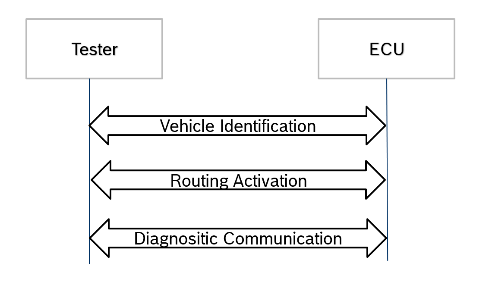

# Diagnostics over Internet Protocol overview {#diagnostics-over-internet-protocol-overview .p_Heading1 style="page-break-after: avoid;"}

+:-------------------------------------------------------------------------------------------------------------------------------------------------------------------------------------------------------------------------------+-------------------------------------------------------------------------------------------------------------------------------------+
| **Navigation:**  [System features](system-concepts.html) \> [BSW](bsw.html) \> [Network communication & protocols](network-comm-protocols.html) \> [Ethernet](ethernet.html) \> [Ethernet overview](ethernet-overview.html) \> |    |
|                                                                                                                                                                                                                                |                                                                                                                                     |
| # Diagnostics over Internet Protocol overview {#diagnostics-over-internet-protocol-overview-1 .p_Heading1 style="page-break-after: avoid;"}                                                                                    |                                                                                                                                     |
+--------------------------------------------------------------------------------------------------------------------------------------------------------------------------------------------------------------------------------+-------------------------------------------------------------------------------------------------------------------------------------+

The following chapter describes a short overview of the Diagnostics over Internet Protocol.

## 1. Introduction {#introduction .p_Heading2 style="page-break-after: avoid;"}

Diagnostics over Internet Protocol facilitates diagnostic communication between an external Tester device and ECU using Internet Protocol, using both TCP and  UDP. It is similar to UDSonCAN. Diagnostics over Internet Protocol enables to use of automotive diagnostic services exposed through UDS over IP.

 \
 \
2. UDSonIP at the OSI Reference model

 

+--------+--------------+----------------------+-------------+
| Layers | OSI model    | Protocols            | ISO UDSonIP |
+--------+--------------+----------------------+-------------+
| 7      | Application  | UDS                  | ISO 14229-5 |
+--------+--------------+                      +-------------+
| 6      | Presentation |                      | \-          |
+--------+--------------+                      +-------------+
| 5      | Session      |                      | ISO 14229-2 |
+--------+--------------+----------------------+-------------+
| 4      | Transport    | TCP/IP, UDP          | ISO 13400-2 |
+--------+--------------+----------------------+             |
| 3      | Network      | IPv4                 |             |
+--------+--------------+----------------------+-------------+
| 2      | Datalink     | Ethernet, 100BASE-T1 | IEEE 802.3  |
+--------+--------------+                      |             |
| 1      | Physical     |                      |             |
+--------+--------------+----------------------+-------------+

 

+--------------------------------------------------------------------------------+---------------------------------------------------------------------------------------------------------------------------------------------------------------------------------------------------------------------------------------------------------------------------------------------------------------------------------------------------+
| {style="margin:0;width:2.1667in;height:0.6979in;border:none"} | •The 100BASE-T1 USB Interface MACH SYSTEMS VCI is supported for RC. It connects a 100BASE-T1 network to any computer with an USB port. The converter acts as an Ethernet network interface card when plugged into an USB port. The interface easily connects Ethernet devices with directly to any PC without a need of an on-board network card. |
|                                                                                |                                                                                                                                                                                                                                                                                                                                                   |
|                                                                                | •The channel's Master/Slave configuration is selected by a switch button. Further, the device can be simultaneously used as a USB-CAN interface..                                                                                                                                                                                                 |
|                                                                                |                                                                                                                                                                                                                                                                                                                                                   |
|                                                                                |                                                                                                                                                                                                                                                                                                                                                   |
+--------------------------------------------------------------------------------+---------------------------------------------------------------------------------------------------------------------------------------------------------------------------------------------------------------------------------------------------------------------------------------------------------------------------------------------------+

 

3\. Ethernet Packet

 

The Ethernet frame structure is given as shown in the table below.

 

<table style="width:80%; border:none; border-spacing:0; border-collapse:collapse;">
<colgroup>
<col style="width: 9%" />
<col style="width: 9%" />
<col style="width: 9%" />
<col style="width: 9%" />
<col style="width: 9%" />
<col style="width: 9%" />
<col style="width: 9%" />
<col style="width: 9%" />
<col style="width: 9%" />
<col style="width: 9%" />
<col style="width: 9%" />
</colgroup>
<tbody>
<tr>
<td style="vertical-align: middle; width: 7%; height: 0.6146in; background-color: #E5EEF2; padding: 0.0417in; border: solid thin #000000; border-right: none; border-left: none">
Packet blocks
</td>
<td style="vertical-align: middle; width: 4%; height: 0.6146in; padding: 0.0417in; border: solid thin #000000; border-right: none; border-left: none">
Preamble
</td>
<td style="vertical-align: middle; width: 7%; height: 0.6146in; background-color: #E5EEF2; padding: 0.0417in; border: solid thin #000000; border-right: none; border-left: none">
Start Frame delimiter
</td>
<td style="vertical-align: middle; width: 15%; height: 0.6146in; padding: 0.0417in; border: solid thin #000000; border-right: none; border-left: none">
Destination MAC address
</td>
<td style="vertical-align: middle; width: 14%; height: 0.6146in; background-color: #E5EEF2; padding: 0.0417in; border: solid thin #000000; border-right: none; border-left: none">
Source MAC address
</td>
<td style="vertical-align: middle; width: 10%; height: 0.6146in; padding: 0.0417in; border: solid thin #000000; border-right: none; border-left: none">
Frame Type
</td>
<td style="vertical-align: middle; width: 10%; height: 0.6146in; background-color: #E5EEF2; padding: 0.0417in; border: solid thin #000000; border-right: none; border-left: none">
IP Header
</td>
<td style="vertical-align: middle; width: 10%; height: 0.6146in; padding: 0.0417in; border: solid thin #000000; border-right: none; border-left: none">
TCP/UDP Header
</td>
<td style="vertical-align: middle; width: 21%; height: 0.6146in; background-color: #E5EEF2; padding: 0.0417in; border: solid thin #000000; border-right: none; border-left: none">
Payload Data
</td>
<td style="vertical-align: middle; width: 17%; height: 0.6146in; background-color: #FFFFFF; padding: 0.0417in; border: solid thin #000000; border-right: none; border-left: none">
CRC
</td>
<td style="vertical-align: middle; width: 19%; height: 0.6146in; background-color: #E5EEF2; padding: 0.0417in; border: solid thin #000000; border-right: none; border-left: none">
Inter Frame Delimiter
</td>
</tr>
<tr>
<td style="vertical-align: top; width: 7%; background-color: #E5EEF2; padding: 0.0417in; border: solid thin #000000; border-right: none; border-left: none">
Size in bytes
</td>
<td style="vertical-align: middle; width: 4%; padding: 0.0417in; border: solid thin #000000; border-right: none; border-left: none">
7
</td>
<td style="vertical-align: middle; width: 7%; background-color: #E5EEF2; padding: 0.0417in; border: solid thin #000000; border-right: none; border-left: none">
1
</td>
<td style="vertical-align: middle; width: 15%; padding: 0.0417in; border: solid thin #000000; border-right: none; border-left: none">
6
</td>
<td style="vertical-align: middle; width: 14%; background-color: #E5EEF2; padding: 0.0417in; border: solid thin #000000; border-right: none; border-left: none">
6
</td>
<td style="vertical-align: middle; width: 10%; padding: 0.0417in; border: solid thin #000000; border-right: none; border-left: none">
2
</td>
<td style="vertical-align: middle; width: 10%; background-color: #E5EEF2; padding: 0.0417in; border: solid thin #000000; border-right: none; border-left: none">
20-60
</td>
<td style="vertical-align: middle; width: 10%; padding: 0.0417in; border: solid thin #000000; border-right: none; border-left: none">
TCP : 20-60 
UDP: 8
</td>
<td style="vertical-align: middle; width: 21%; background-color: #E5EEF2; padding: 0.0417in; border: solid thin #000000; border-right: none; border-left: none">
46 to 1500
</td>
<td style="vertical-align: middle; width: 17%; background-color: #FFFFFF; padding: 0.0417in; border: solid thin #000000; border-right: none; border-left: none">
4
</td>
<td style="vertical-align: middle; width: 19%; background-color: #E5EEF2; padding: 0.0417in; border: solid thin #000000; border-right: none; border-left: none">
12
</td>
</tr>
</tbody>
</table>

 \
3.1  Payload Data

 \
The Payload Data contains the actual data being transmitted in the Ethernet frame. It can vary in length depending on the specific application and requirements.\
The generic DoIP Data(Payload data in Ethernet frame) frame is shown in the below table.\
 

+--------------------------------------------------------------------------------------------------------------------------------------+
| DoIP message                                                                                                                         |
|                                                                                                                                      |
| +-------------+----------------------+--------------+----------------+-------------------------------------------------------------+ |
| | Protocol    | INV Protocol Version | Payload Type | Payload Length | DoIP Payload                                                | |
| |             |                      |              |                |                                                             | |
| | Version     |                      |              |                |                                                             | |
| |             |                      |              |                +-------------------------------------------------------------+ |
| |             |                      |              |                |   --------------------- --------------------- ------------- | |
| |             |                      |              |                |   DoIP Source Address   DoIP Target Address   UDS Payload   | |
| |             |                      |              |                |   --------------------- --------------------- ------------- | |
| +-------------+----------------------+--------------+----------------+-------------------------------------------------------------+ |
+--------------------------------------------------------------------------------------------------------------------------------------+

DoIP protocol packet structure consists of four primary fields: Protocol Version, Inverse Protocol Version, Payload Type, and Payload Length. These fields provide crucial information about the packet and its payload.

### 3.2 Protocol version {#protocol-version .p_Heading3 style="page-break-after: avoid;"}

The Protocol Version field specifies the version of the DoIP protocol being used, such as 0x01, 0x02, or 0x03.

### 3.3 Inverse Protocol Version {#inverse-protocol-version .p_Heading3 style="page-break-after: avoid;"}

The Inverse Protocol Version field carries the bit inverted value of the Protocol Version, ensuring error-checking during transmission.

 

### 3.4 DoIP Payload Type {#doip-payload-type .p_Heading3 style="page-break-after: avoid;"}

The Payload Type field, represented by two bytes, indicates the type of payload in the message. Multiple payload types are defined, including vehicle identification, diagnostic message delivery, and route activation.

  -------------------- ------------------------------------------------------
  Payload Type value   Payload type name
  0x0000               Generic DoIP header negative acknowledge
  0x0001               Vehicle identification request without EID or VIN
  0x0002               Vehicle identification request with EID
  0x0003               Vehicle identification request with VIN
  0x0004               Vehicle announcement/vehicle identification response
  0x0005               Routing activation request
  0x0006               Routing activation response
  0x4003               Diagnostic power mode information request
  0x4004               Diagnostic power mode information response
  0x8001               Diagnostic message
  0x8002               Diagnostic message positive acknowledge
  0x8003               Diagnostic message negative acknowledge
  -------------------- ------------------------------------------------------

### 3.5 Payload Length field {#payload-length-field .p_Heading3 style="page-break-after: avoid;"}

The Payload Length field, represented by four bytes, specifies the length of the payload in bytes. It determines the number of data that follows the header section.

### 3.6 DoIP Payload {#doip-payload .p_Heading3 style="page-break-after: avoid;"}

The DoIP Payload contains the actual data to be transmitted, such as diagnostic messages or control signals. The structure of the payload depends on the Payload Type specified in the header. Within the payload, the Identifier field is used to identify the sender and receiver of the message, providing Source Address and Target Address subfields.

 

## 4. Diagnostics over Internet Protocol communication sequence {#diagnostics-over-internet-protocol-communication-sequence .p_Heading2 style="page-break-after: avoid;"}

{style="margin:0;width:7.5625in;height:4.7500in;border:none"}

Diagnostics over Internet Protocol communication happens in the following three stages:

1.Vehicle Identification

2.Routing activation

3.Diagnostic communication

### 4.1 Vehicle Identification {#vehicle-identification .p_Heading3 style="page-break-after: avoid;"}

Tester transmits a vehicle identification request as broadcast via UDP protocol. Then the ECU will respond by sending a vehicle

identification response

\- VIN: Vehicle Identification Number

\- EID: Entity Identification

\- Logical Tester address of the ECU

 

+--------------------------------------------------------------------------------+-------------------------------------------------------------------------------------------------------------------------------------------+
| {style="margin:0;width:2.1667in;height:0.6979in;border:none"} | •By default, the VIN has a value of B0DASMACH1NE00001 and EID has value of MAC address of the ECU and GID has the mirrored value of EID . |
|                                                                                |                                                                                                                                           |
|                                                                                | •The VIN value can be changed through UDS DID 0xF190 write service and through API bds_uds_setVin .\                                      |
|                                                                                |                                                                                                                                           |
+--------------------------------------------------------------------------------+-------------------------------------------------------------------------------------------------------------------------------------------+

 

### 4.2 Routing activation {#routing-activation .p_Heading3 style="page-break-after: avoid;"}

- Tester transmits a routing activation request to the ECU via TCP protocol.\
- Logical address of Tester\
 

- Then ECU transmits a routing activation response to the Tester via TCP protocol.\
- Logical address of Tester\
- Logical address of ECU\
 

 

### 4.3 Diagnostic communication {#diagnostic-communication .p_Heading3 style="page-break-after: avoid;"}

- Once the routing activation response is received from the ECU then the Tester can request any UDS service to the ECU.\
- e.g: ReadDataByIdentifier, etc;\
 

- Then ECU sends UDS response with respective to tester\'s requested UDS service .\
 

 

 

5\. Supported features

The  RC40 BODAS-BSW library supports the configuration of the parameters given below in the easyConfig.

- IPv4 address of the Tester.

- Logical address of the Tester.

- IPv4 address of the ECU.

- Logical address of the ECU.I

Additionally, for the  VIN, the BODAS-BSW UDS  APIs are provided.

 

  -------------------------------------------------------------------------------- ----------------------------------------------------------------
  {style="margin:0;width:2.1667in;height:0.6979in;border:none"}   The BODAS-BSW library supports TCP/IP, UDP, and ARP protocols.
  -------------------------------------------------------------------------------- ----------------------------------------------------------------

 

 

 

 

 
