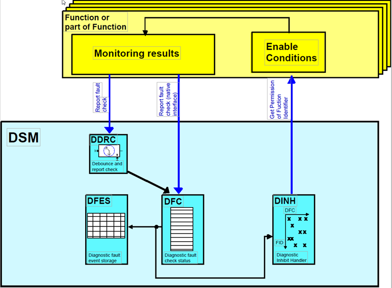

# Diagnostic System Management {#diagnostic-system-management .p_Heading1 style="page-break-after: avoid;"}

 

+:------------------------------------------------------------------------------------------------------------------------------------------------------+----------------------------------------------------------------------------------------------------------------------------------------------------------------------------+
| **Navigation:**  [System features](system-concepts.html) \> [BSW](bsw.html) \> [Error handling infrastructure](error-handling-infrastructure.html) \> |    |
|                                                                                                                                                       |                                                                                                                                                                            |
| # Diagnostic System Management {#diagnostic-system-management-1 .p_Heading1 style="page-break-after: avoid;"}                                         |                                                                                                                                                                            |
|                                                                                                                                                       |                                                                                                                                                                            |
|                                                                                                                                                       |                                                                                                                                                                            |
+-------------------------------------------------------------------------------------------------------------------------------------------------------+----------------------------------------------------------------------------------------------------------------------------------------------------------------------------+

## DSM General Description: {#dsm-general-description .p_Heading2 style="page-break-after: avoid;"}

The Diagnostic System Management (DSM) collects the test results reported from the monitoring functions. The current states and the derived error memory entries are available in standard form for the application software and the tester communications.

The DSM coordinates the visualization of results on the diagnose interface on basis of debounce cycle that can be calibrated in a wide range in easyConfig.

The DSM provides measurement points for easyConfig to make it possible to observe and trace the behavior of monitoring functions. The behavior of the DSM and the provided functionality is configurable within a wide range. The tasks of the DSM are structured into the sub function groups shown on the following overview diagram. Additional sub functions are available to support legal demands or customer specific extensions.

 \
 

<figure style="margin:0;padding:0">

<figcaption>
Figure56: DSM-Overview
</figcaption>
</figure>

On the following links, a short description of every component and the reference to the complete documentation is given.

- [Diagnostic Debounce and Report Check](diagnostic-debounce-and-report-check.html){.topiclink}

  Describes the concept of the Diagnostic Debounce and Report Check.  

- [Diagnostic Fault Check](diagnostic-fault-check.html){.topiclink}

  Describes the concept of the Diagnostic Fault Check.        

- [Diagnostic Fault Event Storage](diagnostic-fault-event-storage.html){.topiclink}

  Describes the concept of the Diagnostic Fault Event Storage.

- [Diagnostic Inhibit Handler](diagnostic-inhibit-handler.html){.topiclink}

  Describes the concept of the Diagnostic Inhibit Handler.

- [Diagnostic Trouble Code](diagnostic-trouble-code.html){.topiclink}

   The diagnostic trouble code table shows the DFC define (DFC name), DTC, DFES_Prio, API function and the description for all used DFC\'s.

## API functions related to DSM module: {#api-functions-related-to-dsm-module .p_Heading2 style="page-break-after: avoid;"}

There are currently more than 20 functions related to DSM modules. To know more about the APIs prototype, usage or code sample visit  DSM (for support of 3 byte DTC) /  DSM legacy. The functions related to DSM module are categorized into three:

- Function for Error Management with DFC as parameter,

- Function for J1939 Errors and

- Function for Error Management with DTC as parameter.

 

 
