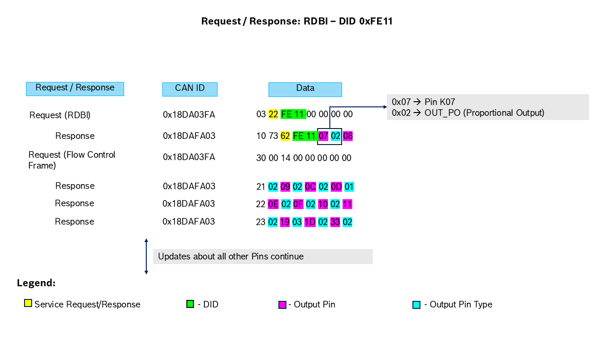
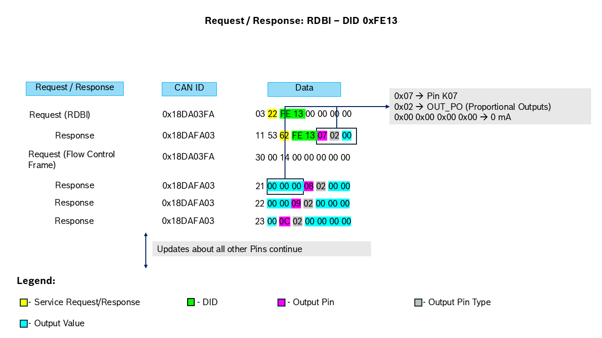

# DIDs for reading Output Pins {#dids-for-reading-output-pins .p_Heading1 style="page-break-after: avoid;"}

+:-----------------------------------------------------------------------------------------------------------------------------------------------------------------------------------------------------------------------------------------------------------------------------------------------------------------------+-----------------------------------------------------------------------------------------------------------------------------------------------------------------------------+
| **Navigation:**  [System features](system-concepts.html) \> [BSW](bsw.html) \> [Diagnostic services (UDS)](diagnostic-services.html) \> [UDS overview](uds---overview.html) \> [Data Identifier (DID)](data-identifier-(did).html) \> [DIDs for reading Input and Output Pins](data-identifiers-(did)-for-rea.html) \> | -for-readinputpins.html "Previous Topic") -for-rea.html "Parent Chapter")  |
|                                                                                                                                                                                                                                                                                                                        |                                                                                                                                                                             |
| # DIDs for reading Output Pins {#dids-for-reading-output-pins-1 .p_Heading1 style="page-break-after: avoid;"}                                                                                                                                                                                                          |                                                                                                                                                                             |
+------------------------------------------------------------------------------------------------------------------------------------------------------------------------------------------------------------------------------------------------------------------------------------------------------------------------+-----------------------------------------------------------------------------------------------------------------------------------------------------------------------------+

### Note: {#note .p_Heading3 style="page-break-after: avoid;"}

- The DIDs are accessible within the Default diagnostic session without requiring any specific security access.

- These DIDs are read-only and cannot be modified or written to.

DIDs which are used for reading output pins are:

  -------- ---------------------------------------------------------------------------------------- --------------------- -------------- ------------------------------------------------ -------------------------------------------------------
  DID      Description (Long Name)                                                                  Short Name (label)    Display Type   Comment                                          Alternative BSW API
  0xFE11   Output Pin Overview, from the ASW configuration in easyConfig of configured outputs      Output Pin Overview   Hexadecimal    Reading Output Pin and related type              No BSW API for this.
  0xFE13   Output Pin Port Values, actual input state values from ASW configuration in easyConfig   Get output Values     Hexadecimal    Reading Output Pin and related voltage/current   Refer \"Type of Outputs\" at the end of this chapter.
  -------- ---------------------------------------------------------------------------------------- --------------------- -------------- ------------------------------------------------ -------------------------------------------------------

 

0xFE11 - Output Pin Overview, from the ASW configuration in easyConfig of configured outputs:

+--------------------+--------+--------+---------------------+--------------------------------------------------------------------------------------+------------+---------+----------------------------------------+
| Name               | Size   | Length | Format of data sent | Format to be displayed                                                               | Conversion | Minimum | Maximum                                |
+--------------------+--------+--------+---------------------+--------------------------------------------------------------------------------------+------------+---------+----------------------------------------+
| PIN number         | 1      | 1      | uint8               | Numeric. Valid range 1-154                                                           | Identical  | 0x01    | 0x98                                   |
|                    |        |        |                     |                                                                                      |            |         |                                        |
|                    |        |        |                     |                                                                                      |            |         | 0xFF - wrong (not required to display) |
+--------------------+--------+--------+---------------------+--------------------------------------------------------------------------------------+------------+---------+----------------------------------------+
| Pin / Channel type | 1      | 1      | uint8               | Numeric. Refer \"Type of Outputs\" at the end of this chapter for further details.\* | Identical  | 0x01    | 0x03                                   |
|                    |        |        |                     |                                                                                      |            |         |                                        |
|                    |        |        |                     |                                                                                      |            |         | 0xFF - wrong (not required to display) |
+--------------------+--------+--------+---------------------+--------------------------------------------------------------------------------------+------------+---------+----------------------------------------+

 

Sample Request and Response:

 

<figure style="margin:0;padding:0">

<figcaption>
Figure 43: UDS Request / Response for RDBI - DID 0xFE11
</figcaption>
</figure>

0xFE13 - Output Pin Port Values, actual input state values from ASW configuration in easyConfig:

+---------------------------+--------+--------+---------------------+--------------------------------------------------------------------------------------+------------+---------+----------------------------------------+
| Name                      | Size   | Length | Format of data sent | Format to be displayed                                                               | Conversion | Minimum | Maximum                                |
+---------------------------+--------+--------+---------------------+--------------------------------------------------------------------------------------+------------+---------+----------------------------------------+
| Output Pin Number         | 1      | 1      | uint8               | Numeric. Valid range 1-154                                                           | Identical  | 0x1     | 0x98                                   |
|                           |        |        |                     |                                                                                      |            |         |                                        |
|                           |        |        |                     |                                                                                      |            |         | 0xFF - wrong (not required to display) |
+---------------------------+--------+--------+---------------------+--------------------------------------------------------------------------------------+------------+---------+----------------------------------------+
| Output Pin / Channel type | 1      | 1      | uint8               | Numeric. Refer \"Type of Outputs\" at the end of this chapter for further details.\* | Identical  | 0x1     | 0x03                                   |
|                           |        |        |                     |                                                                                      |            |         |                                        |
|                           |        |        |                     |                                                                                      |            |         | 0xFF - wrong (not required to display) |
+---------------------------+--------+--------+---------------------+--------------------------------------------------------------------------------------+------------+---------+----------------------------------------+
| Output Pin Value          | 4      | 4      | uint8               | Actual output values                                                                 | Identical  | 0       | 0xFFFFFFFF                             |
+---------------------------+--------+--------+---------------------+--------------------------------------------------------------------------------------+------------+---------+----------------------------------------+

 

Sample Request and Response:

 

<figure style="margin:0;padding:0">

<figcaption>
Figure 44: UDS Request / Response for RDBI - DID 0xFE13
</figcaption>
</figure>

### \*Type of outputs: {#type-of-outputs .p_Heading3 style="page-break-after: avoid;"}

  ------------------------------------ ---------------------------------------------- ------------------------------------ ----------- -----------------------
  Type of Outputs - Abbreviated Form   Meaning / Explanation                          Value as read in UDS Response byte   Units       Alternative BSW API
  OUT_DO                               Digital Output                                 1                                    ON or OFF   bds_out_do_getStatus
  OUT_PO                               Proportional Output                            2                                    mA          bds_out_po_getStatus
  OUT_AOV                              Analog Output Voltage                          3                                    mV          bds_out_aov_getStatus
  \-                                   Unused Input Pin number/ unused channel type   0xFF                                 \-          \-
  ------------------------------------ ---------------------------------------------- ------------------------------------ ----------- -----------------------

 

 
