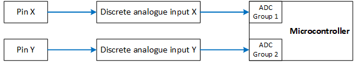

# Discrete analogue inputs {#discrete-analogue-inputs .p_Heading1 style="page-break-after: avoid;"}

+:--------------------------------------------------------------------------------------------------------------+----------------------------------------------------------------------------------------------------------------------------------------+
| **Navigation:**  [Safety manual](safety-manual.html) \> [Safety-related inputs](safety-relatedinputs.html) \> |    |
|                                                                                                               |                                                                                                                                        |
| # Discrete analogue inputs {#discrete-analogue-inputs-1 .p_Heading1 style="page-break-after: avoid;"}         |                                                                                                                                        |
+---------------------------------------------------------------------------------------------------------------+----------------------------------------------------------------------------------------------------------------------------------------+

 

 

<figure style="margin:0;padding:0">

<figcaption aria-hidden="true">
Figure 117: Input path of the discrete analogue inputs of RC18-12/40 and RC28-17/40
</figcaption>
</figure>

 

RC18-12/40 and RC27-18/40 provide 21 discrete analogue inputs, where all the signals are fed, after filtering, directly to the ADCs of the µC (see figure above).

As illustrated in the figure above, the discrete analogue inputs can be used to form completely independent signal paths. The 2 independent signals can either be used to form redundancy or be used for plausibility check.

If the ASW implements a proper comparison of the two input signals, failures in the input processing circuitry external to and internal of the RC can be detected with high reliability.

When used as a single signal, different diagnostic methods could be implemented by the ASW (e.g., range check) to detect failures of the discrete analogue inputs.

The assignment of each discrete analogue input pin to the input groups and hence the signal channels are given in the following table.

+------------------------------+-------------+----------------------------------------+------------------------------------------------------------------------------------+
| Type                         | ADC group   | Connector pin number                   | Function group in [Reliability parameters](reliabilityparameters.html){.topiclink} |
+==============================+=============+========================================+====================================================================================+
| 32 V-discrete analogue input | ADC group 1 | K78, K76, K74, K77, K10, A40, A41, A42 | Disc. analogue inputs (K4)                                                         |
|                              +-------------+----------------------------------------+                                                                                    |
|                              | ADC group 2 | K75, K31, K34, A13, A25, A26, A27      |                                                                                    |
+------------------------------+-------------+----------------------------------------+------------------------------------------------------------------------------------+
| 5 V-discrete analogue input  | ADC group 1 | A14, A57, A28                          | Disc. analogue inputs (K4)                                                         |
|                              +-------------+----------------------------------------+                                                                                    |
|                              | ADC group 2 | A29, K11, K35                          |                                                                                    |
+------------------------------+-------------+----------------------------------------+------------------------------------------------------------------------------------+

[]{#fig_91290e .hmanchor}Table 25: Pin assignment of discrete analogue inputs

Due to its limited accuracy, it is not suggested to use 32 V-discrete analogue inputs to read analogue sensor signals with high accuracy requirements. With the thresholds defined by the ASW, these inputs can be used as digital inputs to read, for example, the state of a switch.

 

  {style="margin:0;width:8.3333in;height:0.4583in;border:none"}
  -------------------------------------------------------------------------------------------------------------------------------------------------------------------------------------------------------------------------------
  For RC18-12/40 and RC27-18/40, restricted by its limited accuracy, using 32 V-discrete analogue inputs for reading of analogue sensor signals with high accuracy requirements may result in danger to life and/or properties.

 

 
