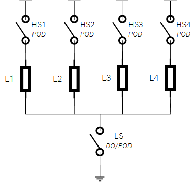
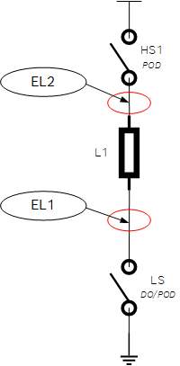
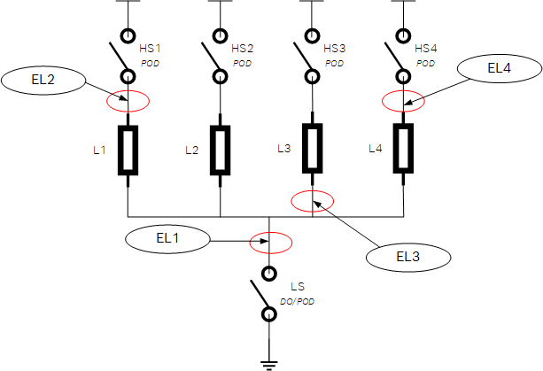

# DLDHM {#dldhm .p_Heading1 style="page-break-after: avoid;"}

+:----------------------------------------------------------------------------------------------------------------------------------------------------+------------------------------------------------------------------------------------------------------+
| **Navigation:**  [System features](system-concepts.html) \> [BSW](bsw.html) \> [Outputs](outputs.html) \> [SAFOUT function](safety-outputs.html) \> |    |
|                                                                                                                                                     |                                                                                                      |
| # DLDHM {#dldhm-1 .p_Heading1 style="page-break-after: avoid;"}                                                                                     |                                                                                                      |
+-----------------------------------------------------------------------------------------------------------------------------------------------------+------------------------------------------------------------------------------------------------------+

Digital Low - Digital High Multiple (DLDHM) operating mode.

DLDHM is the combination of 1 common digital low-side power output and up to 4 parallel digital high-side power outputs.

 

     

<figure style="margin:0;padding:0">

<figcaption aria-hidden="true">
Figure 89: SAFOUT channel comprised of up to four digital HS combined with a digital LS outputs with CLCC
</figcaption>
</figure>

 

## Safety functions {#safety-functions .p_Heading2 style="page-break-after: avoid;"}

Safety function related to this configuration are

- Prevention from unintended actuation, and

- Safe deactivation of the actuators

For these safety functions, each of the high-power outputs is considered to be a functional channel.

## Failure detection possibilities of the DLDHM mode {#failure-detection-possibilities-of-the-dldhm-mode .p_Heading2 style="page-break-after: avoid;"}

+-----------------------------------+----------------+----------------+------------------+----------------------------------------------------------------------------------+
| Failure mode                      | Failure detected?                                  | Comment                                                                          |
|                                   +----------------+----------------+------------------+                                                                                  |
|                                   | Active load    | Inactive load  | Inactive channel |                                                                                  |
|                                   |                |                |                  |                                                                                  |
|                                   | (HS = ON,      | (HS = OFF,     | (HS = LS = OFF)  |                                                                                  |
|                                   |                |                |                  |                                                                                  |
|                                   | LS = ON)       | LS = ON)       |                  |                                                                                  |
+-----------------------------------+----------------+----------------+------------------+----------------------------------------------------------------------------------+
| HS                                | Yes            | Yes            | Yes              | \-                                                                               |
|                                   |                |                |                  |                                                                                  |
| short circuit to ground           |                |                |                  |                                                                                  |
+-----------------------------------+----------------+----------------+------------------+----------------------------------------------------------------------------------+
| HS                                | Yes            | Yes            | Yes              | \-                                                                               |
|                                   |                |                |                  |                                                                                  |
| short circuit to battery          |                |                |                  |                                                                                  |
+-----------------------------------+----------------+----------------+------------------+----------------------------------------------------------------------------------+
| HS                                | Yes            | Yes            | No\*             | \*The API bds_safout_enableTest can be called by the ASW to detect this failure. |
|                                   |                |                |                  |                                                                                  |
| open circuit                      |                |                |                  |                                                                                  |
+-----------------------------------+----------------+----------------+------------------+----------------------------------------------------------------------------------+
| LS                                | No             | No             | Yes              | \-                                                                               |
|                                   |                |                |                  |                                                                                  |
| short circuit to ground           |                |                |                  |                                                                                  |
+-----------------------------------+----------------+----------------+------------------+----------------------------------------------------------------------------------+
| LS                                | Yes            | Yes            | Yes              | \-                                                                               |
|                                   |                |                |                  |                                                                                  |
| short circuit to battery          |                |                |                  |                                                                                  |
+-----------------------------------+----------------+----------------+------------------+----------------------------------------------------------------------------------+
| LS                                | Yes            | Yes            | Yes              | \-                                                                               |
|                                   |                |                |                  |                                                                                  |
| open circuit                      |                |                |                  |                                                                                  |
+-----------------------------------+----------------+----------------+------------------+----------------------------------------------------------------------------------+
| Over current                      | Yes            | N.A.           | N.A.             | \-                                                                               |
+-----------------------------------+----------------+----------------+------------------+----------------------------------------------------------------------------------+
| Mismatch of the HS and LS current | N.A.           | N.A.           | N.A.             | \-                                                                               |
+-----------------------------------+----------------+----------------+------------------+----------------------------------------------------------------------------------+

 

## Configuration {#configuration .p_Heading2 style="page-break-after: avoid;"}

Example:

#define DLDHM_CHNL1  (DLDHM \| CHNL1)

bds_safout_cfg(DLDHM_CHNL1, K12, K73, K08, K07, 0);

## Use {#use .p_Heading2 style="page-break-after: avoid;"}

Switch ON HS1 and HS2:

bds_safout(DLDHM_CHNL1, K73, 1);    /\* Switch ON HS1:(HS1 is ON ) \*/

bds_safout(DLDHM_CHNL1, K08, 1);    /\* Switch ON HS2:(HS2 is ON ) \*/

Shut-OFF:

bds_safout(DLDHM_CHNL1, K73, 0);

bds_safout(DLDHM_CHNL1, K08, 0);

## Diagnostics {#diagnostics .p_Heading2 style="page-break-after: avoid;"}

The diagnostic information of safout channel is read using  bds_safout_getStatus.

In figure, ELx represents the error location.

1 HS : 1 LS configuration  

 

<figure style="margin:0;padding:0">

<figcaption aria-hidden="true">
Figure 90: Error locations (EL) in 1:1 HS-LS combination of SAFOUT
</figcaption>
</figure>

 

+------------+-----------------------+-----------+-----------+--------------------------+
| Error type | Safout channel status | diag_u32              | Remarks                  |
|            |                       +-----------+-----------+                          |
|            |                       | EL1       | EL2       |                          |
+------------+-----------------------+-----------+-----------+--------------------------+
| SCB        | OFF                   | 0x00011   | 0x00001   |                          |
|            +-----------------------+-----------+-----------+--------------------------+
|            | ON                    | 0x00001   | 0x00010   |                          |
+------------+-----------------------+-----------+-----------+--------------------------+
| SCG        | OFF                   | 0x00002   | 0x00002   | only detected by LS      |
|            +-----------------------+-----------+-----------+--------------------------+
|            | ON                    | 0x00000\* | 0x00020   | \*not detected by LS     |
+------------+-----------------------+-----------+-----------+--------------------------+
| OL         | OFF                   | 0x00004   | 0x000004  | \*not detected by HS     |
|            +-----------------------+-----------+-----------+--------------------------+
|            | ON                    | 0x00040   | 0x00040\* | \*OL detected only on HS |
+------------+-----------------------+-----------+-----------+--------------------------+

Note : OL error on HS is not healed if no physical error. Check open load error on LS, if no open load error reported after 150ms, then no physical OL error.

4 HS : 1 LS configuration

 

<figure style="margin:0;padding:0">

<figcaption aria-hidden="true">
Figure 91: Error locations (EL) in 4:1 HS-LS combination of SAFOUT
</figcaption>
</figure>

 

+------------+-----------------------+-----------+-----------+-----------+-----------+-----------------------------------------------------+
| Error type | Safout channel Status | diag_u32                                      | Remarks                                             |
|            |                       +-----------+-----------+-----------+-----------+                                                     |
|            |                       | EL1       | EL2       | EL3       | EL4       |                                                     |
+------------+-----------------------+-----------+-----------+-----------+-----------+-----------------------------------------------------+
| SCB        | OFF                   | 0x11111   | 0x11110   | 0x11111   | 0x11110   |                                                     |
|            +-----------------------+-----------+-----------+-----------+-----------+-----------------------------------------------------+
|            | ON                    | 0x00001   | 0x00010   | 0x00001   | 0x10000   |                                                     |
+------------+-----------------------+-----------+-----------+-----------+-----------+-----------------------------------------------------+
| SCG        | OFF                   | 0x00002   | 0x00002   | 0x00002   | 0x00002   | only detected by LS                                 |
|            +-----------------------+-----------+-----------+-----------+-----------+-----------------------------------------------------+
|            | ON                    | 0x00000\* | 0x00020   | 0x00000\* | 0x20000   | \*not detected by LS, detected as current deviation |
+------------+-----------------------+-----------+-----------+-----------+-----------+-----------------------------------------------------+
| OL         | OFF                   | 0x00004   | 0x00000\* | 0x00000\* | 0x00000\* | \*not detected by HS,use bds_safout_enableTest      |
|            +-----------------------+-----------+-----------+-----------+-----------+-----------------------------------------------------+
|            | ON                    | 0x55540\* | 0x00040   | 0x04000   | 0x40000   | \*HS1 is ON, other HS\'s OFF                        |
+------------+-----------------------+-----------+-----------+-----------+-----------+-----------------------------------------------------+

 

 

 
