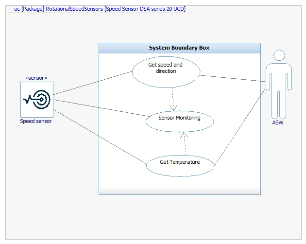

# DSA series 20 {#dsa-series-20 .p_Heading1 style="page-break-after: avoid;"}

+:--------------------------------------------------------------------------------+----------------------------------------------------------------------------------------+
| **Navigation:**  [System features](system-concepts.html) \> [BDL](bdl.html) \>  |    |
|                                                                                 |                                                                                        |
| # DSA series 20 {#dsa-series-20-1 .p_Heading1 style="page-break-after: avoid;"} |                                                                                        |
+---------------------------------------------------------------------------------+----------------------------------------------------------------------------------------+

This chapter contains an overview about rotation BODAS speed sensors DSA series 20. The corresponding BDL APIs are documented in chapter DSA series 20.

BODASdriver updates:

- The rotation speed in rpm and the rotation direction of the encoder wheel.

- The temperature of the DSA series 20 sensor.

- The diagnostics status of the DSA series 20 sensor.

- The BODASdriver for DSA series 20 sensor supports the feature post build selectable, refer to chapter \"[Post build selectable](postbuildselectable.html){.topiclink}\".

 

  -------------------------------------------------------------------------------- ---------------------------------------------------------------------------------------------------------------------------------
  {style="margin:0;width:2.1667in;height:0.6979in;border:none"}   The diagnostic status of the DSA series 20 sensor will be healed automatically, if DSA series 20 sensor is in fault free state.
  -------------------------------------------------------------------------------- ---------------------------------------------------------------------------------------------------------------------------------

 

{style="margin:0;width:6.5625in;height:5.2292in;border:none"}

Rotation speed

The BODASdriver provides:

- The rotation speed in a range of 0 rpm up to 15000 rpm based on detected frequency of the DSA sensor and number of encoder wheel teeth.

- The rotation speed with a resolution of 0.1 rpm

### Freeze state detection {#freeze-state-detection .p_Heading3 style="page-break-after: avoid;"}

- The BODASdriver informs the user about the signal status \"frozen\", if the last calculated rpm value is hold until a new rotation of the encoder wheel is detected.\
It is done to prevent oscillation of the calculated rpm value at low rotation speed of the encoder wheel.

- The maximum hold time is 1 second.

### Standstill detection {#standstill-detection .p_Heading3 style="page-break-after: avoid;"}

- If the BODASdriver is fault free and exceeds the maximum hold time of freeze state detection, the user will be informed about the signal status \"standstill\" and the rotation speed will be set to 0 rpm.

Diagnosis of rotation speed

The BODASdriver detects:

- The signal status \"out of range\" in case the detected rotation speed is above 15000 rpm.

- The error \"short to battery/open load\", if the detected sensor frequency high level is higher than 11V of the frequency inputs.

- The error \"short to ground\", if the detected sensor frequency low level is lower than 400mV of the frequency inputs.

Rotation direction

- The BODASdriver detects the rotation directions for DSA1 series 20 sensor based on detected voltage range of voltage input and for DSA2 series 20 sensor based on the detected phase shift of the frequency input signals.

- The BODASdriver sets the rotation speed to 0 rpm and rotation direction to \"unknown rotation direction\" in case diagnostic error is detected.

Temperature detection:

The BODASdriver provides:

- The DSA series 20 sensor temperature based on the detected resistor value of a NTC-Thermistor.

- The DSA series 20 sensor temperature in the range of -40 up to 125 degrees of Celsius.

- The DSA series 20 sensor temperature in the resolution of 1 degrees of Celsius.

### Diagnosis of temperature detection {#diagnosis-of-temperature-detection .p_Heading3 style="page-break-after: avoid;"}

The BODASdriver detects:

- The error \"temperature value out of range\" in case the detected resistor value is above 152.832 kΩ and below 214.532 kΩ and will set the output temperature to -40 degrees of Celsius .

- The error \"temperature value out of range\" in case the detected resistor value is below 0.186 kΩ and above 0.105 kΩ and will set the output temperature to 125 degrees of Celsius.

- The error \"short to ground\" in case the detected resistor value is below 105 Ω and will set the temperature value to 0x00008000 (32768).

- The error \"short to battery/open load\" in case the detected resistor value is above 224.400 kΩ and will set the temperature value to 0x00008000 (32768).

- The error \"temperature input not configured for resistance measurement\" in case the temperature input is not correctly configured or temperature detection feature is not selected in easyConfig.

 
