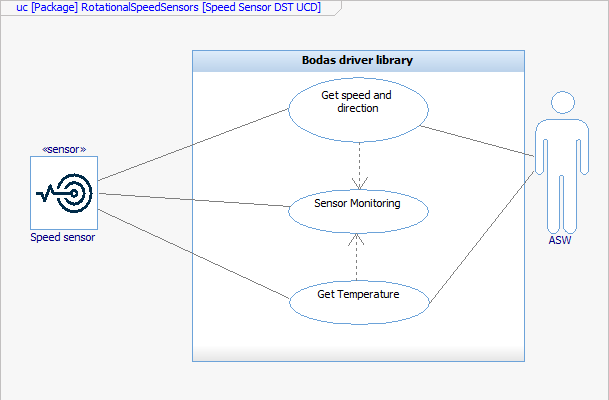
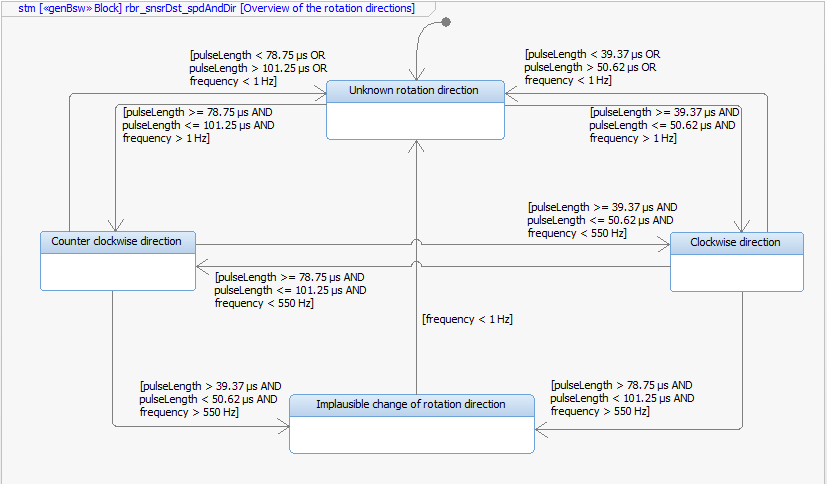

# DST {#dst .p_Heading1 style="page-break-after: avoid;"}

+:-------------------------------------------------------------------------------+---------------------------------------------------------------------------------------+
| **Navigation:**  [System features](system-concepts.html) \> [BDL](bdl.html) \> |    |
|                                                                                |                                                                                       |
| # DST {#dst-1 .p_Heading1 style="page-break-after: avoid;"}                    |                                                                                       |
+--------------------------------------------------------------------------------+---------------------------------------------------------------------------------------+

This chapter contains an overview about rotation speed sensors (DST). The corresponding BDL APIs are documented in chapter DST.

BODASDriver updates:

- The rotation speed in rpm and the rotation direction of the encoder wheel.

- The temperature of the DST sensor.

- The diagnostics status of the DST sensor.

- The BODASDriver for DST sensor supports the feature post build selectable, refer to chapter \"[Post build selectable](postbuildselectable.html){.topiclink}\".

 

  -------------------------------------------------------------------------------- -------------------------------------------------------------------------------------------------------------
  {style="margin:0;width:2.1667in;height:0.6979in;border:none"}   The diagnostic status of the DST sensor will be healed automatically, if DST sensor is in fault free state.
  -------------------------------------------------------------------------------- -------------------------------------------------------------------------------------------------------------

 

<figure style="margin:0;padding:0">

<figcaption aria-hidden="true">
Figure102: DST sensor overview
</figcaption>
</figure>

Rotation speed:

The BODASdriver provides:

- The rotation speed in a range of 0 rpm up to 15000 rpm based on detected frequency of the DST sensor and number of encoder wheel teeth.

- The rotation speed with a resolution of 0.1 rpm

### Freeze state detection: {#freeze-state-detection .p_Heading3 style="page-break-after: avoid;"}

- The BODASdriver informs the user about the signal status \"frozen\", if the last calculated rpm value is hold until a new rotation of the encoder wheel is detected. It is done to prevent oscillation of the calculated rpm value at low rotation speed of the encoder wheel.

- The maximum hold time is 1 second.

### Standstill detection: {#standstill-detection .p_Heading3 style="page-break-after: avoid;"}

- If the BODASdriver is fault free and exceeds the maximum hold time of freeze state detection, user will be informed about the signal status \"standstill\" and rotation speed will be set to 0 rpm.

Diagnosis of rotation speed:

The BODASdriver detects:

- The signal status \"out of range\" in case the detected frequency is above 12kHz for rotation direction clockwise or above 8kHz for rotation direction counter clockwise.

- The error \"short to ground/open load\", if the detected sensor current is lower than 4mA of the frequency input.

- The error \"short to battery\", if the detected sensor current is higher than 17mA of the frequency input.

  ------------------------------------------------------------------------------------------ --------------------------------------------------------------------------------------------------------------------------------------------------------------------------------------
  {style="margin:0;width:2.1667in;height:0.7083in;border:none"}   The shunt is protected if the current exceeds 24mA (overcurrent protection), then the shunt is deactivated for a recovery time of 2s. Afterward it is automatically activated again.
  ------------------------------------------------------------------------------------------ --------------------------------------------------------------------------------------------------------------------------------------------------------------------------------------

Rotation direction:

- The BODASDriver detects the rotation directions based on detected pulse length and frequency of the DST sensor as shown below in the state machine diagram \"Overview of the rotation directions\".

## Remarks: {#remarks .p_Heading2 style="page-break-after: avoid;"}

- The BODASdriver sets the rotation speed to 0 rpm and rotation direction to \"unknown rotation direction\" in case diagnostic error is detected.

<figure style="margin:0;padding:0">

<figcaption aria-hidden="true">
Figure103: Overview of the rotation directions
</figcaption>
</figure>

Temperature detection:

The BODASdriver provides:

- The DST sensor temperature based on the detected resistor value of a NTC-Thermistor.

- The DST sensor temperature in the range of -40 up to 140 degrees of celsius.

- The DST sensor temperature in the resolution of 1 degrees of celsius.

### Diagnosis of temperature detection: {#diagnosis-of-temperature-detection .p_Heading3 style="page-break-after: avoid;"}

The BODASdriver detects:

- The error \"temperature value out of range\" in case the detected resistor value is above 174.4 kΩ and below 225 kΩ and will set the output temperature to -40 degrees of celsius .

- The error \"temperature value out of range\" in case the detected resistor value is below 0.117 kΩ and above 0.05 kΩ and will set the output temperature to 140 degrees of celsius.

- The error \"short to ground\" in case the detected resistor value is below 50 Ω and will set the temperature value to 0x80000000 (-2147483647).

- The error \"short to battery/open load\" in case the detected resistor value is above 225 kΩ and will set the temperature value to 0x80000000 (-2147483647).

- The error \"temperature input not configured for resistance measurement\" in case the temperature input is not correctly configured or temperature detection feature is not selected in easyConfig.
