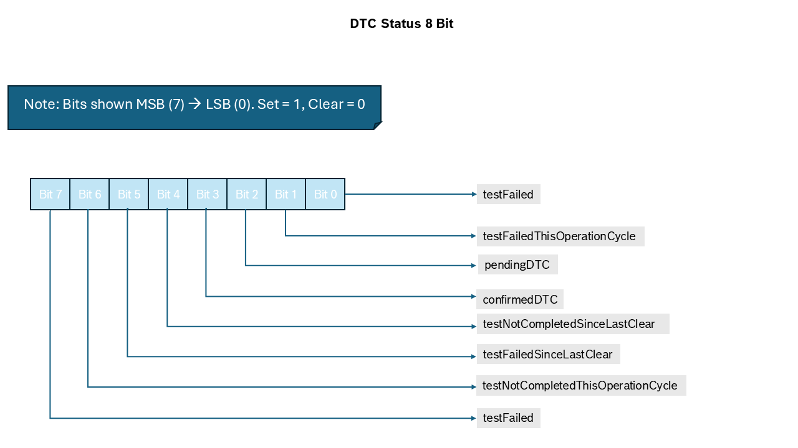
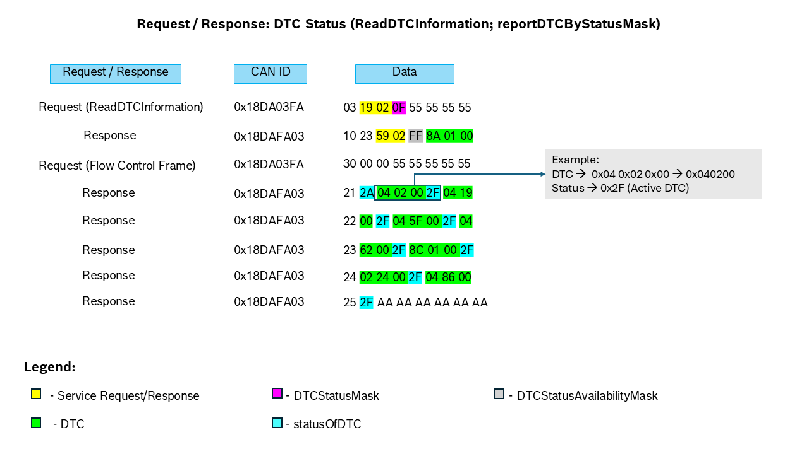

# DTC Status, Sub-function 0x02 {#dtc-status-sub-function-0x02 .p_Heading1 style="page-break-after: avoid;"}

+:------------------------------------------------------------------------------------------------------------------------------------------------------------------------------------------------------------------------------------------------------------------------------------------------------------------+------------------------------------------------------------------------------------------------------------------------------------------------------------------------+
| **Navigation:**  [System features](system-concepts.html) \> [BSW](bsw.html) \> [Diagnostic services (UDS)](diagnostic-services.html) \> [UDS overview](uds---overview.html) \> [Supported UDS services](supported-uds-services.html) \> [SID - ReadDTCInformation (0x19)](sid---readdtcinformation-(0x19.html) \> |    |
|                                                                                                                                                                                                                                                                                                                   |                                                                                                                                                                        |
| # DTC Status, Sub-function 0x02 {#dtc-status-sub-function-0x02-1 .p_Heading1 style="page-break-after: avoid;"}                                                                                                                                                                                                    |                                                                                                                                                                        |
+-------------------------------------------------------------------------------------------------------------------------------------------------------------------------------------------------------------------------------------------------------------------------------------------------------------------+------------------------------------------------------------------------------------------------------------------------------------------------------------------------+

The sub-function 0x02 - reportDTCByStatusMask allows the client to request the server to report all DTCs that are "testFailed" OR "confirmed" OR "etc.".

The RC (server) performs a bit-wise AND operation between the DTC Status and DTCStatusMask provided as part of request message, and provides all the DTCs which match the resultant status.

DTC status information shall be cleared upon a successful ClearDiagnosticInformation request from the client.

8 Bit status of DTCStatusMask is described as follows:

  ------------------------ ------------------------------------- ----------------------------------------------------------------------------------------------------------------------------------------------
  statusOfDTC bit Number   statusOfDTC bit field name            Function
  0                        testFailed                            indicates the result of the most recently performed test
  1                        testFailedThisOperationCycle          indicates whether or not a diagnostic test has reported a testFailed result at any time during the current operation cycle
  2                        pendingDTC                            indicates whether or not a diagnostic test has reported a testFailed result at any time during the current or last completed operation cycle
  3                        confirmedDTC                          indicates whether a malfunction was detected enough times to warrant that the DTC is desired to be stored in long-term memory
  4                        testNotCompletedSinceLastClear        indicates whether a DTC test has ever run and completed since the last time a call was made to ClearDiagnosticInformation (SID 0x14)
  5                        testFailedSinceLastClear              indicates whether a DTC test has completed with a failed result since the last time a call was made to ClearDiagnosticInformation (SID 0x14)
  6                        testNotCompletedThisCompletionCycle   indicates whether a DTC test has ever run and completed during the current operation cycle
  7                        warningIndicatorRequested             reports the status of any warning indicators associated with a particular DTC
  ------------------------ ------------------------------------- ----------------------------------------------------------------------------------------------------------------------------------------------

 

<figure style="margin:0;padding:0">

<figcaption>
Figure 48: DTC Status 8 bit
</figcaption>
</figure>

DTC status shown for each DTC is either of these types:

+-----------------------+----------------------------+-----------------------+----------------------------------------------------------------------------------------------------------------------------------------------------------+
| Category              | 8 Bit Status (Hexadecimal) | 8 Bit Status (Binary) | Description                                                                                                                                              |
+-----------------------+----------------------------+-----------------------+----------------------------------------------------------------------------------------------------------------------------------------------------------+
| Active DTC            | 0x2F                       | 0b00101111            | Test failed, test failed this operating cycle also, DTC was pending and then confirmed, and failed since last clear.                                     |
|                       |                            |                       |                                                                                                                                                          |
|                       |                            |                       | In short: It is an active DTC.                                                                                                                           |
+-----------------------+----------------------------+-----------------------+----------------------------------------------------------------------------------------------------------------------------------------------------------+
| Deactive DTC          | 0x2A                       | 0b00101010            | Currently test not failed, but failed at least once during operating cycle. DTC was confirmed failed at least once, and failed at least once last clear. |
|                       |                            |                       |                                                                                                                                                          |
|                       |                            |                       | In short: It is deactive (can be test passed or at least healed since test failed since previous operating cycle).                                       |
+-----------------------+----------------------------+-----------------------+----------------------------------------------------------------------------------------------------------------------------------------------------------+
| Previously Active DTC | 0x2D                       | 0b00101101            | The test is not failing in the current operating (drive) cycle.                                                                                          |
|                       |                            |                       |                                                                                                                                                          |
|                       |                            |                       | However, it did fail in the previous cycle, reached the confirmed state, and it has failed at least once since the last clear (in the previous cycle).   |
|                       |                            |                       |                                                                                                                                                          |
|                       |                            |                       | In short: The DTC is currently inactive, but it was active in the previous operating cycle.                                                              |
+-----------------------+----------------------------+-----------------------+----------------------------------------------------------------------------------------------------------------------------------------------------------+

 

Note: For requesting DTC Status of all DTCs the DTCStatusMask shall be 0xFF (It means we request DTCs of all valid status).

Sample request and response shall be as follows:

<figure style="margin:0;padding:0">

<figcaption>
Figure 49: Request and response for SID 0x19, Sub-function 0x02
</figcaption>
</figure>

 

 

 
