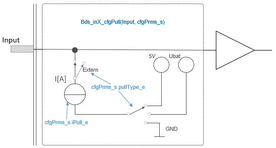
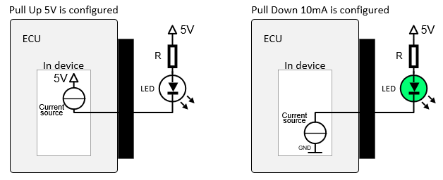

# Dynamic pull configuration {#dynamic-pull-configuration .p_Heading1 style="page-break-after: avoid;"}

+:----------------------------------------------------------------------------------------------------------+----------------------------------------------------------------------------------------------------------------------------------+
| **Navigation:**  [System features](system-concepts.html) \> [BSW](bsw.html) \> [Inputs](inputs.html) \>   |    |
|                                                                                                           |                                                                                                                                  |
| # Dynamic pull configuration {#dynamic-pull-configuration-1 .p_Heading1 style="page-break-after: avoid;"} |                                                                                                                                  |
+-----------------------------------------------------------------------------------------------------------+----------------------------------------------------------------------------------------------------------------------------------+

Description of the dynamic pull configuration feature

For some input types  it is possible to change the pull configuration dynamically at run time.

After reset of the ECU, the preselected easyConfig configuration will become active again.

Supported input types:

- Voltage

- Current

- Digital

- PWM (future use)

API functions to control the pull configuration:

- bds_inU_cfgPull

- bds_inI_cfgPull

- bds_inDig_cfgPull

- bds_inPwm_cfgPull (future use)

The pull type (pullType_e) and pull current (iPull_e) for these inputs  can be configured.

<figure style="margin:0;padding:0">

<figcaption aria-hidden="true">
Figure64: Configuration of pull type and pull current
</figcaption>
</figure>

 

For detailed description of the functions please see chapter BSW API using the above links.

Use cases:

- Use input as additional low power output

- Advanced diagnostics

Remarks:

The inputs that support this feature are connected inside the ECU to configurable devices.

Each of this devices can provide at maximum 40mA for the pull current.

There is a check when a new pull configuration is requested, if the new pull configuration is

within the limit for the connected device.

If the limit exceeds, the new configuration will not become active and there is an error returned.

Example using input as digital output:

Swich off:                                                                                                    Switch on:

{style="margin:0;width:6.5417in;height:2.6667in;border:none"}

Example for diagnostics:

Switch cyclically the pull type and check if the read input value is as expected to detect a broken sensor wiring.
