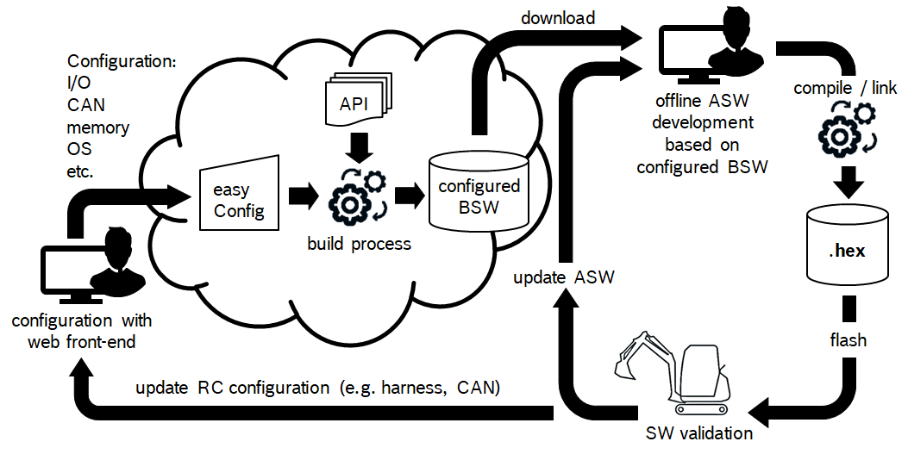

# The BODAS EcoSystem {#the-bodas-ecosystem .p_Heading1 style="page-break-after: avoid;"}

+:--------------------------------------------------------------------------------------------+----------------------------------------------------------------------------------------------------------------------+
| **Navigation:**  [Introduction](introduction.html) \>                                       |    |
|                                                                                             |                                                                                                                      |
| # The BODAS EcoSystem {#the-bodas-ecosystem-1 .p_Heading1 style="page-break-after: avoid;"} |                                                                                                                      |
+---------------------------------------------------------------------------------------------+----------------------------------------------------------------------------------------------------------------------+

<figure style="margin:0;padding:0">

<figcaption aria-hidden="true">
Figure1: BODAS EcoSystem development work-flow
</figcaption>
</figure>

 

Step-by-step work-flow for developing ASW for the RCs:

1.ASW developers configure the BSW according to their applications needs via the online-tool easyConfig.

2.EasyConfig compiles the BSW and provides it for download as object and header files.

3.With that download the ASW is then developed offline.

Detailed instructions for easyConfig are provided in [\[eCM\]](references.html#easyconfig_manual){.topiclink}.

+---------------------------------------------------------------------------------------------------------------------------------------------------------------------------------------------------------------------+
| {style="margin:0;width:8.3333in;height:0.4583in;border:none"}                                                                                                                                |
+=====================================================================================================================================================================================================================+
| Beware of incompatible SW & tool versions when creating an ASW!                                                                                                                                                     |
|                                                                                                                                                                                                                     |
| •Always use the specified development tools (assembler, compiler, linker) in the specified version - see [\[RE95207\]](references.html#re_95207){.topiclink}, [\[RE95208\]](references.html#re_95208){.topiclink}.\ |
| This ensures compatibility to the BSW.                                                                                                                                                                              |
+---------------------------------------------------------------------------------------------------------------------------------------------------------------------------------------------------------------------+

 
